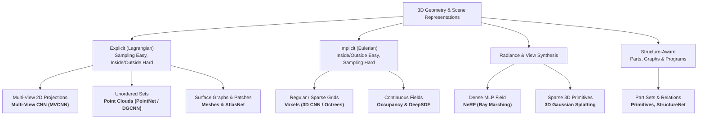

# 3D Computer Vision: PyTorch Implementation Suite & Technical Guides

Welcome to the **3D Computer Vision Suite** for **IF5152**. This repository provides self-contained, mathematically grounded PyTorch implementations, theoretical derivations, and comparative technical guides covering the major paradigms of modern 3D computer vision and geometry learning:

1. **Geometry Foundations & Datasets**: Explicit (Lagrangian) vs. Implicit (Eulerian) duality, parametric surfaces, and 3D benchmarks
2. **Multi-View & Volumetric 3D**: Multi-View CNNs, 3D Voxel CNNs, generative 3D-GAN / VON, and Octrees
3. **Point Clouds, Graph NNs & Surface Decoding**: PointNet, DGCNN (EdgeConv), Chamfer Distance vs. EMD, AtlasNet, and Mesh Deformation
4. **Neural Implicit Representations**: Occupancy Networks, DeepSDF auto-decoders, Eikonal regularization, and Marching Cubes
5. **Neural Radiance Fields & 3D Gaussian Splatting**: Dense volume rendering (NeRF) vs. sparse primitive splatting (3DGS)
6. **Structure-Aware 3D Representations**: Part sets, relationship graphs, hierarchical graphs (StructureNet), and shape programs

---

## 📊 The 3D Representations Taxonomy



### Comprehensive Comparison Table

| Script | Model Paradigm | Technical Guide | Representation Type | Input Data | Core Architectural Mechanism | Primary Trade-Off |
| :--- | :--- | :--- | :--- | :--- | :--- | :--- |
| [`00_3d_representations.ipynb`](./00_3d_representations.ipynb) | **Foundations & Duality** | [Guide 01](./docs/01_geometry_representations_and_datasets.md) | All 3D Representations | Mathematical & Mesh Primitives | Explicit vs. Implicit, CSG, SDF Ray Marching, Octrees | Theoretical foundation across all 3D representations |
| [`01_multiview_cnn.py`](./01_multiview_cnn.py) | **Multi-View CNN (MVCNN)** | [Guide 02](./docs/02_multiview_and_volumetric_3d.md) | Multi-View 2D Renderings | $V$ camera views $(V \times 1 \times H \times W)$ | Shared $\text{CNN}_1$ + View Pooling ($\max_v$) + $\text{CNN}_2$ | Robust 2D classification, but lacks 3D synthesis |
| [`02_voxel_3d_cnn.py`](./02_voxel_3d_cnn.py) | **Voxel 3D CNN** | [Guide 02](./docs/02_multiview_and_volumetric_3d.md) | Explicit Volumetric Grid | $V \times V \times V$ occupancy grid | `nn.Conv3d` + `ConvTranspose3d` reconstructor | Native 3D geometry; severe $\mathcal{O}(V^3)$ memory scaling |
| [`03_pointnet_and_chamfer.py`](./03_pointnet_and_chamfer.py) | **PointNet & DGCNN** | [Guide 03](./docs/03_point_clouds_and_surface_learning.md) | Unordered Point Cloud | $N \times 3$ points | `TNet` + Shared Conv1d / `EdgeConv` + Chamfer Loss | Lightweight $\mathcal{O}(N)$; lacks surface connectivity |
| [`04_mesh_deformation.py`](./04_mesh_deformation.py) | **Mesh Deformation** | [Guide 03](./docs/03_point_clouds_and_surface_learning.md) | Triangle Mesh Topology | Vertices $V$ + Faces $F$ | Template displacement + Edge & Laplacian smoothing | Fast rasterization; rigid genus/topology |
| [`04b_atlasnet_parametric.py`](./04b_atlasnet_parametric.py) | **AtlasNet (Parametric)** | [Guide 03](./docs/03_point_clouds_and_surface_learning.md) | Parametric Surface Patches | $K$ 2D UV grids $[0, 1]^2$ | MLPs mapping $[\mathbf{z}, u, v] \to \mathbb{R}^3$ + Chamfer Loss | Continuous manifold patches; seams may not be watertight |
| [`05_deepsdf_implicit.py`](./05_deepsdf_implicit.py) | **DeepSDF (Implicit)** | [Guide 04](./docs/04_neural_implicit_representations.md) | Continuous Distance Field | Query coords $(x, y, z)$ + code $\mathbf{z}$ | Auto-Decoder MLP + Eikonal loss + Marching Cubes | Arbitrary topology; slow grid evaluation |
| [`06_tiny_nerf.py`](./06_tiny_nerf.py) | **Tiny NeRF from Scratch** | [Guide 05](./docs/05_nerf_and_gaussian_splatting.md) | Continuous 5D Radiance Field | Ray origins $\mathbf{o}$ & directions $\mathbf{d}$ | Fourier features + quadrature volume rendering | High-fidelity novel views; slow ray marching |
| [`07_gaussian_splatting.py`](./07_gaussian_splatting.py) | **3D Gaussian Splatting** | [Guide 05](./docs/05_nerf_and_gaussian_splatting.md) | Discrete Sparse 3D Primitives | 3D Gaussians $(\mu, s, q, \alpha, \mathbf{c})$ | Perspective covariance projection + alpha splatting | **Real-time rendering (>100 FPS)**; larger footprint |
| [`08_structure_aware_primitives.py`](./08_structure_aware_primitives.py) | **Structure-Aware Parts** | [Guide 06](./docs/06_structure_aware_representations.md) | Compositional Part Hierarchy | Target 3D surface points / SDF | CSG Box union SDF + symmetry & contact constraints | Interpretable parts; requires structural abstraction |

---

## 🛠️ Environment Setup & Hardware Acceleration

All scripts run completely **self-contained** using analytical 3D primitives, Constructive Solid Geometry (CSG), and calibrated synthetic multi-view ray-tracing (no multi-GB external datasets required). Hardware acceleration supports:
- **Apple Silicon (M1/M2/M3/M4)** via Metal Performance Shaders (`mps`)
- **NVIDIA GPUs** via CUDA (`cuda`)
- **CPU Fallback** (`cpu`)

### Quickstart
```bash
cd IF5152/3d-vision
pip install -r requirements.txt
```

---

## 🚀 Running the Practical Modules

### 0. 3D Representations Laboratory Notebook (`00_3d_representations.ipynb`)
Comprehensive interactive Jupyter Notebook exploring and benchmarking all core 3D representations:
- **Explicit**: Point clouds (PCA normals, FPS, voxel downsampling), Polygonal meshes (subdivision, decimation, Laplacian smoothing), Parametric surfaces (Bézier patches, Torus/Möbius).
- **Implicit**: Algebraic surfaces, Constructive Solid Geometry (CSG exact and smooth minimum), Signed Distance Functions (SDFs) with real-time sphere tracing / ray marching.
- **Volumetric**: Dense voxel grids vs. adaptive Octree spatial partitioning ($\mathcal{O}(V^3)$ vs $\mathcal{O}(V^2)$).
- **Cross-Representation Conversions**: Marching Cubes, area-weighted face sampling, convex hulls, and voxelization.
- **Modern Primitives**: Multi-view projections, 3D Gaussian Splatting parameters, and structure-aware part assemblies.
- **Empirical Duality Benchmark**: Benchmarking sampling vs inside/outside queries vs topology modification.

Run interactively in VS Code / Jupyter:
```bash
jupyter lab 00_3d_representations.ipynb
```

### 1. Multi-View CNN (`01_multiview_cnn.py`)
Trains a Multi-View CNN (Su et al., ICCV 2015) using $V=12$ camera viewpoints orbiting 3D shapes, demonstrating **element-wise view pooling** and single-view vs. multi-view accuracy comparison. Supports both fast synthetic geometric shapes and the real-world **Princeton ModelNet10** CAD benchmark:
```bash
# Synthetic mode (fast, self-contained, no download required):
python 01_multiview_cnn.py --dataset synthetic --num-views 12 --epochs 15
python 01_multiview_cnn.py --quick-test

# Real ModelNet10 CAD dataset mode (downloads and caches to IF5152/data/):
# Lightweight 3-category subset (chair, bed, sofa):
python 01_multiview_cnn.py --dataset modelnet10 --categories "chair,bed,sofa" --epochs 10 --device mps

# Full 10-category ModelNet10 training:
python 01_multiview_cnn.py --dataset modelnet10 --epochs 15 --device mps
```
*Output: `samples/01_multiview_cnn.png` (displays 3D CAD mesh + camera orbit ring + 12 rendered views + class prediction distribution) and `checkpoints/01_multiview_cnn.pt`*

### 2. Volumetric 3D CNNs (`02_voxel_3d_cnn.py`)
Trains a 3D CNN classifier (`nn.Conv3d`) and a 2D-to-3D single-view voxel reconstructor on $24^3$ occupancy grids. Supports synthetic solids and **Princeton ModelNet10** CAD meshes (voxelized into binary occupancy volumes with cached `.pt` tensors):
```bash
# Synthetic mode:
python 02_voxel_3d_cnn.py --dataset synthetic --epochs 20 --batch-size 32
python 02_voxel_3d_cnn.py --quick-test

# Real ModelNet10 CAD mode (chair, bed, sofa):
python 02_voxel_3d_cnn.py --dataset modelnet10 --categories "chair,bed,sofa" --epochs 10 --device mps
```
*Output: `samples/02_voxel_3d_cnn_modelnet10.png` (displays 2D input projection, ground truth 3D voxels, and reconstructed 3D voxels) and `checkpoints/02_voxel_clf_modelnet10.pt`*

### 3. PointNet, DGCNN & Chamfer Distance (`03_pointnet_and_chamfer.py`)
Supports both **PointNet** (`TNet` + `nn.Conv1d` + max pooling) and **DGCNN** (`EdgeConv` dynamic $k$-NN local graph convolutions) with a dual classification head and Chamfer Distance autoencoder. Supports synthetic shapes and area-weighted surface point sampling from **Princeton ModelNet10**:
```bash
# Synthetic mode:
python 03_pointnet_and_chamfer.py --dataset synthetic --arch pointnet --epochs 25 --num-points 512
python 03_pointnet_and_chamfer.py --dataset synthetic --arch dgcnn --quick-test

# Real ModelNet10 CAD mode:
python 03_pointnet_and_chamfer.py --dataset modelnet10 --arch pointnet --categories "chair,bed,sofa" --epochs 10 --device mps
python 03_pointnet_and_chamfer.py --dataset modelnet10 --arch dgcnn --categories "chair,bed,sofa" --epochs 10 --device mps
```
*Output: `samples/03_pointnet_chamfer_modelnet10.png` (displays ground truth CAD points vs. Chamfer reconstructed points) and `checkpoints/03_pointnet_modelnet10_pointnet.pt`*

### 4. Template Mesh Deformation (`04_mesh_deformation.py`)
Deforms an icosphere template mesh into a target shape (`cube`, `cylinder`, or `chair`) using Surface Chamfer Loss, Edge Length Regularization, and Uniform Laplacian Smoothing:
```bash
python 04_mesh_deformation.py --target cube --steps 300
python 04_mesh_deformation.py --quick-test
```
*Output: `samples/04_mesh_deformation.png` and `checkpoints/04_deformed_mesh.pt`*

### 4b. AtlasNet Parametric Surface Decoding (`04b_atlasnet_parametric.py`)
Maps $K$ 2D unit-square patches $(u, v) \in [0, 1]^2$ into 3D surface patches via MLPs trained with Chamfer Distance, then extracts triangulated patches:
```bash
python 04b_atlasnet_parametric.py --target torus --num-patches 8 --steps 400
python 04b_atlasnet_parametric.py --quick-test
```
*Output: `samples/04b_atlasnet_parametric.png` and `checkpoints/04b_atlasnet.pt`*

### 5. DeepSDF & Marching Cubes (`05_deepsdf_implicit.py`)
Trains a coordinate-based Auto-Decoder MLP with Eikonal gradient regularization ($\|\nabla_x f_\theta\|_2 = 1$) across multiple shapes (`sphere`, `torus`, `chair`), then extracts explicit meshes via Marching Cubes:
```bash
python 05_deepsdf_implicit.py --epochs 80 --batch-size 1024
python 05_deepsdf_implicit.py --quick-test
```
*Output: `samples/05_deepsdf_implicit.png` and `checkpoints/05_deepsdf.pt`*

### 6. Tiny NeRF from Scratch (`06_tiny_nerf.py`)
Trains a 5D Neural Radiance Field with Fourier Positional Encoding and discrete volume-rendering quadrature on calibrated multi-view images, then synthesizes held-out novel views and depth maps:
```bash
python 06_tiny_nerf.py --iters 600 --img-size 48
python 06_tiny_nerf.py --quick-test
```
*Output: `samples/06_tiny_nerf.png` and `checkpoints/06_tiny_nerf.pt`*

### 7. Differentiable 3D Gaussian Splatting (`07_gaussian_splatting.py`)
Optimizes a sparse set of explicit 3D Gaussians ($\mu, s, q, \alpha, \mathbf{c}$) projected to 2D screen space via $\Sigma' = J W \Sigma W^T J^T$ and composited with depth-sorted alpha blending:
```bash
python 07_gaussian_splatting.py --iters 400 --num-gaussians 250
python 07_gaussian_splatting.py --quick-test
```
*Output: `samples/07_gaussian_splatting.png` and `checkpoints/07_gaussian_splatting.pt`*

### 8. Structure-Aware Part Primitives (`08_structure_aware_primitives.py`)
Decomposes a complex 3D shape (`chair`) into a structured set of 6 differentiable box primitives (seat, backrest, 4 legs) supervised by CSG union SDF + bilateral symmetry and support-contact relationship losses:
```bash
python 08_structure_aware_primitives.py --steps 350
python 08_structure_aware_primitives.py --quick-test
```
*Output: `samples/08_structure_aware_primitives.png` and `checkpoints/08_structure_aware.pt`*
