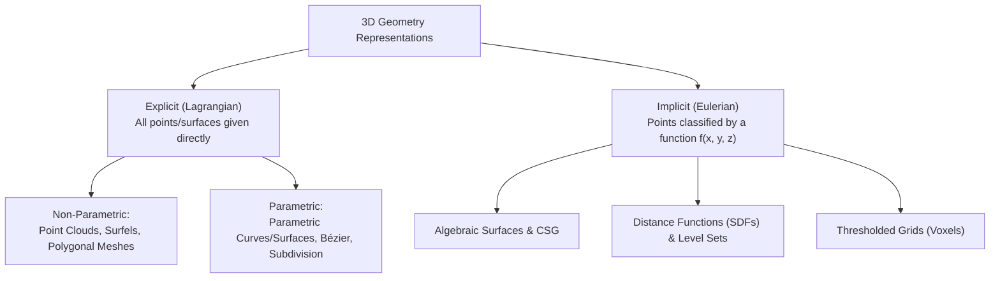
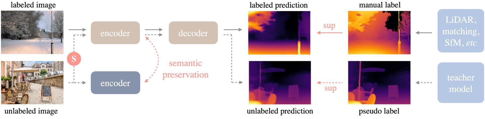

# 3D Geometry Foundations & Datasets: Explicit vs. Implicit Representations

---

## 1. Why 3D Representation Matters

In 3D computer vision and graphics, choosing how to represent geometry directly dictates what operations are easy, how much memory is consumed, and which neural network architectures can process or generate the data. Every representation involves trade-offs across four core considerations:
- **Storage & Memory Efficiency**
- **Creation & Sampling** (generating new shapes or points on a surface)
- **Geometric Operations** (editing, subdivision, simplification, smoothing, repairing)
- **Rendering** (rasterization, ray tracing, neural rendering)

---

## 2. Explicit (Lagrangian) Representations

In an **explicit** representation, surface points are specified directly or generated via a parametric mapping $f(u, v) \to (x, y, z)$.

### 2.1 Non-Parametric Explicit Forms
1. **Point Clouds & Surfels:**
   - Unordered set of 3D coordinates $(x, y, z)$, optionally paired with surface normals (**surfels**) or RGB colors.
   - Common output of 3D scanners (LiDAR, RGB-D), often noisy and requiring multi-view registration.
   - *Limitations:* No surface connectivity, difficult to draw in undersampled regions, no direct subdivision or smooth rendering.
2. **Polygonal Meshes:**
   - Boundary representation consisting of vertices $V$ and faces $F$ (typically triangles).
   - Supports standard graphics operations:
     - **Upsampling (Subdivision):** Increases resolution via vertex interpolation.
     - **Downsampling (Simplification):** Decreases triangle count while preserving shape/appearance.
     - **Mesh Regularization:** Modifies vertex distribution to improve triangle quality.

### 2.2 Parametric Explicit Forms
A parametric surface maps a 2D domain $(u, v)$ into 3D space:
- **Example (3D Sphere):** $f(u, v) = (\cos u \sin v,\, \sin u \sin v,\, \cos v)$.
- **Bézier Curves & Surfaces:** Tensor products of Bernstein polynomials form smooth patches; multiple patches stitch together to model complex CAD surfaces.
- **Subdivision Surfaces:** Recursively refine a coarse control mesh (inserting edge midpoints and updating vertex positions) to converge to a smooth limit surface.

---

## 3. Implicit (Eulerian) Representations

In an **implicit** representation, a surface is defined as the **zero-level set** of a scalar function $f : \mathbb{R}^3 \to \mathbb{R}$:

$$
\mathcal{S} = \{ (x, y, z) \in \mathbb{R}^3 \mid f(x, y, z) = 0 \}
$$

For example, a unit sphere is $f(x, y, z) = x^2 + y^2 + z^2 - 1 = 0$.

1. **Algebraic Surfaces & Constructive Solid Geometry (CSG):**
   - Complex shapes are composed from simple primitives via Boolean operations:
     - **Union ($A \cup B$):** $\min(f_A, f_B)$
     - **Intersection ($A \cap B$):** $\max(f_A, f_B)$
     - **Difference ($A \setminus B$):** $\max(f_A, -f_B)$
2. **Signed Distance Functions (SDFs):**
   - Returns the minimum Euclidean distance from any point $\mathbf{x}$ to the surface, signed negative inside and positive outside—enabling smooth shape blending via linear interpolation.
3. **Level Set Methods & Voxels:**
   - Store a regular 3D grid approximating $f(x, y, z)$ (common in medical CT/MRI).
   - **Voxels** arise directly by binary thresholding a volumetric grid ($f(x, y, z) \le 0$).

---

## 4. The Explicit vs. Implicit Duality

| Operation | Explicit (Lagrangian) | Implicit (Eulerian) |
| :--- | :--- | :--- |
| **Sampling Surface Points** | **Easy** — plug in $(u, v)$ or read vertices directly | **Hard** — must solve $f(x, y, z) = 0$ (e.g., Marching Cubes) |
| **Inside / Outside Membership Test** | **Hard** — requires ray-casting or winding numbers | **Easy** — evaluate $f(x, y, z)$ and check sign |
| **Topology Changes (Merging/Splitting)** | **Hard** — requires remeshing | **Easy** — handled naturally by level sets |
| **Storage for Fine Surfaces** | Compact (only surface elements) | Grid storage scales as $\mathcal{O}(V^3)$ unless neural/sparse |

---

## 5. 3D Datasets & AI + Geometry Tasks

### 5.1 Benchmark Datasets
- **Object-Level Synthetic:** Princeton Shape Benchmark ($1,814$ models), **ShapeNet / ModelNet** ($51.3\text{K}$ ShapeNetCore models across $55$ categories), and **Objaverse / Objaverse-XL** ($800\text{K}$ to $10\text{M}$ 3D assets).
- **Object-Level Real Scans & Videos:** Object Scans ($10\text{K}$ RGB-D scans) and **CO3D** ($19,000$ multi-view videos across $50$ categories).
- **Part-Level:** **PartNet** (fine-grained, hierarchical, instance-level 3D object parts + mobility).
- **Scene-Level:** **ScanNet** ($1,500$ RGB-D indoor scans with 3D camera poses and semantic segmentations), ARKitScenes, and ScanNet++.

### 5.2 Core Learning Tasks
1. **Discriminative Models $p(y \mid x)$:** Learning 3D shape descriptors for classification, part segmentation, semantic scene parsing, and retrieval.
2. **Generative Models $p(x)$ or $p(x \mid y)$:** Learning 3D shape priors for unconditional generation, single-view 3D reconstruction, shape completion, and geometry editing.

*(Complementary 2.5D Note: View-centric depth estimation models such as **DepthAnything** predict per-pixel depth $Z(u,v)$ from 2D images, bridging single-view 2D perception to 3D geometry despite perspective scale/depth ambiguity.)*

