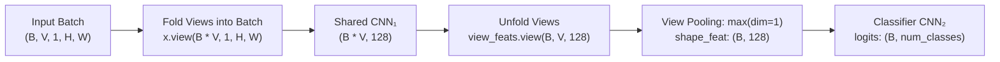
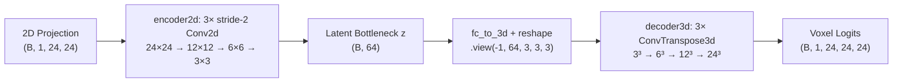
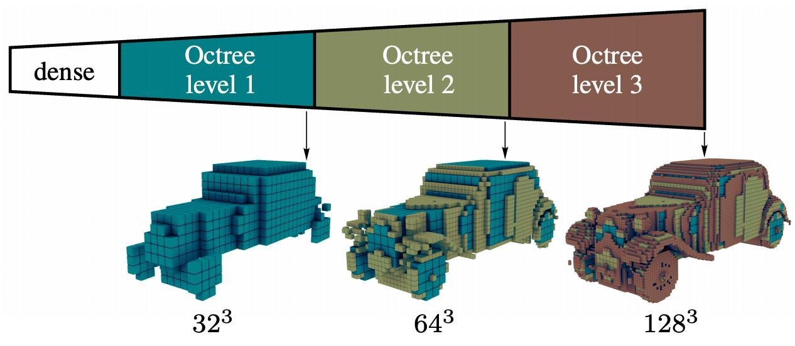

# Multi-View & Volumetric 3D Deep Learning: Theory to Practice

This guide bridges the mathematical foundations of **Multi-View 2D Projections** and **Volumetric 3D Convolutions** directly to their PyTorch implementations in [`01_multiview_cnn.py`](../01_multiview_cnn.py), [`02_voxel_3d_cnn.py`](../02_voxel_3d_cnn.py), and [`utils.py`](../utils.py).

---

## 1. Multi-View CNN (MVCNN)

Rather than inventing 3D convolution operators immediately, **Multi-View CNN** (Su et al., ICCV 2015) bridges mature 2D image networks to 3D shape recognition by rendering a 3D object from $V$ virtual camera viewpoints:

1. **Per-View Feature Extraction ($\text{CNN}_1$):** Pass each rendered 2D view $I_k \in \mathbb{R}^{1 \times H \times W}$ through a shared 2D CNN ($\text{CNN}_1$).
2. **Symmetric View Pooling:** Aggregate features across all $V$ views via element-wise max pooling:
   $$\mathbf{f}_{\text{shape}} = \max_{k=1,\dots,V} \text{CNN}_1(I_k)$$
3. **Shape Classification ($\text{CNN}_2$):** Feed the pooled descriptor $\mathbf{f}_{\text{shape}} \in \mathbb{R}^D$ into a second network ($\text{CNN}_2$) for classification or shape retrieval.


### 1.1 The Princeton ModelNet Benchmark & Camera Setup
In the original MVCNN paper and 3D ShapeNets (Wu et al., CVPR 2015), the canonical benchmark is the **Princeton ModelNet** dataset (ModelNet10 / ModelNet40) containing CAD meshes in `.off` format across common object categories (`chair`, `sofa`, `bed`, `table`, `desk`, etc.).
- **Camera Configuration:** Typically 12 or 80 virtual cameras arranged on an elevated ring ($25^\circ\text{–}30^\circ$ elevation angle, azimuths $\phi_k = k \cdot \frac{360^\circ}{V}$) pointed directly at the normalized shape centroid $\mathbf{c} = \mathbf{0}$.
- **Multi-View vs. Single-View Advantage:** A single camera angle can suffer from severe self-occlusion (e.g., viewing a chair edge-on or from behind). Element-wise max pooling across diverse viewpoints lets the network select salient activations from whichever view best reveals distinguishing geometry (chair legs, backrest, armrests).

- **Strengths:** Leverages 2D CNN backbones and achieves strong classification accuracy without 3D convolutions.
- **Limitations:** Requires multi-view rendering; struggles with partial or noisy raw scans (e.g., single-frame LiDAR); does not directly synthesize 3D geometry.

---

### 1.2 Virtual Camera Rendering (`01_multiview_cnn.py` & `utils.py`)

Before the network sees any pixels, a 3D shape must be projected onto $V$ virtual image planes of shape $(V, 1, H, W)$. Our codebase implements two rendering paths depending on `--dataset`:

1. **Analytical Primitives (`render_multiview_silhouettes` in `01_multiview_cnn.py`):**
   - Places $V$ virtual cameras on a circle of radius `cam_dist = 2.2` at elevation $25^\circ$, constructing a camera-to-world rotation matrix $R_{\text{c2w}} = [\mathbf{r},\, \mathbf{u},\, -\mathbf{f}]$.
   - Casts a ray per pixel `(gx, gy)` and runs 5 **sphere-tracing** steps against `evaluate_shape_sdf(shape_name, pts)` in [`utils.py`](../utils.py), converting ray hit distance $t$ into a normalized depth silhouette in $[0, 1]$.
   - `SyntheticMultiViewDataset` also applies random circular viewpoint shifts (`np.roll(..., axis=0)`) so the classifier learns azimuth invariance.

2. **Real CAD Meshes (`ModelNet10MultiViewDataset` + `render_mesh_multiview` in `utils.py`):**
   - `load_off_mesh()` parses `.off` vertex/face tables, centers the bounding box at the origin, and scales vertices to radius $0.8$.
   - `render_mesh_multiview()` samples `num_points = 3500` points uniformly by triangle area, rotates them into each of the $V$ camera frames ($30^\circ$ elevation), and splats normalized depth onto a $(1, H, W)$ canvas using `np.maximum.at`.
   - Pre-rendered tensors are cached as `.pt` files in `IF5152/data/ModelNet10/cache/` so subsequent epochs load instantaneously on `mps` / `cuda` / `cpu`.

---

### 1.3 Parallel View Batching & View Pooling (`MultiViewCNN`)

A naive implementation of $\max_{k=1}^V \text{CNN}_1(I_k)$ would loop over $k = 1 \dots V$ in Python, launching $V$ separate GPU kernels per batch. Instead, `MultiViewCNN.forward()` in [`01_multiview_cnn.py`](../01_multiview_cnn.py) folds the view dimension $V$ into the batch dimension $B$ so `self.cnn1` processes all $B \times V$ images in a single parallel pass:



```python
def forward(self, x: torch.Tensor, view_pooling: bool = True) -> torch.Tensor:
    B, V, C, H, W = x.shape
    views = x.view(B * V, C, H, W)        # Merge B and V for parallel 2D Conv
    view_feats = self.cnn1(views)         # (B * V, feature_dim)

    if view_pooling and V > 1:
        view_feats = view_feats.view(B, V, -1)
        shape_feat = view_feats.max(dim=1)[0]  # Element-wise View Pooling: (B, D)
    else:
        shape_feat = view_feats.view(B, V, -1).mean(dim=1)

    return self.cnn2(shape_feat)
```

- **Why `AdaptiveAvgPool2d((2, 2))` in `cnn1`?** Because synthetic mode defaults to `32x32` while ModelNet10 defaults to `64x64`, adaptive pooling ensures the flattened feature map before `nn.Linear(128 * 4, feature_dim)` always has fixed spatial size $2 \times 2$ regardless of `--img-size`.
- **Single-View vs. Multi-View Ablation in Practice:** During validation, [`01_multiview_cnn.py`](../01_multiview_cnn.py) evaluates both `model(views, view_pooling=True)` (all $V$ views) and `model(views[:, :1], view_pooling=False)` (first camera view only). On the ModelNet10 3-class subset (`chair,bed,sofa`), aggregating 12 views boosts validation accuracy from **68.0%** (single-view) to **89.3%** (multi-view) in just 2 epochs on Apple Silicon MPS.

---

## 2. Volumetric 3D Learning: Voxels & 3D CNNs

A **voxel grid** discretizes 3D space into a regular $V \times V \times V$ volumetric lattice of occupancies $o_{i,j,k} \in \{0, 1\}$. Because voxels form a regular Euclidean grid, 2D CNN operators generalize directly to 3D:
- **3D Convolution (`nn.Conv3d`):** Convolves $k \times k \times k$ filters across $(D, H, W)$.
- **3D Pooling (`nn.MaxPool3d`):** Downsamples along all three spatial dimensions.
- **3D Transposed Convolution (`nn.ConvTranspose3d`):** Upsamples a latent vector $\mathbf{z} \in \mathbb{R}^d$ into a $V \times V \times V$ occupancy volume for 2D-to-3D reconstruction.

### 2.1 Training Objective & Evaluation Metrics
For volumetric reconstruction, each voxel $(i, j, k)$ is treated as a binary classification target and supervised via **Voxel-wise Binary Cross-Entropy (BCE)**:

$$
\mathcal{L}_{\text{voxel}} = -\frac{1}{V^3} \sum_{i,j,k} \Big[ y_{ijk} \log \hat{y}_{ijk} + (1 - y_{ijk}) \log (1 - \hat{y}_{ijk}) \Big]
$$

Reconstruction quality is evaluated using **3D Intersection-over-Union (IoU)** at probability threshold $\tau = 0.5$:

$$
\text{IoU} = \frac{\sum \mathbb{I}(\hat{y} > \tau \land y = 1)}{\sum \mathbb{I}(\hat{y} > \tau \lor y = 1)}
$$

---

### 2.2 Discretizing Shapes into Voxels (`02_voxel_3d_cnn.py` & `utils.py`)

Each training item in [`02_voxel_3d_cnn.py`](../02_voxel_3d_cnn.py) is a tuple `(proj2d, vox3d, label)` with shapes `(1, V, V)`, `(1, V, V, V)`, and scalar class index:

- **Synthetic Solid Voxels (`generate_voxel_grid` in `utils.py`):** Evaluates `evaluate_shape_sdf(shape_name, grid_pts) <= 0.0` on a $24 \times 24 \times 24$ `meshgrid` in $[-1, 1]^3$, marking the full solid interior as `1.0`. `SyntheticVoxelDataset` applies random 90-degree rotations (`np.rot90`) and axis flips (`np.flip`).
- **ModelNet10 Surface Voxels (`voxelize_mesh` in `utils.py`):** Calls `sample_mesh_surface_points(..., num_points=10000)` on the normalized `.off` mesh and quantizes continuous coordinates $[-0.9, 0.9]^3$ into integer grid indices $[0, V-1]^3$. `ModelNet10VoxelDataset` caches these tensors in `IF5152/data/ModelNet10/cache/`.
- **2D Input Projection:** Both datasets form the 2D single-view input by averaging occupancy along the $Z$-axis: `vox.mean(axis=2, keepdims=True)` $\to$ `(1, V, V)`.

---

### 2.3 3D Classification & 2D-to-3D Reconstruction

[`02_voxel_3d_cnn.py`](../02_voxel_3d_cnn.py) trains two complementary volumetric networks side-by-side:

#### A. 3D CNN Classifier (`VoxelClassifier3D`)
Processes `(B, 1, 24, 24, 24)` directly with 3D convolutions and global pooling:

| Layer | Operation | Output Tensor Shape |
| :--- | :--- | :--- |
| Input | Voxel Occupancy Grid | `(B, 1, 24, 24, 24)` |
| Block 1 | `Conv3d(1->16, k=3, p=1)` + `BatchNorm3d` + `ReLU` + `MaxPool3d(2)` | `(B, 16, 12, 12, 12)` |
| Block 2 | `Conv3d(16->32, k=3, p=1)` + `BatchNorm3d` + `ReLU` + `MaxPool3d(2)` | `(B, 32, 6, 6, 6)` |
| Block 3 | `Conv3d(32->64, k=3, p=1)` + `BatchNorm3d` + `ReLU` + `AdaptiveAvgPool3d(1)` | `(B, 64, 1, 1, 1)` |
| Head | `.flatten(1)` $\to$ `Linear(64, num_classes)` | `(B, num_classes)` |

#### B. 2D-to-3D Single-View Reconstructor (`SingleViewVoxelReconstructor`)
Bridges a 2D image into a 3D volume via a **1D latent bottleneck reshaped into a coarse $3 \times 3 \times 3$ 3D feature grid**:



```python
def forward(self, img2d: torch.Tensor) -> torch.Tensor:
    z = self.encoder2d(img2d)                              # (B, 64)
    h = torch.relu(self.fc_to_3d(z)).view(-1, 64, 3, 3, 3) # Lift 1D -> 3D volume
    return self.decoder3d(h)                               # (B, 1, 24, 24, 24) logits
```

#### C. Loss Stability & Sparse Occupancy Nuances
- **Why `BCEWithLogitsLoss`?** The decoder outputs raw unbounded logits rather than probabilities. `nn.BCEWithLogitsLoss()` combines sigmoid and BCE in a single numerically stable log-sum-exp operation.
- **Thresholding in `compute_voxel_iou()`:** Converts logits to probabilities via `torch.sigmoid(pred_logits) > 0.5` and computes `intersection / (union + 1e-6)` summed over `(1, 2, 3, 4)`.
- **Practical Note on Surface vs. Solid Voxels:** In `ModelNet10VoxelDataset`, `voxelize_mesh()` marks only surface shells (~2% of the $24^3 = 13{,}824$ voxels are `1.0`, while ~98% are empty `0.0`). With unweighted BCE, an early-epoch decoder learns to predict mostly `0.0` first (yielding low BCE loss but near-zero IoU) before gradually recovering thin surface voxels over additional epochs.

---

## 3. Generative Volumetric Models: 3D-GAN & VON

Volumetric representations also power early 3D generative models:
- **3D ShapeNets (Wu et al., CVPR 2015):** 3D Convolutional Deep Belief Networks over $30^3$ voxel grids.
- **3D-GAN (Wu et al., NeurIPS 2016):** Maps a latent noise vector $\mathbf{z} \sim p(\mathbf{z})$ through 3D transposed convolutions (mirroring `SingleViewVoxelReconstructor.decoder3d`) to synthesize $64^3$ voxel shapes judged by a 3D CNN discriminator.
- **Visual Object Networks / VON (Zhu et al., NeurIPS 2018):** Disentangles 3D shape generation ($\mathbf{z}_{\text{shape}} \to$ 3D voxel shape), differentiable 2.5D projection (silhouette + depth map given viewpoint), and 2D texture synthesis ($\mathbf{z}_{\text{texture}} \to$ photorealistic 2D image).

---

## 4. Scaling Voxels: Octrees & Sparse Convolutions

Dense voxel grids suffer from **cubic memory growth $\mathcal{O}(V^3)$**:

| Grid Resolution $V$ | Total Voxels $V^3$ | Memory (`float32`, 1 sample) | Batch of 32 (`float32`) |
| :--- | :--- | :--- | :--- |
| $24^3$ *(Code Default)* | $13,824$ | $54\text{ KB}$ | $1.7\text{ MB}$ |
| $32^3$ | $32,768$ | $128\text{ KB}$ | $4.0\text{ MB}$ |
| $64^3$ | $262,144$ | $1\text{ MB}$ | $32\text{ MB}$ |
| $256^3$ | $16,777,216$ | $64\text{ MB}$ | $2.0\text{ GB}$ |
| $1024^3$ | $1,073,741,824$ | $4\text{ GB}$ | $128\text{ GB}$ |

Notice why [`02_voxel_3d_cnn.py`](../02_voxel_3d_cnn.py) defaults to `--resolution 24`: a batch of 32 samples occupies only $1.7\text{ MB}$ for raw inputs (and $\approx 350\text{ MB}$ peak VRAM including intermediate `Conv3d` feature maps on Apple Silicon `mps`), whereas scaling dense 3D CNNs to $256^3$ would require gigabytes per batch.

Because 3D surfaces occupy only a tiny fraction of 3D space (most voxels are empty air), **Octree representations** (**OctNet**, **O-CNN**, **Octree Generating Networks**) recursively partition space into 8 octants and constrain computation strictly near occupied surfaces, reducing memory from $\mathcal{O}(V^3)$ toward $\mathcal{O}(V^2)$.



---

## 5. Hands-On Execution & Verification

Run both scripts in either fast self-contained synthetic mode or real-world **Princeton ModelNet10** CAD mode (`mps` / `cuda` / `cpu`):

```bash
# 1. Multi-View CNN (01_multiview_cnn.py)
python 01_multiview_cnn.py --dataset synthetic --quick-test
python 01_multiview_cnn.py --dataset modelnet10 --categories "chair,bed,sofa" --epochs 10 --device mps

# 2. Volumetric 3D CNN (02_voxel_3d_cnn.py)
python 02_voxel_3d_cnn.py --dataset synthetic --quick-test
python 02_voxel_3d_cnn.py --dataset modelnet10 --categories "chair,bed,sofa" --epochs 10 --device mps
```

- **Visualizations:** Inspect [`samples/01_multiview_cnn_modelnet10.png`](../samples/01_multiview_cnn_modelnet10.png) (3D mesh + virtual camera orbit + 12 views + class probabilities) and [`samples/02_voxel_3d_cnn_modelnet10.png`](../samples/02_voxel_3d_cnn_modelnet10.png) (2D projection + GT 3D voxels + predicted 3D voxels).
- **Saved Weights:** Checkpoints are saved under `checkpoints/` (`01_multiview_cnn_*.pt`, `02_voxel_clf*.pt`, `02_voxel_recon*.pt`).
