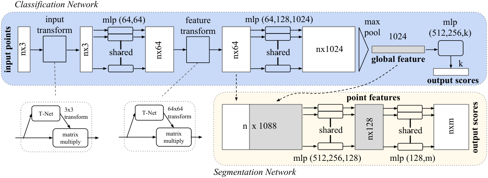
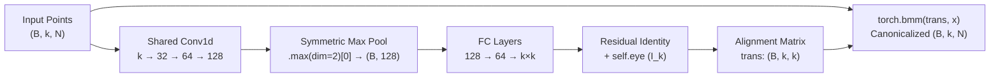
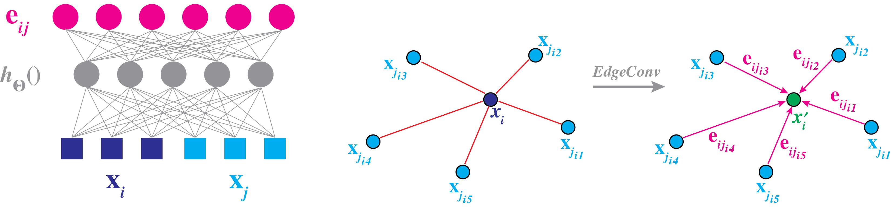
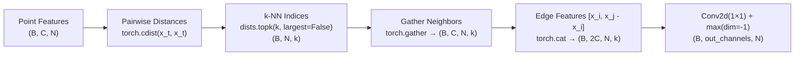
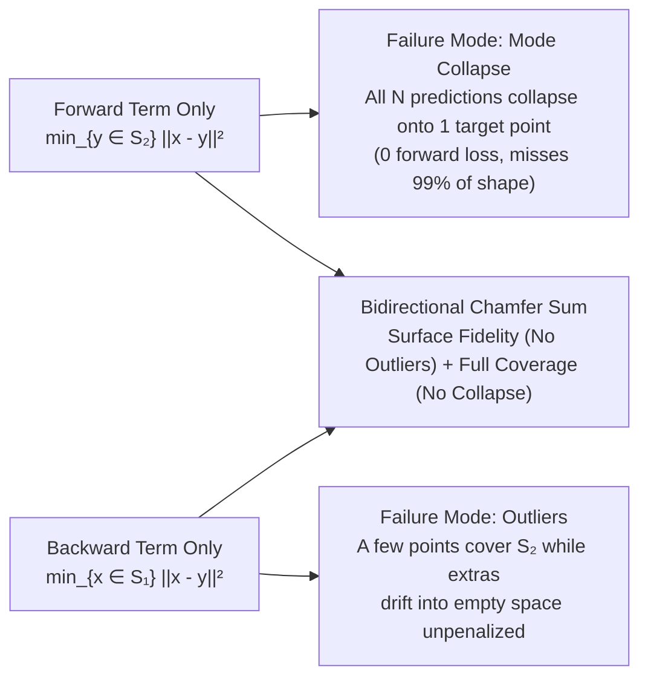
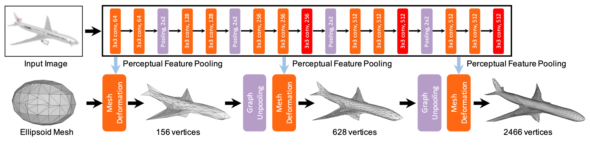
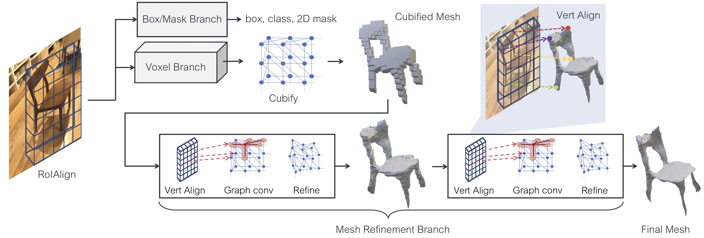

# Point Clouds, Graph Networks, and Parametric Surface Learning

This guide covers the mathematical foundations and PyTorch implementations of **Unordered Point Sets**, **Dynamic Graph Convolutions**, **Set-to-Set Metrics**, and **Parametric / Template Surface Decoding** across [`03_pointnet_and_chamfer.py`](../03_pointnet_and_chamfer.py), [`04_mesh_deformation.py`](../04_mesh_deformation.py), [`04b_atlasnet_parametric.py`](../04b_atlasnet_parametric.py), and [`utils.py`](../utils.py).

---

## 1. Point Clouds & Key Invariances

A **point cloud** is an unordered set of $N$ points $S = \{ \mathbf{p}_i \in \mathbb{R}^3 \}_{i=1}^N$. Any deep learning model operating on raw point clouds must respect three fundamental invariances:

1. **Permutation Invariance:** Reordering the $N$ rows of the input matrix represents the exact same 3D shape ($N!$ equivalent orderings).
2. **Sampling Invariance:** Varying point density or subsampling the underlying surface should not alter the semantic prediction.
3. **Rigid Transformation Invariance:** Rotating or translating the point cloud in 3D space preserves its identity.

### Point Cloud Datasets & Augmentation (`03_pointnet_and_chamfer.py`)
In [`03_pointnet_and_chamfer.py`](../03_pointnet_and_chamfer.py), point clouds are represented as `(B, N, 3)` tensors via two dataset classes:
- **`SyntheticPointCloudDataset`:** Calls `sample_surface_points()` from [`utils.py`](../utils.py), applies random Y-axis rotations ($SO(2)$ around up-axis) and Gaussian coordinate jitter (`std=0.015`) to teach transformation robustness.
- **`ModelNet10PointCloudDataset`:** Calls `sample_mesh_surface_points()` on real Princeton ModelNet10 `.off` CAD meshes and caches the resulting `(N, 3)` tensors in `IF5152/data/ModelNet10/cache/` as `.pt` files for instant loading.

---

## 2. PointNet & Dynamic Graph CNNs (DGCNN)

### 2.1 PointNet (Qi et al., CVPR 2017)
**PointNet** constructs a universal symmetric function over unordered point sets:

$$
f(\{\mathbf{p}_1, \dots, \mathbf{p}_N\}) = \gamma \Big( \max_{i=1,\dots,N} h(\mathbf{p}_i) \Big)
$$

- **$h : \mathbb{R}^3 \to \mathbb{R}^D$:** Shared point-wise MLP (implemented as $1 \times 1$ `nn.Conv1d`).
- **Symmetric Max Pooling ($\max_{i=1}^N$):** Guarantees permutation invariance.
- **T-Net (Spatial Transformer):** Predicts a $3 \times 3$ (or $64 \times 64$) alignment matrix to canonicalize object pose before feature extraction.



#### Spatial Transformer Network (`TNet`)
While symmetric max pooling solves *permutation* invariance, raw $(x, y, z)$ coordinates remain sensitive to **rigid transformations** (rotations, tilts, and pose shifts)—a chair rotated by $45^\circ$ has completely different coordinate values than an upright chair.

Rather than relying solely on data augmentation or hand-crafted PCA alignment, PointNet introduces a learnable **Spatial Transformer Network (`TNet`)** that predicts a data-dependent $k \times k$ affine transformation matrix $\mathbf{T}(\mathbf{P}) \in \mathbb{R}^{k \times k}$ to rotate/align the input cloud into a **canonical pose**:

$$
\mathbf{T}(\mathbf{P}) = \mathbf{I}_k + \text{MLP}\Big(\max_{i=1,\dots,N} h_{\text{T}}(\mathbf{p}_i)\Big), \qquad \mathbf{P}_{\text{aligned}} = \mathbf{T}(\mathbf{P})\,\mathbf{P}
$$



Three design details make `TNet` in [`03_pointnet_and_chamfer.py`](../03_pointnet_and_chamfer.py) work cleanly in practice:
1. **Permutation-Invariant Mini-PointNet:** `TNet` itself uses shared $1 \times 1$ `nn.Conv1d` layers (`k -> 32 -> 64 -> 128`) followed by `max(dim=2)[0]`, guaranteeing that the predicted alignment matrix $\mathbf{T}(\mathbf{P})$ does not change if the input points are shuffled.
2. **Residual Identity Initialization:** Both the `weight` and `bias` of the final `nn.Linear(64, k * k)` layer are zero-initialized, and a registered identity buffer `self.eye` ($\mathbf{I}_k$) is added (`mat = self.fc(h) + self.eye`). At epoch 0, `TNet` outputs the exact identity matrix so coordinates are not scrambled before training stabilizes; during training, it learns smooth residual pose corrections $\Delta\mathbf{T}$.
3. **3D Input Alignment vs. Feature Alignment:** In [`03_pointnet_and_chamfer.py`](../03_pointnet_and_chamfer.py), `TNet(k=3)` aligns the 3D input coordinates via batched matrix multiplication `torch.bmm(trans, x)`. In the full PointNet architecture, a second `TNet(k=64)` also aligns intermediate 64-D features, paired with an orthogonality regularizer $\mathcal{L}_{\text{reg}} = \|\mathbf{I} - \mathbf{A}\mathbf{A}^\top\|_F^2$ to prevent the higher-dimensional matrix from collapsing or shearing the feature space.

```python
# Inside TNet.forward(x):  x has shape (B, k, N)
h = self.mlp(x).max(dim=2)[0]      # Mini-PointNet global feature: (B, 128)
mat = self.fc(h) + self.eye        # Residual from identity matrix I_k
return mat.view(-1, self.k, self.k)

# Inside PointNetEncoder.forward(pts):
x = pts.transpose(1, 2)            # (B, N, 3) -> (B, 3, N)
trans = self.tnet(x)               # Predicted (B, 3, 3) alignment matrix
x = torch.bmm(trans, x)            # Canonicalize pose: (B, 3, 3) @ (B, 3, N)
feat = self.mlp(x)                 # Shared Conv1d MLP: (B, latent_dim, N)
global_feat = feat.max(dim=2)[0]   # Symmetric max pooling -> (B, latent_dim)
```

---

### 2.2 DGCNN / EdgeConv (Wang et al., ToG 2019)
PointNet processes each point independently before global pooling, missing fine local geometric neighborhoods. **DGCNN** constructs a dynamic $k$-nearest neighbor ($k$-NN) graph in feature space at each layer and applies **EdgeConv** message passing:

$$
\mathbf{x}_i' = \max_{j \in \mathcal{N}(i)} h_\Theta\big(\mathbf{x}_i,\, \mathbf{x}_j - \mathbf{x}_i\big)
$$

Combining $\mathbf{x}_i$ (global position) with $\mathbf{x}_j - \mathbf{x}_i$ (local edge vector) captures both global shape structure and local surface curvature.



#### Dynamic $k$-NN Graph & `EdgeConv` Implementation
In [`03_pointnet_and_chamfer.py`](../03_pointnet_and_chamfer.py), `EdgeConv.forward()` implements the graph construction and edge aggregation purely with vectorized PyTorch tensor operations (no external CUDA graph libraries required, so it runs natively on `mps`, `cuda`, and `cpu`):



```python
# Inside EdgeConv.forward(x):  x has shape (B, C, N)
dists = torch.cdist(x_t, x_t, p=2.0)                                   # (B, N, N)
knn_idx = dists.topk(k=min(self.k, N), dim=-1, largest=False)[1]       # (B, N, k)
neighbors = torch.gather(x.unsqueeze(2).expand(B, C, N, N), dim=3, index=idx_expanded)
edge_feat = torch.cat([x_expanded, neighbors - x_expanded], dim=1)     # (B, 2C, N, k)
out = self.conv(edge_feat).max(dim=-1)[0]                              # (B, out_channels, N)
```

`DGCNNEncoder` stacks three `EdgeConv` blocks (`3 -> 64 -> 64 -> 128`, with `k=16`) before global max pooling (`x3.max(dim=2)[0]`), recomputing the $k$-NN graph in learned feature space at every layer.

### 2.3 Dual-Head Classification & Autoencoding (`PointNetAutoencoderAndClassifier`)
Both `--arch pointnet` and `--arch dgcnn` share the same dual-head wrapper in [`03_pointnet_and_chamfer.py`](../03_pointnet_and_chamfer.py):
- **Encoder:** Maps `(B, N, 3)` $\to$ bottleneck $\mathbf{z} \in \mathbb{R}^{128}$.
- **Classification Head (`self.classifier`):** `128 -> 64 -> num_classes` supervised with `CrossEntropyLoss`.
- **Point Decoder (`self.decoder`):** `128 -> 256 -> 512 -> num_points * 3`, reshaped via `.view(-1, self.num_points, 3)` and supervised with Chamfer Distance.

### 2.4 The Princeton ModelNet Benchmark & Area-Weighted Sampling
In the PointNet and DGCNN literature, the canonical benchmark is **Princeton ModelNet** (ModelNet10 / ModelNet40). Raw CAD models in `.off` format have non-uniform triangle sizes; sampling vertices directly would oversample dense tessellations and undersample large flat faces (such as tabletops or bed frames). Instead, `sample_mesh_surface_points()` in [`utils.py`](../utils.py) performs **area-weighted surface sampling**:
1. For each triangle face $T_i = (\mathbf{v}_{i,0}, \mathbf{v}_{i,1}, \mathbf{v}_{i,2})$, compute surface area $A_i = \frac{1}{2} \|(\mathbf{v}_{i,1} - \mathbf{v}_{i,0}) \times (\mathbf{v}_{i,2} - \mathbf{v}_{i,0})\|$.
2. Select triangle faces with probability proportional to relative area: $P(T_i) = A_i / \sum_j A_j$.
3. Sample uniform points inside each selected triangle via random barycentric coordinates:
   $$u = 1 - \sqrt{r_1}, \quad v = \sqrt{r_1}(1 - r_2), \quad w = \sqrt{r_1}r_2 \quad (r_1, r_2 \sim \mathcal{U}(0, 1))$$
   $$\mathbf{p} = u \mathbf{v}_{i,0} + v \mathbf{v}_{i,1} + w \mathbf{v}_{i,2}$$

---

## 3. Distance Metrics for Point Clouds

### 3.1 Why Element-Wise Metrics (MSE) Fail on Point Clouds
In 2D images or 3D voxel grids, pixel $(i, j)$ in the prediction always corresponds to pixel $(i, j)$ in the ground truth, making element-wise **Mean Squared Error (MSE)** valid:

$$\text{MSE}(S_1, S_2) = \frac{1}{N} \sum_{i=1}^N \|\mathbf{p}_i - \mathbf{q}_i\|_2^2$$

For **unordered point clouds**, however, element-wise MSE breaks down for two fundamental reasons:
1. **No Fixed Index Correspondence (Order Sensitivity):** Suppose $S_1 = [(0,0,0),\,(1,0,0)]$ and $S_2 = [(1,0,0),\,(0,0,0)]$. Geometrically, $S_1$ and $S_2$ represent the **exact same two points** (zero shape error). Yet because their rows are swapped, element-wise MSE computes:
   $$\text{MSE}(S_1, S_2) = \frac{1}{2}\Big(\|(0,0,0) - (1,0,0)\|_2^2 + \|(1,0,0) - (0,0,0)\|_2^2\Big) = 1.0 > 0$$
   Training with MSE forces a decoder to memorize an arbitrary row ordering rather than learning 3D geometry.
2. **Unequal Set Sizes ($|S_1| \neq |S_2|$):** Element-wise MSE strictly requires both point sets to have the exact same cardinality $N$. In practice, predicted and target clouds often have different sizes—for instance, [`04_mesh_deformation.py`](../04_mesh_deformation.py) and [`04b_atlasnet_parametric.py`](../04b_atlasnet_parametric.py) compare `1024` sampled/patch points against `1500` ground-truth surface points.

### 3.2 Intuition Behind Bidirectional Chamfer Distance
To compare two unordered sets $S_1$ (predicted) and $S_2$ (target) without relying on row indices, **Chamfer Distance (CD)** replaces index-to-index matching with **nearest-neighbor matching**:

$$\mathcal{L}_{\text{CD}}(S_1, S_2) = \underbrace{\frac{1}{|S_1|} \sum_{x \in S_1} \min_{y \in S_2} \|x - y\|_2^2}_{\text{Forward (Precision)}} + \underbrace{\frac{1}{|S_2|} \sum_{y \in S_2} \min_{x \in S_1} \|x - y\|_2^2}_{\text{Backward (Recall / Coverage)}}$$

Because `min` operates over all points in the opposite set, Chamfer Distance is completely **permutation-invariant** and naturally supports **unequal set sizes** ($N \neq M$). Crucially, **both directions are mandatory**:



- **Forward Term (Precision):** Measures how close every *predicted* point $x \in S_1$ is to the nearest *target* point $y \in S_2$. It pulls stray predictions onto the true surface, eliminating outliers. However, minimizing the forward term alone allows a decoder to cheat by collapsing all $N$ predicted points onto a single target point.
- **Backward Term (Recall / Coverage):** Measures how close every *target* point $y \in S_2$ is to the nearest *predicted* point $x \in S_1$. It forces predictions to spread out and cover every region of the ground-truth shape, preventing mode collapse.

### 3.3 Chamfer Distance vs. Earth Mover's Distance (EMD)
Because $\min$ is **many-to-one**, multiple predicted points can still cluster near a dense region of $S_2$ as long as at least one predicted point covers each part of $S_2$. **Earth Mover's Distance (EMD)** resolves this by solving an optimal 1-to-1 bijection $\phi: S_1 \to S_2$:

$$\mathcal{L}_{\text{EMD}}(S_1, S_2) = \min_{\phi: S_1 \to S_2} \sum_{x \in S_1} \|x - \phi(x)\|_2$$

EMD enforces uniform point density better than CD, but requires $|S_1| = |S_2|$ and is significantly more expensive to compute ($\mathcal{O}(N^2)$–$\mathcal{O}(N^3)$), making Chamfer Distance the standard differentiable loss for real-time 3D training.

### 3.4 Vectorized Chamfer Distance (`chamfer_distance`)
In [`03_pointnet_and_chamfer.py`](../03_pointnet_and_chamfer.py), `chamfer_distance(p1, p2)` computes the $B \times N \times M$ pairwise distance matrix in one GPU-friendly `torch.cdist` call, then takes `min(dim=2)` (nearest target point for each prediction) and `min(dim=1)` (nearest prediction for each target point):

```python
def chamfer_distance(p1: torch.Tensor, p2: torch.Tensor) -> torch.Tensor:
    dist = torch.cdist(p1, p2, p=2.0) ** 2       # Pairwise squared dist: (B, N, M)
    min_p1_to_p2 = dist.min(dim=2)[0].mean(dim=1)  # Forward (Precision):   (B,)
    min_p2_to_p1 = dist.min(dim=1)[0].mean(dim=1)  # Backward (Coverage):   (B,)
    return (min_p1_to_p2 + min_p2_to_p1).mean()
```

During training, the dual-head network combines classification and reconstruction via `loss = loss_ce + 10.0 * loss_cd`. The `10.0` weight scales the small squared-Euclidean Chamfer values (in $[-1, 1]^3$ coordinates) to match the magnitude of cross-entropy logits.

---

## 4. Parametric Surface Decoding & Mesh Deformation

While PointNet's FC decoder outputs an unstructured point set, surface learning methods generate **explicit connected meshes** using either parametric UV atlases or template deformation.

### 4.1 AtlasNet: Parametric 2D-to-3D Patches (Groueix et al., CVPR 2018)
Instead of predicting an unstructured cloud of points, **AtlasNet** enforces local surface smoothness by parameterizing a 3D shape as a union of $K$ learned 2D unit-square manifolds $[0, 1]^2$:

$$
\mathbf{p}_k(u, v) = \text{MLP}_k\big([\mathbf{z},\, u,\, v]\big) \in \mathbb{R}^3, \qquad (u, v) \in [0, 1]^2
$$

#### Random UV Optimization vs. Explicit Mesh Extraction (`04b_atlasnet_parametric.py`)
In [`04b_atlasnet_parametric.py`](../04b_atlasnet_parametric.py), `AtlasNetDecoder` holds a `nn.ModuleList` of $K$ `AtlasPatchMLP` networks, each concatenating $(u, v)$ with the expanded shape latent code `z` (`torch.cat([uv, z_exp], dim=-1)`):

1. **During Optimization:** Each step samples fresh random coordinates `uv_rand = torch.rand(128, 2)` across $[0, 1]^2$, evaluates all $K$ patches, concatenates `all_pts = torch.cat(patch_pts, dim=0)`, and minimizes `chamfer_distance_single(all_pts, target_pts)`. Random sampling prevents overfitting to fixed grid vertices and keeps the continuous mapping smooth everywhere on $[0, 1]^2$.
2. **At Inference (Mesh Extraction):** `create_uv_grid_topology(grid_res=12)` builds a regular $12 \times 12$ triangulated 2D grid. Passing `uv_grid` through each `AtlasPatchMLP` maps the 2D vertices directly into 3D while preserving the 2D triangle connectivity `patch_faces`, yielding an explicit multi-patch 3D mesh without Marching Cubes.

---

### 4.2 Template Mesh Deformation & Regularization (`04_mesh_deformation.py`)
An alternative surface approach (**Pixel2Mesh**, Wang et al., ECCV 2018; **Mesh R-CNN**, Gkioxari et al., ICCV 2019) starts from a closed icosphere template $(V_0, F_0)$ (or a cubified coarse voxel mesh) and predicts vertex offsets $V = V_0 + \Delta V$ supervised with:
1. **Surface Chamfer Loss:** $\mathcal{L}_{\text{CD}}(S_{\text{mesh}}, S_{\text{target}})$ via differentiable barycentric sampling on triangle faces.
2. **Edge Length Regularization:** $\mathcal{L}_{\text{edge}} = \frac{1}{|E|} \sum_{(u, v) \in E} \|\mathbf{v}_u - \mathbf{v}_v\|_2^2$ (prevents degenerate stretched triangles).
3. **Laplacian Smoothing:** $\mathcal{L}_{\text{lap}} = \frac{1}{|V|} \sum_{i \in V} \|\mathbf{L}\mathbf{v}_i\|_2^2$ (prevents self-intersections and surface spikes).





#### Differentiable Mesh Losses & Sparse Laplacian (`04_mesh_deformation.py`)
[`04_mesh_deformation.py`](../04_mesh_deformation.py) initializes `init_verts, faces_np = create_icosphere(subdivisions=2, radius=0.75)` from [`utils.py`](../utils.py) and optimizes `offsets = nn.Parameter(torch.zeros_like(verts_template))` using three differentiable geometric terms:

1. **Differentiable Surface Sampling (`sample_points_from_mesh`):** Sampling only mesh *vertices* leaves large triangle interiors unsupervised. `sample_points_from_mesh()` computes differentiable triangle areas, draws face indices with `torch.multinomial(probs, num_samples, replacement=True)`, and interpolates `w0 * v0[face_idx] + w1 * v1[face_idx] + w2 * v2[face_idx]`. Because `v0, v1, v2` depend linearly on `curr_verts = verts_template + offsets`, gradients from `chamfer_distance_single` flow directly back to every vertex offset.
2. **Edge Regularization (`edge_length_loss`):** Pre-extracts unique undirected edges `(E, 2)` via `extract_edges_and_neighbors()` and penalizes `(verts[edges[:, 0]] - verts[edges[:, 1]]) ** 2`.
3. **Sparse Umbrella Laplacian (`build_uniform_laplacian` & `laplacian_smoothing_loss`):** Constructs the sparse $N \times N$ uniform graph Laplacian $L = I - D^{-1}A$ as a `torch.sparse_coo_tensor` and evaluates `torch.sparse.mm(lap_matrix, verts)`, measuring how far each vertex deviates from the centroid of its 1-ring neighbors.
4. **Combined Objective:** `loss = loss_cd + 0.05 * loss_edge + 0.2 * loss_lap` balances geometric fidelity (`loss_cd`) against triangle regularity (`loss_edge`) and smooth curvature (`loss_lap`).

---

## 5. Hands-On Execution & Verification

Run all three scripts on `mps` / `cuda` / `cpu`:

```bash
# 1. PointNet & DGCNN (03_pointnet_and_chamfer.py)
python 03_pointnet_and_chamfer.py --dataset synthetic --arch pointnet --quick-test
python 03_pointnet_and_chamfer.py --dataset modelnet10 --arch pointnet --categories "chair,bed,sofa" --epochs 10 --device mps
python 03_pointnet_and_chamfer.py --dataset modelnet10 --arch dgcnn --categories "chair,bed,sofa" --epochs 10 --device mps

# 2. Template Mesh Deformation (04_mesh_deformation.py)
python 04_mesh_deformation.py --target cube --steps 300
python 04_mesh_deformation.py --quick-test

# 3. AtlasNet Parametric Patches (04b_atlasnet_parametric.py)
python 04b_atlasnet_parametric.py --target torus --num-patches 8 --steps 400
python 04b_atlasnet_parametric.py --quick-test
```

- **Visualizations:** Inspect [`samples/03_pointnet_chamfer_modelnet10.png`](../samples/03_pointnet_chamfer_modelnet10.png) (GT vs. Chamfer-reconstructed CAD clouds), [`samples/04_mesh_deformation.png`](../samples/04_mesh_deformation.png) (icosphere deformation trajectory), and [`samples/04b_atlasnet_parametric.png`](../samples/04b_atlasnet_parametric.png) (UV patch point clouds and extracted multi-patch mesh).
- **Saved Weights:** Checkpoints are saved under `checkpoints/` (`03_pointnet_*.pt`, `04_deformed_mesh.pt`, `04b_atlasnet.pt`).
