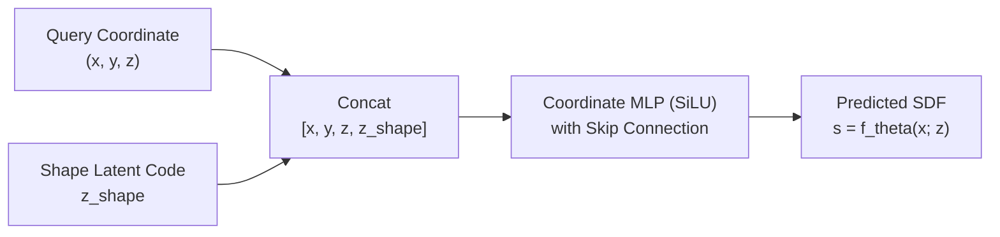
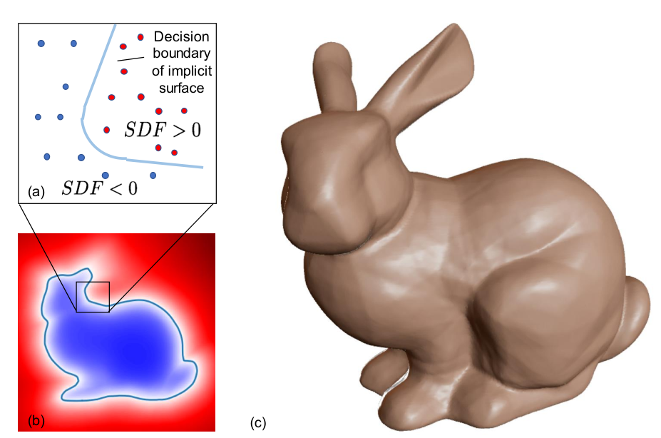

# Neural Implicit Representations: Occupancy Fields & DeepSDF

This guide covers the mathematical foundations and PyTorch implementations of **Implicit Level Sets**, **Constructive Solid Geometry (CSG)**, **DeepSDF Auto-Decoders**, **Eikonal Regularization**, and **Marching Cubes** surface extraction in [`05_deepsdf_implicit.py`](../05_deepsdf_implicit.py) and [`utils.py`](../utils.py).

---

## 1. Explicit vs. Implicit Geometry

Explicit representations (voxels, point clouds, meshes) store geometry as discrete samples. **Implicit representations** instead define a 3D surface continuously as the **level set** of a scalar function $f : \mathbb{R}^3 \to \mathbb{R}$:

$$
\mathcal{S} = \{ \mathbf{x} \in \mathbb{R}^3 \mid f(\mathbf{x}) = c \}
$$

### 1.1 Constructive Solid Geometry (CSG)

Implicit functions make Boolean shape composition effortless:
- **Union ($A \cup B$):** $f_{A \cup B}(\mathbf{x}) = \min(f_A(\mathbf{x}), f_B(\mathbf{x}))$
- **Intersection ($A \cap B$):** $f_{A \cap B}(\mathbf{x}) = \max(f_A(\mathbf{x}), f_B(\mathbf{x}))$
- **Difference ($A \setminus B$):** $f_{A \setminus B}(\mathbf{x}) = \max(f_A(\mathbf{x}), -f_B(\mathbf{x}))$

In [`utils.py`](../utils.py), `evaluate_shape_sdf(shape_name, pts)` implements analytical SDFs and CSG primitives (such as `"sphere"`, `"torus"`, and `"chair"`), providing exact ground-truth signed distances for training and evaluating neural implicit fields.

---

## 2. Neural Implicit Fields

Rather than choosing a fixed-resolution grid, **Neural Implicit Representations** parameterize $f_\theta$ with a coordinate-based Multi-Layer Perceptron (MLP).

### 2.1 Occupancy Networks
An Occupancy Network predicts the binary probability that a query point $\mathbf{x} = (x, y, z)$ lies inside the object, conditioned on a shape latent code $\mathbf{z}$:

$$
f_\theta(\mathbf{x}; \mathbf{z}) \in [0, 1]
$$

The continuous surface is defined as the $0.5$ decision boundary $f_\theta(\mathbf{x}; \mathbf{z}) = 0.5$.

---

### 2.2 Signed Distance Functions & Coordinate MLP (`DeepSDFMLP`)
**DeepSDF** (Park et al., CVPR 2019) predicts the continuous signed distance to the nearest surface:

$$
f_\theta(\mathbf{x}; \mathbf{z}) = s \in \mathbb{R}, \quad \text{where }
\begin{cases}
s < 0 & \text{inside the shape} \\
s = 0 & \text{on the surface } \mathcal{S} \\
s > 0 & \text{outside the shape}
\end{cases}
$$





In [`05_deepsdf_implicit.py`](../05_deepsdf_implicit.py), `DeepSDFMLP` implements this coordinate network with two key architectural choices:
1. **Mid-Network Skip Connection:** The input `x_in = torch.cat([coords, latent], dim=-1)` (dimension `3 + latent_dim`) is passed through `layer1` and `layer2`, then concatenated back into `layer3` via `torch.cat([h, x_in], dim=-1)`. Re-injecting the raw $(x, y, z)$ coordinates prevents high-frequency spatial detail from being washed out by intermediate hidden layers.
2. **Smooth `nn.SiLU()` Activations:** Unlike `ReLU` (whose second derivative is zero almost everywhere), `SiLU` is $C^\infty$ smooth with continuous derivatives. This is essential when applying Eikonal regularization, which backpropagates *through* the spatial gradient $\nabla_{\mathbf{x}} f_\theta(\mathbf{x})$.

```python
# Inside DeepSDFMLP.forward(coords, latent):
x_in = torch.cat([coords, latent], dim=-1)        # (B, 3 + latent_dim)
h = self.layer1(x_in)
h = self.layer2(h)
h = self.layer3(torch.cat([h, x_in], dim=-1))     # Skip connection preserves (x, y, z)
h = self.layer4(h)
return self.out(h).squeeze(-1)                    # (B,) signed distance
```

---

### 2.3 Surface-Band Importance Sampling (`sample_sdf_training_data`)
Sampling query points purely uniformly in $[-1, 1]^3$ wastes most training samples in empty space far from the surface, producing blurry zero-level sets. In [`05_deepsdf_implicit.py`](../05_deepsdf_implicit.py), `sample_sdf_training_data()` splits each shape's budget 50/50:
- **50% Uniform Samples:** Drawn across $[-1, 1]^3$ to establish global inside/outside signs.
- **50% Near-Surface Samples:** Filtered by `np.abs(sdf_cand) < 0.15` so the MLP concentrates capacity on sharp surface boundaries.

---

### 2.4 Auto-Decoder Training & Clamped L1 Loss
Instead of training a separate 3D encoder, DeepSDF uses an **auto-decoder** formulation: each training shape $i$ is assigned a learnable latent vector $\mathbf{z}_i$, and network weights $\theta$ and latent codes $\{\mathbf{z}_i\}$ are jointly optimized:

$$
\mathcal{L} = \sum_{i} \sum_{\mathbf{x}} \big| \text{clamp}(f_\theta(\mathbf{x}; \mathbf{z}_i), \delta) - \text{clamp}(\text{SDF}_i(\mathbf{x}), \delta) \big| + \lambda_{\text{reg}} \|\mathbf{z}_i\|_2^2
$$

In [`05_deepsdf_implicit.py`](../05_deepsdf_implicit.py):
- **Latent Table:** `latents = nn.Embedding(len(shapes), args.latent_dim)` is initialized with small zero-mean Gaussian noise (`std=0.01`) and passed to `optim.Adam` alongside `model.parameters()`.
- **Clamped L1 Loss ($\delta = 0.2$):** `torch.abs(torch.clamp(pred_sdf, -0.2, 0.2) - torch.clamp(gt_sdf, -0.2, 0.2)).mean()` focuses the MLP on accurate metric distances near the surface rather than spending capacity fitting exact far-field distances.
- **Latent Prior:** `loss_reg = (z ** 2).mean()` ($\lambda_{\text{reg}} = 10^{-4}$) keeps the learned latent space compact and centered around the origin.

---

### 2.5 Eikonal Regularization via Double Backpropagation
Any valid Signed Distance Function satisfies the **Eikonal equation** almost everywhere:

$$
\|\nabla_{\mathbf{x}} f_\theta(\mathbf{x}; \mathbf{z})\|_2 = 1
$$

Adding the Eikonal penalty $\mathcal{L}_{\text{eikonal}} = \mathbb{E}_{\mathbf{x}} \big[ (\|\nabla_{\mathbf{x}} f_\theta(\mathbf{x})\|_2 - 1)^2 \big]$ enforces smooth, physically valid distance fields and clean surface normals ($\mathbf{n} = \nabla_{\mathbf{x}} f_\theta$).

In [`05_deepsdf_implicit.py`](../05_deepsdf_implicit.py), computing $\nabla_{\mathbf{x}} f_\theta(\mathbf{x})$ requires differentiating with respect to the *input coordinates* `pts` while keeping the computation graph intact (`create_graph=True`) so `loss.backward()` can differentiate through the gradient norm with respect to $\theta$:

```python
pts = pts.to(device).requires_grad_(True)
pred_sdf = model(pts, z)

grad_pts = torch.autograd.grad(
    outputs=pred_sdf.sum(),
    inputs=pts,
    create_graph=True,   # Required so loss.backward() updates theta via grad_pts
)[0]
loss_eikonal = ((grad_pts.norm(dim=-1) - 1.0) ** 2).mean()
loss = loss_sdf + 0.02 * loss_eikonal + 1e-4 * loss_reg
```

---

## 3. Surface Extraction: Marching Cubes (`extract_mesh_marching_cubes`)

To render or export an implicit field to a graphics engine, **Marching Cubes** (Lorensen & Cline, 1987) evaluates $f_\theta(\mathbf{x})$ on a $G \times G \times G$ grid at inference time, identifies grid cells whose corner signs differ (straddling $f_\theta(\mathbf{x}) = 0$), and linearly interpolates triangle vertices along the cell edges.

In [`05_deepsdf_implicit.py`](../05_deepsdf_implicit.py), `extract_mesh_marching_cubes()` performs this extraction in three steps:
1. **Chunked Grid Evaluation:** Evaluates the $40 \times 40 \times 40$ grid (`64,000` points) in chunks of `8192` points inside `torch.no_grad()` to keep peak memory low on `mps` / `cuda`.
2. **Zero-Level Isosurface Extraction:** Calls `marching_cubes(vol, level=0.0)` from `skimage.measure` to obtain raw grid-index vertices and triangle faces.
3. **Coordinate Rescaling:** Maps grid indices $[0, G - 1]$ back to normalized object coordinates $[-1, 1]^3$ via `verts = (verts / (grid_res - 1)) * 2.0 - 1.0`, rendered alongside 2D $y=0$ SDF cross-section slices (`ax2d.contour(..., levels=[0.0])`) using `plot_mesh_on_ax()`.

- **Key Strength:** Infinite continuous resolution during training; arbitrary topology (handles holes, splitting, and merging naturally).
- **Key Limitation:** Requires $\mathcal{O}(G^3)$ MLP forward passes during Marching Cubes extraction.

---

## 4. Hands-On Execution & Verification

Run [`05_deepsdf_implicit.py`](../05_deepsdf_implicit.py) on `mps` / `cuda` / `cpu`:

```bash
# Fast smoke test:
python 05_deepsdf_implicit.py --quick-test

# Full auto-decoder training (sphere, torus, chair) + Marching Cubes extraction:
python 05_deepsdf_implicit.py --epochs 80 --device mps
```

- **Visualizations:** Inspect [`samples/05_deepsdf_implicit.png`](../samples/05_deepsdf_implicit.png) showing the extracted 3D Marching Cubes meshes (top row) and 2D $y=0$ SDF cross-sections with zero-level contours (bottom row).
- **Saved Weights:** Model weights and learned latent embeddings are saved to `checkpoints/05_deepsdf.pt`.
