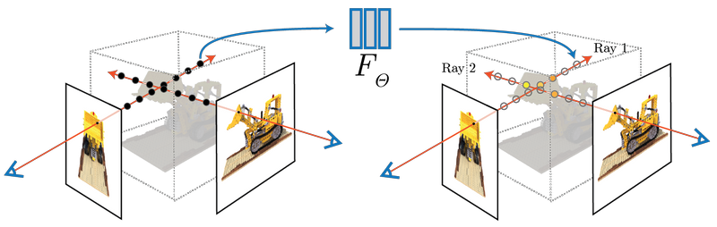
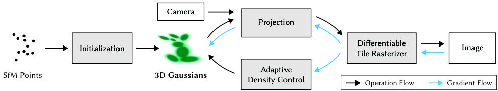

# Neural Radiance Fields (NeRF) & 3D Gaussian Splatting

---

## 1. Novel View Synthesis & Inverse Graphics

Given a set of calibrated 2D images of a scene from known camera poses, **Novel View Synthesis** aims to render photorealistic images from unseen camera viewpoints—**without** requiring 3D ground-truth meshes, voxels, or point clouds.

---

## 2. Neural Radiance Fields (NeRF)

**NeRF** (Mildenhall et al., ECCV 2020) represents a 3D scene as a continuous 5D function parameterized by an MLP:

$$
f_\theta : (\mathbf{x}, \mathbf{d}) = (x, y, z, \theta, \phi) \longmapsto (\mathbf{c}, \sigma)
$$

- **Volume Density $\sigma(\mathbf{x}) \ge 0$:** Differential probability of a ray terminating at $\mathbf{x}$. Notice $\sigma$ depends **only** on 3D position $\mathbf{x}$ (geometry is view-independent).
- **Emitted Color $\mathbf{c}(\mathbf{x}, \mathbf{d}) = (r, g, b)$:** Depends on both position $\mathbf{x}$ and viewing direction $\mathbf{d}$, enabling view-dependent specular highlights and reflections.

### 2.1 Fourier Positional Encoding

Standard MLPs suffer from **spectral bias** (they struggle to represent high-frequency spatial variations). NeRF maps coordinates through sinusoidal Fourier features before feeding them to the MLP:

$$
\gamma(p) = \big[ p, \sin(2^0 \pi p), \cos(2^0 \pi p), \dots, \sin(2^{L-1} \pi p), \cos(2^{L-1} \pi p) \big]
$$

### 2.2 Differentiable Volume Rendering

For a camera ray $\mathbf{r}(t) = \mathbf{o} + t\mathbf{d}$ marching from $t_n$ to $t_f$, the expected pixel color is:

$$
C(\mathbf{r}) = \int_{t_n}^{t_f} T(t)\, \sigma(\mathbf{r}(t))\, \mathbf{c}(\mathbf{r}(t), \mathbf{d})\, dt, \qquad T(t) = \exp\left(-\int_{t_n}^t \sigma(\mathbf{r}(s))\, ds\right)
$$

In practice, NeRF approximates this integral via **discrete quadrature** over $K$ sampled points $t_1 < t_2 < \dots < t_K$ with step sizes $\delta_i = t_{i+1} - t_i$:

$$
\hat{C}(\mathbf{r}) = \sum_{i=1}^K T_i \alpha_i \mathbf{c}_i, \qquad \alpha_i = 1 - \exp(-\sigma_i \delta_i), \qquad T_i = \prod_{j=1}^{i-1} (1 - \alpha_j)
$$

Because every operation is differentiable, NeRF is trained end-to-end using pure **2D Photometric MSE Loss**:

$$
\mathcal{L} = \sum_{\mathbf{r} \in \mathcal{R}} \| \hat{C}(\mathbf{r}) - C_{\text{gt}}(\mathbf{r}) \|_2^2
$$

> **Hands-On Implementation:** See [`06_tiny_nerf.py`](../06_tiny_nerf.py).

---

## 3. 3D Gaussian Splatting (3DGS)

While NeRF achieves remarkable quality, querying an MLP $K$ times per pixel ray makes training and rendering slow (often 1–2 days per scene on a V100 in Vanilla NeRF, and $<1$ FPS rendering).

**3D Gaussian Splatting** (Kerbl & Kopanas et al., SIGGRAPH 2023) replaces the implicit MLP with **explicit anisotropic 3D Gaussians**:

Each Gaussian $k$ is parameterized by:
- **Center $\boldsymbol{\mu}_k \in \mathbb{R}^3$**
- **3D Covariance $\Sigma_k = R_k S_k S_k^T R_k^T$** (factorized into rotation quaternion $\mathbf{q}_k \in \mathbb{R}^4$ and scale vector $\mathbf{s}_k \in \mathbb{R}^3$ to guarantee positive semi-definiteness)
- **Opacity $\alpha_k \in [0, 1]$** and **Color $\mathbf{c}_k$** (view-dependent Spherical Harmonics or RGB)

### 3.1 Perspective Splatting & Alpha Blending

Instead of marching rays through 3D space, 3DGS **projects (splats)** each 3D Gaussian directly onto the 2D image plane using the local affine Jacobian $J$ of perspective projection and world-to-camera rotation $W$:

$$
\Sigma' = J W \Sigma W^T J^T
$$

The projected 2D Gaussians are sorted front-to-back by camera depth and composited via exact alpha blending:

$$
\hat{C}(\mathbf{u}) = \sum_{k=1}^K \mathbf{c}_k \alpha'_k(\mathbf{u}) \prod_{j=1}^{k-1} (1 - \alpha'_j(\mathbf{u}))
$$

### 3.2 Dense vs. Sparse Radiance Parameterization: NeRF vs. 3DGS

A core conceptual distinction between NeRF and 3D Gaussian Splatting lies in **how they allocate capacity in 3D space**:
- **NeRF (Dense Spatial Parameterization):** Parameterizes the scene *densely at every point in 3D space* via a continuous MLP—even empty air must be queried along camera rays during marching.
- **3D Gaussian Splatting (Sparse Primitive Parameterization):** Parameterizes the scene *sparsely*, placing explicit 3D Gaussian blobs only where scene density is nonzero and rasterizing them directly onto the 2D image plane.

| Feature | NeRF (Implicit / Dense) | 3D Gaussian Splatting (Explicit / Sparse) |
| :--- | :--- | :--- |
| **Scene Representation** | Continuous MLP weights over all $(x,y,z)$ | Discrete set of 3D Gaussians where $\sigma > 0$ |
| **Rendering Mechanism** | Ray marching ($K$ MLP queries/pixel) | Tile-based rasterization / splatting |
| **Rendering Speed** | Slow ($\sim 0.1$–$2$ FPS) | **Real-time ($> 100$ FPS)** |
| **Memory Footprint** | Compact ($\sim 5$–$20\text{ MB}$) | Larger ($\sim 100$–$500\text{ MB}$) |

> **Hands-On Implementation:** See [`07_gaussian_splatting.py`](../07_gaussian_splatting.py).
>
> **State-of-the-Art Literature Review (2023–2026):** See [`05b_3dgs_state_of_the_art.md`](./05b_3dgs_state_of_the_art.md) for a curated review of post-2023 advances (Mip-Splatting, 2DGS, 3DGRT/3DGUT, MVSplat/AnySplat, Scaffold-GS/HAC, 4DGS, PhysGaussian, and SplaTAM).
