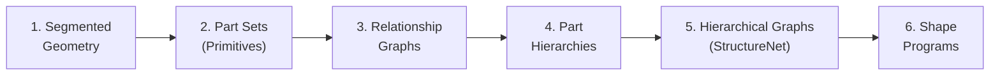
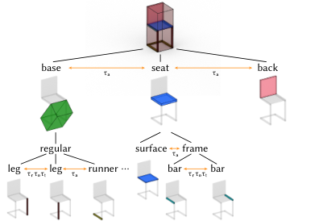

# Structure-Aware 3D Representations: Parts, Graphs, Hierarchies, and Programs

---

## 1. Element Geometry vs. Element Structure

Unstructured 3D representations (raw point clouds, voxel grids, single meshes, or global implicit fields) treat a chair, airplane, or building as one monolithic geometric blob. However, man-made and articulated 3D objects possess rich **compositional structure**:
- **Element Geometry:** The shape of individual atomic parts (e.g., a chair seat, four legs, armrests).
- **Element Structure:** How parts are organized, attached, repeated, and constrained relative to one another (symmetry, support, connectivity).

---

## 2. The Spectrum of Structure-Aware Representations

### 2.1 Segmented Geometry
- Labels each point, voxel, or face with a semantic part ID (e.g., `leg`, `seat`, `back`).
- *Limitation:* Easy to reuse unstructured models, but geometric integrity of individual parts is not guaranteed by construction.

### 2.2 Part Sets (Volumetric & Implicit Primitives)
- Represents an object as an unordered collection of parametric primitives—such as **oriented bounding boxes / volumetric primitives** (Tulsiani et al., CVPR 2017) or **sets of local implicit functions** (Genova et al., CVPR 2020).
- *Strength:* Part integrity is guaranteed.
- *Limitation:* Without explicit relational constraints, parts can float or intersect unnaturally.

### 2.3 Relationship Graphs & Hierarchies
- **Relationship Graphs:** Nodes represent parts; edges encode geometric relations such as **symmetry**, **attachment/contact**, and **parallelism**.
- **Hierarchies (Trees):** Decompose an object recursively from coarse assemblies (`chair` $\to$ `base` + `upper`) down to fine leaf parts (`leg_1`..`leg_4`).

### 2.4 Hierarchical Graphs: StructureNet (Mo et al., SIGGRAPH Asia 2019)
**StructureNet** unifies trees and graphs into a **hierarchical $n$-ary graph representation**:
- Each node represents a part bounding box (or point cloud/mesh) and has its own child graph.
- Sibling nodes at each hierarchy level are connected by **lateral relationship edges** (adjacency and symmetry).
- Graph Convolutional Networks (GCNs) encode and decode variable-degree part graphs into a smooth latent space for shape generation and interpolation.

### 2.5 Shape Programs (Procedural 3D Modeling)
- Subsumes all other representations by expressing 3D geometry as an executable **domain-specific program** (e.g., loops for repeating chair slats, conditionals, and parametric subroutines).
- Naturally captures exact repetition, symmetry, and high-level editing semantics.

---

## 3. Structural Regularization in Practice

When fitting a set of $K$ box primitives $\{(\mathbf{c}_k, \mathbf{s}_k)\}_{k=1}^K$ to a target 3D shape via CSG union $\text{SDF}(x) = \min_k \text{SDF}_{\text{box}}(x - \mathbf{c}_k; \mathbf{s}_k)$, adding explicit **structural relationship losses** prevents floating or asymmetric artifacts:

1. **Bilateral Symmetry Loss:** Mirrors paired parts $(l, r)$ across the symmetry plane $x = 0$:
   $$\mathcal{L}_{\text{sym}} = \|\mathbf{c}_l - \text{diag}(-1, 1, 1)\mathbf{c}_r\|_2^2 + \|\mathbf{s}_l - \mathbf{s}_r\|_2^2$$
2. **Support / Contact Loss:** Enforces that supporting parts (legs) touch the underside of the supported part (seat):
   $$\mathcal{L}_{\text{contact}} = \big((c_{\text{leg}, y} + s_{\text{leg}, y}) - (c_{\text{seat}, y} - s_{\text{seat}, y})\big)^2$$

> **Hands-On Implementation:** See [`08_structure_aware_primitives.py`](../08_structure_aware_primitives.py).
