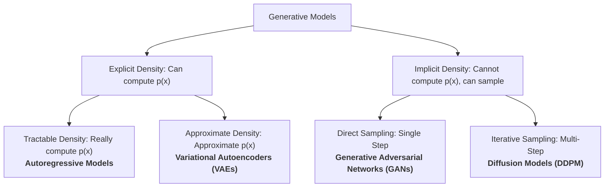

# IF5152: Generative Models Laboratory
### Institut Teknologi Bandung (ITB)

Welcome to the **Generative Models Hands-On Laboratory** for IF5152. This laboratory module provides practical PyTorch implementations, mathematical derivations, and comparative experiments for the five major paradigms of generative modeling presented in **Lecture 13 & 14**:
1. **Autoregressive Models (PixelCNN)**
2. **Classical Autoencoders (Vanilla AE)**
3. **Variational Autoencoders (VAE)**
4. **Generative Adversarial Networks (DCGAN)**
5. **Denoising Diffusion Probabilistic Models (DDPM)**

---

## 📊 The Generative Models Taxonomy



### Comprehensive Comparison Table

| Model Paradigm | Script | Math Formulation | Density Evaluation | Sampling Speed | Training Stability | Primary Trade-Off |
| :--- | :--- | :--- | :--- | :--- | :--- | :--- |
| **Autoregressive** | [`01_autoregressive_pixelcnn.py`](./01_autoregressive_pixelcnn.py) | Chain Rule: $\prod_t p(x_t \mid x_{<t})$ | **Exact MLE** | Very Slow ($O(N)$ sequential) | Very High (Standard NLL) | Sequential inference bottleneck |
| **Vanilla AE** | [`02_vanilla_autoencoder.py`](./02_vanilla_autoencoder.py) | Reconstruction: $\|x - \hat{x}\|_2^2$ | None | N/A (Not Generative) | High (MSE Loss) | Cannot sample; latent space has "holes" |
| **VAE** | [`03_variational_autoencoder.py`](./03_variational_autoencoder.py) | ELBO: $\mathbb{E}[\log p] - D_{KL}$ | Lower Bound (ELBO) | Fast ($O(1)$ forward pass) | High (Gradient on ELBO) | Blurrier images due to L2/BCE regression |
| **GAN (Unconditional)** | [`04a_generative_adversarial_network.py`](./04a_generative_adversarial_network.py) | Minimax: $\min_G \max_D V(D, G)$ | None (Implicit) | Fast ($O(1)$ forward pass) | Fragile (Minimax equilibrium) | Vulnerable to mode collapse & vanishing gradients |
| **cGAN (Conditional DCGAN)** | [`04b_conditional_dcgan.py`](./04b_conditional_dcgan.py) | Conditional Minimax: $V(D, G; y)$ | None (Implicit) | Fast ($O(1)$ forward pass) | Moderate (Label conditioning stabilizes training) | Requires supervised categorical labels $y$ |
| **SNGAN (ResNet + Projection)** | [`04c_sngan_projection_cifar10.py`](./04c_sngan_projection_cifar10.py) | Hinge Loss + Inner-Product Projection: $\phi(\psi(x)) + \psi(x)^T v_y$ | None (Implicit) | Fast ($O(1)$ forward pass) | **High (Spectral Normalization $\sigma(W) \le 1$)** | ResNet parameters (~4.3M) |
| **Conditional Diffusion (DDIM / DDPM)** | [`05_denoising_diffusion_model.py`](./05_denoising_diffusion_model.py) | Score / Denoising MSE: $\|\epsilon - \epsilon_\theta(x_t, t, y)\|^2$ | Implicit / VLB | **Fast ($O(S)$ DDIM, 20-50 steps)** | **State-of-the-Art (CFG Guidance $w \ge 1.5$)** | Multi-step reverse sampling |

---

## 🛠️ Environment Setup & Hardware Acceleration

The code supports:
- **Apple Silicon (M1/M2/M3/M4)** natively via Metal Performance Shaders (`mps`)
- **NVIDIA GPUs** via CUDA (`cuda`)
- **CPU Fallback** (`cpu`)

### Quickstart:
```bash
# Navigate to the laboratory folder
cd IF5152/generative-models

# Install dependencies
pip install -r requirements.txt
```

---

## 🚀 Running the Practical Modules

### 1. Autoregressive Image Modeling (PixelCNN)
Demonstrates causal masked convolutions (Mask A vs. Mask B) and sequential raster-order sampling:
```bash
python 01_autoregressive_pixelcnn.py --epochs 3 --batch-size 128
# Quick verification test:
python 01_autoregressive_pixelcnn.py --quick-test
```
*Output: `samples/pixelcnn_samples.png`*

### 2. Classical Autoencoder & Latent Failure Mode
Demonstrates sharp reconstruction on training data and explains why unconstrained latent spaces fail to generate valid samples from prior noise:
```bash
python 02_vanilla_autoencoder.py --epochs 3 --batch-size 128
```
*Outputs: `samples/ae_reconstructions.png` and `samples/ae_random_sampling_failure.png`*

### 3. Variational Autoencoder (VAE)
Demonstrates the Reparameterization Trick, ELBO optimization, prior sampling, and continuous 2D manifold traversal:
```bash
# Standard VAE (latent_dim=20)
python 03_variational_autoencoder.py --epochs 5 --latent-dim 20

# 2D Latent Manifold Traversal (Lecture Slide 112)
python 03_variational_autoencoder.py --epochs 5 --latent-dim 2
```
*Outputs: `samples/vae_samples.png` and `samples/vae_manifold_2d.png`*

### 4a. Generative Adversarial Network (Unconditional DCGAN)
Demonstrates two-player minimax training, non-saturating generator loss, direct single-step generation, and automatic checkpoint persistence:
```bash
# MNIST / Fashion-MNIST (1x28x28)
python 04a_generative_adversarial_network.py --dataset mnist --epochs 5 --lr 0.0002

# CIFAR-10 RGB (3x32x32, Radford et al. 2016 architecture)
python 04a_generative_adversarial_network.py --dataset cifar10 --epochs 25 --lr 0.0002
```
*Outputs: `samples/gan_samples.png` / `samples/gan_samples_cifar10.png` and checkpoints in `checkpoints/` (`dcgan_generator.pt`, `dcgan_discriminator.pt`, `dcgan_checkpoint.pt`).*

### 4b. Class-Conditional GAN (cGAN on CIFAR-10 & LSUN)
Demonstrates label-guided image generation where class labels $y$ condition both the Generator (via latent embedding concatenation) and Discriminator (via spatial feature map channel concatenation). Supports both **CIFAR-10** ($3 \times 32 \times 32$) and **LSUN Scene Modeling** ($3 \times 64 \times 64$, exactly implementing Figure 1 of Radford et al., 2016):
```bash
# Train conditional DCGAN on CIFAR-10 RGB (3x32x32)
python 04b_conditional_dcgan.py --dataset cifar10 --epochs 25 --lr 0.0002

# Train conditional DCGAN on LSUN Scene Categories (3x64x64, Radford et al. 2016)
python 04b_conditional_dcgan.py --dataset lsun --img-size 64 --lsun-categories "bedroom,church_outdoor,kitchen" --epochs 25

# Quick verification test (1 epoch on 500 samples)
python 04b_conditional_dcgan.py --dataset cifar10 --quick-test

# Generate 10x10 class-conditional grid from saved checkpoint
python 04b_conditional_dcgan.py --dataset cifar10 --sample-only
```
*Outputs: `samples/cgan_cifar10_samples.png`, `samples/cgan_lsun_samples.png`, and checkpoints in `checkpoints/` (`cgan_cifar10_checkpoint.pt`, `cgan_lsun_checkpoint.pt`).*

### 4c. High-Quality SOTA Conditional GAN (ResNet SNGAN with Projection Discriminator)
Demonstrates modern state-of-the-art conditional GAN techniques on CIFAR-10 ($3 \times 32 \times 32$) that eliminate DCGAN's quality ceiling (Inception Score $\sim 8.5$, FID $\sim 15$):
- **ResNet Generator**: Uses nearest-neighbor 2x upsampling with $3 \times 3$ convolutions (eliminates deconvolution checkerboard artifacts) and **Conditional Batch Normalization (CBN)**.
- **ResNet Discriminator with Spectral Normalization**: Strictly bounds the Lipschitz constant ($\sigma(W) \le 1$) across all conv/linear weights.
- **Projection Discriminator**: Inner product $D(x, y) = \phi(\psi(x)) + \psi(x)^T \mathbf{v}_y$ enforces label fidelity without degrading textures.
- **Hinge Loss**: Bounded non-saturating adversarial objective.
```bash
# Train ResNet SNGAN on CIFAR-10 (30 epochs, Apple Silicon M4 Pro accelerated)
python 04c_sngan_projection_cifar10.py --epochs 30 --batch-size 64 --lr 0.0002 --device mps

# Quick verification test (1 epoch on 50 samples)
python 04c_sngan_projection_cifar10.py --quick-test --device mps

# Generate 10x10 canonical class grid from saved checkpoint
python 04c_sngan_projection_cifar10.py --eval-grid --device mps
```
*Outputs: `samples/sngan_cifar10_samples.png`, `samples/sngan_cifar10_milestones/`, and checkpoints in `checkpoints/` (`sngan_cifar10_generator.pt`, `sngan_cifar10_discriminator.pt`, `sngan_cifar10_checkpoint.pt`).*

### 5. Class-Conditional Diffusion Model with DDIM Sampler (CIFAR-10)
Demonstrates state-of-the-art score-based generative modeling with **Classifier-Free Guidance (CFG)** and **Denoising Diffusion Implicit Model (DDIM)** on **CIFAR-10** ($3 \times 32 \times 32$, 10 classes):
- **ResNet U-Net**: GroupNorm, SiLU, and multi-head spatial self-attention at $16 \times 16$ and $8 \times 8$.
- **Classifier-Free Guidance**: Random label dropout ($p=0.15$) during training; guidance scale $w=2.0$ at inference to boost class fidelity and perceptual contrast.
- **DDIM Deterministic Sampler (Song et al., ICLR 2021)**: Accelerates reverse sampling from $T=1000$ to $S=50$ steps (~1.5s per grid).
```bash
# Train conditional diffusion on CIFAR-10 (15 epochs, Apple Silicon MPS)
python 05_denoising_diffusion_model.py --dataset cifar10 --epochs 15 --batch-size 128 --device mps

# Quick verification test (1 epoch on subset)
python 05_denoising_diffusion_model.py --quick-test --device mps

# Generate 10x10 evaluation grid via fast DDIM sampler (S=50 steps, CFG=2.0)
python 05_denoising_diffusion_model.py --sample-only --sampler ddim --ddim-steps 50 --cfg-scale 2.0 --device mps
```
*Outputs: `samples/cddpm_cifar10_samples.png`, `samples/cddpm_cifar10_milestones/`, and checkpoints in `checkpoints/` (`cddpm_cifar10_model.pt`, `cddpm_cifar10_checkpoint.pt`).*

### 6. Interactive Gradio GUIs
1. **AE vs. VAE Latent Generation Demo**: Contrasts **Untrained AE**, **Trained AE**, and **Trained VAE** with continuous latent sliders ($d=10$):
   ```bash
   python app_gradio_ae_vs_vae.py
   ```
2. **DCGAN & cGAN CIFAR-10 Interactive Explorer**: Interactive synthesis, Slerp/Lerp manifold traversal, class-targeted synthesis, 10x10 disentangled class matrix, label-alignment inspector, comparative arena, and Turing test:
   ```bash
   python app_gradio_dcgan_cifar10.py
   ```

---

## 📚 Deep-Dive Theoretical Documentation (`docs/`)

Each sub-module is paired with comprehensive theoretical lecture notes containing step-by-step mathematical derivations:
- **[`docs/01_generative_autoregressive.md`](./docs/01_generative_autoregressive.md)**: Introduction to Generative Modeling, Discriminative vs. Generative paradigms, complete taxonomy, proof of exact Maximum Likelihood Estimation, Chain Rule factorization, causal masking proofs, and latency analysis.
- **[`docs/02_autoencoders_vs_vaes.md`](./docs/02_autoencoders_vs_vaes.md)**: Conceptual transition from deterministic bottleneck reconstruction to probabilistic prior regularization.
- **[`docs/03_variational_inference_elbo.md`](./docs/03_variational_inference_elbo.md)**: Full algebraic derivation of the Evidence Lower Bound (ELBO), closed-form Gaussian KL divergence, and the Reparameterization Trick.
- **[`docs/04_generative_adversarial_networks.md`](./docs/04_generative_adversarial_networks.md)**: Mathematical derivation of the optimal discriminator $D^*(x)$, connection to Jensen-Shannon Divergence, and DCGAN architectural heuristics.
- **[`docs/05_diffusion_probabilistic_models.md`](./docs/05_diffusion_probabilistic_models.md)**: Forward/reverse Markov processes, closed-form jumping equation, $L_{simple}$ derivation, and score matching.
