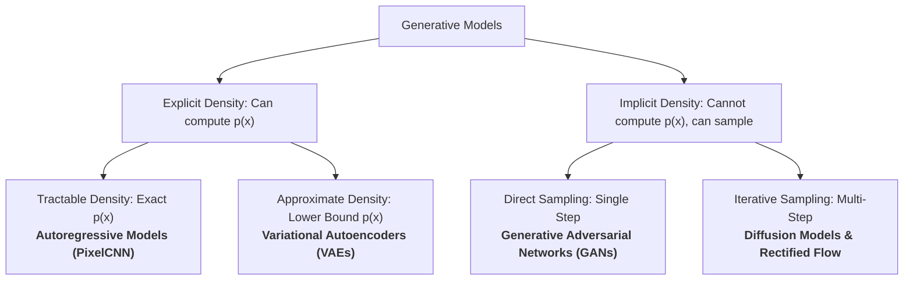

# Generative Deep Learning: PyTorch Implementation Suite & Technical Guides

Welcome to the **Generative Deep Learning Suite**. This repository provides production-grade, mathematically grounded PyTorch implementations, theoretical derivations, and comparative benchmarks for the major paradigms of modern generative modeling:
1. **Autoregressive Models**: PixelCNN with masked causal convolutions
2. **Deterministic Autoencoders**: Latent space topology and unregularized sampling failure modes
3. **Variational Autoencoders (VAEs)**: Evidence Lower Bound (ELBO) and continuous latent manifold exploration
4. **Generative Adversarial Networks (GANs)**: Unconditional DCGAN, Class-Conditional DCGAN (CIFAR-10 & LSUN), ResNet SNGAN with Projection Discriminator, AC-GAN, and Modern ResNet AC-GAN with DiffAugment
5. **Denoising Diffusion Models**: Class-Conditional DDPM and high-speed DDIM ODE sampling on CIFAR-10
6. **Rectified Flow & Flow Matching**: Continuous-time straight-line trajectories and numerical ODE integration (Euler and Heun)

---

## 📊 The Generative Models Taxonomy



### Comprehensive Comparison Table

| Model Paradigm | Implementation Script | Technical Guide | Mathematical Formulation | Density Evaluation | Sampling Latency | Training Stability | Primary Trade-Off |
| :--- | :--- | :--- | :--- | :--- | :--- | :--- | :--- |
| **Autoregressive** | [`01_autoregressive_pixelcnn.py`](./01_autoregressive_pixelcnn.py) | [Guide 01](./docs/01_generative_autoregressive.md) | Chain Rule: $\prod_t p(x_t \mid x_{<t})$ | **Exact MLE** | Very Slow ($O(N)$ sequential) | Very High (Standard NLL) | Sequential inference bottleneck |
| **Vanilla AE** | [`02_vanilla_autoencoder.py`](./02_vanilla_autoencoder.py) | [Guide 02](./docs/02_autoencoders_vs_vaes.md) | Reconstruction: $\|x - \hat{x}\|_2^2$ | None | N/A (Not Generative) | High (MSE Loss) | Cannot sample; latent space has "holes" |
| **VAE** | [`03_variational_autoencoder.py`](./03_variational_autoencoder.py) | [Guide 03](./docs/03_variational_inference_elbo.md) | ELBO: $\mathbb{E}[\log p] - D_{KL}$ | Lower Bound (ELBO) | Fast ($O(1)$ forward pass) | High (Gradient on ELBO) | Blurrier images due to L2/BCE regression |
| **GAN (Unconditional)** | [`04a_generative_adversarial_network.py`](./04a_generative_adversarial_network.py) | [Guide 04](./docs/04_generative_adversarial_networks.md) | Minimax: $\min_G \max_D V(D, G)$ | None (Implicit) | Fast ($O(1)$ forward pass) | Fragile (Minimax equilibrium) | Vulnerable to mode collapse & vanishing gradients |
| **cGAN (Conditional DCGAN)** | [`04b_conditional_dcgan.py`](./04b_conditional_dcgan.py) | [Guide 04](./docs/04_generative_adversarial_networks.md) | Conditional Minimax: $V(D, G; y)$ | None (Implicit) | Fast ($O(1)$ forward pass) | Moderate (Label conditioning stabilizes training) | Requires supervised categorical labels $y$ |
| **AC-GAN (Auxiliary Classifier)** | [`04d_acgan_cifar10.py`](./04d_acgan_cifar10.py) | [Guide 04](./docs/04_generative_adversarial_networks.md) | Multi-Task: $\mathcal{L}_S + \mathcal{L}_C$ | None (Implicit) | Fast ($O(1)$ forward pass) | High (Disentangled Auxiliary Classification) | Dual-head discriminator tuning |
| **ResNet AC-GAN (Modern)** | [`04e_resnet_acgan_cifar10.py`](./04e_resnet_acgan_cifar10.py) | [Guide 04](./docs/04_generative_adversarial_networks.md) | ResNet + CBN + Spectral Norm + Dual Heads | None (Implicit) | Fast ($O(1)$ forward pass) | **Very High (SN bounds Lipschitz; No Checkerboard)** | Model parameter footprint (~4.3M) |
| **SNGAN (ResNet + Projection)** | [`04c_sngan_projection_cifar10.py`](./04c_sngan_projection_cifar10.py) | [Guide 04](./docs/04_generative_adversarial_networks.md) | Hinge Loss + Inner-Product Projection | None (Implicit) | Fast ($O(1)$ forward pass) | **High (Spectral Normalization $\sigma(W) \le 1$)** | Model parameter footprint (~4.3M) |
| **Conditional Diffusion (DDIM / DDPM)** | [`05_denoising_diffusion_model.py`](./05_denoising_diffusion_model.py) | [Guide 05](./docs/05_diffusion_probabilistic_models.md) | Score / Denoising MSE: $\|\epsilon - \epsilon_\theta(x_t, t, y)\|^2$ | Implicit / VLB | **Fast ($O(S)$ DDIM, 20-50 steps)** | **State-of-the-Art (CFG Guidance $w \ge 1.5$)** | Multi-step reverse sampling |
| **Rectified Flow (Flow Matching)** | [`06_rectified_flow_cifar10.py`](./06_rectified_flow_cifar10.py) | [Guide 06](./docs/06_rectified_flow.md) | Straight Line Velocity MSE: $\|v_\theta(x_t, t, y) - (z - x)\|_2^2$ | Implicit / Flow ODE | **Fastest Diffusion ($O(S)$ Euler/Heun, 10-25 steps)** | **State-of-the-Art (Stable MSE, No curved SDE)** | Multi-step reverse ODE integration |

---

## 🛠️ Environment Setup & Hardware Acceleration

The code supports:
- **Apple Silicon (M1/M2/M3/M4)** natively via Metal Performance Shaders (`mps`)
- **NVIDIA GPUs** via CUDA (`cuda`) with automatic mixed precision (AMP)
- **CPU Fallback** (`cpu`)

### Quickstart:
```bash
# Navigate to the repository folder
cd IF5152/generative-models

# Install dependencies
pip install -r requirements.txt
```

---

## 🚀 Running the Practical Modules

### 1. Autoregressive Image Modeling (PixelCNN)
Demonstrates causal masked convolutions (Mask A vs. Mask B) and sequential raster-order sampling:
```bash
python 01_autoregressive_pixelcnn.py --epochs 3 --batch-size 128
# Quick verification test:
python 01_autoregressive_pixelcnn.py --quick-test
```
*Output: `samples/pixelcnn_samples.png`*

### 2. Classical Autoencoder & Latent Failure Mode
Demonstrates sharp reconstruction on training data and explains why unconstrained latent spaces fail to generate valid samples from prior noise:
```bash
python 02_vanilla_autoencoder.py --epochs 3 --batch-size 128
```
*Outputs: `samples/ae_reconstructions.png` and `samples/ae_random_sampling_failure.png`*

### 3. Variational Autoencoder (VAE)
Demonstrates the Reparameterization Trick, ELBO optimization, prior sampling, and continuous 2D manifold traversal:
```bash
# Standard VAE (latent_dim=20)
python 03_variational_autoencoder.py --epochs 5 --latent-dim 20

# 2D Latent Manifold Traversal
python 03_variational_autoencoder.py --epochs 5 --latent-dim 2
```
*Outputs: `samples/vae_samples.png` and `samples/vae_manifold_2d.png`*

### 4a. Generative Adversarial Network (Unconditional DCGAN)
Demonstrates two-player minimax training, non-saturating generator loss, direct single-step generation, and automatic checkpoint persistence:
```bash
# MNIST / Fashion-MNIST (1x28x28)
python 04a_generative_adversarial_network.py --dataset mnist --epochs 5 --lr 0.0002

# CIFAR-10 RGB (3x32x32, Radford et al. 2016 architecture)
python 04a_generative_adversarial_network.py --dataset cifar10 --epochs 25 --lr 0.0002
```
*Outputs: `samples/gan_samples.png` / `samples/gan_samples_cifar10.png` and checkpoints in `checkpoints/` (`dcgan_generator.pt`, `dcgan_discriminator.pt`, `dcgan_checkpoint.pt`).*

### 4b. Class-Conditional GAN (cGAN on CIFAR-10 & LSUN)
Demonstrates label-guided image generation where class labels $y$ condition both the Generator (via latent embedding concatenation) and Discriminator (via spatial feature map channel concatenation). Supports both **CIFAR-10** ($3 \times 32 \times 32$) and **LSUN Scene Modeling** ($3 \times 64 \times 64$, implementing Figure 1 of Radford et al., 2016):
```bash
# Train conditional DCGAN on CIFAR-10 RGB (3x32x32)
python 04b_conditional_dcgan.py --dataset cifar10 --epochs 25 --lr 0.0002

# Train conditional DCGAN on LSUN Scene Categories (3x64x64, Radford et al. 2016)
python 04b_conditional_dcgan.py --dataset lsun --img-size 64 --lsun-categories "bedroom,church_outdoor,kitchen" --epochs 25

# Quick verification test (1 epoch on 500 samples)
python 04b_conditional_dcgan.py --dataset cifar10 --quick-test

# Generate 10x10 class-conditional grid from saved checkpoint
python 04b_conditional_dcgan.py --dataset cifar10 --sample-only
```
*Outputs: `samples/cgan_cifar10_samples.png`, `samples/cgan_lsun_samples.png`, and checkpoints in `checkpoints/` (`cgan_cifar10_checkpoint.pt`, `cgan_lsun_checkpoint.pt`).*

### 4c. High-Quality SOTA Conditional GAN (ResNet SNGAN with Projection Discriminator)
Demonstrates modern state-of-the-art conditional GAN techniques on CIFAR-10 ($3 \times 32 \times 32$) that eliminate DCGAN's quality ceiling:
- **ResNet Generator**: Uses nearest-neighbor $2\times$ upsampling with $3 \times 3$ convolutions (eliminating deconvolution checkerboard artifacts) and **Conditional Batch Normalization (CBN)**.
- **ResNet Discriminator with Spectral Normalization**: Strictly bounds the Lipschitz constant ($\sigma(W) \le 1$) across all conv/linear weights.
- **Projection Discriminator**: Inner product $D(x, y) = \phi(\psi(x)) + \psi(x)^T \mathbf{v}_y$ enforces label fidelity without degrading textures.
- **Hinge Loss**: Bounded non-saturating adversarial objective.
```bash
# Train ResNet SNGAN on CIFAR-10
python 04c_sngan_projection_cifar10.py --epochs 30 --batch-size 64 --lr 0.0002

# Quick verification test (1 epoch on 50 samples)
python 04c_sngan_projection_cifar10.py --quick-test

# Generate 10x10 canonical class grid from saved checkpoint
python 04c_sngan_projection_cifar10.py --eval-grid
```
*Outputs: `samples/sngan_cifar10_samples.png`, `samples/sngan_cifar10_milestones/`, and checkpoints in `checkpoints/` (`sngan_cifar10_generator.pt`, `sngan_cifar10_discriminator.pt`, `sngan_cifar10_checkpoint.pt`).*

### 4d. Auxiliary Classifier GAN (AC-GAN on CIFAR-10)
Demonstrates multi-task conditional synthesis ([Odena et al., ICML 2017](https://arxiv.org/abs/1610.09585)) where the discriminator takes **RGB image alone** ($3 \times 32 \times 32$) and predicts both source validity (real vs. fake) and class labels simultaneously:
- **Dual-Headed Discriminator**: Features a source adversarial head and an auxiliary classifier head trained via Cross-Entropy on both real and fake images.
- **Representation Disentanglement**: Forces the discriminator to learn class-predictive features, boosting training stability.
- **EMA Tracking**: Exponential Moving Average ($\beta = 0.999$) produces smoothed, high-contrast evaluation samples.
```bash
# Train AC-GAN on CIFAR-10
python 04d_acgan_cifar10.py --epochs 50 --batch-size 128

# Quick verification test (1 epoch on 50 samples)
python 04d_acgan_cifar10.py --quick-test

# Generate 10x10 canonical class matrix from saved checkpoint
python 04d_acgan_cifar10.py --eval-grid --use-ema
```
*Outputs: `samples/acgan_cifar10_samples_ema.png`, `samples/acgan_cifar10_milestones/`, and checkpoints in `checkpoints/` (`acgan_cifar10_generator_ema.pt`, `acgan_cifar10_discriminator.pt`, `acgan_cifar10_checkpoint.pt`).*

### 4e. Modern ResNet Auxiliary Classifier GAN (ResNet AC-GAN on CIFAR-10)
Combines the canonical dual-headed multi-task objective of AC-GAN with modern architectural breakthroughs to completely overcome DCGAN quality bottlenecks:
- **Nearest-Neighbor $2\times$ Upsampling + $3\times 3$ Convolutions**: Replaces transposed convolutions in the generator, completely eliminating high-frequency checkerboard artifacts.
- **Conditional Batch Normalization (CBN)**: Modulates feature channels across all residual stages via learned class embeddings $(\gamma_c, \beta_c)$.
- **Spectrally-Normalized ResNet Discriminator**: Bounds Lipschitz constant ($\sigma(W) \le 1$) across all downsampling blocks and dual linear heads (`fc_adv`, `fc_cls`), stabilizing multi-task training.
- **DiffAugment (Differentiable Data Augmentation)**: Applies differentiable translation and cutout (`--diffaugment translation,cutout`) to real and fake images, preventing discriminator memorization on CIFAR-10.
- **Classifier Loss Annealing ($\lambda_{\text{cls}} = 0.1$)**: Prevents auxiliary cross-entropy from overpowering adversarial realness, forcing the generator to learn realistic anatomy rather than coarse color shortcuts.
- **EMA Tracking & Linear LR Decay**: Smooths generator parameters ($\beta=0.999$) and decays learning rate cleanly to zero.
```bash
# Train Modern ResNet AC-GAN on CIFAR-10 with DiffAugment
python 04e_resnet_acgan_cifar10.py --epochs 50 --batch-size 128 --lambda-cls 0.1 --diffaugment translation,cutout

# Quick verification test (1 epoch on 50 samples)
python 04e_resnet_acgan_cifar10.py --quick-test

# Generate 10x10 canonical class matrix from saved checkpoint
python 04e_resnet_acgan_cifar10.py --eval-grid --use-ema
```
*Outputs: `samples/resnet_acgan_cifar10_samples_ema.png`, `samples/resnet_acgan_cifar10_milestones/`, and checkpoints in `checkpoints/` (`resnet_acgan_cifar10_generator_ema.pt`, `resnet_acgan_cifar10_discriminator.pt`, `resnet_acgan_cifar10_checkpoint.pt`).*

### 5. Class-Conditional Diffusion Model with DDIM Sampler (CIFAR-10)
Demonstrates state-of-the-art score-based generative modeling with **Classifier-Free Guidance (CFG)** and **Denoising Diffusion Implicit Model (DDIM)** on **CIFAR-10** ($3 \times 32 \times 32$, 10 classes):
- **ResNet U-Net**: GroupNorm, SiLU, and multi-head spatial self-attention at $16 \times 16$ and $8 \times 8$.
- **Classifier-Free Guidance**: Random label dropout ($p=0.15$) during training; guidance scale $w=2.0$ at inference to boost class fidelity and perceptual contrast.
- **DDIM Deterministic Sampler (Song et al., ICLR 2021)**: Accelerates reverse sampling from $T=1000$ to $S=50$ steps (~1.5s per grid).
```bash
# Train conditional diffusion on CIFAR-10
python 05_denoising_diffusion_model.py --dataset cifar10 --epochs 15 --batch-size 128

# Quick verification test (1 epoch on subset)
python 05_denoising_diffusion_model.py --quick-test

# Generate 10x10 evaluation grid via fast DDIM sampler (S=50 steps, CFG=2.0)
python 05_denoising_diffusion_model.py --sample-only --sampler ddim --ddim-steps 50 --cfg-scale 2.0
```
*Outputs: `samples/cddpm_cifar10_samples.png`, `samples/cddpm_cifar10_milestones/`, and checkpoints in `checkpoints/` (`cddpm_cifar10_model.pt`, `cddpm_cifar10_checkpoint.pt`).*

### 6. Class-Conditional Rectified Flow (CIFAR-10)
Demonstrates continuous-time **Rectified Flow & Flow Matching** ([Liu et al. ICLR 2023](https://arxiv.org/abs/2209.03003); [Lipman et al. ICLR 2023](https://arxiv.org/abs/2210.02747)), as adopted by state-of-the-art foundation models (Stable Diffusion 3, Flux, Movie Gen):
- **Straight Trajectory**: Replaces curved diffusion schedules with a linear path connecting data $x$ and Gaussian noise $z$: $x_t = (1 - t)x + tz$.
- **Constant Target Velocity**: Differentiating yields $v_{\text{gt}} = z - x$, learned directly by a continuous-time U-Net: $\mathcal{L} = \|v_\theta(x_t, t, y) - (z - x)\|_2^2$.
- **Velocity-Space Classifier-Free Guidance**: Extrapolates along the class-conditioned direction ($v_{\text{cfg}} = v_\emptyset + s(v_y - v_\emptyset)$).
- **Fast Numerical ODE Solvers**: Integrates reverse trajectories in just $10-25$ steps using **1st-Order Euler** or **2nd-Order Heun (Predictor-Corrector)**.
```bash
# Train Rectified Flow on CIFAR-10
python 06_rectified_flow_cifar10.py --epochs 50 --batch-size 128 --channels 64 --solver heun

# Quick verification test (1 epoch on subset)
python 06_rectified_flow_cifar10.py --quick-test

# Generate 10x10 evaluation grid from saved checkpoint using 2nd-order Heun solver (15 steps)
python 06_rectified_flow_cifar10.py --eval-grid --use-ema --solver heun --steps 15 --cfg-scale 2.0
```
*Outputs: `samples/rectified_flow_cifar10_samples.png`, `samples/rectified_flow_cifar10_milestones/`, and checkpoints in `checkpoints/` (`rectified_flow_cifar10_model_ema.pt`, `rectified_flow_cifar10_checkpoint.pt`).*

#### 6.1 Training on Google Colab CLI (GPU G4 / T4 / L4)
For faster high-throughput training using NVIDIA Tensor Cores with FP16 Automatic Mixed Precision (AMP), you can run `06_rectified_flow_cifar10.py` directly on Google Colab using the official [`googlecolab/google-colab-cli`](https://github.com/googlecolab/google-colab-cli):

```bash
# 1. Provision a remote Colab session with GPU G4 (or T4)
./run_colab_cli.sh start

# 2. Upload codebase to Colab VM
./run_colab_cli.sh upload

# 3. Connect to interactive TTY console
./run_colab_cli.sh console

# Inside Colab console:
python3 06_rectified_flow_cifar10.py --epochs 80 --batch-size 128 --solver heun --steps 25

# 4. Download checkpoints and generated samples back to local machine
./run_colab_cli.sh download

# 5. Stop the session to preserve Colab compute units
./run_colab_cli.sh stop
```

### 7. Interactive Gradio GUIs
1. **AE vs. VAE Latent Generation Demo**: Contrasts **Untrained AE**, **Trained AE**, and **Trained VAE** with continuous latent sliders ($d=10$):
   ```bash
   python app_gradio_ae_vs_vae.py
   ```
2. **DCGAN & cGAN CIFAR-10 Interactive Explorer**: Interactive synthesis, Slerp/Lerp manifold traversal, class-targeted synthesis, 10x10 disentangled class matrix, label-alignment inspector, comparative arena, and Turing test:
   ```bash
   python app_gradio_dcgan_cifar10.py
   ```
3. **Comprehensive Generative Models CIFAR-10 Explorer**: Unified multi-model dashboard comparing DCGAN, cGAN, SNGAN, AC-GAN, ResNet AC-GAN, DDIM Diffusion, and Rectified Flow:
   ```bash
   python app_gradio_generative_models_cifar10.py
   ```

---

## 📚 Deep-Dive Technical Guides (`docs/`)

Each sub-module is paired with an independent, publication-grade technical guide containing complete theoretical derivations, architecture breakdowns, and algorithm descriptions:
- **[`docs/01_generative_autoregressive.md`](./docs/01_generative_autoregressive.md)**: Generative modeling taxonomy, exact Maximum Likelihood Estimation, Chain Rule factorization, causal masking proofs, and latency analysis.
- **[`docs/02_autoencoders_vs_vaes.md`](./docs/02_autoencoders_vs_vaes.md)**: Conceptual transition from deterministic bottleneck reconstruction to probabilistic prior regularization and latent space topology.
- **[`docs/03_variational_inference_elbo.md`](./docs/03_variational_inference_elbo.md)**: Full algebraic derivation of the Evidence Lower Bound (ELBO), closed-form Gaussian KL divergence, and the Reparameterization Trick.
- **[`docs/04_generative_adversarial_networks.md`](./docs/04_generative_adversarial_networks.md)**: Mathematical derivation of the optimal discriminator $D^*(x)$, connection to Jensen-Shannon Divergence, spectral normalization, projection discriminators, and auxiliary classifier architectures.
- **[`docs/05_diffusion_probabilistic_models.md`](./docs/05_diffusion_probabilistic_models.md)**: Forward/reverse Markov diffusion processes, closed-form jumping equation, score matching, classifier-free guidance, and deterministic DDIM sampling.
- **[`docs/06_rectified_flow.md`](./docs/06_rectified_flow.md)**: Continuous Normalizing Flows and Flow Matching, straight-line vector fields, velocity-space CFG, and numerical ODE solvers (Euler and Heun).
