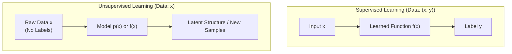
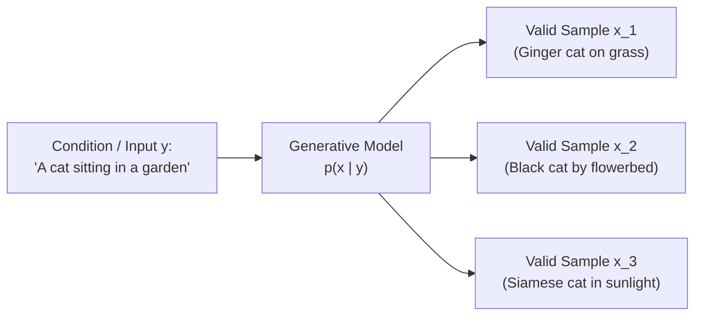
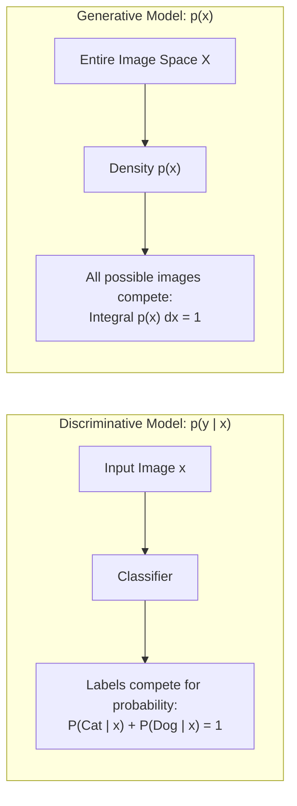
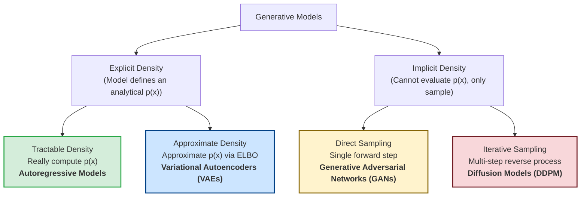
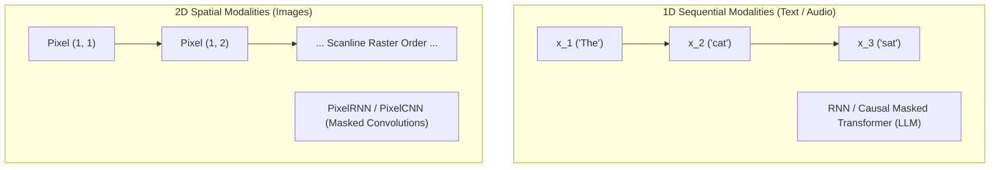
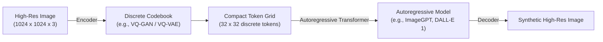

# IF5152 Lecture Notes: Introduction to Generative Modeling & Autoregressive Models

---

## 1. Foundations of Generative Modeling

### 1.1 Supervised vs. Unsupervised Learning

In traditional machine learning and computer vision curricula (see [Goodfellow, Bengio, & Courville, *Deep Learning*, MIT Press 2016](https://www.deeplearningbook.org/contents/ml.html)), tasks are broadly divided into two major paradigms based on the structure of the training dataset:



- **Supervised Learning:**
  - **Data:** Pairs $(x, y)$, where $x$ represents input data (e.g., an image) and $y$ represents a ground-truth supervisory label.
  - **Objective:** Learn a mapping function $f: \mathcal{X} \to \mathcal{Y}$ such that $f(x) \approx y$.
  - **Examples:** Image classification ($x \to \text{class}$), object detection ($x \to \text{bounding boxes}$), semantic segmentation ($x \to \text{pixel masks}$), and image captioning ($x \to \text{text sequence}$).
- **Unsupervised Learning:**
  - **Data:** Unlabeled samples $x \in \mathcal{X}$ drawn from an underlying data distribution.
  - **Objective:** Discover hidden patterns, underlying manifold geometry, or probability distributions governing the data without external human supervision (see [Bengio, Courville, & Vincent, IEEE TPAMI 2013](https://arxiv.org/abs/1206.5538)).
  - **Classical Examples:** Clustering ($k$-means), dimensionality reduction (PCA, t-SNE, UMAP), and density estimation.
  - **Modern Generative Machine Learning:** Learning to model the complete data distribution $p(x)$ or sample realistic new synthetic data points that look indistinguishable from real data.

---

### 1.2 Why Generative Models? Modeling Ambiguity & One-to-Many Mappings

Standard predictive models are well-suited for **many-to-one** tasks (e.g., thousands of slightly different dog images all map to the single discrete label `"dog"`). However, real-world intelligent systems frequently face **one-to-many** problems where a single input or condition can have countless valid, high-dimensional outcomes:



Key motivations for generative modeling highlighted in Lecture 13 include:

1. **Handling Ambiguity:** When multiple valid solutions exist, deterministic regression to the mean produces blurry, washed-out artifacts (e.g., averaging all possible valid futures creates an impossible ghost image, as analyzed by [Mathieu, Couprie, & LeCun, ICLR 2016](https://arxiv.org/abs/1511.05440)). A generative model samples specific, sharp trajectories from the learned distribution $p(x \mid y)$.
2. **Language Modeling:** Given a prompt $y$, produce coherent output text $x$ token by token (e.g., [Radford et al., GPT-2, 2019](https://cdn.openai.com/better-language-models/language_models_are_unsupervised_multitask_learners.pdf)):
   $$\text{"Write a short poem about generative models"} \implies x \sim p(x \mid y)$$
3. **Text-to-Image Synthesis:** Given a natural language caption $y$, generate a high-fidelity image $x$ (e.g., [Ramesh et al., DALL-E, ICML 2021](https://arxiv.org/abs/2102.12092)):
   $$\text{"A person teaching a class in front of a whiteboard"} \implies x \sim p(x \mid y)$$
4. **Video Prediction & Action Modeling ("What happens next?"):** Given current video frames $y$, predict physically plausible future frames $x$. Because the future is non-deterministic, the model must capture multimodal distributions over possible actions and physical interactions.

---

## 2. Predictive / Discriminative vs. Generative Models

To understand generative models deeply, we must contrast how they formulate probability distributions compared to standard predictive (discriminative) classifiers (see the foundational analysis by [Ng & Jordan, NeurIPS 2001](https://proceedings.neurips.cc/paper/2001/file/7b7a53e239400a13bd6be6c0b2400aec-Paper.pdf)).



### 2.1 Mathematical Definitions

#### 1. Discriminative (Predictive) Models: $p(y \mid x)$
- **Goal:** Learn the conditional probability distribution of the target label $y$ given the observed input $x$.
- **Normalization Constraint:** For any specific input $x$, the probabilities across all candidate classes $y \in \mathcal{Y}$ sum to 1:
  $$\sum_{y \in \mathcal{Y}} p(y \mid x) = 1$$
- **Competition:** **Possible labels compete for probability mass for each individual image.** There is *no competition between different images*.
- **Task:** Assign labels to data and perform supervised feature learning with labels.

#### 2. Generative Models (Unconditional): $p(x)$
- **Goal:** Learn the probability density function $p(x)$ over the entire input space $\mathcal{X}$.
- **Density Function Fundamentals:** $p(x)$ assigns a non-negative scalar to every possible data point $x \in \mathcal{X}$, where higher numbers mean $x$ is more likely.
- **Normalization Constraint:** The integral over all conceivable images in the universe equals 1:
  $$\int_{\mathcal{X}} p(x) \, dx = 1$$
- **Competition:** **All possible images in the universe compete for total probability mass.** If the model allocates probability mass to one image, it must subtract it from others.
- **Task:** Learn the underlying data manifold, detect outliers, perform feature learning without labels, and sample to generate new data instances.

#### 3. Conditional Generative Models: $p(x \mid y)$
- **Goal:** Learn the probability distribution of high-dimensional data $x$ conditioned on an external label, text prompt, or class $y$.
- **Normalization Constraint:** For a given class or prompt $y$, all candidate images $x$ compete for probability mass:
  $$\int_{\mathcal{X}} p(x \mid y) \, dx = 1$$
- **Task:** Sample new data $x$ from specified categories or text instructions (e.g., class-conditional generation, text-to-image).

---

### 2.2 Deep Conceptual Differences

#### A. Handling Outliers and Unreasonable Inputs
A critical limitation of discriminative models demonstrated in Lecture 13 (slides 25–29) is their vulnerability to out-of-distribution or unreasonable inputs:
- Suppose a discriminative classifier is trained to classify images into **Cat** vs. **Dog**.
- If we pass an image of a **Monkey** or pure **Abstract Noise**, the discriminative model *has no mechanism to reject it*. Because $\sum_y p(y \mid x) = 1$, it is forced to allocate $100\%$ of its probability mass between Cat and Dog (e.g., predicting 70% Cat and 30% Dog with high confidence).
- In contrast, an unconditional generative model $p(x)$ computes the likelihood of the image itself. For a monkey or abstract noise, the model evaluates $p(x) \approx 0$, naturally identifying and rejecting the input as an outlier.

```
Input: Abstract Noise / Monkey
-----------------------------------------------------------------------
Discriminative Model:  p(Cat | Noise) = 0.65,  p(Dog | Noise) = 0.35  --> Broken / Unsafe
Generative Model:      p(Noise) ≈ 0.0000001                          --> Safely Rejected
```

#### B. The Depth of Semantic Understanding Required
Generative modeling is intrinsically harder than discriminative classification:
- A discriminative model can succeed by taking superficial shortcuts (e.g., classifying a bird by detecting a patch of blue sky or tree bark).
- A generative model cannot take shortcuts: to allocate probability mass efficiently across all possible images, it must understand fine-grained physical and semantic realities:
  - *Is a dog more likely to be sitting or standing?*
  - *Is a 3-legged dog more likely than a 3-armed monkey?*
  - *How do lighting, shadows, anatomy, and perspective interact?*

#### C. The Bayes' Rule Connection
Conditional generative models and discriminative models are fundamentally linked by Bayes' Rule:
$$p(x \mid y) = \frac{p(y \mid x) \, p(x)}{p(y)}$$

- $p(y \mid x)$: Discriminative classifier.
- $p(x)$: Unconditional generative prior over data.
- $p(y)$: Prior distribution over labels.
- $p(x \mid y)$: Conditional generative model.

While one could theoretically assemble a conditional generative model by combining a classifier $p(y \mid x)$ with an unconditional model $p(x)$, this is computationally unwieldy and rare in modern deep learning practice. Instead, modern systems train direct conditional models $p(x \mid y)$ end-to-end.

---

### 2.3 Summary Matrix: Predictive vs. Generative

| Dimension | Discriminative / Predictive ($p(y \mid x)$) | Generative ($p(x)$ or $p(x \mid y)$) |
| :--- | :--- | :--- |
| **Probability Target** | Probability of label given data | Probability of data instance (or data given condition) |
| **Normalizing Space** | $\sum_{y \in \mathcal{Y}} p(y \mid x) = 1$ (over labels) | $\int_{\mathcal{X}} p(x) \, dx = 1$ (over data space) |
| **Competition** | Labels compete for probability on one image | All possible images compete for total probability mass |
| **Outlier Handling** | Cannot reject outliers (forces distribution on labels) | Rejects outliers naturally ($p(x) \approx 0$) |
| **Primary Capabilities** | Categorization, bounding box regression, ranking | Data synthesis, inpainting, unprompted creative generation |
| **Difficulty** | Relatively easy (maps high-D to low-D) | Highly complex (models high-D joint distributions) |

---

## 3. Master Taxonomy of Generative Models

In Lecture 13 (adapted from [Goodfellow, *NIPS 2016 Tutorial: Generative Adversarial Networks*, 2016](https://arxiv.org/abs/1701.00160)), generative models are categorized into a hierarchical taxonomy based on how they treat the probability density function $p(x)$:



### 1. Explicit Density Models
The model defines an explicit mathematical function for $p(x)$:
- **Tractable Density (Autoregressive Models):** The density $p(x)$ can be calculated **exactly** and evaluated in closed form using standard neural network heads. Likelihood maximization is direct and exact.
- **Approximate Density (Variational Autoencoders - VAEs):** The true density $p(x) = \int p(x, z) dz$ is intractable due to unobserved continuous latent variables $z$. Instead of computing $p(x)$ directly, the model optimizes a mathematically sound lower bound: the **Evidence Lower Bound (ELBO)** (see [Kingma & Welling, ICLR 2014](https://arxiv.org/abs/1312.6114)).

### 2. Implicit Density Models
The model never evaluates or computes the scalar density $p(x)$ for an input. Instead, it provides a sampling mechanism $x = G(z)$ where $z \sim \mathcal{N}(0, I)$:
- **Direct Sampling (GANs):** A generator network transforms noise directly into a sample in a single forward pass ($O(1)$) via an adversarial minimax game with a discriminator (see [Goodfellow et al., NeurIPS 2014](https://arxiv.org/abs/1406.2661)).
- **Iterative Sampling (Diffusion Models):** Generates samples gradually by reversing a multi-step stochastic noise process ($O(T)$ steps) using score-matching or noise-prediction U-Nets (see [Sohl-Dickstein et al., ICML 2015](https://arxiv.org/abs/1503.03585); [Ho, Jain, & Abbeel, NeurIPS 2020](https://arxiv.org/abs/2006.11239)).

---

## 4. Autoregressive Models & Exact Likelihood

Having established the foundational taxonomy, we now explore the first family of explicit density models: **Autoregressive Models**.

---

### 4.1 The Chain Rule of Probability & Exact Factorization

Let an observed sample $x$ (e.g., an audio clip, a text sequence, or an image) be decomposed into an ordered sequence of $T$ sub-elements:
$$x = (x_1, x_2, x_3, \dots, x_T)$$

According to the **Chain Rule of Probability**, any joint probability distribution can be factored into a product of conditional distributions without making any independence assumptions:
$$p(x) = p(x_1) \cdot p(x_2 \mid x_1) \cdot p(x_3 \mid x_1, x_2) \cdots p(x_T \mid x_1, \dots, x_{T-1})$$

More compactly:
$$p(x) = \prod_{t=1}^T p(x_t \mid x_{<t})$$
where $x_{<t} = (x_1, x_2, \dots, x_{t-1})$ represents the historical context available prior to step $t$.

Taking the logarithm yields the log-likelihood:
$$\log p(x) = \sum_{t=1}^T \log p(x_t \mid x_{<t})$$

---

### 4.2 Why Autoregressive Models Represent Exact Maximum Likelihood

In Lecture 13, autoregressive models are highlighted as the prime example of **"really computing $p(x)$"** (exact maximum likelihood). Why?

1. **Exact Mathematical Identity:** The chain rule is not an approximation, truncation, or assumption (unlike Naive Bayes or Markov chains). It holds identically for any joint distribution.
2. **No Latent Variables:** In VAEs, calculating $p(x) = \int p(x \mid z) p(z) dz$ requires integrating over all possible unobserved latent codes $z$, which is computationally intractable. In autoregressive models, **all variables $x_1, \dots, x_T$ are directly observed** in the training data. There is no hidden $z$ to marginalize out.
3. **Directly Computable Loss:** Each step's conditional $p(x_t \mid x_{<t})$ is modeled with a standard neural network output (e.g., Softmax over discrete vocabulary or pixel values). Given an empirical dataset $\mathcal{D} = \{x^{(1)}, \dots, x^{(N)}\}$, the Maximum Likelihood objective:
   $$W^* = \arg\max_W \sum_{i=1}^N \sum_{t=1}^T \log p_W(x_t^{(i)} \mid x_{<t}^{(i)})$$
   is computed **exactly** via standard Cross-Entropy Loss and optimized directly with gradient descent.

---

### 4.3 Autoregressive Modeling Across Modalities



#### 1. Language Models (LLMs)
Large Language Models (such as GPT; see [Radford et al., 2018](https://cdn.openai.com/research-covers/language-unsupervised/language_understanding_paper.pdf); [Brown et al., GPT-3, NeurIPS 2020](https://arxiv.org/abs/2005.14165)) are autoregressive models over 1D discrete tokens. Causal self-attention masks ([Vaswani et al., *Attention Is All You Need*, NeurIPS 2017](https://arxiv.org/abs/1706.03762)) prevent future tokens from attending to past tokens, allowing parallel likelihood computation during training.

#### 2. Autoregressive Image Modeling: PixelCNN
Applying autoregression to 2D images requires flattening the 2D grid into a 1D sequence using **scanline raster order** (row by row, left to right):
$$(1, 1) \to (1, 2) \to \dots \to (1, W) \to (2, 1) \to \dots \to (H, W)$$

To predict each pixel given only previously generated pixels without slow recurrent loops, PixelCNN ([van den Oord et al., ICML 2016](https://arxiv.org/abs/1601.06759); [van den Oord et al., NeurIPS 2016](https://arxiv.org/abs/1606.05328)) utilizes **Masked Convolutions**.

---

### 4.4 Causal Masked Convolutions (Mask Type A vs. Mask Type B)

Standard 2D convolution filters look symmetrically in all directions (left, right, above, and below). To enforce causality, weights that connect to "future" pixels in raster order must be zeroed out.

For a convolutional kernel of size $k \times k$ with center coordinates $(c_h, c_w) = (\lfloor k/2 \rfloor, \lfloor k/2 \rfloor)$, the kernel weights are multiplied element-wise by a binary mask $M$:

$$M_{i, j} = \begin{cases} 
1 & \text{if } i < c_h \\
1 & \text{if } i = c_h \text{ and } j < c_w \\
1 & \text{if } i = c_h \text{ and } j = c_w \quad (\textbf{Type B only}) \\
0 & \text{otherwise}
\end{cases}$$

```
Mask Type A (Center = 0)            Mask Type B (Center = 1)
Used in First Input Layer          Used in Hidden Residual Blocks
       1   1   1                              1   1   1
       1  [0]  0                              1  [1]  0
       0   0   0                              0   0   0
```

- **Mask Type A (Input Layer):** The center pixel is explicitly masked out ($M_{c_h, c_w} = 0$). This guarantees that the network's prediction for pixel $x_t$ cannot see $x_t$ itself, preventing trivial identity shortcuts.
- **Mask Type B (Hidden Layers):** The center pixel is retained ($M_{c_h, c_w} = 1$). Because the first layer already barred access to the current pixel, subsequent layers are allowed to build upon features extracted at the current position.

---

### 4.5 Strengths, Trade-Offs, and the Sampling Bottleneck

| Aspect | Status | Detailed Explanation |
| :--- | :--- | :--- |
| **Exact Likelihood Evaluation** |  Advantage | Computes true log-likelihood numbers (reported as negative log-likelihood or *bits per dimension*). Ideal for model comparison without generative approximations. |
| **Training Parallelism** |  Advantage | During training, all ground-truth pixels/tokens are already known. The entire image is processed in a single parallel convolutional pass using **Teacher Forcing**. |
| **Sampling Latency Bottleneck** | ❌ Limitation | Generating an image requires sequential inference: pixel $(i, j)$ cannot be generated until pixel $(i, j-1)$ is sampled and fed back into the network. For a $1024 \times 1024 \times 3$ image, this requires over **3,000,000 sequential forward passes**. |
| **Receptive Field Blind Spot** | ⚠️ Architecture Issue | Naive square masked convolutions have an asymmetric blind spot on the right side of the receptive field; resolved in Gated PixelCNN by splitting into separate horizontal and vertical conv stacks ([van den Oord et al., NeurIPS 2016](https://arxiv.org/abs/1606.05328)). |

---

### 4.6 Evolution: From Raw Pixels to Discrete Latent Tokens

Because raw pixel autoregression cannot scale to modern high-resolution images ($O(H \times W \times C)$ latency), modern visual generative architectures decouple the process into a two-stage paradigm:



1. **Stage 1 (Perceptual Compression):** A deterministic autoencoder with a discrete vector-quantized codebook (VQ-VAE: [van den Oord, Vinyals, & Kavukcuoglu, NeurIPS 2017](https://arxiv.org/abs/1711.00937); VQ-GAN: [Esser, Rombach, & Ommer, CVPR 2021](https://arxiv.org/abs/2012.09841)) compresses raw pixels into a compact spatial grid of discrete latent codes (e.g., reducing $1024 \times 1024$ pixels down to $32 \times 32$ discrete tokens).
2. **Stage 2 (Latent Autoregression):** An autoregressive Transformer (e.g., [Chen et al., ImageGPT, ICML 2020](https://cdn.openai.com/papers/Generative_Pretraining_from_Pixels_1.pdf); [Ramesh et al., DALL-E, ICML 2021](https://arxiv.org/abs/2102.12092)) models the sequential distribution over discrete latent tokens. Instead of millions of sequential steps, generation requires only $\approx 1024$ steps, yielding rich, high-resolution generative capability while retaining the exact likelihood properties of autoregressive modeling.

---

## 5. Summary & Reading Guide

- **Next Note ([`02_autoencoders_vs_vaes.md`](./02_autoencoders_vs_vaes.md)):** Explores deterministic autoencoders and explains why unconstrained latent spaces fail at generation, motivating the transition to probabilistic latent models.
- **Reference Code ([`01_autoregressive_pixelcnn.py`](../01_autoregressive_pixelcnn.py)):** Hands-on PyTorch implementation of causal Masked Convolutions (Mask A & B), gated residual blocks, exact likelihood loss, and sequential raster sampling.

---

## 📚 References & Canonical Literature

1. **Foundations of Machine Learning & Deep Learning:**
   - Goodfellow, I., Bengio, Y., & Courville, A. (2016). *Deep Learning*. MIT Press. [https://www.deeplearningbook.org/](https://www.deeplearningbook.org/)
   - Bengio, Y., Courville, A., & Vincent, P. (2013). "Representation Learning: A Review and New Perspectives". *IEEE Transactions on Pattern Analysis and Machine Intelligence (TPAMI)*, 35(8), 1798–1828. [https://arxiv.org/abs/1206.5538](https://arxiv.org/abs/1206.5538)

2. **Discriminative vs. Generative Classifiers:**
   - Ng, A. Y., & Jordan, M. I. (2001). "On Discriminative vs. Generative Classifiers: A comparison of logistic regression and naive Bayes". *Advances in Neural Information Processing Systems (NeurIPS 2001)*. [Paper PDF](https://proceedings.neurips.cc/paper/2001/file/7b7a53e239400a13bd6be6c0b2400aec-Paper.pdf)
   - Goodfellow, I. (2016). "NIPS 2016 Tutorial: Generative Adversarial Networks". *arXiv:1701.00160*. [https://arxiv.org/abs/1701.00160](https://arxiv.org/abs/1701.00160)

3. **Multimodality, Ambiguity, & Video Prediction:**
   - Mathieu, M., Couprie, C., & LeCun, Y. (2016). "Deep multi-scale video prediction beyond mean square error". *International Conference on Learning Representations (ICLR 2016)*. [https://arxiv.org/abs/1511.05440](https://arxiv.org/abs/1511.05440)
   - Ramesh, A., Pavlov, M., Goh, G., Gray, S., Voss, C., Radford, A., Chen, M., & Sutskever, I. (2021). "Zero-Shot Text-to-Image Generation". *International Conference on Machine Learning (ICML 2021)*. [https://arxiv.org/abs/2102.12092](https://arxiv.org/abs/2102.12092)

4. **Autoregressive Sequence Modeling & Transformers:**
   - Vaswani, A., Shazeer, N., Parmar, N., Uszkoreit, J., Jones, L., Gomez, A. N., Kaiser, Ł., & Polosukhin, I. (2017). "Attention Is All You Need". *Advances in Neural Information Processing Systems (NeurIPS 2017)*. [https://arxiv.org/abs/1706.03762](https://arxiv.org/abs/1706.03762)
   - Radford, A., Narasimhan, K., Salimans, T., & Sutskever, I. (2018). "Improving Language Understanding by Generative Pre-Training". *OpenAI Technical Report*. [Paper PDF](https://cdn.openai.com/research-covers/language-unsupervised/language_understanding_paper.pdf)
   - Brown, T., et al. (2020). "Language Models are Few-Shot Learners". *Advances in Neural Information Processing Systems (NeurIPS 2020)*. [https://arxiv.org/abs/2005.14165](https://arxiv.org/abs/2005.14165)

5. **Autoregressive Image Modeling:**
   - van den Oord, A., Kalchbrenner, N., & Kavukcuoglu, K. (2016). "Pixel Recurrent Neural Networks". *International Conference on Machine Learning (ICML 2016)*. [https://arxiv.org/abs/1601.06759](https://arxiv.org/abs/1601.06759)
   - van den Oord, A., Kalchbrenner, N., Vinyals, O., Espeholt, L., Graves, A., & Kavukcuoglu, K. (2016). "Conditional Image Generation with PixelCNN Decoders". *Advances in Neural Information Processing Systems (NeurIPS 2016)*. [https://arxiv.org/abs/1606.05328](https://arxiv.org/abs/1606.05328)

6. **Discrete Latent Tokenization:**
   - van den Oord, A., Vinyals, O., & Kavukcuoglu, K. (2017). "Neural Discrete Representation Learning". *Advances in Neural Information Processing Systems (NeurIPS 2017)*. [https://arxiv.org/abs/1711.00937](https://arxiv.org/abs/1711.00937)
   - Esser, P., Rombach, R., & Ommer, B. (2021). "Taming Transformers for High-Resolution Image Synthesis". *IEEE/CVF Conference on Computer Vision and Pattern Recognition (CVPR 2021)*. [https://arxiv.org/abs/2012.09841](https://arxiv.org/abs/2012.09841)
   - Chen, M., Radford, A., Child, R., Wu, J., Jun, H., Luan, D., & Sutskever, I. (2020). "Generative Pretraining from Pixels". *International Conference on Machine Learning (ICML 2020)*. [Paper PDF](https://cdn.openai.com/papers/Generative_Pretraining_from_Pixels_1.pdf)
