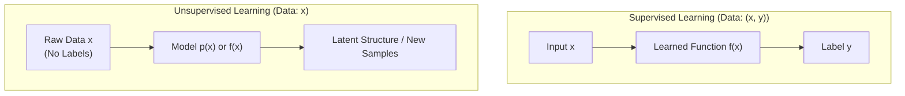
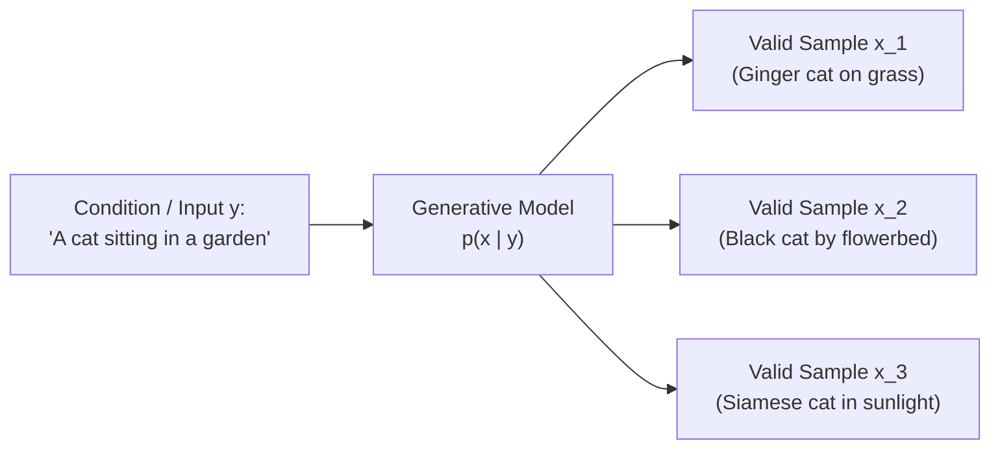
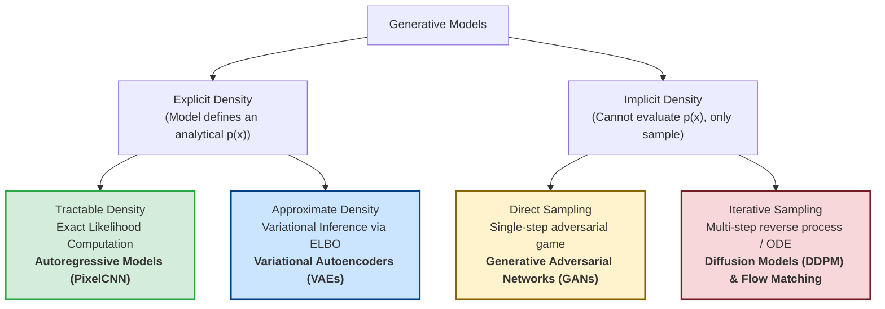
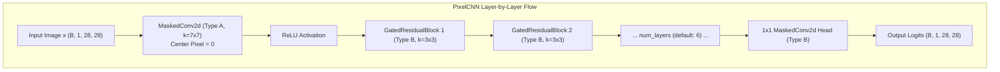
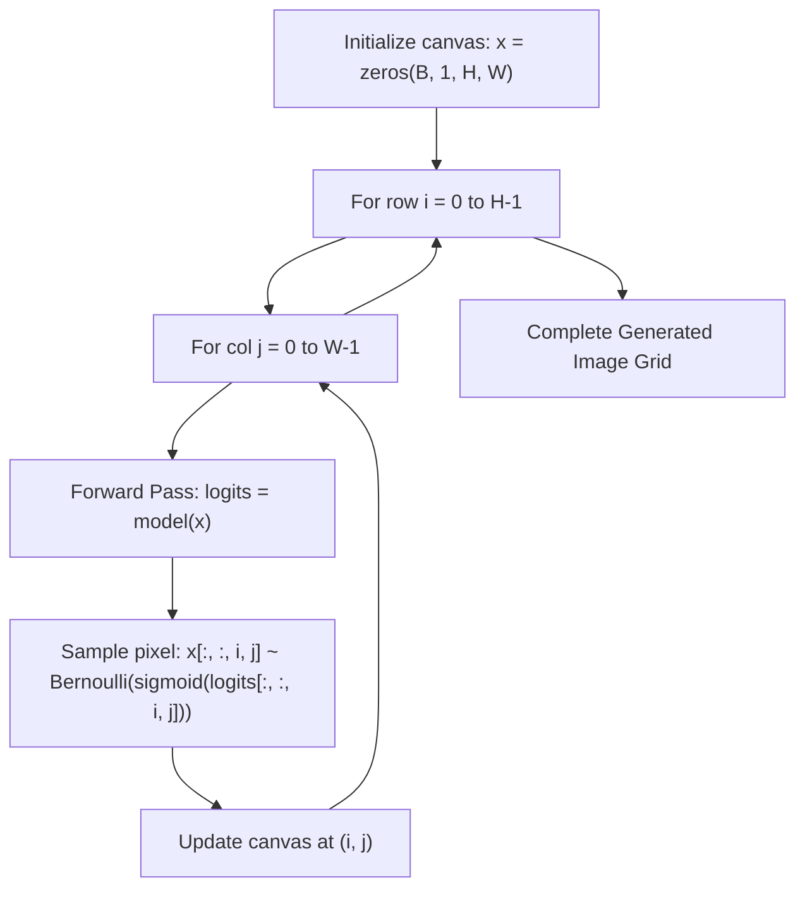

# Autoregressive Models: Masked Convolutions & PixelCNN

---

## 1. Core Concept & Problem Formulation

### 1.1 Supervised vs. Unsupervised Learning

In traditional machine learning and computer vision (see [Goodfellow, Bengio, & Courville, *Deep Learning*, MIT Press 2016](https://www.deeplearningbook.org/contents/ml.html)), learning algorithms are broadly divided based on the structure of the training dataset:



- **Supervised Learning:**
  - **Data:** Input-target pairs $(x, y)$, where $x$ represents input features (e.g., an image) and $y$ represents a ground-truth supervisory label.
  - **Objective:** Learn a mapping function $f: \mathcal{X} \to \mathcal{Y}$ such that $f(x) \approx y$.
  - **Examples:** Image classification ($x \to \text{class}$), object detection ($x \to \text{bounding boxes}$), semantic segmentation ($x \to \text{pixel masks}$).
- **Unsupervised Learning:**
  - **Data:** Unlabeled samples $x \in \mathcal{X}$ drawn from an underlying data distribution.
  - **Objective:** Discover hidden patterns, underlying manifold geometry, or probability distributions governing the data without external human supervision (see [Bengio, Courville, & Vincent, IEEE TPAMI 2013](https://arxiv.org/abs/1206.5538)).
  - **Classical Examples:** Clustering ($k$-means), dimensionality reduction (PCA, t-SNE, UMAP), and density estimation.
  - **Generative Machine Learning:** Learning to model the complete data distribution $p(x)$ and synthesize novel, high-dimensional observations indistinguishable from real data.

---

### 1.2 Modeling Ambiguity & One-to-Many Mappings

Standard predictive models are well-suited for **many-to-one** tasks (e.g., thousands of slightly different dog images all map to the single discrete label `"dog"`). However, real-world intelligent systems frequently face **one-to-many** problems where a single input or condition can have countless valid, high-dimensional outcomes:



Key motivations for generative modeling include:

1. **Handling Multimodal Ambiguity:** When multiple valid solutions exist, deterministic regression to the mean produces blurry, washed-out artifacts (e.g., averaging all possible valid futures creates an impossible ghost image, as analyzed by [Mathieu, Couprie, & LeCun, ICLR 2016](https://arxiv.org/abs/1511.05440)). A generative model samples specific, sharp trajectories from the learned distribution $p(x \mid y)$.
2. **Language Modeling:** Given a prompt $y$, produce coherent output text $x$ token by token:

$$
\text{"Write a short poem about generative models"} \implies x \sim p(x \mid y)
$$

3. **Text-to-Image Synthesis:** Given a natural language caption $y$, generate a high-fidelity image $x$ (e.g., [Ramesh et al., DALL-E, ICML 2021](https://arxiv.org/abs/2102.12092)):

$$
\text{"A person teaching a class in front of a whiteboard"} \implies x \sim p(x \mid y)
$$

4. **Video Prediction & Action Modeling:** Given past video frames $y$, predict physically plausible future frames $x$. Because the future is non-deterministic, the model must capture multimodal distributions over possible actions and physical interactions.

---

### 1.3 Predictive / Discriminative vs. Generative Formulations

To understand generative models deeply, we contrast how they formulate probability distributions compared to standard predictive (discriminative) classifiers (see [Ng & Jordan, NeurIPS 2001](https://proceedings.neurips.cc/paper/2001/file/7b7a53e239400a13bd6be6c0b2400aec-Paper.pdf)).

#### 1. Discriminative Models: $p(y \mid x)$
- **Goal:** Learn the conditional probability distribution of a low-dimensional target label $y$ given a high-dimensional observation $x$.
- **Normalization Constraint:** For any fixed input image $x$, candidate classes compete for probability:

$$
\sum_{y \in \mathcal{Y}} p(y \mid x) = 1
$$

- **Outlier Vulnerability:** If passed an out-of-distribution input (e.g., pure abstract noise into a Cat vs. Dog classifier), a discriminative classifier *cannot reject it*. Because the probabilities must sum to 1, it will arbitrarily output high confidence (e.g., 70% Cat, 30% Dog).

#### 2. Unconditional Generative Models: $p(x)$
- **Goal:** Learn the joint probability density over the entire high-dimensional input space $\mathcal{X}$.
- **Normalization Constraint:** All candidate images in the universe compete for total probability mass:

$$
\int_{\mathcal{X}} p(x) \, dx = 1
$$

- **Outlier Rejection:** Because the model evaluates the density of the input itself, abstract noise or anomalous inputs naturally yield $p(x) \approx 0$, enabling robust out-of-distribution detection.

#### 3. Summary Comparison

| Dimension | Discriminative / Predictive ($p(y \mid x)$) | Generative ($p(x)$ or $p(x \mid y)$) |
| :--- | :--- | :--- |
| **Probability Target** | Probability of label given data | Probability of data instance (or data given condition) |
| **Normalizing Space** | $\sum_{y \in \mathcal{Y}} p(y \mid x) = 1$ (over labels) | $\int_{\mathcal{X}} p(x) \, dx = 1$ (over data space) |
| **Competition** | Labels compete for probability on one image | All possible images compete for total probability mass |
| **Outlier Handling** | Cannot reject outliers (forces distribution on labels) | Rejects outliers naturally ($p(x) \approx 0$) |
| **Primary Capabilities** | Categorization, bounding box regression, ranking | Data synthesis, inpainting, unprompted creative generation |
| **Difficulty** | Relatively easy (maps high-D to low-D) | Highly complex (models high-D joint distributions) |

---

### 1.4 Master Taxonomy of Generative Models

Generative models are classified based on how they treat the probability density function $p(x)$ (adapted from [Goodfellow, NIPS 2016 Tutorial](https://arxiv.org/abs/1701.00160)):



1. **Explicit Density Models:** Specify a mathematical probability density function $p_\theta(x)$:
   - **Tractable Density (Autoregressive Models):** Decompose $p(x)$ via the chain rule. The exact likelihood can be evaluated directly in closed form without approximations.
   - **Approximate Density (VAEs):** Marginalizing unobserved latent variables $p(x) = \int p(x \mid z) p(z) dz$ is intractable; models optimize the Evidence Lower Bound (ELBO).
2. **Implicit Density Models:** Avoid explicit density functions; instead, define a stochastic sampling procedure $x = G(z)$ where $z \sim \mathcal{N}(0, I)$:
   - **Direct Sampling (GANs):** A generator converts noise into data in a single step via an adversarial zero-sum game.
   - **Iterative Sampling (Diffusion & Flow Matching):** Iteratively denoise or integrate along an ordinary differential equation (ODE) trajectory across multiple steps.

---

## 2. Mathematical Foundation & Objective Derivation

### 2.1 The Chain Rule of Probability & Exact Factorization

Let an observed data sample $x$ (an audio waveform, text sequence, or 2D image) be represented as an ordered sequence of $T$ sub-elements:

$$
x = (x_1, x_2, x_3, \dots, x_T)
$$

By the **Chain Rule of Probability**, any joint probability distribution factors exactly into a product of conditional distributions without making any independence assumptions:

$$
p(x) = p(x_1) \cdot p(x_2 \mid x_1) \cdot p(x_3 \mid x_1, x_2) \cdots p(x_T \mid x_1, \dots, x_{T-1})
$$

More compactly:

$$
p(x) = \prod_{t=1}^T p(x_t \mid x_{<t})
$$

where $x_{<t} = (x_1, x_2, \dots, x_{t-1})$ denotes the sequence history preceding step $t$.

Taking the logarithm yields the exact log-likelihood:

$$
\log p(x) = \sum_{t=1}^T \log p(x_t \mid x_{<t})
$$

---

### 2.2 Exact Maximum Likelihood Estimation

Autoregressive models are the gold standard for **exact maximum likelihood** because:
1. **No Approximations:** The chain rule is an algebraic identity, not a variational bound or Markov approximation.
2. **No Latent Variables:** Every component $x_1, \dots, x_T$ is directly observed in the training data; there are no hidden variables $z$ requiring integration or inference networks.
3. **Directly Computable Loss:** Given an empirical dataset $\mathcal{D} = \{x^{(1)}, \dots, x^{(N)}\}$, the optimal parameters $\theta^*$ are obtained by minimizing the Negative Log-Likelihood (NLL):

$$
\mathcal{L}_{\text{NLL}}(\theta) = - \frac{1}{N} \sum_{i=1}^N \sum_{t=1}^T \log p_\theta(x_t^{(i)} \mid x_{<t}^{(i)})
$$

For discrete pixels or vocabulary tokens, this is evaluated exactly via standard **Cross-Entropy Loss**.

---

### 2.3 2D Spatial Autoregression via Raster Scanline Order

For a 2D image of dimension $H \times W$, applying autoregression requires flattening the spatial lattice into an ordered 1D sequence using **scanline raster order** (row by row, left to right):

$$
(1, 1) \to (1, 2) \to \dots \to (1, W) \to (2, 1) \to \dots \to (H, W)
$$

Pixel $(i, j)$ may depend on all pixels above it, and all pixels to its left on the current row:

$$
x_{< (i, j)} = \{ x_{r, c} \mid r < i \text{ or } (r = i \text{ and } c < j) \}
$$

---

## 3. Architecture & Code Walkthrough (`01_autoregressive_pixelcnn.py`)

In [`01_autoregressive_pixelcnn.py`](file:///Users/mghifary/Documents/ITB/IF5152/generative-models/01_autoregressive_pixelcnn.py), this causal raster dependency is implemented using convolutional neural networks via **Masked Convolutions** ([van den Oord et al., PixelCNN, 2016](https://arxiv.org/abs/1601.06759)).



---

### 3.1 Causal Masked Convolutions: `MaskedConv2d`

A standard 2D convolution kernel $W \in \mathbb{R}^{C_{\text{out}} \times C_{\text{in}} \times k \times k}$ examines all neighboring pixels symmetrically, violating autoregressive causality. To enforce causality, the kernel is multiplied element-wise by a binary mask $M$:

$$
W_{\text{causal}} = W \odot M
$$

where the kernel center is at $(c_h, c_w) = (\lfloor k/2 \rfloor, \lfloor k/2 \rfloor)$:

$$
M_{i, j} = \begin{cases} 
1 & \text{if } i < c_h \\
1 & \text{if } i = c_h \text{ and } j < c_w \\
1 & \text{if } i = c_h \text{ and } j = c_w \quad (\textbf{Type B only}) \\
0 & \text{otherwise}
\end{cases}
$$

```
Mask Type A (Center = 0)            Mask Type B (Center = 1)
Used in First Input Layer          Used in Hidden Residual Blocks
       1   1   1                              1   1   1
       1  [0]  0                              1  [1]  0
       0   0   0                              0   0   0
```

- **Mask Type A (Input Layer):** The center pixel is zeroed out ($M_{c_h, c_w} = 0$). This ensures the network's prediction for pixel $x_{(i, j)}$ cannot access the ground truth value of $x_{(i, j)}$, preventing a trivial identity mapping.
- **Mask Type B (Hidden Layers):** The center pixel is included ($M_{c_h, c_w} = 1$). Because the input layer has already excluded the current pixel, subsequent layers can build upon the causal representations extracted at this position.

#### Implementation in PyTorch:
From [`01_autoregressive_pixelcnn.py`](file:///Users/mghifary/Documents/ITB/IF5152/generative-models/01_autoregressive_pixelcnn.py#L23-L54):

```python
class MaskedConv2d(nn.Conv2d):
    def __init__(self, mask_type: str, *args, **kwargs):
        super().__init__(*args, **kwargs)
        assert mask_type in ["A", "B"]
        self.register_buffer("mask", torch.ones_like(self.weight))
        _, _, kh, kw = self.weight.shape
        center_h, center_w = kh // 2, kw // 2

        # Zero out future rows
        self.mask[:, :, center_h + 1 :, :] = 0
        # Zero out future columns on the current row
        self.mask[:, :, center_h, center_w + 1 :] = 0

        # Type A mask also zeroes out the center pixel
        if mask_type == "A":
            self.mask[:, :, center_h, center_w] = 0

    def forward(self, x: torch.Tensor) -> torch.Tensor:
        self.weight.data *= self.mask
        return super().forward(x)
```

---

### 3.2 Gated Residual Blocks: `GatedResidualBlock`

To avoid gradient vanishing across deep masked stacks and model multiplicative feature interactions, PixelCNN utilizes gated activation units ([van den Oord et al., 2016](https://arxiv.org/abs/1606.05328)):

$$
y = x + \tanh(W_{f} * x) \odot \sigma(W_{g} * x)
$$

where $*$ is a causal masked convolution (Type B), $\tanh$ produces feature values, and $\sigma$ (sigmoid) acts as an information gate.

From [`01_autoregressive_pixelcnn.py`](file:///Users/mghifary/Documents/ITB/IF5152/generative-models/01_autoregressive_pixelcnn.py#L55-L69):

```python
class GatedResidualBlock(nn.Module):
    def __init__(self, channels: int):
        super().__init__()
        # Output 2*channels to split into value and gate branches
        self.conv = MaskedConv2d("B", channels, 2 * channels, kernel_size=3, padding=1)

    def forward(self, x: torch.Tensor) -> torch.Tensor:
        h = self.conv(x)
        val, gate = torch.chunk(h, 2, dim=1)
        out = torch.tanh(val) * torch.sigmoid(gate)
        return x + out
```

---

### 3.3 Complete Network: `PixelCNN`

From [`01_autoregressive_pixelcnn.py`](file:///Users/mghifary/Documents/ITB/IF5152/generative-models/01_autoregressive_pixelcnn.py#L71-L101):
1. **Entry Layer:** `MaskedConv2d("A", in_channels, hidden_channels, kernel_size=7, padding=3)` with `ReLU`.
2. **Hidden Stack:** `num_layers` of `GatedResidualBlock(hidden_channels)`.
3. **Output Head:** $1 \times 1$ Type B masked convolutions mapping hidden channels to pixel Bernoulli logits (`BCEWithLogitsLoss`).

---

## 4. Training Dynamics & Sampling Algorithms

### 4.1 Training: Fast Parallel Processing via Teacher Forcing

During training, the ground truth image $x$ is fully observed. Because causal masks prevent future information from leaking into past predictions, the entire image can be passed through the network in **a single forward pass**:

```
Training Step (Parallel Forward Pass):
Input: Full Ground Truth Image (28 x 28)
Pass:  All 784 pixel conditional distributions computed simultaneously
Loss:  BCEWithLogitsLoss(predicted_logits, ground_truth_pixels)
```

This training efficiency contrasts sharply with autoregressive generation.

---

### 4.2 Inference: The $O(H \times W)$ Sampling Latency Bottleneck

During sampling, no ground-truth pixels exist. Pixel $(i, j)$ cannot be predicted until all preceding pixels $(1, 1), \dots, (i, j-1)$ have been sampled:



From [`01_autoregressive_pixelcnn.py`](file:///Users/mghifary/Documents/ITB/IF5152/generative-models/01_autoregressive_pixelcnn.py#L104-L132):

```python
@torch.no_grad()
def sample_pixelcnn(model, device, num_samples=64, img_shape=(1, 28, 28)):
    model.eval()
    samples = torch.zeros((num_samples, *img_shape), device=device)
    _, h, w = img_shape

    for i in range(h):
        for j in range(w):
            logits = model(samples)
            probs = torch.sigmoid(logits[:, :, i, j])
            sampled_pixel = torch.bernoulli(probs)
            samples[:, :, i, j] = sampled_pixel

    return samples
```

For MNIST ($28 \times 28$), this requires $784$ sequential forward passes. For a $1024 \times 1024 \times 3$ image, it would require over $3{,}000{,}000$ sequential evaluations, explaining why pixel-level autoregression has been superseded by discrete latent token modeling in modern architectures (e.g., VQ-VAE and DALL-E).

---

### 4.3 Summary Matrix: Advantages vs. Trade-offs

| Criterion | Status | Technical Details |
| :--- | :---: | :--- |
| **Exact Density Evaluation** |  | Computes exact log-likelihood without variational approximations or lower bounds. |
| **Training Speed** |  | Fully parallelized across all spatial coordinates via Teacher Forcing. |
| **Sampling Latency** | ❌ | Inherently sequential: requires $O(H \times W)$ forward evaluations per image. |
| **Latent Representation** | ❌ | Vanilla PixelCNN has no latent code $z$; cannot perform latent interpolation or semantic editing. |

---

## 5. CLI Execution & Practical Usage

The implementation script [`01_autoregressive_pixelcnn.py`](file:///Users/mghifary/Documents/ITB/IF5152/generative-models/01_autoregressive_pixelcnn.py) supports training and sampling on MNIST and Fashion-MNIST:

### Basic Training Command
```bash
python IF5152/generative-models/01_autoregressive_pixelcnn.py \
    --dataset mnist \
    --epochs 10 \
    --batch-size 128 \
    --lr 0.001 \
    --hidden-channels 64 \
    --num-layers 6
```

### Fast Smoke Test (Single Batch Verification)
```bash
python IF5152/generative-models/01_autoregressive_pixelcnn.py --quick-test --epochs 1
```

### Command-Line Arguments Reference

| Argument | Type | Default | Description |
| :--- | :--- | :--- | :--- |
| `--dataset` | `str` | `mnist` | Target dataset: `mnist` or `fashion-mnist`. |
| `--epochs` | `int` | `10` | Number of training epochs. |
| `--batch-size` | `int` | `128` | Mini-batch size for DataLoader. |
| `--lr` | `float` | `0.001` | Adam optimizer learning rate. |
| `--hidden-channels` | `int` | `64` | Feature channels in masked residual layers. |
| `--num-layers` | `int` | `6` | Number of stacked `GatedResidualBlock` modules. |
| `--samples-dir` | `str` | `samples/` | Output directory for synthetic generated grids. |
| `--device` | `str` | `auto` | Execution device (`cuda`, `mps`, or `cpu`). |
| `--quick-test` | `flag` | `False` | Executes on a 1-batch synthetic slice for debugging. |

Generated samples are saved to `samples/pixelcnn_samples.png`.

---

## 📚 References & Canonical Literature

1. **PixelCNN Foundations:**
   - van den Oord, A., Kalchbrenner, N., & Kavukcuoglu, K. (2016). "Pixel Recurrent Neural Networks". *International Conference on Machine Learning (ICML 2016)*. [https://arxiv.org/abs/1601.06759](https://arxiv.org/abs/1601.06759)
   - van den Oord, A., Kalchbrenner, N., Vinyals, O., Espeholt, L., Graves, A., & Kavukcuoglu, K. (2016). "Conditional Image Generation with PixelCNN Decoders". *Advances in Neural Information Processing Systems (NeurIPS 2016)*. [https://arxiv.org/abs/1606.05328](https://arxiv.org/abs/1606.05328)

2. **Discriminative vs. Generative Classifiers:**
   - Ng, A. Y., & Jordan, M. I. (2001). "On Discriminative vs. Generative Classifiers: A comparison of logistic regression and naive Bayes". *Advances in Neural Information Processing Systems (NeurIPS 2001)*. [Paper PDF](https://proceedings.neurips.cc/paper/2001/file/7b7a53e239400a13bd6be6c0b2400aec-Paper.pdf)
   - Goodfellow, I. (2016). "NIPS 2016 Tutorial: Generative Adversarial Networks". *arXiv:1701.00160*. [https://arxiv.org/abs/1701.00160](https://arxiv.org/abs/1701.00160)

3. **Modern Two-Stage Discrete Token Modeling:**
   - van den Oord, A., Vinyals, O., & Kavukcuoglu, K. (2017). "Neural Discrete Representation Learning" (VQ-VAE). *Advances in Neural Information Processing Systems (NeurIPS 2017)*. [https://arxiv.org/abs/1711.00937](https://arxiv.org/abs/1711.00937)
   - Esser, P., Rombach, R., & Ommer, B. (2021). "Taming Transformers for High-Resolution Image Synthesis" (VQ-GAN). *IEEE/CVF CVPR 2021*. [https://arxiv.org/abs/2012.09841](https://arxiv.org/abs/2012.09841)
   - Ramesh, A., et al. (2021). "Zero-Shot Text-to-Image Generation" (DALL-E). *ICML 2021*. [https://arxiv.org/abs/2102.12092](https://arxiv.org/abs/2102.12092)
