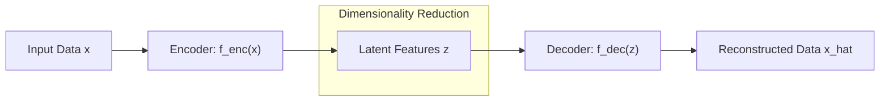

# IF5152 Lecture Notes: Autoencoders vs. Variational Autoencoders

---

## 1. Classical (Non-Variational) Autoencoders

A classical autoencoder is an unsupervised neural network designed to reconstruct its input through a low-dimensional bottleneck representation (originally popularized for deep architectures by [Hinton & Salakhutdinov, *Science* 2006](https://www.science.org/doi/10.1126/science.1127647); see also [Goodfellow, Bengio, & Courville, *Deep Learning*, Chapter 14: Autoencoders](https://www.deeplearningbook.org/contents/autoencoders.html)):



### Mathematical Objective
Given input $x \in \mathbb{R}^D$ and latent code $z \in \mathbb{R}^d$ with $d \ll D$:
$$z = f_\phi(x)$$
$$\hat{x} = g_\theta(z)$$

The network is trained deterministically by minimizing reconstruction error (e.g., L2 Mean Squared Error or Binary Cross-Entropy):
$$\mathcal{L}_{AE}(\phi, \theta) = \frac{1}{N} \sum_{i=1}^N \| x^{(i)} - g_\theta(f_\phi(x^{(i)})) \|_2^2$$

### Downstream Utility
Classical autoencoders are effective for:
- **Dimensionality reduction:** Non-linear generalization of Principal Component Analysis (PCA) ([Hinton & Salakhutdinov, 2006](https://www.science.org/doi/10.1126/science.1127647)).
- **Denoising:** Denoising Autoencoders (DAE) force the network to reconstruct clean inputs from corrupted versions, learning the vector field toward the data manifold ([Vincent et al., ICML 2008](https://dl.acm.org/doi/10.1145/1390156.1390294)).
- **Unsupervised representation learning:** Pretraining feature extractors for downstream classification heads ([Bengio, Courville, & Vincent, IEEE TPAMI 2013](https://arxiv.org/abs/1206.5538)).

---

## 2. Why Classical Autoencoders CANNOT Generate New Data

In Lecture 13 (slides 68–70), a fundamental question is posed:
> *"If we could generate new $z$, could we use the decoder to generate new images?"*  
> **Problem:** *Generating new $z$ is not any easier than generating new $x$.*

### The "Holes" in Deterministic Latent Space
1. **Unconstrained Geometry:** The loss function only penalizes reconstruction of points that exist in the empirical training dataset. There is no regularizer dictating where in $\mathbb{R}^d$ the latent codes should lie or what distribution they should follow.
2. **Discontinuity and Clustering:** The encoder maps data clusters to distant, isolated islands in the latent space. The regions between clusters correspond to unconstrained empty space ("holes").
3. **Nonsensical Decoding:** If a user samples a vector $z_{random} \sim \mathcal{N}(0, I)$, it is almost guaranteed to land in an empty void never visited during training. The decoder produces garbled, blurred, or completely unrecognizable artifacts.

```
Deterministic Latent Space:
   [Cluster 1: Digit '1']               (Empty Void: Garbled Output)
           * * *                                     ?
          *  z1 *                                  z_random
           * * *                                     ?
                                  [Cluster 2: Digit '7']
                                          # # #
                                         #  z2 #
                                          # # #
```

---

## 3. The Conceptual Leap: The Variational Autoencoder (VAE)

To turn an autoencoder into a true generative model, [Kingma & Welling (ICLR 2014)](https://arxiv.org/abs/1312.6114) and [Rezende, Mohamed, & Wierstra (ICML 2014)](https://arxiv.org/abs/1401.4082) introduced a probabilistic framework grounded in variational Bayesian inference:

| Aspect | Classical Autoencoder | Variational Autoencoder (VAE) |
| :--- | :--- | :--- |
| **Latent Representation** | Deterministic point: $z = f_\phi(x)$ | Probability distribution: $q_\phi(z \mid x) = \mathcal{N}(\mu, \Sigma)$ |
| **Sampling Mechanism** | Not possible (no known prior distribution) | Sample $z \sim \mathcal{N}(0, I)$, pass to decoder $p_\theta(x \mid z)$ |
| **Latent Space Geometry** | Unbounded, clustered, discontinuous | Smooth, compact, centered around origin via KL regularizer |
| **Interpolation** | Jerky, passes through nonsensical artifacts | Smooth semantic morphing between classes |
| **Mathematical Basis** | Deterministic regression | Variational Inference / Maximum Likelihood Lower Bound (ELBO) |

### The Core Solution
Instead of mapping $x$ to a single static vector $z$:
1. The encoder outputs the **mean $\mu$** and **covariance $\Sigma$** of a Gaussian distribution.
2. The network enforces that this distribution matches a simple, tractable prior:
   $$p(z) \sim \mathcal{N}(0, I)$$
3. Because the entire latent space is filled continuously, any random vector drawn from $\mathcal{N}(0, I)$ decodes into a coherent, realistic data sample.

---

## 4. Summary & Reading Guide

- **Next Note ([`03_variational_inference_elbo.md`](./03_variational_inference_elbo.md)):** Mathematical derivation of the Evidence Lower Bound (ELBO), closed-form Gaussian KL divergence, and the Reparameterization Trick.
- **Reference Code ([`02_vanilla_autoencoder.py`](../02_vanilla_autoencoder.py)):** Hands-on script demonstrating high-fidelity reconstruction vs. the failure mode of naive latent sampling.
- **Reference Code ([`03_variational_autoencoder.py`](../03_variational_autoencoder.py)):** Complete VAE implementation resolving the latent space discontinuity problem.

---

## 📚 References & Canonical Literature

1. **Autoencoders & Dimensionality Reduction:**
   - Hinton, G. E., & Salakhutdinov, R. R. (2006). "Reducing the Dimensionality of Data with Neural Networks". *Science*, 313(5786), 504–507. [https://www.science.org/doi/10.1126/science.1127647](https://www.science.org/doi/10.1126/science.1127647)
   - Goodfellow, I., Bengio, Y., & Courville, A. (2016). "Chapter 14: Autoencoders". In *Deep Learning*. MIT Press. [https://www.deeplearningbook.org/contents/autoencoders.html](https://www.deeplearningbook.org/contents/autoencoders.html)

2. **Denoising Autoencoders & Manifold Learning:**
   - Vincent, P., Larochelle, H., Bengio, Y., & Manzagol, P. A. (2008). "Extracting and Composing Robust Features with Denoising Autoencoders". *International Conference on Machine Learning (ICML 2008)*. [ACM Portal](https://dl.acm.org/doi/10.1145/1390156.1390294)
   - Bengio, Y., Courville, A., & Vincent, P. (2013). "Representation Learning: A Review and New Perspectives". *IEEE Transactions on Pattern Analysis and Machine Intelligence (TPAMI)*, 35(8), 1798–1828. [https://arxiv.org/abs/1206.5538](https://arxiv.org/abs/1206.5538)

3. **Foundational Variational Autoencoder Papers:**
   - Kingma, D. P., & Welling, M. (2014). "Auto-Encoding Variational Bayes". *International Conference on Learning Representations (ICLR 2014)*. [https://arxiv.org/abs/1312.6114](https://arxiv.org/abs/1312.6114)
   - Rezende, D. J., Mohamed, S., & Wierstra, D. (2014). "Stochastic Backpropagation and Approximate Inference in Deep Generative Models". *International Conference on Machine Learning (ICML 2014)*. [https://arxiv.org/abs/1401.4082](https://arxiv.org/abs/1401.4082)
