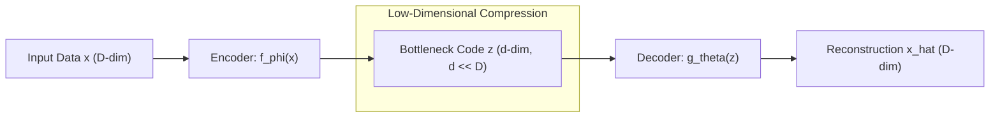

# Autoencoders vs. VAEs: The Generative Bottleneck & Latent Geometry

---

## 1. Core Concept & Problem Formulation

### 1.1 The Classical Autoencoder Principle

A classical autoencoder is an unsupervised neural network designed to reconstruct high-dimensional inputs through a low-dimensional bottleneck representation (originally formalized by [Hinton & Salakhutdinov, *Science* 2006](https://www.science.org/doi/10.1126/science.1127647); see also [Goodfellow, Bengio, & Courville, *Deep Learning*, Chapter 14: Autoencoders](https://www.deeplearningbook.org/contents/autoencoders.html)):



By constraining the latent dimension $d \ll D$, the network is forced to discard superficial pixel-level noise and learn salient coordinate axes of data variance—effectively acting as a non-linear generalization of Principal Component Analysis (PCA).

---

### 1.2 Downstream Utility of Classical Autoencoders

Deterministic autoencoders excel in several core unsupervised tasks:
- **Non-Linear Dimensionality Reduction:** Compressing high-dimensional observations into dense feature vectors for visualization or retrieval ([Hinton & Salakhutdinov, 2006](https://www.science.org/doi/10.1126/science.1127647)).
- **Denoising & Manifold Projection:** Denoising Autoencoders (DAE) corrupt inputs with noise $\tilde{x} \sim q(\tilde{x} \mid x)$ and train the network to reconstruct the clean input, learning an implicit score vector field pointing toward the data manifold ([Vincent et al., ICML 2008](https://dl.acm.org/doi/10.1145/1390156.1390294)).
- **Self-Supervised Pretraining:** Initializing backbone feature representations for downstream classifiers ([Bengio, Courville, & Vincent, IEEE TPAMI 2013](https://arxiv.org/abs/1206.5538)).

---

## 2. Mathematical Foundation & Objective Derivation

### 2.1 Deterministic Reconstruction Loss

Given an input observation $x \in \mathbb{R}^D$ and a latent coordinate vector $z \in \mathbb{R}^d$:

$$
z = f_\phi(x), \quad \hat{x} = g_\theta(z) = g_\theta(f_\phi(x))
$$

The autoencoder parameters $\{\phi, \theta\}$ are optimized deterministically by minimizing the Mean Squared Error (MSE) or Binary Cross-Entropy (BCE) reconstruction loss across $N$ training samples:

$$
\mathcal{L}_{\text{AE}}(\phi, \theta) = \frac{1}{N} \sum_{i=1}^N \| x^{(i)} - g_\theta(f_\phi(x^{(i)})) \|_2^2
$$

---

### 2.2 Why Classical Autoencoders CANNOT Generate New Data

Consider the fundamental question of generative synthesis:
> *"If we possess a trained decoder $g_\theta(z)$, can we generate new images by sampling novel latent vectors $z$?"*

**The Problem:** Generating a valid new $z$ without a probabilistic prior is just as difficult as generating a new image $x$ directly.

#### The "Holes" in Deterministic Latent Space:
1. **Unconstrained Latent Distribution:** The reconstruction loss only penalizes points present in the empirical training dataset $\mathcal{D}$. Nothing in the objective function forces the latent representations to follow a standard Gaussian distribution, be centered around the origin, or even be bounded.
2. **Discontinuity and Clustering:** The encoder maps distinct semantic classes to isolated islands in $\mathbb{R}^d$. The intermediate space between these islands corresponds to unvisited "holes" or voids.
3. **Nonsensical Decoding:** If a user samples an arbitrary vector $z_{\text{random}} \sim \mathcal{N}(0, I)$, it will almost certainly land in an unpopulated void. Because the decoder was never trained on coordinates in these voids, it outputs garbled, blurry, or unrecognizable artifacts.

```
Deterministic Latent Space:
   [Cluster 1: Digit '1']               (Empty Void: Garbled Artifacts)
           * * *                                     ?
          *  z1 *                                  z_random
           * * *                                     ?
                                  [Cluster 2: Digit '7']
                                          # # #
                                         #  z2 #
                                          # # #
```

---

### 2.3 The Variational Leap: From Points to Probability Distributions

To transform the autoencoder into a true generative model, [Kingma & Welling (ICLR 2014)](https://arxiv.org/abs/1312.6114) and [Rezende et al. (ICML 2014)](https://arxiv.org/abs/1401.4082) introduced the **Variational Autoencoder (VAE)**:

| Dimension | Classical Autoencoder | Variational Autoencoder (VAE) |
| :--- | :--- | :--- |
| **Latent Mapping** | Deterministic point: $z = f_\phi(x)$ | Probability distribution: $q_\phi(z \mid x) = \mathcal{N}(\mu, \Sigma)$ |
| **Sampling Mechanism** | ❌ Impossible (no regularized prior) | ✅ Sample $z \sim \mathcal{N}(0, I)$, evaluate decoder $p_\theta(x \mid z)$ |
| **Latent Space Geometry** | Fragmented, discontinuous, unconstrained | Smooth, dense, centered at origin via KL divergence regularizer |
| **Latent Interpolation** | Jerky; traverses nonsensical void regions | Smooth semantic morphing between classes |
| **Mathematical Basis** | Pure geometric regression | Variational Inference / Maximum Likelihood Lower Bound (ELBO) |

Instead of mapping $x$ to a single static vector $z$:
1. The encoder predicts the **mean $\mu(x)$** and **log-variance $\log \sigma^2(x)$** of a Gaussian distribution.
2. A Kullback-Leibler (KL) divergence penalty forces $q_\phi(z \mid x)$ to match a standard Gaussian prior $p(z) = \mathcal{N}(0, I)$.
3. Because the entire latent space is filled continuously, drawing any random vector from $\mathcal{N}(0, I)$ guarantees a coherent, realistic generation.

---

## 3. Architecture & Code Walkthrough (`02_vanilla_autoencoder.py`)

The script [`02_vanilla_autoencoder.py`](file:///Users/mghifary/Documents/ITB/IF5152/generative-models/02_vanilla_autoencoder.py) provides a clean convolutional implementation of the deterministic autoencoder and demonstrates this generative limitation empirically.

```mermaid
flowchart LR
    subgraph Encoder ["Encoder (Downsampling)"]
        In["Input (1, 28, 28)"] --> Conv1["Conv2d (1 -> 32, k=3, s=2, p=1)<br/>14 x 14"]
        Conv1 --> BN1["BatchNorm2d + ReLU"]
        BN1 --> Conv2["Conv2d (32 -> 64, k=3, s=2, p=1)<br/>7 x 7"]
        Conv2 --> BN2["BatchNorm2d + ReLU"]
        BN2 --> Flat["Flatten (64*7*7 = 3136)"]
        Flat --> FC_Enc["Linear(3136 -> latent_dim)"]
        FC_Enc --> Z["Latent Bottleneck z"]
    end
    
    subgraph Decoder ["Decoder (Upsampling)"]
        Z --> FC_Dec["Linear(latent_dim -> 3136)"]
        FC_Dec --> Reshape["Reshape (64, 7, 7)"]
        Reshape --> Deconv1["ConvTranspose2d (64 -> 32, k=3, s=2, p=1)<br/>14 x 14"]
        Deconv1 --> BN3["BatchNorm2d + ReLU"]
        BN3 --> Deconv2["ConvTranspose2d (32 -> 1, k=3, s=2, p=1)<br/>28 x 28"]
        Deconv2 --> Sigmoid["Sigmoid Activation"]
        Sigmoid --> Out["Reconstruction x_hat (1, 28, 28)"]
    end
```



---

### 3.1 Network Definition: `VanillaAutoencoder`

From [`02_vanilla_autoencoder.py`](file:///Users/mghifary/Documents/ITB/IF5152/generative-models/02_vanilla_autoencoder.py#L24-L65):

```python
class VanillaAutoencoder(nn.Module):
    def __init__(self, latent_dim: int = 16):
        super().__init__()
        self.latent_dim = latent_dim

        # Encoder: 1x28x28 -> latent_dim
        self.encoder = nn.Sequential(
            nn.Conv2d(1, 32, kernel_size=3, stride=2, padding=1),  # 14x14
            nn.BatchNorm2d(32),
            nn.ReLU(inplace=True),
            nn.Conv2d(32, 64, kernel_size=3, stride=2, padding=1),  # 7x7
            nn.BatchNorm2d(64),
            nn.ReLU(inplace=True),
            nn.Flatten(),
            nn.Linear(64 * 7 * 7, latent_dim),
        )

        # Decoder: latent_dim -> 1x28x28
        self.decoder_fc = nn.Linear(latent_dim, 64 * 7 * 7)
        self.decoder = nn.Sequential(
            nn.ConvTranspose2d(64, 32, kernel_size=3, stride=2, padding=1, output_padding=1),  # 14x14
            nn.BatchNorm2d(32),
            nn.ReLU(inplace=True),
            nn.ConvTranspose2d(32, 1, kernel_size=3, stride=2, padding=1, output_padding=1),   # 28x28
            nn.Sigmoid(),  # Bound pixels to [0, 1]
        )

    def encode(self, x: torch.Tensor) -> torch.Tensor:
        return self.encoder(x)

    def decode(self, z: torch.Tensor) -> torch.Tensor:
        h = self.decoder_fc(z).view(-1, 64, 7, 7)
        return self.decoder(h)

    def forward(self, x: torch.Tensor) -> torch.Tensor:
        z = self.encode(x)
        return self.decode(z)
```

---

## 4. Training Dynamics & The Latent Sampling Failure Mode

### 4.1 Training Loop: Minimizing Reconstruction Error

The model is trained via Adam optimizer on `nn.MSELoss()`. As training progresses, reconstruction MSE drops monotonically:
- High-fidelity preservation of character strokes and silhouettes.
- The top row (original inputs) and bottom row (reconstructions) in `samples/ae_reconstructions.png` show clear, sharp fidelity.

---

### 4.2 The Sampling Failure Mode

To demonstrate why this trained model is not a generative model, [`02_vanilla_autoencoder.py`](file:///Users/mghifary/Documents/ITB/IF5152/generative-models/02_vanilla_autoencoder.py#L125-L137) executes a naive latent sampling experiment:

```python
# Naive Latent Sampling Experiment:
random_z = torch.randn(32, args.latent_dim, device=device)
failed_samples = model.decode(random_z)
save_image_grid(failed_samples, filename="samples/ae_random_sampling_failure.png")
```

#### Outcome:
- While `ae_reconstructions.png` displays sharp reconstructions of known inputs, `ae_random_sampling_failure.png` displays blurry, meaningless shapes or empty canvases.
- **Root Cause:** In the absence of a prior penalty, the training points occupy a minuscule fraction of $\mathbb{R}^{16}$. Random sampling from $\mathcal{N}(0, I)$ lands in unexplored voids where the decoder has undefined behavior.

---

## 5. CLI Execution & Practical Usage

### Basic Execution Command
```bash
python IF5152/generative-models/02_vanilla_autoencoder.py \
    --dataset mnist \
    --epochs 5 \
    --batch-size 128 \
    --latent-dim 16 \
    --lr 0.001
```

### Fast Verification Run
```bash
python IF5152/generative-models/02_vanilla_autoencoder.py --quick-test --epochs 1
```

### Command-Line Arguments Reference

| Argument | Type | Default | Description |
| :--- | :--- | :--- | :--- |
| `--dataset` | `str` | `mnist` | Target dataset: `mnist` or `fashion`. |
| `--epochs` | `int` | `1` | Training epoch count. |
| `--batch-size` | `int` | `128` | Batch size. |
| `--latent-dim` | `int` | `16` | Dimension $d$ of the bottleneck latent representation. |
| `--lr` | `float` | `0.001` | Adam learning rate. |
| `--output-dir` | `str` | `samples/` | Directory where reconstruction and failure grids are saved. |
| `--device` | `str` | `auto` | Execution device (`cuda`, `mps`, or `cpu`). |
| `--quick-test` | `flag` | `False` | Run on a small data subset for pipeline testing. |

### Generated Artifacts
- `samples/ae_reconstructions.png`: Side-by-side comparison of original inputs vs. autoencoder reconstructions.
- `samples/ae_random_sampling_failure.png`: Empirical evidence of naive latent sampling failure.

---

## 📚 References & Canonical Literature

1. **Autoencoder Foundations & Dimensionality Reduction:**
   - Hinton, G. E., & Salakhutdinov, R. R. (2006). "Reducing the Dimensionality of Data with Neural Networks". *Science*, 313(5786), 504–507. [https://www.science.org/doi/10.1126/science.1127647](https://www.science.org/doi/10.1126/science.1127647)
   - Goodfellow, I., Bengio, Y., & Courville, A. (2016). "Chapter 14: Autoencoders". In *Deep Learning*. MIT Press. [https://www.deeplearningbook.org/contents/autoencoders.html](https://www.deeplearningbook.org/contents/autoencoders.html)

2. **Denoising Autoencoders & Manifold Learning:**
   - Vincent, P., Larochelle, H., Bengio, Y., & Manzagol, P. A. (2008). "Extracting and Composing Robust Features with Denoising Autoencoders". *International Conference on Machine Learning (ICML 2008)*. [ACM Portal](https://dl.acm.org/doi/10.1145/1390156.1390294)

3. **Transition to Variational Autoencoders:**
   - Kingma, D. P., & Welling, M. (2014). "Auto-Encoding Variational Bayes". *International Conference on Learning Representations (ICLR 2014)*. [https://arxiv.org/abs/1312.6114](https://arxiv.org/abs/1312.6114)
   - Rezende, D. J., Mohamed, S., & Wierstra, D. (2014). "Stochastic Backpropagation and Approximate Inference in Deep Generative Models". *International Conference on Machine Learning (ICML 2014)*. [https://arxiv.org/abs/1401.4082](https://arxiv.org/abs/1401.4082)
