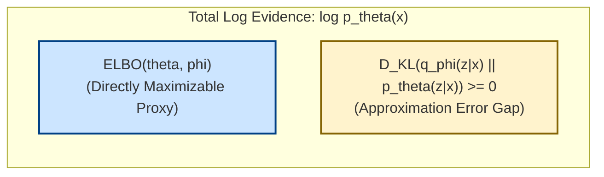
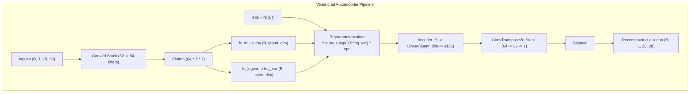

# Variational Autoencoders: Latent Inference & ELBO Derivation

---

## 1. Core Concept & Problem Formulation

### 1.1 The Manifold Hypothesis & Latent Variable Models

In computer vision and machine learning, observed high-dimensional data $x$ (such as an image of a handwritten digit with $28 \times 28 = 784$ pixels or a high-resolution face with $1024 \times 1024 \times 3$ color values) exhibits immense spatial correlation. Natural images are not scattered uniformly throughout pixel space; instead, they lie on or near a low-dimensional manifold embedded within ambient space (the **manifold hypothesis**, [Cayton, 2005](https://www.cs.ucsd.edu/~elkan/250Bwinter2006/cayton.pdf); [Bengio et al., IEEE TPAMI 2013](https://arxiv.org/abs/1206.5538)).


Real-world observations are generated by a relatively small set of underlying physical, geometric, and semantic causes:
- In handwritten digits: digit identity, stroke thickness, slant angle, and scale.
- In human faces: 3D head pose, lighting azimuth, facial expression, and skin tone.

Because these governing factors are **unobserved** in raw data collections, they are formalized mathematically as **latent variables** $z \in \mathbb{R}^d$, where typically $d \ll D$.

---

### 1.2 Generative Recipe: From Simple Prior to Complex Reality

Latent Variable Models (LVMs) decouple generative modeling into two modular components:
1. **The Latent Prior $p(z)$:** A simple, tractable probability distribution over latent causes, standardly chosen as an isotropic multivariate Gaussian:

$$
z \sim p(z) = \mathcal{N}(0, I_d)
$$

2. **The Conditional Decoder $p_\theta(x \mid z)$:** A non-linear mapping parameterized by deep neural network weights $\theta$:

$$
x \sim p_\theta(x \mid z)
$$

   - For continuous real-valued data: $p_\theta(x \mid z) = \mathcal{N}(\mu_\theta(z), \sigma^2 I)$.
   - For normalized pixel values in $[0, 1]$: $p_\theta(x \mid z) = \text{Bernoulli}(p = f_\theta(z))$.

By passing simple Gaussian noise $z$ through a deep neural network, the model transforms the unimodal prior into an expressive, multimodal distribution over high-dimensional observations $x$.

---

### 1.3 The Marginal Likelihood Intractability Bottleneck

The joint probability of an LVM is defined as:

$$
p_\theta(x, z) = p_\theta(x \mid z) p(z)
$$

To train $\theta$ by Maximum Likelihood Estimation, we must compute the marginal log-likelihood (evidence) $\log p_\theta(x)$:

$$
p_\theta(x) = \int_{\mathcal{Z}} p_\theta(x, z) \, dz = \int_{\mathcal{Z}} p_\theta(x \mid z) p(z) \, dz
$$

#### Why Direct Integration Fails:
- **Intractable Integral:** In modern neural decoders, $p_\theta(x \mid z)$ is non-linear. The integral over continuous $\mathbb{R}^d$ has no analytical closed-form solution.
- **Monte Carlo Failure in High Dimensions:** Approximating the integral via naive Monte Carlo sampling $p_\theta(x) \approx \frac{1}{S} \sum_{s=1}^S p_\theta(x \mid z^{(s)})$ with $z^{(s)} \sim \mathcal{N}(0, I)$ fails completely. For any given image $x$, only an infinitesimally tiny sub-region of latent space $\mathcal{Z}$ will decode to an image resembling $x$. Almost all random samples yield $p_\theta(x \mid z^{(s)}) \approx 0$, causing astronomical variance.
- **Intractable Posterior:** Applying Bayes' rule to compute the true posterior:

$$
p_\theta(z \mid x) = \frac{p_\theta(x \mid z) p(z)}{p_\theta(x)}
$$

requires the exact marginal $p_\theta(x)$ in the denominator, which is what we cannot calculate.

---

## 2. Mathematical Foundation & Step-by-Step ELBO Derivation

### 2.1 Amortized Variational Inference

To bypass this intractability, [Kingma & Welling (ICLR 2014)](https://arxiv.org/abs/1312.6114) and [Rezende et al. (ICML 2014)](https://arxiv.org/abs/1401.4082) introduced **Amortized Variational Inference**:
- Rather than optimizing individual variational parameters for every training datapoint, we train a single recognition neural network—the **encoder** $q_\phi(z \mid x)$ parameterized by shared weights $\phi$.
- Given any input sample $x$, the encoder outputs the mean $\mu_\phi(x)$ and diagonal covariance $\sigma_\phi^2(x)$ in a single forward pass:

$$
q_\phi(z \mid x) = \mathcal{N}\left( z; \mu_\phi(x), \text{diag}(\sigma_\phi^2(x)) \right)
$$

---

### 2.2 Algebraic Derivation of the Evidence Lower Bound (ELBO)

We derive the Evidence Lower Bound directly from Bayes' rule and Jensen's inequality:

#### Step 1: Express Evidence via Conditional Probability
By definition:

$$
p_\theta(z \mid x) = \frac{p_\theta(x \mid z) p(z)}{p_\theta(x)} \implies p_\theta(x) = \frac{p_\theta(x \mid z) p(z)}{p_\theta(z \mid x)}
$$

Taking the natural logarithm:

$$
\log p_\theta(x) = \log \left( \frac{p_\theta(x \mid z) p(z)}{p_\theta(z \mid x)} \right)
$$

#### Step 2: Multiply and Divide by the Variational Posterior $q_\phi(z \mid x)$

$$
\log p_\theta(x) = \log \left( \frac{p_\theta(x \mid z) p(z) \cdot q_\phi(z \mid x)}{p_\theta(z \mid x) \cdot q_\phi(z \mid x)} \right)
$$

#### Step 3: Decompose the Logarithm into Additive Terms

$$
\log p_\theta(x) = \log p_\theta(x \mid z) - \log \left( \frac{q_\phi(z \mid x)}{p(z)} \right) + \log \left( \frac{q_\phi(z \mid x)}{p_\theta(z \mid x)} \right)
$$

#### Step 4: Take Expectation over $z \sim q_\phi(z \mid x)$
Because $\log p_\theta(x)$ has no mathematical dependence on $z$, taking its expectation over $z \sim q_\phi(z \mid x)$ leaves it unchanged:

$$
\log p_\theta(x) = \mathbb{E}_{z \sim q_\phi(z \mid x)} \left[ \log p_\theta(x \mid z) \right] - \mathbb{E}_{z \sim q_\phi(z \mid x)} \left[ \log \frac{q_\phi(z \mid x)}{p(z)} \right] + \mathbb{E}_{z \sim q_\phi(z \mid x)} \left[ \log \frac{q_\phi(z \mid x)}{p_\theta(z \mid x)} \right]
$$

#### Step 5: Express in Terms of Kullback-Leibler (KL) Divergences
Using the definition of KL divergence $D_{\text{KL}}(q(u) \parallel p(u)) \triangleq \mathbb{E}_{u \sim q} \left[ \log \frac{q(u)}{p(u)} \right]$:

$$
\log p_\theta(x) = \underbrace{\mathbb{E}_{z \sim q_\phi(z \mid x)} [\log p_\theta(x \mid z)]}_{\text{1. Reconstruction Likelihood}} - \underbrace{D_{\text{KL}}(q_\phi(z \mid x) \parallel p(z))}_{\text{2. Prior Matching Regularizer}} + \underbrace{D_{\text{KL}}(q_\phi(z \mid x) \parallel p_\theta(z \mid x))}_{\text{3. Posterior Approximation Gap}}
$$

#### Step 6: The Evidence Lower Bound
Because the KL divergence between any two distributions is non-negative ($D_{\text{KL}}(q \parallel p) \ge 0$), dropping the third term yields the **Evidence Lower Bound (ELBO)**:

$$
\log p_\theta(x) \ge \text{ELBO}(\theta, \phi; x) \triangleq \mathbb{E}_{z \sim q_\phi(z \mid x)} [\log p_\theta(x \mid z)] - D_{\text{KL}}(q_\phi(z \mid x) \parallel p(z))
$$



When optimizing $\text{ELBO}(\theta, \phi)$ with gradient ascent:
1. **With respect to decoder $\theta$:** Directly pushes up data likelihood $p_\theta(x)$.
2. **With respect to encoder $\phi$:** For a fixed $\theta$, the total evidence $\log p_\theta(x)$ is constant. Therefore, increasing the lower bound forces the gap $D_{\text{KL}}(q_\phi(z \mid x) \parallel p_\theta(z \mid x))$ to shrink toward zero, tightening the variational posterior to the true posterior.

---

### 2.3 Closed-Form Gaussian KL Divergence

When the prior is standard normal $p(z) = \mathcal{N}(0, I_d)$ and the variational encoder outputs diagonal parameters $q_\phi(z \mid x) = \mathcal{N}(\mu, \text{diag}(\sigma^2))$, the KL divergence integrates analytically in closed form ([Kingma & Welling, 2014](https://arxiv.org/abs/1312.6114)):

$$
D_{\text{KL}}(q_\phi(z \mid x) \parallel p(z)) = \int q_\phi(z \mid x) \log \frac{q_\phi(z \mid x)}{p(z)} \, dz
$$

Expanding the ratio of Gaussian densities:

$$
\log \frac{q_\phi(z \mid x)}{p(z)} = -\frac{1}{2} \sum_{j=1}^d \left( \log(2\pi \sigma_j^2) + \frac{(z_j - \mu_j)^2}{\sigma_j^2} \right) + \frac{1}{2} \sum_{j=1}^d \left( \log(2\pi) + z_j^2 \right)
$$

Taking expectations using $\mathbb{E}[z_j] = \mu_j$ and $\mathbb{E}[z_j^2] = \mu_j^2 + \sigma_j^2$:

$$
D_{\text{KL}}(\mathcal{N}(\mu, \text{diag}(\sigma^2)) \parallel \mathcal{N}(0, I)) = -\frac{1}{2} \sum_{j=1}^d \left( 1 + \log(\sigma_j^2) - \mu_j^2 - \sigma_j^2 \right)
$$

This analytical form entirely avoids Monte Carlo sampling variance for the prior regularization term.

---

### 2.4 The Reparameterization Trick

In a naive stochastic computation graph:

$$
x \xrightarrow{\text{Encoder}} (\mu, \sigma) \xrightarrow{\text{Sample } z \sim \mathcal{N}(\mu, \sigma^2)} z \xrightarrow{\text{Decoder}} \hat{x}
$$

Drawing a random sample $z$ inside the forward pass is a non-differentiable operation: standard backpropagation cannot pass gradients through an active random number generator ($\frac{\partial z}{\partial \mu}$ and $\frac{\partial z}{\partial \sigma}$ are undefined).

#### The Solution: Isolate Stochasticity into Auxiliary Noise
Express $z$ as a deterministic, differentiable function of the network parameters and an external, parameter-free Gaussian noise source $\epsilon \sim \mathcal{N}(0, I)$:

$$
z = g_\phi(x, \epsilon) \triangleq \mu(x) + \sigma(x) \odot \epsilon \quad \text{where } \epsilon \sim \mathcal{N}(0, I)
$$

```
     Deterministic Paths                  Stochastic Node
      x ---> [Encoder] ---> mu(x) --------> (+) ----> z ---> [Decoder] ---> x_hat
                       ---> sigma(x) ---> (*) |
                                           ^
                                           |
                                   eps ~ N(0, I)
```

Now, all stochasticity is isolated into $\epsilon$, which has no dependence on model parameters $\phi$ or $\theta$. Gradients flow cleanly to $\mu$ and $\sigma$ via standard multivariate calculus:

$$
\frac{\partial z}{\partial \mu} = 1, \qquad \frac{\partial z}{\partial \sigma} = \epsilon
$$

---

## 3. Architecture & Code Walkthrough (`03_variational_autoencoder.py`)

The script [`03_variational_autoencoder.py`](file:///Users/mghifary/Documents/ITB/IF5152/generative-models/03_variational_autoencoder.py) implements the complete convolutional VAE pipeline.



---

### 3.1 Network Class: `VAE`

From [`03_variational_autoencoder.py`](file:///Users/mghifary/Documents/ITB/IF5152/generative-models/03_variational_autoencoder.py#L26-L84):

```python
class VAE(nn.Module):
    def __init__(self, latent_dim: int = 20):
        super().__init__()
        self.latent_dim = latent_dim

        # Encoder: x -> (mu, log_var)
        self.encoder_conv = nn.Sequential(
            nn.Conv2d(1, 32, kernel_size=3, stride=2, padding=1),  # 14x14
            nn.BatchNorm2d(32),
            nn.ReLU(inplace=True),
            nn.Conv2d(32, 64, kernel_size=3, stride=2, padding=1),  # 7x7
            nn.BatchNorm2d(64),
            nn.ReLU(inplace=True),
            nn.Flatten(),
        )
        self.fc_mu = nn.Linear(64 * 7 * 7, latent_dim)
        self.fc_logvar = nn.Linear(64 * 7 * 7, latent_dim)

        # Decoder: z -> x_recon
        self.decoder_fc = nn.Linear(latent_dim, 64 * 7 * 7)
        self.decoder_conv = nn.Sequential(
            nn.ConvTranspose2d(64, 32, kernel_size=3, stride=2, padding=1, output_padding=1),  # 14x14
            nn.BatchNorm2d(32),
            nn.ReLU(inplace=True),
            nn.ConvTranspose2d(32, 1, kernel_size=3, stride=2, padding=1, output_padding=1),   # 28x28
            nn.Sigmoid(),
        )

    def encode(self, x: torch.Tensor):
        h = self.encoder_conv(x)
        return self.fc_mu(h), self.fc_logvar(h)

    def reparameterize(self, mu: torch.Tensor, log_var: torch.Tensor) -> torch.Tensor:
        if self.training:
            std = torch.exp(0.5 * log_var)
            eps = torch.randn_like(std)
            return mu + eps * std
        return mu

    def decode(self, z: torch.Tensor) -> torch.Tensor:
        h = self.decoder_fc(z).view(-1, 64, 7, 7)
        return self.decoder_conv(h)

    def forward(self, x: torch.Tensor):
        mu, log_var = self.encode(x)
        z = self.reparameterize(mu, log_var)
        x_recon = self.decode(z)
        return x_recon, mu, log_var
```

---

### 3.2 Loss Function: `elbo_loss`

From [`03_variational_autoencoder.py`](file:///Users/mghifary/Documents/ITB/IF5152/generative-models/03_variational_autoencoder.py#L86-L99):

```python
def elbo_loss(x: torch.Tensor, x_recon: torch.Tensor, mu: torch.Tensor, log_var: torch.Tensor):
    # 1. Reconstruction Loss: Binary Cross-Entropy summed across pixels
    recon_loss = nn.functional.binary_cross_entropy(x_recon, x, reduction="sum")

    # 2. Closed-form KL Divergence for Gaussian prior
    kl_div = -0.5 * torch.sum(1 + log_var - mu.pow(2) - log_var.exp())

    # Total Negative ELBO (to be minimized)
    return (recon_loss + kl_div) / x.size(0), recon_loss / x.size(0), kl_div / x.size(0)
```

---

## 4. Training Dynamics & The Reconstruction vs. Prior Tug-of-War

### 4.1 Internal Loss Competition

During training, the two terms in the ELBO objective engage in an essential balance:

1. **Reconstruction Loss** ($\mathbb{E}_{q}[\log p_\theta(x \mid z)]$):
   - Pushes the variance $\sigma_j^2 \to 0$ and forces distinct means $\mu(x)$ for each distinct input image.
   - If unrestricted, the model collapses toward a deterministic autoencoder.
2. **Prior Matching Regularizer** ($- D_{\text{KL}}(q_\phi(z \mid x) \parallel p(z))$):
   - Pushes variance $\sigma_j^2 \to 1$ and mean $\mu_j \to 0$ for all inputs.
   - Prevents the encoder from clustering samples into disconnected islands, ensuring the latent space is continuous and free of unpopulated "voids".

### 4.2 Disentanglement & The $\beta$-VAE Framework

By scaling the KL regularizer with a hyperparameter $\beta > 1$ ([Higgins et al., ICLR 2017](https://openreview.net/forum?id=Sy2fzU9gl)):

$$
\mathcal{L}_{\beta\text{-VAE}} = \mathbb{E}_{q_\phi(z \mid x)} [\log p_\theta(x \mid z)] - \beta \cdot D_{\text{KL}}(q_\phi(z \mid x) \parallel p(z))
$$

one can encourage **disentangled representations**, where individual semantic attributes (stroke angle, digit width) align orthogonally with single coordinate axes of $z$.

---

### 4.3 2D Latent Manifold Traversal

When trained with `latent_dim = 2`, [`03_variational_autoencoder.py`](file:///Users/mghifary/Documents/ITB/IF5152/generative-models/03_variational_autoencoder.py#L141-L167) generates an interpolative 2D grid using the Gaussian percent point function (inverse CDF, `scipy.stats.norm.ppf`):

```python
grid_x = norm.ppf(np.linspace(0.05, 0.95, n))
grid_y = norm.ppf(np.linspace(0.05, 0.95, n))
```

This traversal produces `samples/vae_manifold_2d.png`, demonstrating smooth semantic morphing between digit classes without any garbled artifacts.

---

## 5. CLI Execution & Practical Usage

### Basic Training Command (MNIST)
```bash
python IF5152/generative-models/03_variational_autoencoder.py \
    --dataset mnist \
    --epochs 10 \
    --batch-size 128 \
    --latent-dim 20 \
    --lr 0.001
```

### 2D Latent Space Manifold Visualization
```bash
python IF5152/generative-models/03_variational_autoencoder.py \
    --dataset mnist \
    --latent-dim 2 \
    --epochs 15
```

### Command-Line Arguments Reference

| Argument | Type | Default | Description |
| :--- | :--- | :--- | :--- |
| `--dataset` | `str` | `mnist` | Target dataset (`mnist` or `fashion`). |
| `--epochs` | `int` | `10` | Number of training epochs. |
| `--batch-size` | `int` | `128` | Training mini-batch size. |
| `--latent-dim` | `int` | `20` | Dimension of latent vector $z$ (use `2` for 2D manifold plotting). |
| `--lr` | `float` | `0.001` | Adam learning rate. |
| `--output-dir` | `str` | `samples/` | Output directory for reconstructions and manifolds. |
| `--device` | `str` | `auto` | Target device (`cuda`, `mps`, or `cpu`). |
| `--quick-test` | `flag` | `False` | Run on a small batch subset for pipeline smoke testing. |

### Generated Artifacts
- `samples/vae_samples.png`: Direct generative samples drawn from the prior $z \sim \mathcal{N}(0, I_d)$.
- `samples/vae_manifold_2d.png`: 2D continuous latent manifold traversal grid.

---

## 📚 References & Canonical Literature

1. **Foundational Variational Autoencoders:**
   - Kingma, D. P., & Welling, M. (2014). "Auto-Encoding Variational Bayes". *International Conference on Learning Representations (ICLR 2014)*. [https://arxiv.org/abs/1312.6114](https://arxiv.org/abs/1312.6114)
   - Rezende, D. J., Mohamed, S., & Wierstra, D. (2014). "Stochastic Backpropagation and Approximate Inference in Deep Generative Models". *International Conference on Machine Learning (ICML 2014)*. [https://arxiv.org/abs/1401.4082](https://arxiv.org/abs/1401.4082)
   - Kingma, D. P., & Welling, M. (2019). "An Introduction to Variational Autoencoders". *Foundations and Trends in Machine Learning*, 12(4), 307–392. [https://arxiv.org/abs/1906.02691](https://arxiv.org/abs/1906.02691)

2. **Variational Inference Principles:**
   - Blei, D. M., Kucukelbir, A., & McAuliffe, J. D. (2017). "Variational Inference: A Review for Statisticians". *Journal of the American Statistical Association (JASA)*, 112(518), 859–877. [https://arxiv.org/abs/1601.00670](https://arxiv.org/abs/1601.00670)

3. **Disentangled Representation Learning ($\beta$-VAE):**
   - Higgins, I., Matthey, L., Pal, A., Burgess, C., Glorot, X., Botvinick, M., Mohamed, S., & Lerchner, A. (2017). "$\beta$-VAE: Learning Basic Visual Concepts with a Constrained Variational Framework". *ICLR 2017*. [OpenReview Link](https://openreview.net/forum?id=Sy2fzU9gl)
   - Burgess, C. P., et al. (2018). "Understanding Computing Disentanglement in $\beta$-VAE". *arXiv:1804.03599*. [https://arxiv.org/abs/1804.03599](https://arxiv.org/abs/1804.03599)
