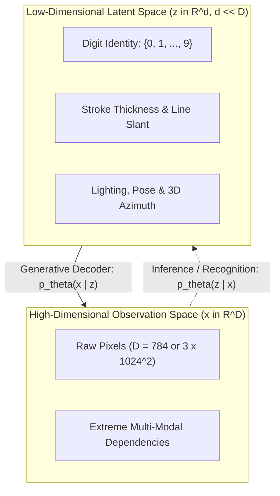
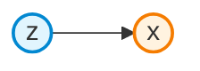
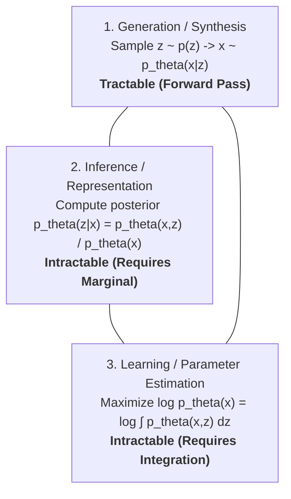
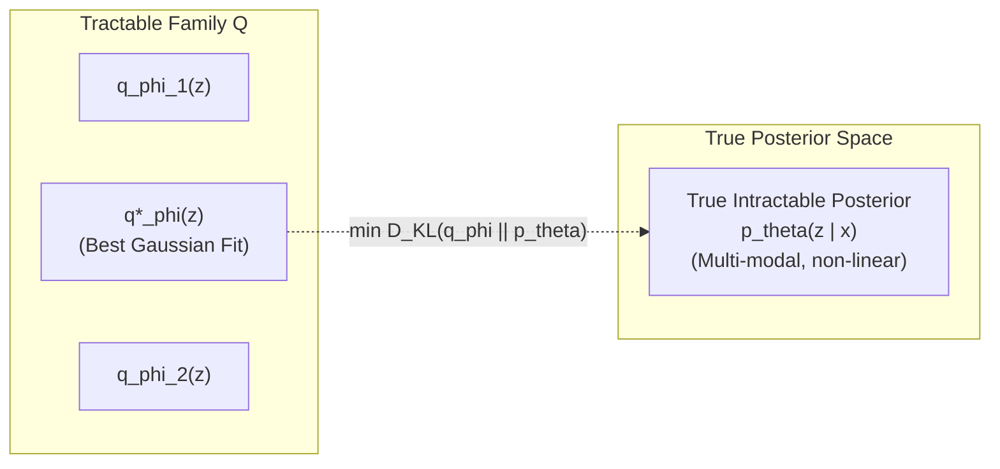
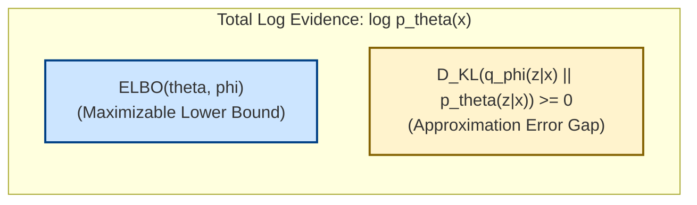

# IF5152 Lecture Notes: Latent Variable Models, Variational Inference & ELBO Derivation

---

## 1. Motivation: Why Latent Variable Models (LVMs)?

In machine learning and computer vision, observed high-dimensional data $x$ (such as an image of a handwritten digit with $28 \times 28 = 784$ pixels or a high-resolution face with $1024 \times 1024 \times 3$ colour values) exhibits immense complexity and correlation. Modelling the raw distribution $p(x)$ directly across all individual pixels—as done in autoregressive models—requires massive sequential compute. 

However, natural data is not distributed uniformly throughout its pixel space; rather, it adheres to the **manifold hypothesis** (see [Cayton, 2005](https://www.cs.ucsd.edu/~elkan/250Bwinter2006/cayton.pdf); [Bengio, Courville, & Vincent, *IEEE TPAMI* 2013](https://arxiv.org/abs/1206.5538)).



### 1.1 Unobserved Causes & The Manifold Hypothesis
Real-world observations are generated by a relatively small set of underlying physical, geometric, and semantic causes:
- In handwritten digits: digit identity, pen stroke thickness, slant angle, and digit size.
- In human faces: 3D head pose, lighting azimuth, facial expression, skin tone, and presence of eyeglasses.

Because these governing factors are **unobserved** in raw data collections, they are formalized mathematically as **latent variables** $z \in \mathbb{R}^d$, where typically $d \ll D$.

### 1.2 The Generative Recipe: From Simple Prior to Complex Reality
Latent Variable Models (LVMs) provide an elegant, modular framework for generative modelling by decoupling the problem into two distinct stages:
1. **The Latent Prior $p(z)$:** We choose a simple, well-behaved, tractable probability distribution over the latent causes, almost universally an isotropic standard multivariate Gaussian:
   $$z \sim p(z) = \mathcal{N}(0, I_d)$$
2. **The Conditional Generator / Decoder $p_\theta(x \mid z)$:** We define a non-linear mapping from latent space to data space parameterized by deep neural network weights $\theta$:
   $$x \sim p_\theta(x \mid z)$$
   - For continuous real-valued data (e.g., natural images), $p_\theta(x \mid z) = \mathcal{N}(\mu_\theta(z), \sigma^2 I)$.
   - For binary or normalized data (e.g., black-and-white digits), $p_\theta(x \mid z) = \text{Bernoulli}(p = f_\theta(z))$.

By passing simple Gaussian random noise $z$ through a highly expressive non-linear neural network $f_\theta(\cdot)$, the model can transform the simple prior into an arbitrarily complex, multimodal probability distribution over $x$ in high-dimensional space.

### 1.3 Directed Graphical Model Formulation
Formally, an LVM defines a joint probability distribution over observed and latent variables:
$$p_\theta(x, z) = p_\theta(x \mid z) p(z)$$



---

## 2. The Core Challenge: The Dual Problem of Learning and Inference

Once we have posited a latent variable model, we encounter a fundamental triangular relationship between three operational queries:



### 2.1 The Chicken-and-Egg Dilemma
- **Learning requires Inference:** To update the decoder parameters $\theta$ via Maximum Likelihood on an observed dataset $\mathcal{D} = \{x^{(1)}, x^{(2)}, \dots, x^{(N)}\}$, we want to maximize the log-evidence:
  $$\max_\theta \sum_{i=1}^N \log p_\theta(x^{(i)})$$
  Using the chain rule of calculus, the gradient of the log-evidence with respect to $\theta$ is:
  $$\nabla_\theta \log p_\theta(x) = \mathbb{E}_{z \sim p_\theta(z \mid x)} \left[ \nabla_\theta \log p_\theta(x, z) \right]$$
  Notice that taking this gradient requires computing expectations under the **true posterior** $p_\theta(z \mid x)$!
- **Inference requires the Marginal Evidence:** By Bayes' rule, the true posterior is:
  $$p_\theta(z \mid x) = \frac{p_\theta(x, z)}{p_\theta(x)} = \frac{p_\theta(x \mid z) p(z)}{\int p_\theta(x \mid z) p(z) \, dz}$$
  Computing the posterior requires evaluating the marginal evidence in the denominator, $p_\theta(x) = \int p_\theta(x, z) dz$.

### 2.2 Why Exact Integration is Intractable
Why can't we simply compute the marginal integral $\int p_\theta(x \mid z) p(z) dz$?

1. **No Analytical Closed Form:** In classical shallow models (such as Factor Analysis or Probabilistic PCA; [Tipping & Bishop, 1999](https://www.jstor.org/stable/2680726)), the mapping from $z$ to $x$ is linear ($x = Wz + \mu + \epsilon$), so the marginal integral is a linear Gaussian convolution with a closed-form solution. However, in deep generative models, $p_\theta(x \mid z)$ is parameterized by deep convolutional or MLP networks with non-linear activation functions (ReLU, GELU, Sigmoid). There is no analytical mathematical antiderivative for a deep neural network integrated against a Gaussian measure.
2. **The Curse of Dimensionality in Numerical Quadrature:** Discretizing the latent space into a grid of $K$ points per dimension across $d$ latent dimensions requires $K^d$ function evaluations. Even for a modest latent space of $d = 20$ with $K = 10$ bins per axis, $10^{20}$ evaluations are required per single image, rendering grid integration completely impossible.
3. **The "Needle in a Haystack" Failure of Naive Monte Carlo:** One might propose estimating the integral via standard Monte Carlo sampling:
   $$p_\theta(x) \approx \frac{1}{S} \sum_{s=1}^S p_\theta(x \mid z^{(s)}), \quad z^{(s)} \sim p(z) = \mathcal{N}(0, I)$$
   In high dimensions, the probability volume where $p_\theta(x \mid z)$ is significantly non-zero for a specific observed $x$ occupies an infinitesimally minuscule fraction of the total latent space volume. Almost every sampled $z^{(s)}$ produces an output image completely unlike $x$, yielding $p_\theta(x \mid z^{(s)}) \approx 0$. The Monte Carlo estimator has near-infinite relative variance and requires trillions of samples per image to register a single non-zero signal.

---

## 3. What is Variational Inference? (From Integration to Optimization)

Because exact inference and marginalization are analytically and computationally intractable, we must turn to **approximate inference**.

### 3.1 Why Not Markov Chain Monte Carlo (MCMC)?
Historically, Bayesian statistics relied heavily on **Markov Chain Monte Carlo (MCMC)** algorithms (such as Metropolis-Hastings or Gibbs Sampling; see [Robert & Casella, *Monte Carlo Statistical Methods*, 2004](https://link.springer.com/book/10.1007/978-1-4757-4145-2)). MCMC constructs an ergodic Markov chain whose stationary distribution equals the true posterior $p_\theta(z \mid x)$. 

While MCMC is asymptotically exact as the number of sampling steps approaches infinity, it suffers from severe limitations in deep learning:
- **Sequential Bottleneck:** Sampling steps cannot be parallelized effectively across modern GPU hardware.
- **Slow Mixing & Burning:** In complex, multi-modal energy landscapes, Markov chains can take thousands of iterations to escape local modes.
- **Incompatible with Mini-Batch SGD:** MCMC requires iterative sweeps over large datasets, making it prohibitively expensive for millions of images trained with stochastic gradient descent.

### 3.2 The Variational Philosophy: Optimization Over a Tractable Family
**Variational Inference (VI)** provides a radically different paradigm: **it converts an intractable integration problem into a deterministic, continuous optimization problem** (see foundational reviews by [Jordan et al., *Machine Learning* 1999](https://link.springer.com/article/10.1023/A:1007665907178); [Blei, Kucukelbir, & McAuliffe, *JASA* 2017](https://arxiv.org/abs/1601.00670)).

Instead of simulating random walks to approximate $p_\theta(z \mid x)$, we:
1. Define a family of tractable, analytically well-behaved probability distributions $\mathcal{Q} = \{ q_\phi(z) \}_{\phi \in \Phi}$ (e.g., multivariate Gaussians with diagonal covariance).
2. Measure the discrepancy between our candidate distribution $q_\phi(z)$ and the true unknown posterior $p_\theta(z \mid x)$ using the **Kullback-Leibler (KL) divergence**:
   $$D_{KL}(q_\phi(z) \parallel p_\theta(z \mid x)) = \int q_\phi(z) \log \left( \frac{q_\phi(z)}{p_\theta(z \mid x)} \right) dz$$
3. Optimize the variational parameters $\phi$ to find the member of $\mathcal{Q}$ that minimizes this divergence:
   $$q^*(z) = \arg\min_{\phi} D_{KL}(q_\phi(z) \parallel p_\theta(z \mid x))$$



### 3.3 The Core Paradox & Its Resolution
At first glance, this optimization appears impossible: evaluating $D_{KL}(q_\phi(z) \parallel p_\theta(z \mid x))$ requires knowing $p_\theta(z \mid x)$ in the denominator of the logarithm—the exact intractable quantity we were trying to avoid!

The breakthrough of Variational Inference is that we do not need to evaluate $p_\theta(z \mid x)$ directly. Through simple algebraic rearrangement (detailed in Section 4), we discover that minimizing this KL divergence is mathematically identical to maximizing a computable objective: the **Evidence Lower Bound (ELBO)**.

### 3.4 Amortized Variational Inference (The Encoder Network)
In classical Variational Inference (e.g., variational Bayes for graphical models), a separate set of variational parameters $\phi^{(i)}$ had to be optimized iteratively for *each individual training instance* $x^{(i)}$. For a dataset with 1,000,000 images, this required maintaining and updating 1,000,000 distinct parameter vectors.

In the **Variational Autoencoder (VAE)** framework ([Kingma & Welling, ICLR 2014](https://arxiv.org/abs/1312.6114); [Rezende, Mohamed, & Wierstra, ICML 2014](https://arxiv.org/abs/1401.4082)), this bottleneck is eliminated via **Amortized Inference**:
- Rather than optimizing individual variational parameters per datapoint, we train a single deep neural network—the **inference network / encoder** $q_\phi(z \mid x)$ with shared global parameters $\phi$.
- Given any input sample $x$ (even unseen test instances), the encoder outputs the mean $\mu_\phi(x)$ and variance $\sigma_\phi^2(x)$ of the variational distribution in a single forward pass:
  $$q_\phi(z \mid x) = \mathcal{N}\left( z; \mu_\phi(x), \text{diag}(\sigma_\phi^2(x)) \right)$$

---

## 4. Step-by-Step Algebraic Derivation of the Evidence Lower Bound (ELBO)

We now derive the Evidence Lower Bound directly from Bayes' rule and Jensen's inequality, following the exact theoretical progression from Lecture 13 (slides 92–102).

### Step 1: Apply Bayes' Rule
By definition of conditional probability:
$$p_\theta(z \mid x) = \frac{p_\theta(x \mid z) p(z)}{p_\theta(x)} \implies p_\theta(x) = \frac{p_\theta(x \mid z) p(z)}{p_\theta(z \mid x)}$$

Taking the natural logarithm of both sides:
$$\log p_\theta(x) = \log \left( \frac{p_\theta(x \mid z) p(z)}{p_\theta(z \mid x)} \right)$$

### Step 2: Multiply Top and Bottom by $q_\phi(z \mid x)$
Introduce the amortized variational posterior distribution $q_\phi(z \mid x)$:
$$\log p_\theta(x) = \log \left( \frac{p_\theta(x \mid z) p(z) \cdot q_\phi(z \mid x)}{p_\theta(z \mid x) \cdot q_\phi(z \mid x)} \right)$$

### Step 3: Rearrange via Logarithm Properties
Decompose the fraction into three distinct additive log ratios:
$$\log p_\theta(x) = \log p_\theta(x \mid z) - \log \left( \frac{q_\phi(z \mid x)}{p(z)} \right) + \log \left( \frac{q_\phi(z \mid x)}{p_\theta(z \mid x)} \right)$$

### Step 4: Take Expectation with Respect to $z \sim q_\phi(z \mid x)$
Since the left-hand side $\log p_\theta(x)$ has no mathematical dependence on $z$, taking its expectation over $z \sim q_\phi(z \mid x)$ leaves it unchanged:
$$\log p_\theta(x) = \mathbb{E}_{z \sim q_\phi(z \mid x)} [\log p_\theta(x)]$$

Distributing the linear expectation operator across all three terms on the right-hand side:
$$\log p_\theta(x) = \mathbb{E}_{z \sim q_\phi(z \mid x)} [\log p_\theta(x \mid z)] - \mathbb{E}_{z \sim q_\phi(z \mid x)} \left[ \log \frac{q_\phi(z \mid x)}{p(z)} \right] + \mathbb{E}_{z \sim q_\phi(z \mid x)} \left[ \log \frac{q_\phi(z \mid x)}{p_\theta(z \mid x)} \right]$$

### Step 5: Express as KL Divergences
Recall the definition of the Kullback-Leibler divergence between two distributions $q$ and $p$:
$$D_{KL}(q(u) \parallel p(u)) \triangleq \mathbb{E}_{u \sim q} \left[ \log \frac{q(u)}{p(u)} \right]$$

Substituting this definition into the second and third expectation terms yields:
$$\log p_\theta(x) = \underbrace{\mathbb{E}_{z \sim q_\phi(z \mid x)} [\log p_\theta(x \mid z)]}_{\text{1. Reconstruction Likelihood}} - \underbrace{D_{KL}(q_\phi(z \mid x) \parallel p(z))}_{\text{2. Prior Matching Regularizer}} + \underbrace{D_{KL}(q_\phi(z \mid x) \parallel p_\theta(z \mid x))}_{\text{3. Posterior Approximation Gap}}$$

### Step 6: Formulating the Lower Bound
By Gibbs' inequality (or Jensen's inequality applied to $-\log$), the KL divergence between any two valid probability distributions is strictly non-negative:
$$D_{KL}(q_\phi(z \mid x) \parallel p_\theta(z \mid x)) \ge 0$$
with equality if and only if $q_\phi(z \mid x) = p_\theta(z \mid x)$ almost everywhere.

Because this final term is strictly non-negative, dropping it gives a rigorous mathematical lower bound:
$$\log p_\theta(x) \ge \text{ELBO}(\theta, \phi) \triangleq \mathbb{E}_{z \sim q_\phi(z \mid x)} [\log p_\theta(x \mid z)] - D_{KL}(q_\phi(z \mid x) \parallel p(z))$$



### The Dual Benefit of Maximizing the ELBO
Notice the fundamental identity:
$$\log p_\theta(x) = \text{ELBO}(\theta, \phi) + D_{KL}(q_\phi(z \mid x) \parallel p_\theta(z \mid x))$$

When we optimize $\text{ELBO}(\theta, \phi)$ via gradient ascent:
1. **With respect to $\theta$ (Decoder):** We push up the lower bound, directly maximizing the likelihood of observing the real training data under the generative model.
2. **With respect to $\phi$ (Encoder):** For a fixed $\theta$, the true data evidence $\log p_\theta(x)$ is constant. Therefore, increasing $\text{ELBO}(\theta, \phi)$ forces the non-negative gap $D_{KL}(q_\phi(z \mid x) \parallel p_\theta(z \mid x))$ to shrink toward zero, tightening our variational approximation to the true posterior!

---

## 5. Closed-Form KL Divergence for Gaussians

When the prior is standard normal $p(z) = \mathcal{N}(0, I_d)$ and the encoder outputs diagonal Gaussian parameters $q_\phi(z \mid x) = \mathcal{N}(\mu, \text{diag}(\sigma^2))$, the KL divergence term has an exact analytical closed-form solution ([Kingma & Welling, 2014](https://arxiv.org/abs/1312.6114)):

$$D_{KL}(q_\phi(z \mid x) \parallel p(z)) = \int q_\phi(z \mid x) \log \frac{q_\phi(z \mid x)}{p(z)} dz$$

Expanding the log ratio of two multivariate diagonal Gaussians:
$$\log \frac{q_\phi(z \mid x)}{p(z)} = -\frac{1}{2} \sum_{j=1}^d \left( \log(2\pi \sigma_j^2) + \frac{(z_j - \mu_j)^2}{\sigma_j^2} \right) + \frac{1}{2} \sum_{j=1}^d \left( \log(2\pi) + z_j^2 \right)$$

Taking the expectation under $z \sim q_\phi(z \mid x)$ where $\mathbb{E}[z_j] = \mu_j$ and $\mathbb{E}[z_j^2] = \mu_j^2 + \sigma_j^2$:
$$D_{KL}(\mathcal{N}(\mu, \Sigma) \parallel \mathcal{N}(0, I)) = -\frac{1}{2} \sum_{j=1}^d \left( 1 + \log(\sigma_j^2) - \mu_j^2 - \sigma_j^2 \right)$$

### PyTorch Implementation
In code, the encoder outputs the logarithm of variance $\log(\sigma^2) = \text{logvar}$ for numerical stability:
```python
# Closed-form KL divergence for diagonal Gaussians (batch mean)
kl_loss = -0.5 * torch.sum(1 + logvar - mu.pow(2) - logvar.exp(), dim=-1).mean()
```
This analytical solution completely eliminates Monte Carlo sampling variance for the prior regularization term during backpropagation.

---

## 6. The Reparameterization Trick

### The Gradient Flow Problem
In a naive stochastic computation graph:
$$x \xrightarrow{\text{Encoder}} (\mu, \sigma) \xrightarrow{\text{Sample } z \sim \mathcal{N}(\mu, \sigma^2)} z \xrightarrow{\text{Decoder}} \hat{x}$$

Directly drawing a random sample $z$ inside the forward pass is a non-differentiable operation. Standard automatic differentiation algorithms cannot propagate gradients backwards through an active random number generator ($\frac{\partial z}{\partial \mu}$ and $\frac{\partial z}{\partial \sigma}$ are mathematically undefined).

### The Solution: Isolate the Stochasticity
Kingma & Welling (2014) and Rezende et al. (2014) reparameterized the random variable by expressing $z$ as a deterministic, differentiable transformation of an auxiliary, parameter-free noise source $\epsilon \sim \mathcal{N}(0, I)$:
$$z = g_\phi(x, \epsilon) \triangleq \mu(x) + \sigma(x) \odot \epsilon \quad \text{where } \epsilon \sim \mathcal{N}(0, I)$$

```
     Deterministic Nodes                 Stochastic Node
      x ---> [Encoder] ---> mu(x) --------> (+) ----> z ---> [Decoder] ---> x_hat
                       ---> sigma(x) ---> (*) |
                                           ^
                                           |
                                  eps ~ N(0, I)
```

Now, all stochasticity is injected as an external input $\epsilon$ that does not depend on parameters $\phi$ or $\theta$. Gradients flow cleanly back to $\mu$ and $\sigma$ via standard multivariate calculus:
$$\frac{\partial z}{\partial \mu} = 1, \qquad \frac{\partial z}{\partial \sigma} = \epsilon$$

---

## 7. The Internal Loss Competition & Disentanglement

The two terms in the ELBO objective engage in an essential tug-of-war during training (Lecture 13, slide 110):

1. **Reconstruction Loss** ($\mathbb{E}_{z}[\log p_\theta(x \mid z)]$):
   - Wants variance $\sigma_j^2 \to 0$ and distinct means $\mu_j$ for each training instance.
   - Pushes the network toward deterministic memorization (collapsing toward a classical autoencoder).
2. **Prior Loss** ($- D_{KL}(q_\phi(z \mid x) \parallel p(z))$):
   - Wants variance $\sigma_j^2 \to 1$ and mean $\mu_j \to 0$ for all samples.
   - Pushes all representations toward the origin, acting as a strict information bottleneck.

### Equilibrium & The $\beta$-VAE Framework
The resulting equilibrium prevents the latent space from fragmenting into isolated clusters, forming a continuous, smooth manifold where semantic factors of variation (stroke slant, line thickness, digit identity) are organized without empty voids.

By weighting the prior loss with a scalar hyperparameter $\beta > 1$ (the $\beta$-VAE framework of [Higgins et al., ICLR 2017](https://openreview.net/forum?id=Sy2fzU9gl); [Burgess et al., 2018](https://arxiv.org/abs/1804.03599)):
$$\mathcal{L}_{\beta\text{-VAE}} = \mathbb{E}_{q_\phi(z \mid x)} [\log p_\theta(x \mid z)] - \beta \cdot D_{KL}(q_\phi(z \mid x) \parallel p(z))$$
one can encourage greater **disentanglement**, isolating individual semantic attributes along orthogonal latent axes.

---

## 8. Summary & Reading Guide

- **Reference Code ([`03_variational_autoencoder.py`](../03_variational_autoencoder.py)):** Hands-on PyTorch implementation of the VAE architecture, ELBO loss computation, the Reparameterization Trick, and 2D latent manifold traversal.
- **Previous Note ([`02_autoencoders_vs_vaes.md`](./02_autoencoders_vs_vaes.md)):** Compares classical autoencoders against VAEs and explains why deterministic bottleneck spaces fail at synthesis.
- **Next Note ([`04_generative_adversarial_networks.md`](./04_generative_adversarial_networks.md)):** Explores implicit density models and the minimax game of Generative Adversarial Networks (GANs).

---

## 📚 References & Canonical Literature

1. **Manifold Hypothesis & Representation Learning:**
   - Cayton, L. (2005). "Algorithms for manifold learning". *University of California, San Diego Tech Report CS2008-0923*. [PDF Link](https://www.cs.ucsd.edu/~elkan/250Bwinter2006/cayton.pdf)
   - Bengio, Y., Courville, A., & Vincent, P. (2013). "Representation Learning: A Review and New Perspectives". *IEEE Transactions on Pattern Analysis and Machine Intelligence (TPAMI)*, 35(8), 1798–1828. [https://arxiv.org/abs/1206.5538](https://arxiv.org/abs/1206.5538)
   - Tipping, M. E., & Bishop, C. M. (1999). "Probabilistic Principal Component Analysis". *Journal of the Royal Statistical Society: Series B (Statistical Methodology)*, 61(3), 611–622. [JSTOR Link](https://www.jstor.org/stable/2680726)

2. **Variational Inference Foundations:**
   - Jordan, M. I., Ghahramani, Z., Jaakkola, T. S., & Saul, L. K. (1999). "An Introduction to Variational Methods for Graphical Models". *Machine Learning*, 37(2), 183–233. [Springer Link](https://link.springer.com/article/10.1023/A:1007665907178)
   - Blei, D. M., Kucukelbir, A., & McAuliffe, J. D. (2017). "Variational Inference: A Review for Statisticians". *Journal of the American Statistical Association (JASA)*, 112(518), 859–877. [https://arxiv.org/abs/1601.00670](https://arxiv.org/abs/1601.00670)
   - Robert, C. P., & Casella, G. (2004). *Monte Carlo Statistical Methods*. Springer New York. [Springer Link](https://link.springer.com/book/10.1007/978-1-4757-4145-2)

3. **Foundational VAE Literature & Amortized Inference:**
   - Kingma, D. P., & Welling, M. (2014). "Auto-Encoding Variational Bayes". *International Conference on Learning Representations (ICLR 2014)*. [https://arxiv.org/abs/1312.6114](https://arxiv.org/abs/1312.6114)
   - Rezende, D. J., Mohamed, S., & Wierstra, D. (2014). "Stochastic Backpropagation and Approximate Inference in Deep Generative Models". *International Conference on Machine Learning (ICML 2014)*. [https://arxiv.org/abs/1401.4082](https://arxiv.org/abs/1401.4082)
   - Kingma, D. P., & Welling, M. (2019). "An Introduction to Variational Autoencoders". *Foundations and Trends in Machine Learning*, 12(4), 307–392. [https://arxiv.org/abs/1906.02691](https://arxiv.org/abs/1906.02691)

4. **Disentangled Representation Learning ($\beta$-VAE):**
   - Higgins, I., Matthey, L., Pal, A., Burgess, C., Glorot, X., Botvinick, M., Mohamed, S., & Lerchner, A. (2017). "$\beta$-VAE: Learning Basic Visual Concepts with a Constrained Variational Framework". *International Conference on Learning Representations (ICLR 2017)*. [OpenReview Link](https://openreview.net/forum?id=Sy2fzU9gl)
   - Burgess, C. P., Higgins, I., Pal, A., Matthey, L., Watters, N., Desjardins, G., & Lerchner, A. (2018). "Understanding Computing Disentanglement in $\beta$-VAE". *arXiv:1804.03599*. [https://arxiv.org/abs/1804.03599](https://arxiv.org/abs/1804.03599)
