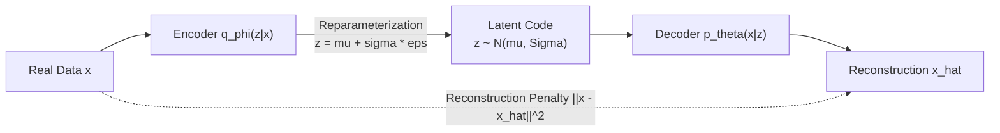
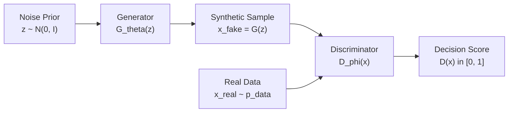
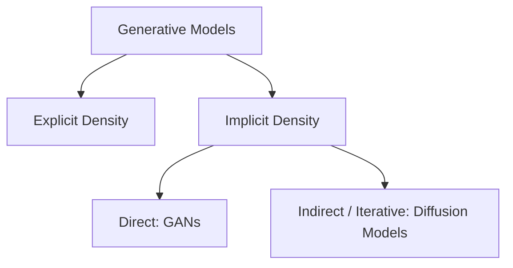
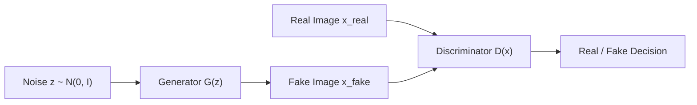
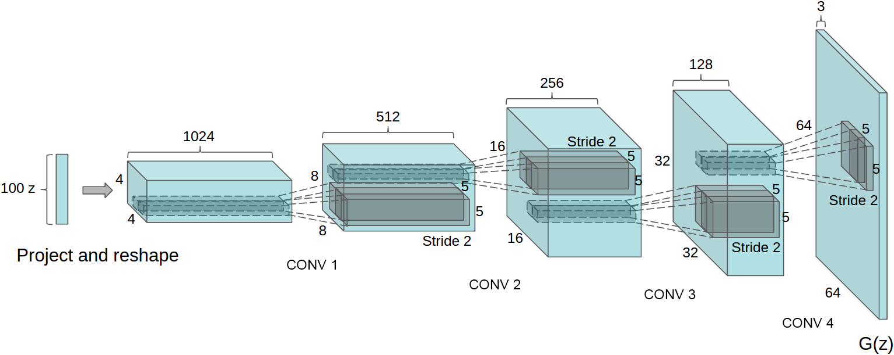
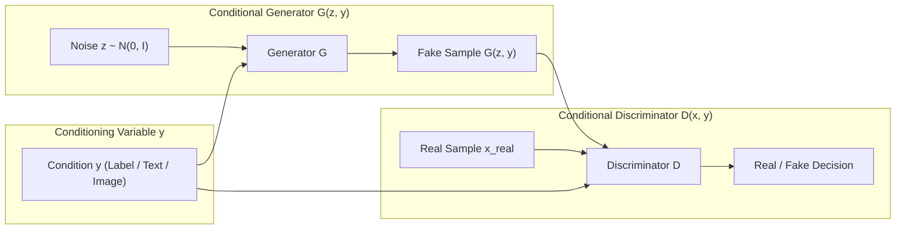

# Generative Adversarial Networks: Adversarial Minimax Games, SNGAN & AC-GAN

---

## 1. The Generative Paradigm Shift: VAEs vs. GANs

Before delving into the adversarial formulation, it is crucial to contrast Generative Adversarial Networks (GANs) with Variational Autoencoders (VAEs, covered in Notes 02 and 03). While both models aim to learn an unknown data distribution $p_{data}(x)$ from observed samples and synthesize novel, high-dimensional observations (e.g., images) from a low-dimensional noise vector $z$, they approach this challenge from radically divergent philosophical, statistical, and architectural angles.

### Visual Paradigm 1: Variational Autoencoder (VAE)
*Explicit Density Approximation, Cooperative Encoder-Decoder Training, and Reparameterized Latent Inference:*



$$
\max_{\theta, \phi} \mathcal{L}_{\text{ELBO}}(\theta, \phi; x) = \mathbb{E}_{q_\phi(z \mid x)} [\log p_\theta(x \mid z)] - D_{\text{KL}}\big(q_\phi(z \mid x) \parallel p(z)\big)
$$

---

### Visual Paradigm 2: Generative Adversarial Network (GAN)
*Implicit Density, Two-Player Non-Cooperative Minimax Game, and Adversarial Verification:*



$$
\min_G \max_D V(D, G) = \mathbb{E}_{x \sim p_{\text{data}}} [\log D(x)] + \mathbb{E}_{z \sim p_z} [\log (1 - D(G(z)))]
$$

### 1.1 Core Conceptual & Mathematical Contrasts

#### 1. Explicit vs. Implicit Density Modeling
- **VAEs (Explicit / Tractable Lower Bound):** A VAE specifies an explicit parametric probability distribution over data:

$$
p_\theta(x) = \int p_\theta(x \mid z) p(z) \, dz
$$

  Because marginalizing over all latent variables $z$ is computationally intractable, VAEs optimize the **Evidence Lower Bound (ELBO)** as a rigorous proxy for true log-likelihood:

$$
\log p(x) \ge \mathcal{L}_{\text{ELBO}}(\theta, \phi; x) = \mathbb{E}_{q_\phi(z \mid x)} [\log p_\theta(x \mid z)] - D_{\text{KL}}\big(q_\phi(z \mid x) \parallel p(z)\big)
$$

  VAEs belong to the class of **likelihood-based models**, optimizing density via variational approximation.
- **GANs (Implicit / Likelihood-Free):** A GAN completely abandons explicit probability density formulation. The generator $G: \mathcal{Z} \to \mathcal{X}$ defines an **implicit distribution** $p_g$: you cannot evaluate $p_g(x)$ or compute marginal log-likelihoods $\log p(x)$. Instead, you can only **draw samples** by evaluating $x = G(z)$ with $z \sim p_z$. Learning is driven not by maximum likelihood, but by statistical distribution matching evaluated by an adversary.

#### 2. Cooperative Inference vs. Non-Cooperative Minimax Game
- **VAEs (Cooperative Single-Agent Optimization):** The encoder $q_\phi$ and decoder $p_\theta$ work cooperatively toward a single shared objective ($\max_{\theta, \phi} \mathcal{L}_{\text{ELBO}}$). Gradients flow cleanly throughout the network via the reparameterization trick ($z = \mu + \sigma \odot \epsilon$), yielding stable and predictable gradient ascent dynamics.
- **GANs (Two-Player Zero-Sum Game):** Training is framed as a non-cooperative game between two competing neural networks:

$$
\min_G \max_D V(D, G) = \mathbb{E}_{x \sim p_{\text{data}}} [\log D(x)] + \mathbb{E}_{z \sim p_z} [\log (1 - D(G(z)))]
$$

  Rather than minimizing a static scalar loss, the system seeks a **Nash equilibrium** in high-dimensional non-convex parameter space. This game-theoretic setting makes GANs notorious for training instability, limit cycles, oscillatory dynamics, and catastrophic mode collapse.

#### 3. Asymmetry in Latent Inference ($x \to z$)
- **VAEs Provide Direct Latent Inference:** Thanks to the recognition model (encoder $q_\phi(z \mid x)$), VAEs can project any real data sample $x$ into its corresponding latent distribution $\mathcal{N}(\mu, \Sigma)$. This enables direct latent feature manipulation, attribute editing, and downstream representation learning.
- **Vanilla GANs Lack an Encoder:** GANs are strictly generative samplers ($z \to x$). There is no native mechanism to infer the latent code $z$ of an existing real image $x$. Inverting a GAN ($x \to z$) requires expensive test-time optimization or hybrid auxiliary architectures (e.g., BiGAN, ALI, or VAE-GAN).

#### 4. The "Blurry vs. Sharp" Dichotomy: Mean-Seeking vs. Mode-Seeking Divergences
The most visually striking difference between VAEs and GANs is sample quality: VAE outputs frequently appear overly smooth or blurry, while GAN outputs are sharp and perceptually realistic. This is directly rooted in the underlying statistical divergences:

```
Distribution Alignment Behavior:
Data Distribution: Two isolated modes (peaks)

Forward KL (VAE / Maximum Likelihood): "Mean-Seeking" (Zero-Avoiding)
      p_data:       /\           /\
      p_model:     /  \_________/  \    <-- Spreads mass across empty gap (blurry averages)

Reverse KL / JSD (GANs): "Mode-Seeking" (Zero-Forcing)
      p_data:       /\           /\
      p_model:     /  \                 <-- Focuses sharp mass on a single mode (sharp, but risk of mode drop)
```

- **VAEs Minimize Forward KL Divergence (Mean-Seeking / Zero-Avoiding):**
  Maximizing log-likelihood is mathematically equivalent to minimizing the forward Kullback-Leibler divergence:

$$
\min_\theta D_{\text{KL}}(p_{\text{data}} \parallel p_\theta) = \int p_{\text{data}}(x) \log \frac{p_{\text{data}}(x)}{p_\theta(x)} \, dx
$$

  If $p_{\text{data}}(x) > 0$ for any sample $x$, then $p_\theta(x)$ cannot be zero, otherwise the objective incurs an infinite penalty ($\frac{p_{\text{data}}}{0} \to \infty$). Consequently, the model is **zero-avoiding**: it must spread probability mass over all observed variations. Paired with pixel-wise Gaussian reconstruction losses (such as Mean Squared Error $\|x - \hat{x}\|_2^2$), the decoder hedges its bets by outputting the statistical mean of plausible high-frequency textures, producing characteristic blurriness.
- **GANs Minimize Jensen-Shannon Divergence (Mode-Seeking / Zero-Forcing):**
  As proven by Goodfellow et al. (2014), when the discriminator is optimal, the minimax objective equates to minimizing the symmetric **Jensen-Shannon Divergence (JSD)**:

$$
V(D^*, G) = 2 \cdot D_{\text{JS}}(p_{\text{data}} \parallel p_g) - \log 4
$$

  In practical training (especially under the non-saturating loss $-\log D(G(z))$), the adversary severely penalizes the generator for producing unnatural, blurry, or interpolated artifacts because the discriminator easily detects them as fakes ($D(x_{\text{fake}}) \approx 0$). The generator is thus driven by a **mode-seeking (zero-forcing)** objective: it is heavily rewarded for generating crisp, realistic patches that closely match true data modes, even if it ignores or drops other valid modes entirely (**mode collapse**).

---

### 1.2 Comprehensive Side-by-Side Comparison

| Feature / Dimension | Variational Autoencoders (VAEs) | Generative Adversarial Networks (GANs) |
| :--- | :--- | :--- |
| **Generative Family** | Explicit Density (Approximated via Variational Inference) | Implicit Density (Likelihood-Free, Direct Sampling) |
| **Core Architecture** | Encoder $q_\phi(z \mid x)$ + Decoder $p_\theta(x \mid z)$ | Generator $G_\theta(z)$ + Discriminator $D_\phi(x)$ |
| **Mathematical Objective** | Maximize ELBO: $\mathbb{E}_{q}[\log p(x\mid z)] - D_{\text{KL}}(q \parallel p)$ | Minimax game: $\min_G \max_D \mathbb{E}[\log D] + \mathbb{E}[\log(1 - D(G))]$ |
| **Latent Inference ($x \to z$)** | ✅ **Native** (Encoder directly predicts $\mu_\phi(x), \Sigma_\phi(x)$) | ❌ **None** in vanilla GAN (Requires inversion or BiGAN/ALI) |
| **Latent Space Geometry** | Smooth, compact, centered via $D_{\text{KL}}(q(z\mid x) \parallel \mathcal{N}(0, I))$ | Unconstrained prior $z \sim p_z$ mapped non-linearly by $G$ |
| **Divergence Minimized** | Forward KL: $D_{\text{KL}}(p_{\text{data}} \parallel p_\theta)$ (via MLE) | Jensen-Shannon Divergence: $D_{\text{JS}}(p_{\text{data}} \parallel p_g)$ |
| **Statistical Behavior** | **Mean-seeking / Zero-avoiding** (Covers all data modes) | **Mode-seeking / Zero-forcing** (Focuses on mode peaks) |
| **Visual Sample Quality** | ⚠️ Often blurry / smooth (L2/Gaussian pixel averaging) | ✅ Crisp, high-frequency details, realistic textures |
| **Training Dynamics** | ✅ Stable, monotonic gradient ascent on ELBO | ⚠️ Unstable, sensitive hyperparameters, oscillatory non-convergence |
| **Primary Failure Mode** | Blurry generations, posterior collapse ($q_\phi(z\mid x) \approx p(z)$) | Mode collapse (dropping diversity), vanishing gradients |
| **Sampling Complexity** | Fast single forward pass: $z \sim \mathcal{N}(0, I) \to \text{Dec}(z)$ ($O(1)$) | Fast single forward pass: $z \sim p_z \to G(z)$ ($O(1)$) |

---

## 2. Overview & Taxonomy

In the modern taxonomy of generative modeling ([Goodfellow et al., NeurIPS 2014](https://arxiv.org/abs/1406.2661); [Goodfellow, NIPS 2016 Tutorial](https://arxiv.org/abs/1701.00160)), Generative Adversarial Networks are classified under **Implicit Density & Direct Sampling**:



Unlike Autoregressive models and VAEs:
- GANs do **not** define, approximate, or compute an explicit probability density function $p(x)$.
- GANs sample directly: a neural network transforms an unconstrained random noise vector $z \sim p_z$ into an artificial data sample $G(z)$ in a single forward evaluation ($O(1)$).

---

## 3. The Two-Player Minimax Formulation

A GAN pits two deep neural networks against each other in a zero-sum game rooted in game theory:
1. **Generator $G(z; \theta_g)$:** Attempts to generate realistic fake images to fool the discriminator.
2. **Discriminator $D(x; \theta_d)$:** Acts as an inspector, predicting the probability that an image $x$ came from the true data distribution $p_{data}$ rather than the generator distribution $p_g$.



### The Minimax Objective Function

$$
\min_G \max_D V(D, G) = \mathbb{E}_{x \sim p_{\text{data}}(x)} [\log D(x)] + \mathbb{E}_{z \sim p_z(z)} [\log (1 - D(G(z)))]
$$

---

## 4. Theoretical Derivation: Global Optimality & JSD

### Optimal Discriminator $D^*(x)$
For any fixed generator $G$, the objective can be rewritten in continuous integral form:

$$
V(D, G) = \int_x \Big( p_{\text{data}}(x) \log D(x) + p_g(x) \log(1 - D(x)) \Big) \, dx
$$

To maximize the integrand at every point $x$, consider the scalar objective $f(y) = a \log y + b \log(1 - y)$, where $a = p_{\text{data}}(x)$, $b = p_g(x)$, and $y = D(x)$. Setting the derivative with respect to $y$ to zero:

$$
\frac{df}{dy} = \frac{a}{y} - \frac{b}{1 - y} = 0 \implies a(1 - y) = b y \implies y^* = \frac{a}{a + b}
$$

Therefore, the optimal discriminator for any given generator is:

$$
D^*(x) = \frac{p_{\text{data}}(x)}{p_{\text{data}}(x) + p_g(x)}
$$

### Connection to Jensen-Shannon Divergence
Substituting $D^*(x)$ back into the minimax value function ([Nowozin, Cseke, & Tomioka, NeurIPS 2016](https://arxiv.org/abs/1606.00709)):

$$
V(D^*, G) = \int_x \left[ p_{\text{data}}(x) \log \frac{p_{\text{data}}(x)}{p_{\text{data}}(x) + p_g(x)} + p_g(x) \log \frac{p_g(x)}{p_{\text{data}}(x) + p_g(x)} \right] dx
$$

Adding and subtracting $\log 2$ inside the logarithms:

$$
\begin{aligned}
V(D^*, G) &= -\log 4 + D_{\text{KL}}\left(p_{\text{data}} \parallel \frac{p_{\text{data}} + p_g}{2}\right) + D_{\text{KL}}\left(p_g \parallel \frac{p_{\text{data}} + p_g}{2}\right) \\
&= -\log 4 + 2 \cdot D_{\text{JS}}(p_{\text{data}} \parallel p_g)
\end{aligned}
$$

where $D_{\text{JS}}$ is the symmetric **Jensen-Shannon Divergence**.
- The global minimum occurs if and only if $p_g = p_{\text{data}}$.
- At this equilibrium, $D_{\text{JS}} = 0$, $V(D^*, G) = -\log 4 \approx -1.386$, and $D^*(x) = \frac{1}{2}$ everywhere (the discriminator cannot distinguish real samples from generator fakes).

---

## 5. The Non-Saturating Generator Loss Heuristic

In the theoretical minimax formulation, the generator minimizes:

$$
\mathcal{L}_G^{\text{minimax}} = \mathbb{E}_{z} [\log (1 - D(G(z)))]
$$

### The Vanishing Gradient Problem
Early in training, $G$ produces poor images. The discriminator quickly learns to classify them with high confidence ($D(G(z)) \approx 0$).
As proved by [Arjovsky & Bottou (ICLR 2017)](https://arxiv.org/abs/1701.04862), the gradient of $\log(1 - D(G(z)))$ with respect to generator parameters vanishes as $D \to 0$. As a result, $G$ starves of gradients early in training.

### The Solution: Non-Saturating Loss
Goodfellow et al. (2014) proposed that instead of minimizing $\log(1 - D(G(z)))$, the generator should be trained to **maximize $\log D(G(z))$**:

$$
\mathcal{L}_G^{\text{heuristic}} = - \mathbb{E}_{z} [\log D(G(z))]
$$

This simple flip provides steep, non-vanishing gradients early in training when $D(G(z))$ is near zero, enabling rapid parameter updates and stable convergence.

---

## 6. Architectural Principles & the Canonical DCGAN Network

Before 2015, standard vanilla GANs were notoriously unstable when scaled to deep convolutional networks, frequently suffering from catastrophic mode collapse, vanishing gradients, or producing noisy, incoherent high-frequency artifacts. In their seminal paper, [Radford, Metz, & Chintala (ICLR 2016)](https://arxiv.org/abs/1511.06434) introduced **Deep Convolutional GANs (DCGAN)**, establishing the definitive set of architectural heuristics and topological principles that unlocked stable, high-resolution adversarial image generation.

---

### 6.1 The Canonical DCGAN Generator Architecture (Figure 1 from Original Paper)

The iconic architecture diagram from Radford et al. (2016, Figure 1) illustrates the complete forward transformation from a 100-dimensional latent noise vector $z$ to a high-resolution $64 \times 64$ RGB image:



> **Figure 1 (Radford et al., 2016):** *DCGAN generator used for LSUN scene modeling. A 100-dimensional uniform distribution $Z$ is projected to a small spatial area with many feature maps. A series of four fractionally-strided convolutions (often called transposed convolutions) then convert this high-level representation into a $64 \times 64$ pixel image. Notably, no fully connected or pooling layers are used in this network.*

#### Step-by-Step Tensor Flow & Dimensionality

```mermaid
flowchart LR
    Z["z in R^100<br/>(Noise Vector)"] -->|"Dense Projection"| P["1024 x 4 x 4<br/>(Project & Reshape)"]
    P -->|"ConvTranspose 5x5 / s=2<br/>BatchNorm + ReLU"| L1["512 x 8 x 8"]
    L1 -->|"ConvTranspose 5x5 / s=2<br/>BatchNorm + ReLU"| L2["256 x 16 x 16"]
    L2 -->|"ConvTranspose 5x5 / s=2<br/>BatchNorm + ReLU"| L3["128 x 32 x 32"]
    L3 -->|"ConvTranspose 5x5 / s=2<br/>Tanh Activation"| Out["3 x 64 x 64<br/>(RGB Image in [-1, 1])"]
    
    style Z fill:#ede7f6,stroke:#7e57c2,stroke-width:2px
    style Out fill:#e8f5e9,stroke:#388e3c,stroke-width:2px
```



1. **Input Noise Projection ($z \to 1024 \times 4 \times 4$):**
   - The generator draws a 100-dimensional noise vector $z \sim \mathcal{N}(0, I)$ (or uniform $\mathcal{U}[-1, 1]$).
   - This vector is linearly projected to $1024 \times 4 \times 4 = 16,384$ scalar activations via a dense affine mapping (or equivalently a $1 \times 1$ convolution from a $100 \times 1 \times 1$ tensor with kernel size 4, stride 1, padding 0).
   - The resulting tensor forms the coarsest $4 \times 4$ spatial feature maps with the highest channel density ($1024$ channels).

2. **Hierarchical Spatial Upsampling via Fractionally-Strided Convolutions:**
   - Instead of static upsampling algorithms (such as nearest-neighbor or bilinear interpolation) followed by standard convolutions, DCGAN relies entirely on **fractionally-strided convolutions** (implemented in PyTorch as `nn.ConvTranspose2d`).
   - Each successive transposed convolution with stride $s = 2$ and padding $p = 1$:
     - **Doubles spatial resolution**: $4 \times 4 \to 8 \times 8 \to 16 \times 16 \to 32 \times 32 \to 64 \times 64$.
     - **Halves feature channels**: $1024 \to 512 \to 256 \to 128 \to 3$.
   - This architectural symmetry allows the network to learn its own adaptive, task-specific spatial interpolation filters directly from gradient feedback.

3. **Normalization & Activations:**
   - **Spatial Batch Normalization (`nn.BatchNorm2d`)** is applied to every intermediate transposed convolution block. It standardizes each feature map to zero mean and unit variance, preventing gradients from vanishing or exploding across deep layers and preventing all samples from collapsing into a single point (mode collapse).
   - **ReLU (`nn.ReLU`)** is utilized across all hidden layers to promote sparse, non-saturating activations.
   - **Tanh (`nn.Tanh`)** caps the final output layer, strictly bounding synthesized pixel values to $[-1.0, 1.0]$. Training images are symmetrically scaled to $[-1.0, 1.0]$ via standard normalization transforms.

---

### 6.2 The Complementary Discriminator Architecture

The DCGAN Discriminator mirrors the Generator's spatial pipeline in reverse, acting as an all-convolutional feature extractor:
- **Strided Convolutions over Pooling:** All deterministic pooling layers (e.g., `MaxPool2d`, `AvgPool2d`) are replaced with strided convolutions (kernel size $4 \times 4$, stride $s = 2$). This enables the discriminator to learn its own spatial downsampling filters.
- **LeakyReLU Activations:** Instead of standard ReLU (which zeros out negative activations and can lead to "dying neurons"), the discriminator utilizes **LeakyReLU with a negative slope of $0.2$** across all layers. This guarantees non-zero gradient flow back through the entire spatial domain, even when a region of the image strongly appears fake.
- **Selective Batch Normalization:** BatchNorm is applied across intermediate conv layers, but **explicitly omitted on the first input layer** (to preserve the authentic scale and statistics of the raw data distribution) and the final decision scalar.

---

### 6.3 Adaptation to CIFAR-10 ($32 \times 32$) and MNIST ($28 \times 28$)

In our laboratory code ([`04a_generative_adversarial_network.py`](../04a_generative_adversarial_network.py) and [`04b_conditional_dcgan.py`](../04b_conditional_dcgan.py)), Radford et al.'s design is adapted to lower-resolution datasets:

| Dataset | Image Dim | Generator Layers | Discriminator Layers |
| :--- | :--- | :--- | :--- |
| **LSUN (Radford et al. 2016)** | $3 \times 64 \times 64$ | $z \to 4 \times 4 \to 8 \times 8 \to 16 \times 16 \to 32 \times 32 \to 64 \times 64$ ($4$ upsamples) | $64 \times 64 \to 32 \times 32 \to 16 \times 16 \to 8 \times 8 \to 4 \times 4 \to 1$ |
| **CIFAR-10 (Laboratory)** | $3 \times 32 \times 32$ | $z \to 4 \times 4 \to 8 \times 8 \to 16 \times 16 \to 32 \times 32$ ($3$ upsamples) | $32 \times 32 \to 16 \times 16 \to 8 \times 8 \to 4 \times 4 \to 1$ |
| **MNIST (Laboratory)** | $1 \times 28 \times 28$ | $z \to 7 \times 7 \to 14 \times 14 \to 28 \times 28$ ($2$ upsamples) | $28 \times 28 \to 14 \times 14 \to 7 \times 7 \to 1$ |

---

### 6.4 Radford et al. Summary of Core Guidelines

Radford et al. distilled these architectural principles into five foundational guidelines:
1. **Eliminate fully connected and pooling layers:** Replace deterministic pooling with strided convolutions (Discriminator) and fractional-strided convolutions (Generator).
2. **Use Batch Normalization in both Generator and Discriminator:** Stabilizes deep layer dynamics; omit on Generator output layer and Discriminator input layer.
3. **Use ReLU in Generator for all layers except the output, which uses Tanh.**
4. **Use LeakyReLU in Discriminator for all layers with slope $0.2$.**
5. **Adam Optimizer Hyperparameters:** Set learning rate $\eta = 0.0002$, momentum $\beta_1 = 0.5$ (reduced from default $0.9$), and $\beta_2 = 0.999$.

---

## 7. Holistic Comparison: GANs vs. Likelihood-Based Models

| Metric | GANs | Autoregressive (PixelCNN) | VAEs |
| :--- | :--- | :--- | :--- |
| **Density Evaluation** | ❌ None (Implicit) |  Exact ($p(x)$ tractable) | ⚠️ Lower Bound (ELBO) |
| **Sampling Speed** |  Fast (single forward pass) | ❌ Slow ($O(N)$ sequential) |  Fast (single forward pass) |
| **Image Sharpness** |  Very sharp & detailed |  Sharp | ⚠️ Often blurry (L2 regression) |
| **Training Stability** | ⚠️ Unstable (Minimax game) |  Very stable (Standard MLE) |  Stable (Gradient on ELBO) |
| **Mode Dropping / Collapse** | ⚠️ Vulnerable | ❌ Immune (Covers all data) | ❌ Immune |

---

## 8. Conditional Generative Adversarial Networks (cGANs)

In the standard vanilla GAN formulation, the generator synthesizes samples from an unconditional prior $z \sim p_z(z)$. Consequently, there is **no explicit mechanism to control or guide the modes** of data generated—one cannot instruct the model to produce a specific digit (e.g., "draw a 7") or a specific class of object.

To steer the generation process, [Mirza & Osindero (2014)](https://arxiv.org/abs/1411.1784) introduced **Conditional GANs (cGANs)**, conditioning both the generator and discriminator on auxiliary information $y$.



### 8.1 The Conditional Minimax Objective

The conditioning signal $y$ (such as a one-hot class label, text embedding, semantic segmentation map, or edge outline) is fed into **both** networks:
- **Generator $G(z, y)$:** Combines random noise $z$ with condition $y$ to synthesize samples consistent with the requested attribute.
- **Discriminator $D(x, y)$:** Evaluates whether the pair $(x, y)$ represents a plausible real data-condition pairing.

The two-player minimax objective becomes:

$$
\min_G \max_D V(D, G) = \mathbb{E}_{(x, y) \sim p_{\text{data}}(x, y)} [\log D(x, y)] + \mathbb{E}_{z \sim p_z, y \sim p_y} [\log (1 - D(G(z, y), y))]
$$

### 8.2 The Dual Task of the Conditional Discriminator

In unconditional GANs, the discriminator only asks one question:
> *"Does $x$ look like a realistic image from the dataset?"*

In cGANs, the discriminator must solve a **joint verification problem**:
1. **Fidelity:** Is $x$ a realistic image?
2. **Contextual Alignment:** Does $x$ match the specified conditioning variable $y$?

If a generator creates a photo-realistic dog when the condition was $y = \text{"cat"}$, an effective conditional discriminator must classify $(x_{dog}, y_{cat})$ as **fake** ($D \to 0$).

### 8.3 Architectural Conditioning Strategies

Depending on the modality of $y$, several conditioning techniques are widely employed:

1. **Input Concatenation ([Mirza & Osindero, 2014](https://arxiv.org/abs/1411.1784)):**
   - In the Generator: Concatenate embedding vector $\mathbf{e}(y)$ directly with noise vector $z$ before feeding into dense or transposed convolution layers.
   - In the Discriminator: Spatially tile or broadcast the class embedding across image channels and concatenate along the channel dimension ($C + C_y, H, W$).
2. **Conditional Batch Normalization / AdaIN ([Dumoulin et al., 2017](https://arxiv.org/abs/1610.07629); [Brock et al., 2019](https://arxiv.org/abs/1809.11096)):**
   - Rather than feeding $y$ directly as an input channel, the conditioning vector dynamically modulates the gain ($\gamma(y)$) and bias ($\beta(y)$) parameters of normalization layers:

$$
\text{CBN}(h \mid y) = \gamma(y) \left( \frac{h - \mu}{\sigma} \right) + \beta(y)
$$

3. **Projection Discriminator ([Miyato & Koyama, ICLR 2018](https://arxiv.org/abs/1802.05637)):**
   - Decomposes the discriminator output into an unconditional quality score plus an inner product between the image feature representation $\psi(x)$ and a learned label embedding $\mathbf{v}_y$:

$$
D(x, y) = \sigma\big(\psi(x)^T \mathbf{v}_y + \phi(\psi(x))\big)
$$

   - This formulation guarantees that gradients specifically reinforce class consistency without washing out image realism.

4. **Auxiliary Classifier GAN (AC-GAN, [Odena et al., ICML 2017](https://arxiv.org/abs/1610.09585)):**
   - The discriminator receives the RGB image $x$ alone ($3 \times H \times W$), with **no class channel concatenated into the input**.
   - Instead, the discriminator branches into two distinct output heads:
     1. **Adversarial Head $D_S(x) \in [0, 1]$**: Predicts whether $x$ is real or generated.
     2. **Auxiliary Classifier Head $D_C(x) \in \Delta^K$**: Predicts the probability distribution over the $K$ classes.
   - The training objective combines the log-likelihood of the source ($\mathcal{L}_S$) and class ($\mathcal{L}_C$):

$$
\mathcal{L}_S = \mathbb{E}\big[\log P(S=\text{real} \mid x_{\text{real}})\big] + \mathbb{E}\big[\log P(S=\text{fake} \mid G(z, c))\big]
$$
$$
\mathcal{L}_C = \mathbb{E}\big[\log P(C=c \mid x_{\text{real}})\big] + \mathbb{E}\big[\log P(C=c \mid G(z, c))\big]
$$

   - The discriminator maximizes $\mathcal{L}_S + \mathcal{L}_C$, while the generator maximizes $\mathcal{L}_C - \mathcal{L}_S$. This multi-task structure forces $D$ to learn representationally rich, disentangled semantic features.
   - *Course Implementations*:
     - Standard DCGAN Backbone: [`04d_acgan_cifar10.py`](file:///Users/mghifary/Documents/ITB/IF5152/generative-models/04d_acgan_cifar10.py)
     - Modern ResNet Backbone with CBN & Spectral Norm: [`04e_resnet_acgan_cifar10.py`](file:///Users/mghifary/Documents/ITB/IF5152/generative-models/04e_resnet_acgan_cifar10.py)

### 8.4 Seminal Applications: Image-to-Image Translation (Pix2Pix)

When the condition $y$ is an entire image (e.g., edge sketch, black-and-white photo, or depth map), cGANs perform **paired Image-to-Image Translation** ([Isola et al., CVPR 2017](https://arxiv.org/abs/1611.07004) - Pix2Pix):
- **Objective:** Combines conditional adversarial loss with an explicit pixel-level $L_1$ reconstruction loss to enforce both sharp high-frequency edges and structural layout adherence:

$$
\mathcal{L}_{\text{Pix2Pix}}(G, D) = \mathcal{L}_{\text{cGAN}}(G, D) + \lambda \, \mathbb{E}_{x, y, z} \big[ \| x - G(y, z) \|_1 \big]
$$
- The $L_1$ penalty handles coarse low-frequency correctness (averaging colors and macro structures), while the adversarial discriminator acts as a **PatchGAN** that penalizes blurry, unnatural high-frequency textures.

---

## 10. Why Vanilla DCGAN Struggles on Complex Natural Images (CIFAR-10 Diagnosis & Modern Solutions)

When training vanilla Deep Convolutional GANs (DCGAN) on CIFAR-10, students often observe that while structural silhouettes and color palettes converge quickly, generated samples can look impressionistic, textured with artifacts, or lack the razor-sharp realism seen in modern generative models. Understanding why this happens requires diagnosing the mathematical, architectural, and geometric constraints inherent to 2015-era GAN formulations.

```
+----------------------------------------------------------------------------------------------------+
|                               THE 5 QUALITY BOTTLENECKS OF VANILLA DCGAN                           |
+------------------------------------+---------------------------------------------------------------+
| 1. Pixel Density & Unalignment     | 32x32 = 1,024 pixels per channel; unaligned natural photos    |
| 2. Checkerboard Transposed Convs   | Kernel size 4 with stride 2 causes uneven receptive overlaps   |
| 3. JSD Gradient Vanishing          | Disjoint low-dimensional manifolds yield uninformative 0 grads|
| 4. Shallow 4-Layer Architecture    | Lacks multi-scale residual paths and self-attention capacity  |
| 5. Finite Training Budget          | 30-50 epochs vs. modern benchmarks requiring 100k-500k steps  |
+------------------------------------+---------------------------------------------------------------+
```

---

### 10.1 The $32 \times 32$ Low-Resolution & Unaligned Multimodality Bottleneck

1. **Pixel Budget Constraints:**
   A CIFAR-10 image spans only $32 \times 32 = 1{,}024$ pixels per color channel ($3{,}072$ total values in $[-1, 1]$). In contrast to human faces in CelebA (which are rigidly cropped and centered around eye/nose landmarks) or MNIST digits (which are centered binary strokes on solid black backgrounds), CIFAR-10 consists of unaligned, in-the-wild photography:
   - Animals appear in arbitrary poses, head orientations, and occlusions (e.g., frogs camouflaged on leaves, running dogs, horses facing left or right).
   - Complex backgrounds vary from skies and asphalt to turbulent ocean waves and cluttered foliage.
   At a native resolution of $32 \times 32$, even authentic ground-truth CIFAR-10 photos appear heavily pixelated and blurry when scaled up on high-DPI displays.

2. **Multimodal Entropy per Class:**
   Because each class encompasses hundreds of sub-species, orientations, and camera angles, the target data distribution $p_{data}(x)$ does not form a simple unimodal Gaussian-like bubble. Instead, it forms an intricate, highly fractured low-dimensional manifold embedded within $\mathbb{R}^{3{,}072}$. A 4-layer feedforward convolutional network struggles to parameterize this multi-peaked density without blending modes together.

---

### 10.2 Deconvolution Checkerboard Artifacts & Shallow Capacity

1. **Receptive Field Overlap in `ConvTranspose2d`:**
   DCGAN generators upsample spatial features using strided transposed 2D convolutions:
   ```python
   nn.ConvTranspose2d(in_channels, out_channels, kernel_size=4, stride=2, padding=1)
   ```
   When the kernel size ($k = 4$) is divisible by the stride ($s = 2$), each output pixel receives contributions from varying numbers of overlapping filter windows:
   - Certain pixel positions receive twice as many kernel weight updates as their neighboring pixels.
   - This unequal accumulation produces high-frequency periodic grid noise across the image plane, commonly termed **checkerboard artifacts** ([Odena et al., 2016](https://distill.pub/2016/deconv-checkerboard/)).

2. **Absence of Skip & Residual Connections:**
   Vanilla DCGAN relies on a strictly sequential 4-layer cascade:

$$
\mathbf{z} \in \mathbb{R}^{100} \to 4\times 4 \times 256 \to 8\times 8 \times 128 \to 16\times 16 \times 64 \to 32\times 32 \times 3
$$

   Without residual skip connections ($\mathbf{x} + \mathcal{F}(\mathbf{x})$), gradients must propagate through every non-linear layer without attenuation. As a result:
   - The network cannot easily preserve high-level semantic layout while simultaneously refining fine edge textures.
   - Deep features quickly suffer from gradient degradation or vanishing signals.

---

### 10.3 JSD Vanishing Gradients on Disjoint Low-Dimensional Manifolds

As proven by Arjovsky & Bottou (2017), real natural images and generated samples lie on low-dimensional submanifolds $\mathcal{M}_r$ and $\mathcal{M}_g$ embedded in high-dimensional ambient space $\mathbb{R}^D$ ($D = 3{,}072$ for CIFAR-10).

1. **Manifold Disjointness:**
   Because the support of $p_{\text{data}}$ and $p_g$ have measure zero with respect to the ambient space, their intersection $\mathcal{M}_r \cap \mathcal{M}_g$ is almost everywhere empty or confined to a set of measure zero:

$$
\mathbb{P}_{x \sim \text{Lebesgue}}\left( x \in \mathcal{M}_r \cap \mathcal{M}_g \right) = 0
$$

2. **Saturation of Jensen-Shannon Divergence:**
   When the manifolds are disjoint, an optimal discriminator $D^*(x)$ perfectly separates real from fake images ($D^*(x) = 1$ on $\mathcal{M}_r$ and $D^*(x) = 0$ on $\mathcal{M}_g$). The Jensen-Shannon Divergence saturates at its theoretical maximum:

$$
\text{JSD}(p_{\text{data}} \parallel p_g) = \log 2
$$

   Under this condition:

$$
\nabla_{\theta_g} \text{JSD}(p_{\text{data}} \parallel p_g) = \mathbf{0}
$$

   The discriminator produces saturated outputs, and the backpropagated gradient signal guiding generator weights vanishes completely ($\nabla_x \log(1 - D(x)) \to \mathbf{0}$).

3. **The Non-Saturating Gradient Tradeoff:**
   While Goodfellow's heuristic non-saturating generator objective ($\max \log D(G(z))$) prevents early vanishing gradients, it introduces an asymmetric penalty:

$$
\nabla_{\theta_g} \mathcal{L}_G \propto \frac{\nabla_x D(x)}{D(x)}
$$

   When $D(x)$ becomes confident ($D(x) \to 0$), the ratio can cause extreme gradient variance and training instability, leading to oscillation or local mode collapse.

---

### 10.4 Empirical Benchmarks: Where Does DCGAN Stand?

To place vanilla DCGAN in context, the table below highlights standard academic benchmarks on CIFAR-10 unconditional and class-conditional generation:

| Model Architecture | Paradigm / Regularizer | Inception Score (IS) ↑ | Fréchet Inception Distance (FID) ↓ | Key Innovation |
| :--- | :--- | :---: | :---: | :--- |
| **Vanilla DCGAN** (Radford et al., 2016) | Standard Minimax, BatchNorm | ~6.4 – 6.6 | ~35 – 42 | Deep Convolutional baseline |
| **WGAN-GP** (Gulrajani et al., 2017) | 1-Lipschitz Penalty via Gradient Norm | ~7.8 – 8.0 | ~18 – 22 | Wasserstein metric, stable gradients |
| **SNGAN** (Miyato et al., 2018) | Spectral Normalization ($\sigma(W) \le 1$) | ~8.2 – 8.6 | ~14 – 17 | Matrix power iteration Lipschitz control |
| **BigGAN** (Brock et al., 2019) | Large-scale ResNet, Self-Attention, CBN | ~9.2 – 9.6 | ~8.0 – 9.5 | Scaled batch size, class projection |
| **EDM / DDPM** (Karras 2022; Ho 2020) | Continuous Denoising Diffusion | ~9.9 – 10.1 | ~1.9 – 2.5 | Non-adversarial maximum likelihood |
| *Real CIFAR-10 Data (Oracle)* | *Empirical ground truth* | *~11.24* | *0.0* | *True distribution limit* |

> [!NOTE]
> An Inception Score of $\sim 6.5$ for DCGAN after 30–50 epochs accurately reflects the theoretical capability of the architecture. Achieving near-photorealistic CIFAR-10 samples requires residual topologies and strict Lipschitz enforcement.

---

### 10.5 Modern Architectural Solutions

How did the machine learning community resolve these limitations after 2016?

1. **Sub-Pixel Convolution / Nearest-Neighbor Upsampling:**
   Replace `ConvTranspose2d` with `nn.Upsample(scale_factor=2, mode="nearest")` followed by standard `Conv2d(kernel_size=3, padding=1)`. This guarantees uniform receptive field density and eliminates checkerboard grid artifacts.

2. **Spectral Normalization (SNGAN, Miyato et al., 2018):**
   Normalize the weight matrix of every convolutional layer by its largest singular value (spectral norm $\sigma(W)$):

$$
\bar{W}_{\text{SN}} = \frac{W}{\sigma(W)}, \quad \text{where } \sigma(W) = \max_{h \ne 0} \frac{\|Wh\|_2}{\|h\|_2}
$$
   This restricts the Lipschitz constant of the discriminator without gradient clipping, preventing gradient explosion or saturation.

3. **Residual Discriminator and Generator Blocks (ResNet-GAN):**
   Modern GANs replace sequential convolutional layers with Residual Blocks featuring pre-activation BatchNorm, LeakyReLU, and skip paths, allowing models to scale to 20+ layers without vanishing gradients.

4. **Self-Attention Mechanisms (SAGAN, Zhang et al., 2019):**
   Standard convolutions have localized receptive fields ($3\times 3$ or $4\times 4$). Self-attention enables the generator to coordinate distant features simultaneously (e.g., ensuring both eyes of a dog match in color, or wings of an airplane are symmetrical).

5. **Projection Discriminator for Conditional Synthesis (Miyato & Koyama, 2018):**
   As explored in Section 8.3, projecting the label embedding directly into the discriminator's final hidden representation ($\psi(x)^T \mathbf{v}_y$) eliminates the need to spatially tile class channels, dramatically boosting conditional sample quality.

---

## 11. Summary & Reading Guide

- **Reference Code (Unconditional DCGAN: [`04a_generative_adversarial_network.py`](../04a_generative_adversarial_network.py)):** Unified PyTorch implementation of DCGAN with alternating discriminator and non-saturating generator training loops, supporting MNIST, Fashion-MNIST, and CIFAR-10 (Radford et al. 2016).
- **Reference Code (Conditional cGAN: [`04b_conditional_dcgan.py`](../04b_conditional_dcgan.py)):** Class-conditional DCGAN supporting CIFAR-10 ($32 \times 32$) and LSUN Scene Modeling ($64 \times 64$, Radford et al. 2016 Figure 1), conditioning both Generator (latent embedding concatenation) and Discriminator (spatial feature channel) on class labels (Mirza & Osindero, 2014).
- **Reference Code (Modern SOTA cGAN: [`04c_sngan_projection_cifar10.py`](../04c_sngan_projection_cifar10.py)):** High-quality Class-Conditional ResNet GAN with Spectral Normalization, Conditional Batch Normalization (CBN), Projection Discriminator, and Hinge Loss, eliminating DCGAN's quality bottleneck (Miyato et al., ICLR 2018).
- **Reference Code (Auxiliary Classifier GAN: [`04d_acgan_cifar10.py`](../04d_acgan_cifar10.py)):** Auxiliary Classifier GAN (AC-GAN) on CIFAR-10 with dual-headed discriminator ($D_{\text{adv}}$ and $D_{\text{cls}}$), multi-task loss $\mathcal{L}_S + \mathcal{L}_C$, and EMA generator tracking (Odena et al., ICML 2017).
- **Reference Code (Modern ResNet AC-GAN: [`04e_resnet_acgan_cifar10.py`](../04e_resnet_acgan_cifar10.py)):** Modern ResNet AC-GAN combining Conditional Batch Normalization (CBN), nearest-neighbor upsampling (eliminating checkerboard artifacts), and spectrally-normalized dual-headed discriminator.
- **Interactive Web Explorer ([`app_gradio_dcgan_cifar10.py`](../app_gradio_dcgan_cifar10.py)):** Real-time Gradio GUI featuring batch sampling, Slerp/Lerp latent traversal, vector arithmetic, discriminator realness inspector, and an interactive Human vs. AI Turing test.
- **Next Note ([`05_diffusion_probabilistic_models.md`](./05_diffusion_probabilistic_models.md)):** Explores iterative diffusion models, which retain the sample sharpness of GANs while offering stable, non-adversarial maximum-likelihood training.

---

## 📚 References & Canonical Literature

1. **Foundational GAN Literature:**
   - Goodfellow, I., Pouget-Abadie, J., Mirza, M., Xu, B., Warde-Farley, D., Ozair, S., Courville, A., & Bengio, Y. (2014). "Generative Adversarial Nets". *Advances in Neural Information Processing Systems (NeurIPS 2014)*. [https://arxiv.org/abs/1406.2661](https://arxiv.org/abs/1406.2661)
   - Goodfellow, I. (2016). "NIPS 2016 Tutorial: Generative Adversarial Networks". *arXiv:1701.00160*. [https://arxiv.org/abs/1701.00160](https://arxiv.org/abs/1701.00160)
   - Mirza, M., & Osindero, S. (2014). "Conditional Generative Adversarial Nets". *arXiv:1411.1784*. [https://arxiv.org/abs/1411.1784](https://arxiv.org/abs/1411.1784)

2. **Theoretical Contrasts & Evaluation:**
   - Theis, L., Oord, A. v. d., & Bethge, M. (2016). "A note on the evaluation of generative models". *International Conference on Learning Representations (ICLR 2016)*. [https://arxiv.org/abs/1511.01844](https://arxiv.org/abs/1511.01844)
   - Dumoulin, V., Belghazi, I., Poole, B., Lamb, A., Arjovsky, M., Mastropietro, O., & Courville, A. (2017). "Adversarially Learned Inference". *International Conference on Learning Representations (ICLR 2017)*. [https://arxiv.org/abs/1606.00704](https://arxiv.org/abs/1606.00704)
   - Donahue, J., Krähenbühl, P., & Darrell, T. (2017). "Adversarial Feature Learning" (BiGAN). *International Conference on Learning Representations (ICLR 2017)*. [https://arxiv.org/abs/1605.09782](https://arxiv.org/abs/1605.09782)

3. **Architectures & Stabilization:**
   - Radford, A., Metz, L., & Chintala, S. (2016). "Unsupervised Representation Learning with Deep Convolutional Generative Adversarial Networks". *International Conference on Learning Representations (ICLR 2016)*. [https://arxiv.org/abs/1511.06434](https://arxiv.org/abs/1511.06434)
   - Odena, A., Olah, C., & Shlens, J. (2017). "Conditional Image Synthesis With Auxiliary Classifier GANs" (AC-GAN). *International Conference on Machine Learning (ICML 2017)*. [https://arxiv.org/abs/1610.09585](https://arxiv.org/abs/1610.09585)
   - Arjovsky, M., & Bottou, L. (2017). "Towards Principled Methods for Training Generative Adversarial Networks". *International Conference on Learning Representations (ICLR 2017)*. [https://arxiv.org/abs/1701.04862](https://arxiv.org/abs/1701.04862)
   - Nowozin, S., Cseke, B., & Tomioka, R. (2016). "f-GAN: Training Generative Neural Samplers using Variational Divergence Minimization". *Advances in Neural Information Processing Systems (NeurIPS 2016)*. [https://arxiv.org/abs/1606.00709](https://arxiv.org/abs/1606.00709)
   - Miyato, T., & Koyama, M. (2018). "cGANs with Projection Discriminator". *International Conference on Learning Representations (ICLR 2018)*. [https://arxiv.org/abs/1802.05637](https://arxiv.org/abs/1802.05637)

4. **Advanced Conditional & Large-Scale Formulations:**
   - Isola, P., Zhu, J. Y., Zhou, T., & Efros, A. A. (2017). "Image-to-Image Translation with Conditional Adversarial Networks" (Pix2Pix). *IEEE Conference on Computer Vision and Pattern Recognition (CVPR 2017)*. [https://arxiv.org/abs/1611.07004](https://arxiv.org/abs/1611.07004)
   - Brock, A., Donahue, J., & Simonyan, K. (2019). "Large Scale GAN Training for High Fidelity Natural Image Synthesis" (BigGAN). *International Conference on Learning Representations (ICLR 2019)*. [https://arxiv.org/abs/1809.11096](https://arxiv.org/abs/1809.11096)
   - Arjovsky, M., Chintala, S., & Bottou, L. (2017). "Wasserstein Generative Adversarial Networks". *International Conference on Machine Learning (ICML 2017)*. [https://arxiv.org/abs/1701.07875](https://arxiv.org/abs/1701.07875)
   - Gulrajani, I., Ahmed, F., Arjovsky, M., Dumoulin, V., & Courville, A. (2017). "Improved Training of Wasserstein GANs". *Advances in Neural Information Processing Systems (NeurIPS 2017)*. [https://arxiv.org/abs/1704.00028](https://arxiv.org/abs/1704.00028)
   - Miyato, T., Kataoka, T., Koyama, M., & Yoshida, Y. (2018). "Spectral Normalization for Generative Adversarial Networks". *International Conference on Learning Representations (ICLR 2018)*. [https://arxiv.org/abs/1802.05957](https://arxiv.org/abs/1802.05957)
   - Karras, T., Laine, S., & Aila, T. (2019). "A Style-Based Generator Architecture for Generative Adversarial Networks". *IEEE/CVF Conference on Computer Vision and Pattern Recognition (CVPR 2019)*. [https://arxiv.org/abs/1812.04948](https://arxiv.org/abs/1812.04948)
