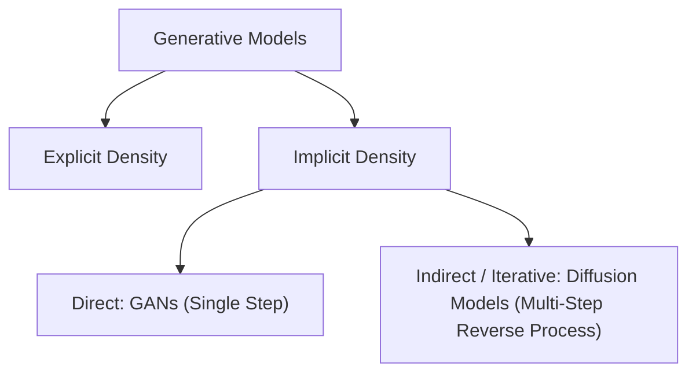
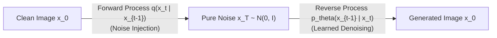
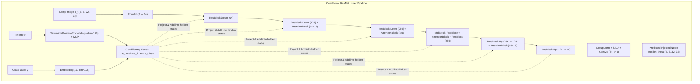

# Denoising Diffusion Probabilistic Models: DDPM & Accelerated DDIM

---

## 1. Core Concept & Problem Formulation

### 1.1 The Diffusion Paradigm

In the landscape of deep generative modeling, **Diffusion Models** ([Sohl-Dickstein et al., ICML 2015](https://arxiv.org/abs/1503.03585); [Ho, Jain, & Abbeel, NeurIPS 2020](https://arxiv.org/abs/2006.11239)) represent state-of-the-art visual generation quality, classified under **Implicit Density & Iterative Sampling**:



Unlike GANs (which map noise to data in a single adversarial step), diffusion models formulate generation as a **gradual reverse stochastic process**, iteratively denoising a chaotic Gaussian latent variable over discrete timesteps.



This formulation offers significant fundamental advantages:
1. **Stable Likelihood-Based Objective:** Replaces the unstable two-player minimax saddle-point game of GANs with a stable mean-squared error (MSE) regression loss.
2. **Full Mode Coverage:** Because training optimizes a variational lower bound over the entire data distribution, diffusion models are inherently resistant to mode collapse.
3. **High-Resolution Fidelity:** Yields crisp high-frequency textures without delicate discriminator tuning.

---

## 2. Mathematical Foundation & Objective Derivation

### 2.1 The Forward Process (Noising Markov Chain)

The forward process $q$ is a fixed, non-learnable Markov chain that gradually destroys structure by adding Gaussian noise over $T$ discrete timesteps according to a predefined variance schedule $\beta_1, \beta_2, \dots, \beta_T$:

$$
q(x_t \mid x_{t-1}) = \mathcal{N}\left(x_t; \sqrt{1 - \beta_t} x_{t-1}, \, \beta_t \mathbf{I}\right)
$$

Jointly over the trajectory:

$$
q(x_{1:T} \mid x_0) = \prod_{t=1}^T q(x_t \mid x_{t-1})
$$

As $T \to \infty$ with $\sum \beta_t \to \infty$, the distribution at the final step converges to an isotropic Gaussian: $x_T \sim \mathcal{N}(0, \mathbf{I})$.

---

### 2.2 The Closed-Form Forward Shortcut

A key mathematical property of Gaussian Markov chains is that we do not need to simulate $t$ intermediate steps to sample $x_t$.
Let $\alpha_t = 1 - \beta_t$ and $\bar{\alpha}_t = \prod_{s=1}^t \alpha_s$:

$$
x_t = \sqrt{\alpha_t} x_{t-1} + \sqrt{1 - \alpha_t} \epsilon_{t-1}
$$

By recursive substitution of independent Gaussian variables:

$$
x_t = \sqrt{\bar{\alpha}_t} x_0 + \sqrt{1 - \bar{\alpha}_t} \epsilon, \quad \text{where } \epsilon \sim \mathcal{N}(0, \mathbf{I})
$$

This closed form allows us to sample an arbitrary timestep $t \sim \mathcal{U}(1, T)$ in **$O(1)$ constant time** during training without unrolling intermediate steps.

---

### 2.3 The Reverse Process (Learned Denoising)

If we could compute the true reverse conditional distribution $q(x_{t-1} \mid x_t)$, we could invert the chain starting from pure noise $x_T \sim \mathcal{N}(0, \mathbf{I})$. However, $q(x_{t-1} \mid x_t)$ depends on the unknown data distribution $q(x_0)$.

Instead, we train a parameterized neural network $p_\theta(x_{t-1} \mid x_t)$ (typically a U-Net with timestep embeddings) to approximate the reverse transitions:

$$
p_\theta(x_{t-1} \mid x_t) = \mathcal{N}\left(x_{t-1}; \mu_\theta(x_t, t), \, \Sigma_\theta(x_t, t)\right)
$$

[Ho et al. (2020)](https://arxiv.org/abs/2006.11239) proved that setting $\Sigma_\theta(x_t, t) = \sigma_t^2 \mathbf{I}$ (where $\sigma_t^2 = \beta_t$ or $\tilde{\beta}_t = \frac{1 - \bar{\alpha}_{t-1}}{1 - \bar{\alpha}_t} \beta_t$) works remarkably well in practice, leaving only the mean $\mu_\theta$ to be learned.

---

### 2.4 Derivation of the Simplified Training Objective ($L_{\text{simple}}$)

Conditioned on the original clean image $x_0$, the true posterior of the reverse step is tractable and Gaussian:

$$
q(x_{t-1} \mid x_t, x_0) = \mathcal{N}\left(x_{t-1}; \tilde{\mu}_t(x_t, x_0), \tilde{\beta}_t \mathbf{I}\right)
$$

where:

$$
\tilde{\mu}_t(x_t, x_0) = \frac{\sqrt{\bar{\alpha}_{t-1}}\beta_t}{1 - \bar{\alpha}_t} x_0 + \frac{\sqrt{\alpha_t}(1 - \bar{\alpha}_{t-1})}{1 - \bar{\alpha}_t} x_t
$$

Substituting the forward shortcut $x_0 = \frac{x_t - \sqrt{1 - \bar{\alpha}_t}\epsilon}{\sqrt{\bar{\alpha}_t}}$ reveals that predicting $\tilde{\mu}_t$ is mathematically equivalent to **predicting the injected Gaussian noise vector $\epsilon$**:

$$
\mu_\theta(x_t, t) = \frac{1}{\sqrt{\alpha_t}} \left( x_t - \frac{\beta_t}{\sqrt{1 - \bar{\alpha}_t}} \epsilon_\theta(x_t, t) \right)
$$

By expanding the Variational Lower Bound (VLB) and dropping the complicated weighting terms, Ho et al. arrived at the **simplified MSE loss**:

$$
\mathcal{L}_{\text{simple}}(\theta) = \mathbb{E}_{t \sim [1, T], \, x_0, \, \epsilon \sim \mathcal{N}(0, \mathbf{I})} \left[ \| \epsilon - \epsilon_\theta(x_t, t) \|_2^2 \right]
$$

#### 4-Step Training Algorithm:
1. Sample clean data $x_0 \sim p_{\text{data}}$.
2. Sample timestep $t \sim \text{Uniform}(1, \dots, T)$.
3. Sample Gaussian noise $\epsilon \sim \mathcal{N}(0, \mathbf{I})$ and compute noisy image $x_t = \sqrt{\bar{\alpha}_t} x_0 + \sqrt{1 - \bar{\alpha}_t} \epsilon$.
4. Compute gradient $\nabla_\theta \| \epsilon - \epsilon_\theta(x_t, t) \|_2^2$ and step optimizer.

---

## 3. Architecture & Code Walkthrough (`05_denoising_diffusion_model.py`)

The implementation in [`05_denoising_diffusion_model.py`](file:///Users/mghifary/Documents/ITB/IF5152/generative-models/05_denoising_diffusion_model.py) features a complete class-conditional ResNet U-Net tailored for CIFAR-10 ($3 \times 32 \times 32$).



---

### 3.1 Sinusoidal Position Embeddings: `SinusoidalPositionEmbeddings`

Following [Vaswani et al. (2017)](https://arxiv.org/abs/1706.03762) and [Ho et al. (2020)](https://arxiv.org/abs/2006.11239), the discrete scalar timestep $t \in [1, T]$ is transformed into a continuous embedding vector using sinusoidal frequencies:

From [`05_denoising_diffusion_model.py`](file:///Users/mghifary/Documents/ITB/IF5152/generative-models/05_denoising_diffusion_model.py#L52-L69):

```python
class SinusoidalPositionEmbeddings(nn.Module):
    def __init__(self, dim: int):
        super().__init__()
        self.dim = dim

    def forward(self, time: torch.Tensor) -> torch.Tensor:
        device = time.device
        half_dim = self.dim // 2
        embeddings = math.log(10000) / (half_dim - 1)
        embeddings = torch.exp(torch.arange(half_dim, device=device) * -embeddings)
        embeddings = time[:, None].float() * embeddings[None, :]
        return torch.cat((embeddings.sin(), embeddings.cos()), dim=-1)
```

---

### 3.2 Multi-Head Self-Attention: `AttentionBlock`

To coordinate global spatial features across distant pixels (e.g., ensuring both wings of an airplane match), spatial multi-head self-attention is applied at lower spatial resolutions ($16 \times 16$ and $8 \times 8$).

From [`05_denoising_diffusion_model.py`](file:///Users/mghifary/Documents/ITB/IF5152/generative-models/05_denoising_diffusion_model.py#L71-L97):

```python
class AttentionBlock(nn.Module):
    def __init__(self, channels: int, num_heads: int = 4):
        super().__init__()
        self.num_heads = num_heads
        self.head_dim = channels // num_heads
        self.norm = nn.GroupNorm(min(8, channels), channels)
        self.qkv = nn.Conv2d(channels, channels * 3, kernel_size=1, bias=False)
        self.proj = nn.Conv2d(channels, channels, kernel_size=1, bias=False)

    def forward(self, x: torch.Tensor) -> torch.Tensor:
        b, c, h, w = x.shape
        h_norm = self.norm(x)
        qkv = self.qkv(h_norm).view(b, 3, self.num_heads, self.head_dim, h * w)
        q, k, v = qkv[:, 0].transpose(-2, -1), qkv[:, 1].transpose(-2, -1), qkv[:, 2].transpose(-2, -1)
        out = torch.nn.functional.scaled_dot_product_attention(q, k, v)
        out = out.transpose(-2, -1).contiguous().view(b, c, h, w)
        return x + self.proj(out)
```

---

### 3.3 Conditioning Vector Injection: `ResBlock`

Timestep and class conditioning vectors are fused additively:

$$
e_{\text{cond}} = e_{\text{time}} + e_{\text{class}}
$$

Within each `ResBlock`, $e_{\text{cond}}$ is passed through a linear projection and added directly into the normalized feature map before the second convolution.

---

## 4. Reverse Sampling Dynamics & Accelerated Algorithms

### 4.1 Stochastic Ancestral Sampling (DDPM, Ho et al. 2020)

To synthesize images using the standard Markovian reverse process:
1. Initialize $x_T \sim \mathcal{N}(0, \mathbf{I})$.
2. For $t = T, T-1, \dots, 1$:
   - Sample $z \sim \mathcal{N}(0, \mathbf{I})$ if $t > 1$, else $z = \mathbf{0}$.
   - Compute reverse step:

$$
x_{t-1} = \frac{1}{\sqrt{\alpha_t}} \left( x_t - \frac{1 - \alpha_t}{\sqrt{1 - \bar{\alpha}_t}} \epsilon_\theta(x_t, t, y) \right) + \sigma_t z
$$

     where $\sigma_t^2 = \tilde{\beta}_t = \frac{1 - \bar{\alpha}_{t-1}}{1 - \bar{\alpha}_t} \beta_t$.
3. Return clean sample $x_0$.

**Limitation:** DDPM requires simulating all $T = 1000$ sequential evaluations, taking $30\text{--}60$ seconds per batch.

---

### 4.2 Accelerated Non-Markovian Sampling (DDIM, Song et al. 2021)

[Song, Meng, & Ermon (ICLR 2021)](https://arxiv.org/abs/2010.02502) proved that the forward marginals $q(x_t \mid x_0)$ can be matched using **non-Markovian forward inference processes**:

$$
q_\sigma(x_{t-1} \mid x_t, x_0) = \mathcal{N}\left( \sqrt{\bar{\alpha}_{t-1}} x_0 + \sqrt{1 - \bar{\alpha}_{t-1} - \sigma_t^2} \frac{x_t - \sqrt{\bar{\alpha}_t}x_0}{\sqrt{1 - \bar{\alpha}_t}}, \, \sigma_t^2 \mathbf{I} \right)
$$

where stochasticity is governed by:

$$
\sigma_t = \eta \sqrt{\frac{1 - \bar{\alpha}_{t-1}}{1 - \bar{\alpha}_t}} \sqrt{1 - \frac{\bar{\alpha}_t}{\bar{\alpha}_{t-1}}}
$$

#### The Deterministic ODE Regime ($\eta = 0$):
Setting $\eta = 0$ sets $\sigma_t = 0$, transforming the reverse chain into a **completely deterministic Ordinary Differential Equation (ODE)**:

1. **Predict Clean Image ($\hat{x}_0$):**

$$
\hat{x}_0 = \frac{x_t - \sqrt{1 - \bar{\alpha}_t} \epsilon_\theta(x_t, t, y)}{\sqrt{\bar{\alpha}_t}}
$$

2. **Deterministic Step to $x_{t-1}$:**

$$
x_{t-1} = \sqrt{\bar{\alpha}_{t-1}} \hat{x}_0 + \sqrt{1 - \bar{\alpha}_{t-1}} \epsilon_\theta(x_t, t, y)
$$

#### Advantages of DDIM:
- **Sub-sequence Trajectories ($S \ll T$):** Evaluates only an evenly spaced sub-sequence $\tau = [\tau_1, \tau_2, \dots, \tau_S]$ (e.g. $S = 25$ or $50$ steps).
- **$20\times\text{--}50\times$ Speedup:** Generation completes in **1–2 seconds** instead of minutes.
- **Invertible Latents:** Because the ODE is deterministic, $x_T$ acts as a unique latent code enabling exact latent interpolation and editing.

---

### 4.3 Classifier-Free Guidance (CFG, Ho & Salimans 2022)

In class-conditional synthesis, simply feeding class labels often yields muted, ambiguous generations. [Ho & Salimans (2022)](https://arxiv.org/abs/2207.12598) introduced **Classifier-Free Guidance (CFG)**:

1. **Training with Label Dropout:**
   With probability $p_{\text{uncond}} \approx 0.15$, the class label $y \in \{0, \dots, K-1\}$ is dropped to an unconditional null token $\emptyset$:

$$
y_{\text{train}} = \begin{cases}
\emptyset & \text{with probability } p_{\text{uncond}}, \\
y & \text{with probability } 1 - p_{\text{uncond}}
\end{cases}
$$

2. **Inference Extrapolation:**
   At sampling time, the network evaluates both conditional $\epsilon_\theta(x_t, t, y)$ and unconditional $\epsilon_\theta(x_t, t, \emptyset)$ estimates in a single batched pass. The guided noise prediction extrapolates away from the unconditional prior:

$$
\hat{\epsilon}_\theta(x_t, t, y) = \epsilon_\theta(x_t, t, \emptyset) + w \cdot \left( \epsilon_\theta(x_t, t, y) - \epsilon_\theta(x_t, t, \emptyset) \right)
$$

where $w \ge 1.0$ is the guidance scale (e.g., $w = 2.0\text{--}3.0$), strongly amplifying class-discriminative visual features and contrast.

---

### 4.4 Exponential Moving Average (EMA) Parameter Tracking

To stabilize stochastic gradient fluctuations across timesteps $t \in [1, 1000]$, the training loop maintains an Exponential Moving Average (EMA) copy of the model parameters:

$$
\theta_{\text{EMA}} \leftarrow \beta \cdot \theta_{\text{EMA}} + (1 - \beta) \cdot \theta
$$

with decay $\beta = 0.999$. Sampling with $\theta_{\text{EMA}}$ significantly reduces visual artifacts and improves sample fidelity.

---

## 5. CLI Execution & Practical Usage

The script [`05_denoising_diffusion_model.py`](file:///Users/mghifary/Documents/ITB/IF5152/generative-models/05_denoising_diffusion_model.py) implements full training, checkpointing, and fast DDIM sampling:

### Standard Training Command (CIFAR-10)
```bash
python IF5152/generative-models/05_denoising_diffusion_model.py \
    --epochs 50 \
    --batch-size 128 \
    --lr 0.0002 \
    --timesteps 1000 \
    --ddim-steps 50 \
    --cfg-scale 2.0 \
    --ema-decay 0.999
```

### Fast Inference Only (Using Saved Checkpoint)
```bash
python IF5152/generative-models/05_denoising_diffusion_model.py \
    --sample-only \
    --checkpoint checkpoints/cddpm_cifar10_checkpoint.pt \
    --ddim-steps 25 \
    --cfg-scale 2.5
```

### Command-Line Arguments Reference

| Argument | Type | Default | Description |
| :--- | :--- | :--- | :--- |
| `--epochs` | `int` | `50` | Total training epochs on CIFAR-10. |
| `--batch-size` | `int` | `128` | Mini-batch training size. |
| `--lr` | `float` | `0.0002` | AdamW learning rate. |
| `--timesteps` | `int` | `1000` | Discrete timesteps $T$ for forward noising schedule. |
| `--ddim-steps` | `int` | `50` | Number of sub-sequence steps $S$ for fast DDIM sampling. |
| `--cfg-scale` | `float` | `2.0` | Classifier-Free Guidance extrapolation scale $w$. |
| `--p-uncond` | `float` | `0.15` | Probability of dropping label to unconditional token $\emptyset$. |
| `--ema-decay` | `float` | `0.999` | Exponential Moving Average decay rate. |
| `--sample-only` | `flag` | `False` | Skip training and generate sample grids from checkpoint. |
| `--checkpoint` | `str` | `None` | Path to load or resume model weights. |

---

## 6. Forward Perspective: Straight Trajectories in Rectified Flow

While DDIM accelerates diffusion by taking deterministic strides along curved stochastic paths, recent foundation models (such as Stable Diffusion 3 and Flux) generalize diffusion using **Rectified Flow & Flow Matching**, connecting noise and data along deterministic **straight-line paths** with constant velocity.

For complete theoretical derivations, ODE vector fields, and CIFAR-10 implementation details, refer to the next guide:
➡️ **[`06_rectified_flow.md`](./06_rectified_flow.md): Rectified Flow & Flow Matching: Straight-Line ODE Trajectories**.

---

## 📚 References & Canonical Literature

1. **Foundations of Diffusion & Non-Equilibrium Thermodynamics:**
   - Sohl-Dickstein, J., Weiss, E., Khan, N., & Sompolinsky, H. (2015). "Deep Unsupervised Learning using Nonequilibrium Thermodynamics". *International Conference on Machine Learning (ICML 2015)*. [https://arxiv.org/abs/1503.03585](https://arxiv.org/abs/1503.03585)
   - Ho, J., Jain, A., & Abbeel, P. (2020). "Denoising Diffusion Probabilistic Models". *Advances in Neural Information Processing Systems (NeurIPS 2020)*. [https://arxiv.org/abs/2006.11239](https://arxiv.org/abs/2006.11239)

2. **Accelerated Non-Markovian Sampling (DDIM):**
   - Song, J., Meng, C., & Ermon, S. (2021). "Denoising Diffusion Implicit Models". *International Conference on Learning Representations (ICLR 2021)*. [https://arxiv.org/abs/2010.02502](https://arxiv.org/abs/2010.02502)

3. **Classifier-Free Guidance:**
   - Ho, J., & Salimans, T. (2022). "Classifier-Free Diffusion Guidance". *NeurIPS 2022 Workshop on Score-Based Methods*. [https://arxiv.org/abs/2207.12598](https://arxiv.org/abs/2207.12598)

4. **Diffusion Beating GANs:**
   - Dhariwal, P., & Nichol, A. (2021). "Diffusion Models Beat GANs on Image Synthesis". *Advances in Neural Information Processing Systems (NeurIPS 2021)*. [https://arxiv.org/abs/2105.05233](https://arxiv.org/abs/2105.05233)
