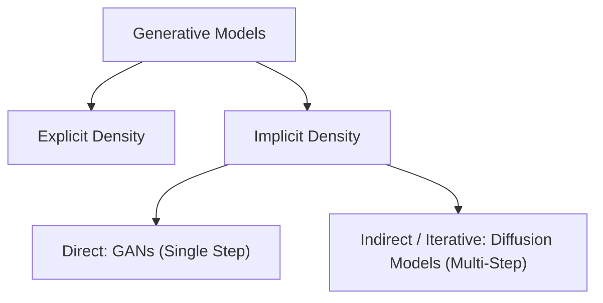
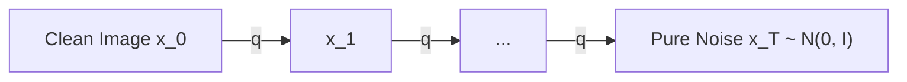

# IF5152 Lecture Notes: Denoising Diffusion Probabilistic Models (DDPM)

---

## 1. Overview & Taxonomy

In the modern generative landscape (Lecture 13, slides 46–47 & 116), **Diffusion Models** represent the state of the art in generative quality, classified under **Implicit Density & Iterative Sampling**:

Unlike GANs (which generate samples in a single forward pass through an adversarial game), Diffusion Models formulate generation as a **gradual reverse stochastic process**, iteratively cleaning noisy inputs over hundreds of discrete steps ([Sohl-Dickstein et al., ICML 2015](https://arxiv.org/abs/1503.03585); [Ho, Jain, & Abbeel, NeurIPS 2020](https://arxiv.org/abs/2006.11239)).

---

## 2. The Forward Process (Noising)

The forward process $q$ is a fixed, non-learnable Markov chain that gradually destroys information by adding Gaussian noise over $T$ timesteps according to a predefined variance schedule $\beta_1, \beta_2, \dots, \beta_T$:

$$q(x_t \mid x_{t-1}) = \mathcal{N}\left(x_t; \sqrt{1 - \beta_t} x_{t-1}, \, \beta_t \mathbf{I}\right)$$

### The Closed-Form Forward Shortcut
A key mathematical property of Gaussian Markov chains is that we do not need to simulate $t$ intermediate steps to generate $x_t$.
Let $\alpha_t = 1 - \beta_t$ and $\bar{\alpha}_t = \prod_{s=1}^t \alpha_s$:

$$x_t = \sqrt{\bar{\alpha}_t} x_0 + \sqrt{1 - \bar{\alpha}_t} \epsilon, \quad \text{where } \epsilon \sim \mathcal{N}(0, \mathbf{I})$$

This closed form allows us to sample an arbitrary timestep $t \sim \mathcal{U}(1, T)$ in $O(1)$ constant time during training!

---

## 3. The Reverse Process (Denoising)

If we could compute the true reverse conditional distribution $q(x_{t-1} \mid x_t)$, we could start with pure noise $x_T \sim \mathcal{N}(0, \mathbf{I})$ and reverse the chain step by step.
However, $q(x_{t-1} \mid x_t)$ depends on the entire data distribution $q(x_0)$, which is unknown.

Instead, we train a parameterized neural network $p_\theta(x_{t-1} \mid x_t)$ (typically a U-Net with timestep embeddings) to approximate this reverse distribution:

$$p_\theta(x_{t-1} \mid x_t) = \mathcal{N}\left(x_{t-1}; \mu_\theta(x_t, t), \, \Sigma_\theta(x_t, t)\right)$$

[Ho et al. (2020)](https://arxiv.org/abs/2006.11239) demonstrated that fixing $\Sigma_\theta(x_t, t) = \sigma_t^2 \mathbf{I}$ (where $\sigma_t^2 = \beta_t$ or $\tilde{\beta}_t = \frac{1 - \bar{\alpha}_{t-1}}{1 - \bar{\alpha}_t} \beta_t$) works remarkably well, leaving only the mean $\mu_\theta$ to be learned.

---

## 4. The Training Objective ($L_{simple}$)

By expanding the Variational Lower Bound (VLB) on the negative log-likelihood $\mathbb{E}[-\log p_\theta(x_0)]$, the objective reduces to matching the reverse step posterior with a closed form:

$$q(x_{t-1} \mid x_t, x_0) = \mathcal{N}\left(x_{t-1}; \tilde{\mu}_t(x_t, x_0), \tilde{\beta}_t \mathbf{I}\right)$$
where:
$$\tilde{\mu}_t(x_t, x_0) = \frac{\sqrt{\bar{\alpha}_{t-1}}\beta_t}{1 - \bar{\alpha}_t} x_0 + \frac{\sqrt{\alpha_t}(1 - \bar{\alpha}_{t-1})}{1 - \bar{\alpha}_t} x_t$$

Substituting $x_0 = \frac{x_t - \sqrt{1 - \bar{\alpha}_t}\epsilon}{\sqrt{\bar{\alpha}_t}}$ reveals that predicting $\tilde{\mu}_t$ is equivalent to **predicting the Gaussian noise vector $\epsilon$** that was injected at step $t$:

$$\mu_\theta(x_t, t) = \frac{1}{\sqrt{\alpha_t}} \left( x_t - \frac{\beta_t}{\sqrt{1 - \bar{\alpha}_t}} \epsilon_\theta(x_t, t) \right)$$

### Simplified Loss Function
Ho et al. showed that dropping the complicated weighting factors yields superior perceptual generation quality:

$$\mathcal{L}_{simple}(\theta) = \mathbb{E}_{t \sim [1, T], \, x_0, \, \epsilon \sim \mathcal{N}(0, \mathbf{I})} \left[ \| \epsilon - \epsilon_\theta(x_t, t) \|_2^2 \right]$$

### Training Algorithm in 4 Steps:
1. Sample clean data $x_0 \sim q(x_0)$ from the training batch.
2. Sample timestep $t \sim \text{Uniform}(1, \dots, T)$.
3. Sample noise $\epsilon \sim \mathcal{N}(0, \mathbf{I})$ and compute noisy image $x_t = \sqrt{\bar{\alpha}_t} x_0 + \sqrt{1 - \bar{\alpha}_t} \epsilon$.
4. Compute gradient $\nabla_\theta \| \epsilon - \epsilon_\theta(x_t, t) \|^2$ and step optimizer.

---

## 5. Reverse Sampling Dynamics: DDPM & Accelerated DDIM

### 5.1 Stochastic Ancestral Sampling (DDPM, Ho et al. 2020)

To synthesize a new image from scratch using the standard Markovian formulation:
1. Sample $x_T \sim \mathcal{N}(0, \mathbf{I})$.
2. For $t = T, T-1, \dots, 1$:
   - Sample $z \sim \mathcal{N}(0, \mathbf{I})$ if $t > 1$, else $z = \mathbf{0}$.
   - Compute:
     $$x_{t-1} = \frac{1}{\sqrt{\alpha_t}} \left( x_t - \frac{1 - \alpha_t}{\sqrt{1 - \bar{\alpha}_t}} \epsilon_\theta(x_t, t) \right) + \sigma_t z$$
     where $\sigma_t^2 = \beta_t$ or $\tilde{\beta}_t = \frac{1 - \bar{\alpha}_{t-1}}{1 - \bar{\alpha}_t} \beta_t$.
3. Return clean sample $x_0$.

While theoretically sound, DDPM requires $T = 1000$ sequential network evaluations, making generation prohibitively slow ($O(T)$ latency).

---

### 5.2 Accelerated Non-Markovian Sampling (DDIM, Song et al. 2021)

[Song, Meng, & Ermon (ICLR 2021)](https://arxiv.org/abs/2010.02502) proved that the forward marginal distributions $q(x_t \mid x_0)$ can be matched using a family of **non-Markovian forward inference processes**:

$$q_\sigma(x_{t-1} \mid x_t, x_0) = \mathcal{N}\left( \sqrt{\bar{\alpha}_{t-1}} x_0 + \sqrt{1 - \bar{\alpha}_{t-1} - \sigma_t^2} \frac{x_t - \sqrt{\bar{\alpha}_t}x_0}{\sqrt{1 - \bar{\alpha}_t}}, \, \sigma_t^2 \mathbf{I} \right)$$

where the stochasticity is governed by:
$$\sigma_t = \eta \sqrt{\frac{1 - \bar{\alpha}_{t-1}}{1 - \bar{\alpha}_t}} \sqrt{1 - \frac{\bar{\alpha}_t}{\bar{\alpha}_{t-1}}}$$

#### The Deterministic ODE Regime ($\eta = 0$):
When $\eta = 0$, $\sigma_t = 0$. The stochastic reverse process collapses into a **completely deterministic Ordinary Differential Equation (ODE)** trajectory:

1. **Predict Clean Image ($\hat{x}_0$):**
   $$\hat{x}_0 = \frac{x_t - \sqrt{1 - \bar{\alpha}_t} \epsilon_\theta(x_t, t)}{\sqrt{\bar{\alpha}_t}}$$
2. **Deterministic Step to $x_{t-1}$:**
   $$x_{t-1} = \sqrt{\bar{\alpha}_{t-1}} \hat{x}_0 + \sqrt{1 - \bar{\alpha}_{t-1}} \epsilon_\theta(x_t, t)$$

#### Key Advantages of DDIM:
- **Sub-sequence Sampling ($S \ll T$):** Instead of simulating all $T = 1000$ timesteps, DDIM samples along an evenly spaced trajectory $\tau = [\tau_1, \tau_2, \dots, \tau_S]$ (e.g., $S = 25$ or $50$ steps).
- **$20\times\text{--}50\times$ Speedup:** Full batches generate in **1–2 seconds** instead of minutes.
- **Consistent Latent Trajectories:** Because $\eta = 0$ is deterministic, the initial noise vector $x_T$ acts as an exact invertible latent code, enabling latent interpolation and semantic editing just like GANs.

---

### 5.3 Classifier-Free Guidance (CFG, Ho & Salimans 2022)

In class-conditional synthesis, conditioning simply on class labels often produces muted or ambiguous samples. [Ho & Salimans (2022)](https://arxiv.org/abs/2207.12598) introduced **Classifier-Free Guidance (CFG)**, avoiding the need for an external noisy classifier network.

#### 1. Training with Label Dropout:
During training, the class label $y \in \{0, \dots, K-1\}$ is randomly dropped to an unconditional null token $\emptyset$ with probability $p_{\text{uncond}} \approx 0.15$:
$$y_{\text{train}} = \begin{cases} \emptyset & \text{with probability } p_{\text{uncond}} \\ y & \text{with probability } 1 - p_{\text{uncond}} \end{cases}$$

#### 2. Inference Extrapolation:
At sampling time, the network computes both the conditional estimate $\epsilon_\theta(x_t, t, y)$ and the unconditional estimate $\epsilon_\theta(x_t, t, \emptyset)$. The guided noise prediction extrapolates away from the unconditional prior:

$$\hat{\epsilon}_\theta(x_t, t, y) = \epsilon_\theta(x_t, t, \emptyset) + w \cdot \left( \epsilon_\theta(x_t, t, y) - \epsilon_\theta(x_t, t, \emptyset) \right)$$

where $w \ge 1.0$ is the **guidance scale**:
- $w = 1.0$: Standard conditional diffusion.
- $w \in [1.5, 3.0]$: Amplifies class-discriminative features, sharpens textures, and increases perceptual contrast at the cost of slight diversity reduction.

---

### 5.4 Conditional ResNet U-Net Architecture

For natural image datasets like CIFAR-10 ($3 \times 32 \times 32$), the architecture features:
1. **Sinusoidal Position Encoding + SiLU MLP:** Maps discrete scalar timestep $t$ to continuous conditioning vector $e_{\text{time}} \in \mathbb{R}^{128}$.
2. **Class Embedding:** Maps class index $y \in \{0, \dots, K\}$ to $e_{\text{class}} \in \mathbb{R}^{128}$, merged via element-wise addition:
   $$e_{\text{cond}} = e_{\text{time}} + e_{\text{class}}$$
3. **Residual Blocks (`ResBlock`):** Pre-activation `GroupNorm` + `SiLU` + $3\times 3$ Conv with adaptive conditioning projection ($h + \text{Linear}(e_{\text{cond}})$) and residual skip paths.
4. **Spatial Self-Attention:** Multi-head attention at $16 \times 16$ and $8 \times 8$ feature resolutions to coordinate long-range spatial correlations across object components.

---

### 5.5 Exponential Moving Average (EMA) Parameter Tracking

In diffusion models, gradients at step $t$ are computed across random noise scales ranging from near-zero noise ($t \approx 1$) to pure Gaussian chaos ($t \approx 1000$). This produces high stochastic gradient variance across batches.

To stabilize inference and achieve photorealistic synthesis, modern diffusion models maintain an **Exponential Moving Average (EMA)** shadow copy of all model parameters ([Song & Ermon, 2020](https://arxiv.org/abs/1907.05600); [Ho et al., 2020](https://arxiv.org/abs/2006.11239)):

$$\theta_{\text{EMA}} \leftarrow \beta \cdot \theta_{\text{EMA}} + (1 - \beta) \cdot \theta$$

where $\beta \in [0.995, 0.9999]$ (typically $\beta = 0.999$):
- **Training:** Backpropagation updates raw parameters $\theta$ via AdamW, and $\theta_{\text{EMA}}$ is updated as a running average.
- **Inference & Sampling:** The shadow parameters $\theta_{\text{EMA}}$ are loaded into the U-Net for DDIM/DDPM reverse sampling, drastically smoothing out high-frequency artifacts, stabilizing contrast, and reducing FID scores.

---

## 6. Why Diffusion Outperformed GANs

In the landmark paper *"Diffusion Models Beat GANs on Image Synthesis"* ([Dhariwal & Nichol, NeurIPS 2021](https://arxiv.org/abs/2105.05233)), diffusion demonstrated superior mode coverage and sample fidelity:

| Criterion | Generative Adversarial Networks (GANs) | Denoising Diffusion Models (DDPM) |
| :--- | :--- | :--- |
| **Optimization Stability** | ⚠️ Unstable minimax game; prone to mode collapse |  Stable standard L2 regression objective |
| **Mode Coverage** | ⚠️ Often misses rare modes of data distribution |  Excellent diversity (covers full support of data) |
| **Sample Quality** |  Sharp, but fragile hyperparameter tuning |  Superior fidelity and photo-realism |
| **Sampling Latency** |  1 forward pass ($O(1)$) | ⚠️ 50–1000 iterative steps ($O(T)$) (accelerated via DDIM/flow matching) |
| **Theoretical Rigor** | Game theory & saddle point equilibrium | Non-equilibrium thermodynamics & score matching ([Song et al., 2021](https://arxiv.org/abs/2011.13456)) |

To overcome the pixel-space computational cost of high-resolution diffusion, modern foundation models (such as Stable Diffusion) operate in latent space (**Latent Diffusion Models**, [Rombach et al., CVPR 2022](https://arxiv.org/abs/2112.10752)).

---

## 7. Summary & Reading Guide

- **Reference Code ([`05_denoising_diffusion_model.py`](../05_denoising_diffusion_model.py)):** Hands-on PyTorch DDPM implementation featuring forward noising, U-Net with sinusoidal timestep embeddings, and reverse ancestral sampling.
- **Top-Level Lab Overview ([`README.md`](../README.md)):** Master comparison table covering all five generative paradigms.

---

## 📚 References & Canonical Literature

1. **Foundational Non-Equilibrium Thermodynamics Diffusion:**
   - Sohl-Dickstein, J., Weiss, E., Khan, N., & Sompolinsky, H. (2015). "Deep Unsupervised Learning using Nonequilibrium Thermodynamics". *International Conference on Machine Learning (ICML 2015)*. [https://arxiv.org/abs/1503.03585](https://arxiv.org/abs/1503.03585)

2. **Denoising Diffusion Probabilistic Models (DDPM):**
   - Ho, J., Jain, A., & Abbeel, P. (2020). "Denoising Diffusion Probabilistic Models". *Advances in Neural Information Processing Systems (NeurIPS 2020)*. [https://arxiv.org/abs/2006.11239](https://arxiv.org/abs/2006.11239)
   - Nichol, A. Q., & Dhariwal, P. (2021). "Improved Denoising Diffusion Probabilistic Models". *International Conference on Machine Learning (ICML 2021)*. [https://arxiv.org/abs/2102.09672](https://arxiv.org/abs/2102.09672)

3. **Score-Based Generative Modeling & SDEs:**
   - Song, Y., & Ermon, S. (2019). "Generative Modeling by Estimating Gradients of the Data Distribution". *Advances in Neural Information Processing Systems (NeurIPS 2019)*. [https://arxiv.org/abs/1907.05600](https://arxiv.org/abs/1907.05600)
   - Song, Y., Sohl-Dickstein, J., Kingma, D. P., Kumar, A., Ermon, S., & Poole, B. (2021). "Score-Based Generative Modeling through Stochastic Differential Equations". *International Conference on Learning Representations (ICLR 2021)*. [https://arxiv.org/abs/2011.13456](https://arxiv.org/abs/2011.13456)

4. **Fast Sampling & Guidance:**
   - Song, J., Meng, C., & Ermon, S. (2021). "Denoising Diffusion Implicit Models". *International Conference on Learning Representations (ICLR 2021)*. [https://arxiv.org/abs/2010.02502](https://arxiv.org/abs/2010.02502)
   - Dhariwal, P., & Nichol, A. (2021). "Diffusion Models Beat GANs on Image Synthesis". *Advances in Neural Information Processing Systems (NeurIPS 2021)*. [https://arxiv.org/abs/2105.05233](https://arxiv.org/abs/2105.05233)
   - Ho, J., & Salimans, T. (2022). "Classifier-Free Diffusion Guidance". *NeurIPS 2022 Workshop on Score-Based Methods*. [https://arxiv.org/abs/2207.12598](https://arxiv.org/abs/2207.12598)

5. **Latent Diffusion & High-Resolution Synthesis:**
   - Rombach, R., Blattmann, A., Lorenz, D., Esser, P., & Ommer, B. (2022). "High-Resolution Image Synthesis with Latent Diffusion Models". *IEEE/CVF Conference on Computer Vision and Pattern Recognition (CVPR 2022)*. [https://arxiv.org/abs/2112.10752](https://arxiv.org/abs/2112.10752)
