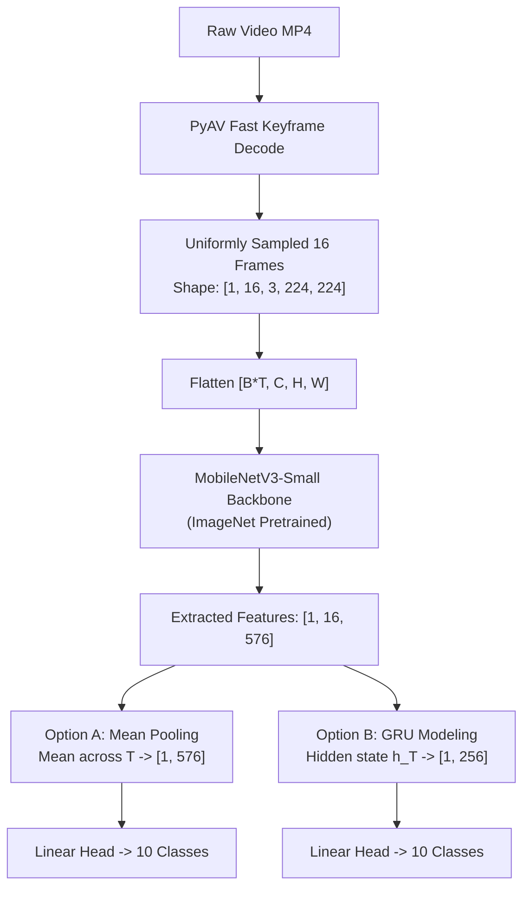

# Session 1: Video I/O Bottlenecks, Spatial Backbones, and Late Fusion

- **File**: [`01_video_io_and_late_fusion.py`](../01_video_io_and_late_fusion.py)
- **Lecture Alignment**: IF5152 Week 11 (Slides 9–20, 63)
- **Target Hardware**: Apple Silicon (`mps`), NVIDIA Cloud GPU (`cuda`), or CPU fallback (`cpu`)

---

## 1. Pedagogical Objective

In this lab session, you will explore the transition from **2D image classification** to **spatio-temporal video understanding**:
1. **The I/O Decoding Bottleneck**: Why traditional video decoding (e.g., standard frame-by-frame loops) severely throttles deep learning pipelines, and how multi-threaded keyframe seeking solves it.
2. **5D Video Tensor Mechanics**: How video clips are represented in PyTorch as `[Batch, Time, Channels, Height, Width]`.
3. **Late Fusion Paradigms**: Comparing order-invariant **Average Pooling** (Slide 19) against order-aware **Recurrent GRU Modeling** (Slide 63) atop an ImageNet-pretrained 2D CNN backbone.

---

## 2. Theoretical Background & Mathematical Foundations

### Video Representation: 2D Space + 1D Time (Slide 9)
While a standard image is a 3D tensor $[C \times H \times W]$, a video clip introduces a temporal dimension $T$:
$$\mathbf{X} \in \mathbb{R}^{B \times T \times C \times H \times W}$$
where:
- $B$: Batch size (e.g., 1 or 8)
- $T$: Number of sampled frames (e.g., 16)
- $C$: Number of color channels (3 for RGB)
- $H, W$: Spatial resolution (e.g., $224 \times 224$)

Processing every single frame of a 30 FPS high-definition video through a deep neural network is computationally infeasible. Therefore, we sample short clips of $T$ frames uniformly across the video duration (Slides 14–16).

### Late Fusion Architectures (Slides 18–20)
Instead of processing frames in complete isolation (Single-Frame baseline), **Late Fusion** first passes each frame through a shared 2D CNN feature extractor $f_\theta(\cdot)$, yielding spatial embeddings:
$$\mathbf{h}_t = f_\theta(\mathbf{x}_t) \in \mathbb{R}^{D}, \quad t = 1, \dots, T$$

We then aggregate these temporal embeddings before the final classification head:



#### Strategy A: Temporal Average Pooling (Slide 19)
Compresses the sequence into a single vector by computing the element-wise mean over time:
$$\mathbf{z}_{\text{mean}} = \frac{1}{T} \sum_{t=1}^{T} \mathbf{h}_t \in \mathbb{R}^{D}$$
- **Inductive Bias**: Permutation-invariant (shuffling video frames produces the exact same classification prediction).
- **Pros**: Zero additional parameters, extremely fast, robust for static scenes.
- **Cons**: Cannot distinguish irreversible directional actions (e.g., *opening a door* vs *closing a door*).

#### Strategy B: Recurrent GRU Temporal Modeling (Slide 63)
Feeds the sequence of vectors into a Gated Recurrent Unit (GRU):
$$\mathbf{s}_t = \text{GRU}(\mathbf{h}_t, \mathbf{s}_{t-1}), \quad \mathbf{z}_{\text{gru}} = \mathbf{s}_T \in \mathbb{R}^{d_h}$$
- **Inductive Bias**: Order-sensitive temporal dynamics.
- **Pros**: Explicitly models sequential transitions and directionality.
- **Cons**: Sequential computation cannot be easily parallelized across the time steps; adds model parameters.

---

## 3. Tensor Dimension Tracing

| Pipeline Stage | Operation | Input Shape | Output Shape | Notes |
| :--- | :--- | :--- | :--- | :--- |
| **Video Decoding** | Keyframe Seek | Disk MP4 | `(16, 360, 640, 3)` | Decoded as uint8 RGB numpy array |
| **Preprocessing** | Normalization & Stack | `16 x [3, 224, 224]` | `[1, 16, 3, 224, 224]` | Added Batch dimension $B=1$ |
| **Backbone Flatten** | View Reshape | `[1, 16, 3, 224, 224]` | `[16, 3, 224, 224]` | Treats $B \times T$ frames as a 2D batch |
| **Spatial Extraction** | 2D MobileNetV3 | `[16, 3, 224, 224]` | `[16, 576]` | Spatial pooling inside backbone |
| **Unflatten Time** | View Reshape | `[16, 576]` | `[1, 16, 576]` | Restores `[B, T, D]` temporal structure |
| **Mean Pooling** | `torch.mean(dim=1)` | `[1, 16, 576]` | `[1, 576]` | Time dimension collapsed |
| **GRU Alternative** | `gru(x)[:, -1, :]` | `[1, 16, 576]` | `[1, 256]` | Hidden dimension $d_h = 256$ |
| **Classification** | Linear Layer | `[1, 576]` or `[1, 256]` | `[1, 10]` | Unnormalized class logits |

---

## 4. Execution Playbook

### Running with Default Mean Pooling
```bash
python 01_video_io_and_late_fusion.py --video data/person_bicycle.mp4 --fusion mean
```

### Running with Recurrent GRU Temporal Head
```bash
python 01_video_io_and_late_fusion.py --video data/person_bicycle.mp4 --fusion gru
```

### Specifying Hardware Accelerators
```bash
# Apple Silicon Mac (M1/M2/M3/M4)
python 01_video_io_and_late_fusion.py --device mps

# NVIDIA Cloud GPU / Colab
python 01_video_io_and_late_fusion.py --device cuda

# Standard CPU
python 01_video_io_and_late_fusion.py --device cpu
```

### CLI Arguments Reference

| Flag | Type | Default | Description |
| :--- | :--- | :--- | :--- |
| `--video` | `str` | `data/person_bicycle.mp4` | Path to input `.mp4` video file |
| `--num_frames` | `int` | `16` | Number of frames uniformly sampled across video |
| `--fusion` | `str` | `mean` | Fusion mechanism: `mean` (Average Pooling) or `gru` (Recurrent) |
| `--device` | `str` | `auto` | Target device (`auto`, `mps`, `cuda`, `cpu`) |

---

## 5. Expected Output & Interpretation

When you run the script, you will see three distinct phases in the terminal:

```text
==================================================
Hardware Acceleration: Apple Silicon Metal (MPS)
PyTorch Version:       2.X.X
==================================================

--- [STEP 1] Industrial I/O Decoding Benchmark ---
Target Video Clip : data/person_bicycle.mp4 (Sample 16 frames)
  1. OpenCV (Sequential Loop)             :  84.50 ms
  2. PyAV Naive (Single-threaded Loop)    :  92.30 ms
  3. PyAV Fast Seek (Industrial Standard) :  12.40 ms
==> PyAV with Keyframe Seeking is 6.8x faster than OpenCV!

--- [STEP 2] Constructing the 5D Video Tensor ---
Input Video Tensor Shape: (1, 16, 3, 224, 224) (Batch, Time, Channels, Height, Width)
Tensor VRAM Footprint on MPS: 9408.00 KB

--- [STEP 3] Late Fusion Model (MEAN) ---
Backbone + Fusion Total Parameters : 935,978
Forward Pass Execution Latency     : 14.85 ms
Output Logits Tensor Shape         : (1, 10) (Batch, Classes)
Class Probabilities (Softmax)      : [0.0982 0.1054 0.1011 ...]

[SUCCESS] Session 1 demo completed.
```

### Key Takeaways:
1. **Notice the I/O Speedup**: PyAV using multithreaded FFmpeg keyframe seeking jumps directly to target timestamps instead of reading and uncompressing every intermediate frame from disk.
2. **Notice the Batching Trick**: The code flattens `[B, T, C, H, W]` to `[B*T, C, H, W]` so a standard 2D CNN can compute all 16 frames simultaneously in parallel on the GPU/MPS tensor cores.

---

## 6. Self-Study Exercises & Experiments

### Exercise 1: Temporal Invariance Verification
1. Open [`01_video_io_and_late_fusion.py`](../01_video_io_and_late_fusion.py) in your editor.
2. Under `video_tensor`, invert the temporal order of frames (`video_tensor = torch.flip(video_tensor, dims=[1])`).
3. Run both `--fusion mean` and `--fusion gru`.
4. **Question**: Does the output probability distribution change when frames are reversed in `mean` pooling? What about in `gru`? Why?

### Exercise 2: Scaling Number of Frames
Test the script with `--num_frames 8`, `--num_frames 16`, and `--num_frames 32`:
- Track both the **I/O decoding time** and the **model forward latency**.
- Does memory consumption scale linearly with the number of frames?

---

## 7. Troubleshooting FAQ

- **Error: `FileNotFoundError: Could not find demo video`**:
  - Run `python download_samples.py` from the `video-understanding-lab/` directory first to fetch the sample video.
- **Error: `ModuleNotFoundError: No module named 'av'`**:
  - Install PyAV via `pip install av` or `conda install av -c conda-forge`.
- **MPS Out-of-Memory or Unsupported Op Warning**:
  - If using an older macOS version without full MPS support, pass `--device cpu` to verify functionality.
