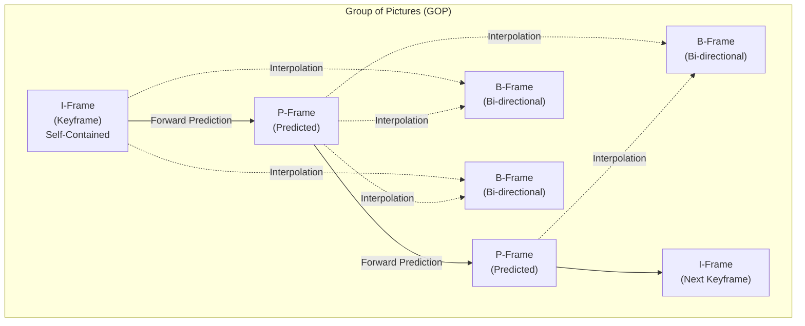
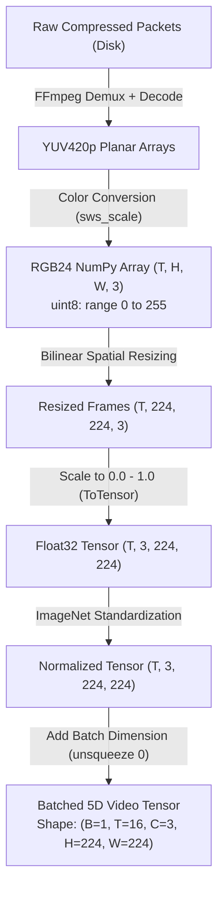
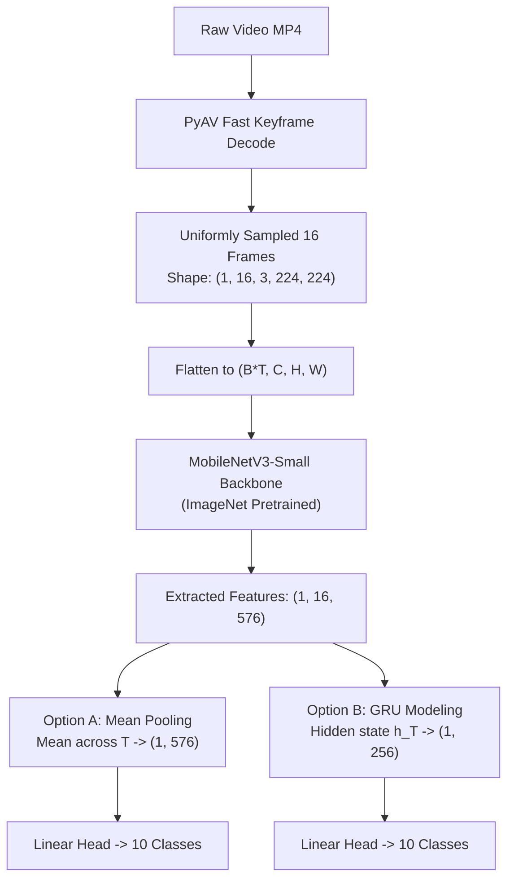

# Session 1: Video I/O Bottlenecks, Spatial Backbones, and Late Fusion

- **File**: [`01_video_io_and_late_fusion.py`](../01_video_io_and_late_fusion.py)
- **Lecture Alignment**: IF5152 Week 11 (Video Understanding Foundations & Late Fusion)
- **Target Hardware**: Apple Silicon (`mps`), NVIDIA Cloud GPU (`cuda`), or CPU fallback (`cpu`)

---

## 1. Pedagogical Objective

In this lab session, you will explore the transition from **2D static image classification** to **spatio-temporal video understanding**:
1. **The Video I/O Decoding Bottleneck**: Why traditional frame-by-frame decoding severely throttles deep learning training pipelines, and how multi-threaded keyframe seeking solves it.
2. **Video Compression Architecture**: How modern codecs (H.264/HEVC) compress video using Group of Pictures (GOP), I/P/B-frames, and presentation timestamps (PTS).
3. **5D Video Tensor Mechanics**: How video clips are structured in PyTorch as `[Batch, Time, Channels, Height, Width]`.
4. **Late Fusion Paradigms**: Comparing order-invariant **Average Pooling** against order-aware **Recurrent GRU Modeling** atop an ImageNet-pretrained 2D CNN backbone.

---

## 2. Theoretical Background: The Video Processing & I/O Mechanism

### 2.1 The Computational & Bandwidth Explosion
While a standard image is a 3D tensor $[C \times H \times W]$, a video clip introduces a temporal dimension $T$:

$$
\mathbf{X} \in \mathbb{R}^{B \times T \times C \times H \times W}
$$

Consider the bandwidth of uncompressed raw video:
* A standard $1080\text{p}$ video clip at 30 frames per second (FPS):

$$
\text{Size per frame} = 1920 \times 1080 \times 3 \text{ bytes (RGB24)} \approx 6.22 \text{ MB}
$$

$$
\text{Data throughput} = 6.22 \text{ MB} \times 30 \text{ frames/sec} \approx 186.6 \text{ MB/second}
$$
* A 10-minute video clip in uncompressed RGB format would consume over **111 Gigabytes** of disk space!

To make storage and internet streaming feasible, all real-world video files are heavily compressed using lossy video codecs (e.g., H.264/AVC ([Wiegand et al., IEEE TCSVT 2003](https://ieeexplore.ieee.org/document/1218189)), H.265/HEVC ([Sullivan et al., IEEE TCSVT 2012](https://ieeexplore.ieee.org/document/6316136)), VP9, AV1).

---

### 2.2 Video Containers vs. Video Codecs
Students often confuse containers with codecs:
* **Container Format (`.mp4`, `.mkv`, `.avi`)**: A file wrapper (multiplexer) containing metadata (frame rate, duration, audio/video synchronization tracks, and index tables like the MP4 `moov` atom).
* **Video Codec (H.264, HEVC, ProRes)**: The actual compression algorithm that encodes raw pixel buffers into compressed bitstream packets.

---

### 2.3 Inter-Frame Compression & The Group of Pictures (GOP)
Video codecs exploit two types of redundancies:
1. **Spatial Redundancy (Intra-frame)**: Adjacent pixels within the same image often share color and texture (compressed via Discrete Cosine Transform / DCT and quantization).
2. **Temporal Redundancy (Inter-frame)**: Consecutive frames in a 30 FPS video are nearly identical, with only small regions moving.

Codecs organize video sequences into a repeating **Group of Pictures (GOP)** consisting of three frame types:



| Frame Type | Full Name | Compression Mechanism | Decoding Dependencies | Size Ratio |
| :--- | :--- | :--- | :--- | :--- |
| **I-Frame** | Intra-coded (Keyframe) | Encoded independently like a standalone JPEG image using spatial DCT. | **None**. Can be decoded instantly in isolation. | **Largest** (100%) |
| **P-Frame** | Predicted Frame | Stores only **motion vectors** and residual error relative to the preceding I-frame or P-frame. | Requires decoding all preceding reference frames in the GOP. | **Medium** (~20–30%) |
| **B-Frame** | Bi-directional Frame | Stores motion vectors interpolated from both **preceding and succeeding** reference frames. | Requires decoding both past and future anchor frames. | **Smallest** (~5–10%) |

#### Decode Time Stamp (DTS) vs. Presentation Time Stamp (PTS):
Because B-frames require future reference frames to decode, video codecs transmit frames in **Decode Order (DTS)** which differs from their human display order **Presentation Order (PTS)**:
* **Display Order (PTS)**: $I_0 \rightarrow B_1 \rightarrow B_2 \rightarrow P_3$
* **Storage/Decode Order (DTS)**: $I_0 \rightarrow P_3 \rightarrow B_1 \rightarrow B_2$  *(The decoder must reconstruct $P_3$ before it can render $B_1$ and $B_2$!)*

---

### 2.4 Why Video I/O is the #1 Bottleneck in Deep Learning
When training neural networks on image datasets (e.g., ImageNet, [Deng et al., CVPR 2009](https://ieeexplore.ieee.org/document/5206848)), reading a JPEG image from disk takes $\sim 1\text{ ms}$.
However, when training on video clips:
* An epoch requires sampling thousands of video clips.
* If a model needs 16 frames uniformly spaced across a 600-frame video, how should those frames be retrieved?
* If a naive loop is used, the CPU must decompress entropy blocks (CABAC), compute inverse transforms, and apply motion compensation across **all 600 frames** just to throw away 584 of them!
* While the CPU spends $150\text{--}300\text{ ms}$ decoding frames, the GPU/MPS accelerator (which can compute a forward pass in $5\text{--}15\text{ ms}$) sits completely idle. This is known as **GPU Starvation**.

---

### 2.5 Algorithmic Comparison of Decoding Approaches

`01_video_io_and_late_fusion.py` implements a live benchmark comparing three distinct decoding algorithms on the exact same video file:


#### 1. Naive Sequential Decoding (`OpenCV`):
* Calls `cap.read()` in a linear loop starting from frame 0.
* Time complexity: $\mathcal{O}(N_{\text{total}})$, where $N_{\text{total}}$ is the total number of frames in the video.
* To extract 16 frames from a 647-frame video, it must decode **all 647 frames**.

#### 2. Naive Linear Decode with High-Level Python Wrappers (`PyAV Naive`):
* Iterates linearly using Python: `for frame in container.decode(stream): ...`
* In addition to decoding all 647 frames, PyAV instantiates a rich Python `av.VideoFrame` wrapper object for **every single discarded frame**.
* In Python, performing 647 object allocations, reference counts, and garbage collections under the Global Interpreter Lock (GIL) makes this approach even slower than OpenCV!

#### 3. Industrial Fast Seek via Demuxer Keyframe Navigation (`PyAV Fast Seek`):
* Reads the MP4 container's index table to find the byte offset corresponding to the nearest preceding **I-frame** for each target Presentation Time Stamp (PTS):

$$
\text{pts\_targets} = \text{linspace}(0, \text{duration}, T)
$$

* Executes `container.seek(pts, any_frame=False)` to jump the underlying disk file pointer directly to that byte offset, completely bypassing intermediate compressed packets.
* Enables hardware slice/frame multithreading:
  ```python
  stream.thread_type = "AUTO"  # Spawns worker threads across all available CPU cores
  ```
* Time complexity: $\mathcal{O}(T \cdot L_{\text{GOP}})$, where $T$ is the number of sampled frames ($16$) and $L_{\text{GOP}}$ is the distance to the keyframe ($\le 12\text{--}30$ frames).
* **Result**: Achieves **3x to 5x speedups** over sequential loops, keeping GPU/MPS tensor cores fully saturated.

---

### 2.6 The End-to-End Video Preprocessing Pipeline

Once raw frames are decoded, they undergo a multi-stage transformation into a normalized 5D PyTorch tensor:



#### Mathematical Steps in Preprocessing:
1. **Color Space Conversion**: Video codecs compress video in **YUV420p** (luma/chroma subsampling). The decoder converts this to **RGB24** using the ITU-R BT.601/BT.709 color conversion matrix:

$$
\begin{bmatrix} R \\ G \\ B \end{bmatrix} = \begin{bmatrix} 1 & 0 & 1.402 \\ 1 & -0.344136 & -0.714136 \\ 1 & 1.772 & 0 \end{bmatrix} \begin{bmatrix} Y \\ U - 128 \\ V - 128 \end{bmatrix}
$$

2. **Spatial Resizing**: Resizes spatial dimensions from arbitrary video resolution $(H_{\text{orig}}, W_{\text{orig}})$ to the model input resolution $(224 \times 224)$ via bilinear interpolation.
3. **Channel Standardization**: Re-scales pixel values to $[0.0, 1.0]$ and applies standard ImageNet mean and standard deviation:

$$
x_{\text{norm}}^{(c)} = \frac{x^{(c)} - \mu^{(c)}}{\sigma^{(c)}}, \quad \mu = [0.485, 0.456, 0.406], \; \sigma = [0.229, 0.224, 0.225]
$$

4. **The Batch Flattening Trick (Parallel Spatial Feature Extraction)**:
   A standard 2D CNN (e.g. MobileNetV3 ([Howard et al., ICCV 2019](https://arxiv.org/abs/1905.02244)) or ResNet ([He et al., CVPR 2016](https://arxiv.org/abs/1512.03385))) expects a 4D image input `[Batch, C, H, W]`.
   Instead of using a Python for-loop over the $T=16$ time steps, we fold the temporal dimension into the batch dimension:

$$
\mathbf{X}_{\text{flat}} = \mathbf{X}.\mathrm{view}(B \cdot T, C, H, W) \in \mathbb{R}^{16 \times 3 \times 224 \times 224}
$$

   This allows the GPU/MPS tensor cores to process all 16 frames **simultaneously in parallel**, achieving maximum hardware utilization.

---

## 3. Late Fusion Architectures

In their seminal study on large-scale video classification, [Karpathy et al. (CVPR 2014)](https://cs.stanford.edu/people/karpathy/deepvideo/) established that combining frame-level representations via late temporal fusion provides a strong, computationally efficient baseline. Once spatial feature vectors $\mathbf{h}_t \in \mathbb{R}^{576}$ are extracted for each frame $t = 1, \dots, T$, we unflatten the tensor back to `[B, T, D]` and aggregate temporal information before classification:



### Strategy A: Temporal Average Pooling
Compresses the sequence into a single vector by computing the element-wise mean over time:

$$
\mathbf{z}_{\text{mean}} = \frac{1}{T} \sum_{t=1}^{T} \mathbf{h}_t \in \mathbb{R}^{D}
$$

* **Inductive Bias**: Permutation-invariant (shuffling video frames produces the exact same classification prediction).
* **Pros**: Zero additional parameters, extremely fast, robust for static actions (e.g., *playing cello*, *sitting in classroom*).
* **Cons**: Cannot distinguish irreversible directional actions (e.g., *opening a door* vs *closing a door*).

### Strategy B: Recurrent GRU Temporal Modeling
Feeds the sequence of vectors into a Gated Recurrent Unit (GRU) ([Cho et al., EMNLP 2014](https://arxiv.org/abs/1406.1078); see also Long-term Recurrent Convolutional Networks by [Donahue et al., CVPR 2015](https://arxiv.org/abs/1411.4389)):

$$
\mathbf{s}_t = \mathrm{GRU}(\mathbf{h}_t, \mathbf{s}_{t-1}), \quad \mathbf{z}_{\text{gru}} = \mathbf{s}_T \in \mathbb{R}^{d_h}
$$

* **Inductive Bias**: Order-sensitive temporal dynamics.
* **Pros**: Explicitly models sequential transitions and directionality.
* **Cons**: Sequential computation across time steps; adds model parameters ($576 \times 256 \times 3 \approx 640\text{k}$ parameters).

---

## 4. Tensor Dimension Tracing

| Pipeline Stage | Operation / Function | Input Shape | Output Shape | Notes |
| :--- | :--- | :--- | :--- | :--- |
| **Video Demuxing** | Container Index Lookup | Disk MP4 | Seek Offsets | Finds I-frame byte positions via PTS |
| **Video Decoding** | PyAV Fast Seek | Disk Bitstream | `(16, 360, 640, 3)` | Decoded as uint8 RGB NumPy array |
| **Preprocessing** | Resizing & Normalization | `16 x [360, 640, 3]` | `[16, 3, 224, 224]` | Scaled to $[0, 1]$ and normalized with ImageNet stats |
| **Video Batching** | `torch.stack().unsqueeze(0)` | `[16, 3, 224, 224]` | `[1, 16, 3, 224, 224]` | Creates 5D tensor: `[B, T, C, H, W]` |
| **Backbone Flatten** | `view(B * T, C, H, W)` | `[1, 16, 3, 224, 224]` | `[16, 3, 224, 224]` | Flattens time into batch for parallel 2D convolution |
| **Spatial Extraction**| MobileNetV3 Backbone | `[16, 3, 224, 224]` | `[16, 576]` | Evaluates spatial features on MPS/CUDA tensor cores |
| **Unflatten Time** | `view(B, T, -1)` | `[16, 576]` | `[1, 16, 576]` | Restores `[B, T, D]` temporal sequence structure |
| **Mean Pooling** | `torch.mean(dim=1)` | `[1, 16, 576]` | `[1, 576]` | Time dimension collapsed (Option A) |
| **GRU Alternative** | `gru(x)[:, -1, :]` | `[1, 16, 576]` | `[1, 256]` | Hidden dimension $d_h = 256$ (Option B) |
| **Classification Head**| `Linear(D, K)` | `[1, 576]` or `[1, 256]` | `[1, 10]` | Unnormalized class logits |

---

## 5. Execution Playbook

### Running with Default Mean Pooling
```bash
python video-understanding-lab/01_video_io_and_late_fusion.py --video data/person_bicycle.mp4 --fusion mean
```

### Running with Recurrent GRU Temporal Head
```bash
python video-understanding-lab/01_video_io_and_late_fusion.py --video data/person_bicycle.mp4 --fusion gru
```

### Specifying Hardware Accelerators
```bash
# Apple Silicon Mac (M1/M2/M3/M4) via Metal Performance Shaders
python video-understanding-lab/01_video_io_and_late_fusion.py --device mps

# NVIDIA Cloud GPU / Google Colab via CUDA
python video-understanding-lab/01_video_io_and_late_fusion.py --device cuda

# Universal CPU Fallback
python video-understanding-lab/01_video_io_and_late_fusion.py --device cpu
```

### CLI Arguments Reference

| Flag | Type | Default | Description |
| :--- | :--- | :--- | :--- |
| `--video` | `str` | `data/person_bicycle.mp4` | Path to input `.mp4` video file |
| `--num_frames` | `int` | `16` | Number of frames uniformly sampled across video |
| `--fusion` | `str` | `mean` | Fusion mechanism: `mean` (Average Pooling) or `gru` (Recurrent) |
| `--device` | `str` | `auto` | Target device (`auto`, `mps`, `cuda`, `cpu`) |

---

## 6. Expected Terminal Output & Interpretation

When you execute the script, the output displays the three operational phases:

```text
=================================================================
 PyTorch Version : 2.X.X
 Active Device   : MPS
 Backend         : Apple Silicon Metal Performance Shaders (MPS)
 Note            : Leveraging Unified Memory Architecture (UMA)
=================================================================

--- [STEP 1] Industrial I/O Decoding Benchmark ---
Target Video Clip : data/person_bicycle.mp4 (Sample 16 frames)
  1. OpenCV (Sequential Loop)             : 142.18 ms
  2. PyAV Naive (Single-threaded Loop)    : 270.77 ms
  3. PyAV Fast Seek (Industrial Standard) :  36.31 ms
==> PyAV with Keyframe Seeking is 3.9x faster than OpenCV!

--- [STEP 2] Constructing the 5D Video Tensor ---
Input Video Tensor Shape: (1, 16, 3, 224, 224) (Batch, Time, Channels, Height, Width)
Tensor VRAM Footprint on MPS: 9408.00 KB

--- [STEP 3] Late Fusion Model (MEAN) ---
Backbone + Fusion Total Parameters : 932,778

=================================================================
 MODEL ARCHITECTURE (MEAN FUSION)
=================================================================
LateFusionVideoClassifier(
  (backbone): MobileNetV3(
    (features): Sequential(
      ...
    )
    (avgpool): AdaptiveAvgPool2d(output_size=1)
    (classifier): Identity()
  )
  (head): Linear(in_features=576, out_features=10, bias=True)
)
=================================================================

Forward Pass Execution Latency     : 14.85 ms
Output Logits Tensor Shape         : (1, 10) (Batch, Classes)
Class Probabilities (Softmax)      : [0.0751 0.0798 0.1328 0.1071 ...]

[SUCCESS] Session 1 demo completed.
```

---

## 7. Self-Study Exercises & Experiments

### Exercise 1: Temporal Invariance Verification
1. Open [`01_video_io_and_late_fusion.py`](../01_video_io_and_late_fusion.py) in your editor.
2. Invert the temporal order of frames before model inference:
   ```python
   video_tensor = torch.flip(video_tensor, dims=[1])
   ```
3. Run both `--fusion mean` and `--fusion gru`.
4. **Question**: Does the output probability distribution change when frames are reversed in `mean` pooling? What about in `gru`? Why?

### Exercise 2: Scaling Number of Frames
Test the script with `--num_frames 8`, `--num_frames 16`, and `--num_frames 32`:
* Track both the **I/O decoding time** and the **model forward latency**.
* Does memory consumption scale linearly with the number of frames?

---

## 8. Troubleshooting FAQ

* **Error: `FileNotFoundError: Could not find demo video`**:
  * Run `python video-understanding-lab/download_samples.py` from the repository root to download the sample video clip into `data/`.
* **Warning: `Class AVFFrameReceiver is implemented in both...`**:
  * This is an informational macOS dynamic linker warning caused when both OpenCV and PyAV bundle FFmpeg dylibs. It does not affect execution or numerical correctness.
* **MPS Out-of-Memory or Unsupported Op Warning**:
  * If running on an older macOS version without full MPS support, pass `--device cpu` to verify functionality.

---

## 📚 References & Canonical Literature

1. **Video Compression & Codec Standards:**
   - Wiegand, T., Sullivan, G. J., Bjøntegaard, G., & Luthra, A. (2003). "Overview of the H.264/AVC Video Coding Standard". *IEEE Transactions on Circuits and Systems for Video Technology (TCSVT)*, 13(7), 560–576. [IEEE Xplore](https://ieeexplore.ieee.org/document/1218189)
   - Sullivan, G. J., Ohm, J. R., Han, W. J., & Wiegand, T. (2012). "Overview of the High Efficiency Video Coding (HEVC) Standard". *IEEE Transactions on Circuits and Systems for Video Technology (TCSVT)*, 22(12), 1649–1668. [IEEE Xplore](https://ieeexplore.ieee.org/document/6316136)

2. **Large-Scale Video Classification & Late Fusion:**
   - Karpathy, A., Toderici, G., Shetty, S., Leung, T., Sukthankar, R., & Fei-Fei, L. (2014). "Large-scale Video Classification with Convolutional Neural Networks". *IEEE Conference on Computer Vision and Pattern Recognition (CVPR 2014)*, 1725–1732. [Paper Link](https://cs.stanford.edu/people/karpathy/deepvideo/)

3. **2D Deep Backbone Architectures & Datasets:**
   - Deng, J., Dong, W., Socher, R., Li, L.-J., Li, K., & Fei-Fei, L. (2009). "ImageNet: A Large-Scale Hierarchical Image Database". *IEEE Conference on Computer Vision and Pattern Recognition (CVPR 2009)*. [IEEE Xplore](https://ieeexplore.ieee.org/document/5206848)
   - He, K., Zhang, X., Ren, S., & Sun, J. (2016). "Deep Residual Learning for Image Recognition". *IEEE Conference on Computer Vision and Pattern Recognition (CVPR 2016)*. [https://arxiv.org/abs/1512.03385](https://arxiv.org/abs/1512.03385)
   - Howard, A., et al. (2019). "Searching for MobileNetV3". *IEEE/CVF International Conference on Computer Vision (ICCV 2019)*. [https://arxiv.org/abs/1905.02244](https://arxiv.org/abs/1905.02244)

4. **Recurrent Spatio-Temporal Modeling:**
   - Cho, K., van Merriënboer, B., Gulcehre, C., Bahdanau, D., Bougares, F., Schwenk, H., & Bengio, Y. (2014). "Learning Phrase Representations using RNN Encoder-Decoder for Statistical Machine Translation". *Conference on Empirical Methods in Natural Language Processing (EMNLP 2014)*. [https://arxiv.org/abs/1406.1078](https://arxiv.org/abs/1406.1078)
   - Donahue, J., Anne Hendricks, L., Guadarrama, S., Rohrbach, M., Venugopalan, S., Saenko, K., & Darrell, T. (2015). "Long-term Recurrent Convolutional Networks for Visual Recognition and Description". *IEEE Conference on Computer Vision and Pattern Recognition (CVPR 2015)*. [https://arxiv.org/abs/1411.4389](https://arxiv.org/abs/1411.4389)

