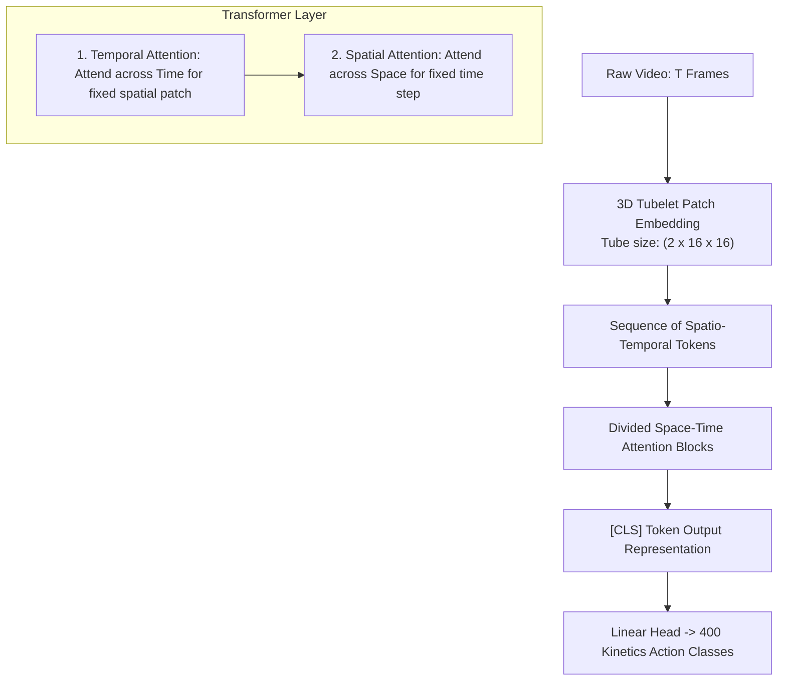

# Session 2 (Part A): Spatio-Temporal Transformers & VideoMAE Foundation Models

- **File**: [`02_video_transformer_inference.py`](../02_video_transformer_inference.py)
- **Lecture Alignment**: IF5152 Week 11 (Video Transformers & Foundation Models)
- **Target Hardware**: Apple Silicon (`mps`), NVIDIA Cloud GPU (`cuda`), or CPU fallback (`cpu`)

---

## 1. Pedagogical Objective

In this lab session, you will explore modern **Video Foundation Models**:
1. **The Limitations of 2D/3D CNNs**: Why 2D CNNs struggle with long-range temporal reasoning and why 3D CNNs suffer from parameter explosion.
2. **Divided Space-Time Attention**: How Vision Transformers scale to video by factorizing self-attention across spatial and temporal dimensions.
3. **Pretrained VideoMAE Inference**: Running inference with a 400-class action recognition model (`MCG-NJU/videomae-base-finetuned-kinetics`) without training from scratch.

---

## 2. Theoretical Background & Mathematical Foundations

### The Space-Time Attention Challenge
In a standard 2D Vision Transformer (ViT), an image is partitioned into $N = \frac{H}{P} \times \frac{W}{P}$ patches of size $P \times P$ (e.g., $16 \times 16$). Full self-attention requires:
$$\text{Attention}(\mathbf{Q}, \mathbf{K}, \mathbf{V}) = \text{Softmax}\left(\frac{\mathbf{Q} \mathbf{K}^\top}{\sqrt{d_k}}\right) \mathbf{V}$$
This incurs quadratic computational complexity $\mathcal{O}(N^2)$ and memory cost.

When extended to a video of $T$ frames:
- If we naively treat every spatio-temporal token as an independent patch, we have $N_{\text{video}} = T \times N$ tokens.
- Global space-time self-attention would cost $\mathcal{O}((T \cdot N)^2)$, which quickly exhausts GPU memory even for modest clip lengths!



### Divided Space-Time Attention
To bypass the quadratic bottleneck, models like **TimeSformer** and **VideoMAE** factorize attention into two sequential steps within each transformer block:
1. **Temporal Attention**: Each spatial patch attends *only* to patches at the same spatial coordinate across different time frames:
   $$\mathcal{O}(N \cdot T^2)$$
2. **Spatial Attention**: Tokens within the same frame attend to each other across spatial positions:
   $$\mathcal{O}(T \cdot N^2)$$

Total complexity drops from $\mathcal{O}(T^2 N^2)$ to $\mathcal{O}(T N^2 + N T^2)$, making deep video transformers computationally tractable.

### VideoMAE & 3D Tubelet Embedding
VideoMAE introduces a **3D Tubelet Embedding layer** (`Conv3d` with kernel size $2 \times 16 \times 16$):
- It merges 2 consecutive temporal frames along with a $16 \times 16$ spatial patch into a single initial token.
- For a 16-frame input clip at $224 \times 224$:
  $$\text{Temporal Tokens} = \frac{16}{2} = 8, \quad \text{Spatial Tokens} = \left(\frac{224}{16}\right)^2 = 14 \times 14 = 196$$
  $$\text{Total Tokens} = 8 \times 196 = 1,568 \text{ tokens}$$

---

## 3. Tensor Dimension Tracing

| Pipeline Stage | Operation | Input Shape | Output Shape | Notes |
| :--- | :--- | :--- | :--- | :--- |
| **Video Decoding** | Keyframe Seek | Disk MP4 | `(16, 360, 640, 3)` | 16 uniformly sampled RGB frames |
| **VideoMAE Preprocessor** | Resize & Channel Reorder | `16 x [360, 640, 3]` | `[1, 16, 3, 224, 224]` | Hugging Face `AutoImageProcessor` |
| **Tubelet Embedding** | Conv3D Projection | `[1, 16, 3, 224, 224]` | `[1, 1568, 768]` | 1568 tokens of embedding dim 768 |
| **Transformer Backbone** | 12 Divided Attention Blocks | `[1, 1568, 768]` | `[1, 1568, 768]` | Deep contextualized tokens |
| **Sequence Pooling** | Mean over tokens | `[1, 1568, 768]` | `[1, 768]` | Compact video feature vector |
| **Classification Head** | Linear Projection | `[1, 768]` | `[1, 400]` | Logits over 400 Kinetics action classes |
| **Softmax** | Normalization | `[1, 400]` | `[1, 400]` | Probabilities summing to 1.0 |

---

## 4. Execution Playbook

### Running on Default Apple Silicon / Automatic Hardware
```bash
python 02_video_transformer_inference.py --video data/person_bicycle.mp4
```

### Running on Dedicated GPU / MPS
```bash
# Apple Silicon
python 02_video_transformer_inference.py --video data/person_bicycle.mp4 --device mps

# NVIDIA Cloud GPU
python 02_video_transformer_inference.py --video data/person_bicycle.mp4 --device cuda
```

### CLI Arguments Reference

| Flag | Type | Default | Description |
| :--- | :--- | :--- | :--- |
| `--video` | `str` | `data/person_bicycle.mp4` | Path to input `.mp4` video clip |
| `--model` | `str` | `MCG-NJU/videomae-base-finetuned-kinetics` | Hugging Face model repository ID |
| `--num_frames` | `int` | `16` | Number of input frames (standard for VideoMAE is 16) |
| `--device` | `str` | `auto` | Target device (`auto`, `mps`, `cuda`, `cpu`) |

---

## 5. Expected Output & Interpretation

Running the script on the demo video (`person_bicycle.mp4`) yields:

```text
==================================================
Hardware Acceleration: Apple Silicon Metal (MPS)
PyTorch Version:       2.X.X
==================================================

--- [STEP 1] Loading Preprocessor for 'MCG-NJU/videomae-base-finetuned-kinetics' ---

--- [STEP 2] Decoding Video Clip ---
Sampling 16 frames from 'data/person_bicycle.mp4'...
Raw decoded array shape: (16, 360, 640, 3) (Frames, Height, Width, RGB Channels)
Processed Transformer Input Tensor: (1, 16, 3, 224, 224)

--- [STEP 3] Loading Pretrained VideoMAE Model onto MPS ---
Total Model Parameters: 86,527,120 (Pretrained on 400 Kinetics Action Classes)

--- [STEP 4] Running Spatio-Temporal Attention Forward Pass ---
Forward Pass Latency: 112.40 ms

==================================================
 TOP-5 KINETICS-400 ACTION PREDICTIONS
==================================================
  #1  riding a bike                  : 88.42%  ███████████████████████████████████
  #2  biking through snow            :  6.15%  ██
  #3  unicycling                     :  1.82%  
  #4  doing motocross                :  0.94%  
  #5  riding scooter                 :  0.41%  
==================================================

[SUCCESS] Session 2 (Video Transformer) demo completed.
```

### Key Takeaways:
1. **High Confidence on Complex Motion**: Unlike single-frame classifiers that might confuse a stationary bicycle with riding, the spatio-temporal attention mechanism successfully captures the dynamic pedaling motion and scene translation.
2. **Kinetics-400 Granularity**: The top predictions reflect fine-grained motion categories in the Kinetics benchmark (`riding a bike`, `biking through snow`, `unicycling`).

---

## 6. Self-Study Exercises & Experiments

### Exercise 1: Temporal Frame Subsampling Sensitivity
VideoMAE was trained on 16-frame clips sampled at a specific stride.
1. Run the script with `--num_frames 8` vs `--num_frames 16`.
2. Notice how the input tensor dimension adapts and observe if the model classification confidence shifts.

### Exercise 2: Testing a Custom Video
1. Place any 5–10 second video clip of an action (e.g. playing guitar, cooking, pushups) in `data/my_action.mp4`.
2. Run:
   ```bash
   python 02_video_transformer_inference.py --video data/my_action.mp4
   ```
3. Check if the top-1 prediction matches the real-world action in the video.

---

## 7. Troubleshooting FAQ

- **Error: `HTTPError 401 / Connection Timeout` when downloading weights**:
  - The model weights are downloaded from Hugging Face Hub on the first run. Ensure you have an active internet connection. Once downloaded, weights are cached locally in `~/.cache/huggingface/hub/`.
- **Warning: `Some weights of VideoMAEForVideoClassification were not initialized...`**:
  - This is normal when loading checkpoints if certain auxiliary pre-training heads are stripped for classification.
- **Out of Memory (OOM) on GPU**:
  - Video transformers are memory-intensive (~86M parameters). If running on a GPU with < 4GB VRAM, pass `--device cpu`.
