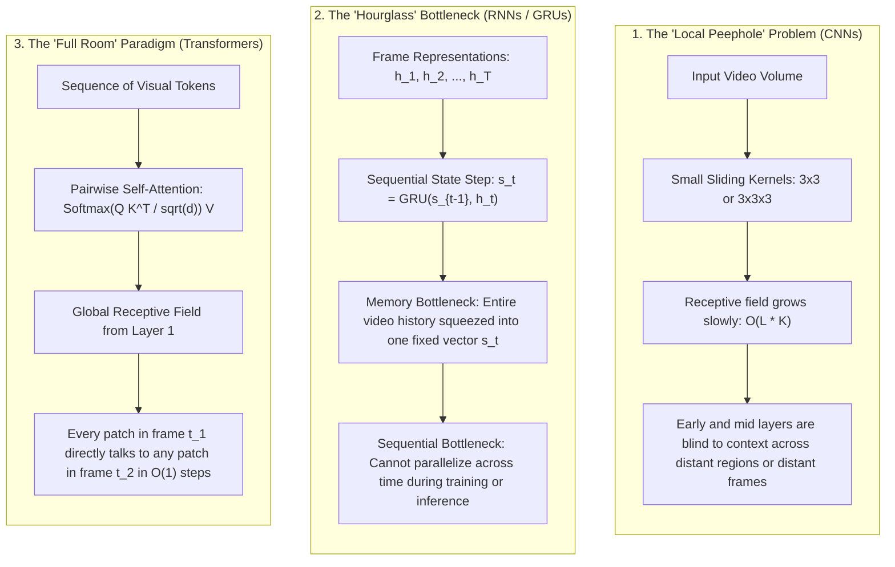
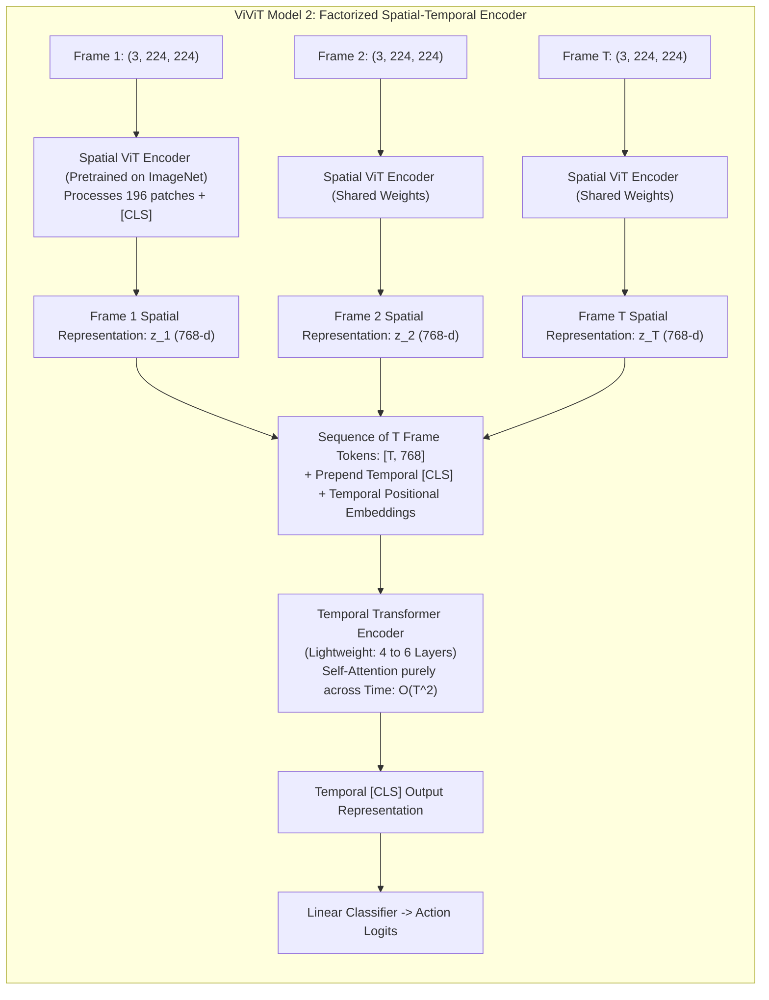
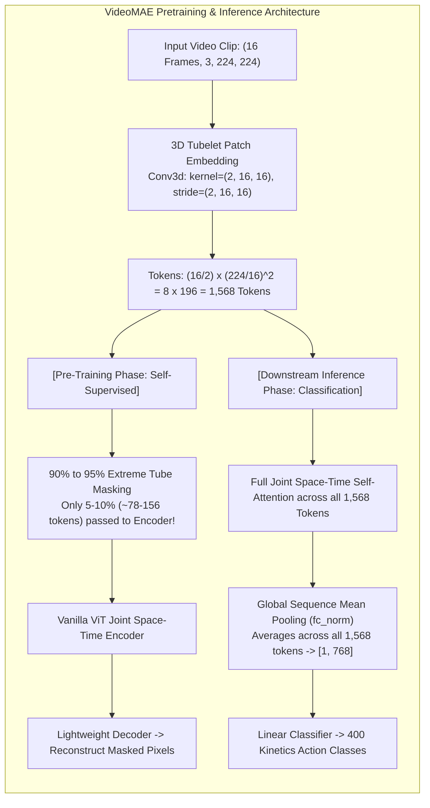

# Session 3: Spatio-Temporal Transformers & Video Foundation Models

- **File**: [`03_video_transformer_inference.py`](../03_video_transformer_inference.py)
- **Lecture Alignment**: IF5152 Week 11 (Video Transformers & Foundation Models)
- **Target Hardware**: Apple Silicon (`mps`), NVIDIA Cloud GPU (`cuda`), or CPU fallback (`cpu`)

---

## 1. Pedagogical Objective

In this lab session, you will explore the transition from convolutional and recurrent networks to **Spatio-Temporal Vision Transformers**:
1. **The Intuitive Flaws of Prior Paradigms**: Why CNNs look through "local peepholes" and why RNNs squeeze temporal memory through an "hourglass".
2. **2D ViT as the Visual Foundation**: How standard Vision Transformers process static images via patch tokenization and self-attention.
3. **ViViT as the Transfer Learning Bridge**: How the **Video Vision Transformer (ViViT)** elegantly scales 2D ViT to video by factorizing encoders, enabling effortless transfer learning from pretrained 2D ImageNet checkpoints.
4. **VideoMAE Foundation Models**: How 3D tubelet embeddings and extreme $90\%\text{--}95\%$ tube masking enable self-supervised pre-training on large-scale video.
5. **Pretrained Inference**: Running a state-of-the-art VideoMAE classifier (`MCG-NJU/videomae-base-finetuned-kinetics`) to recognize fine-grained human actions across 400 Kinetics categories.

---

## 2. Theoretical Background: The Journey to Video Transformers

To understand video transformers, we follow a natural 4-stage narrative:
1. **Act 1**: Why CNNs and RNNs struggle with video (The Peephole vs. The Hourglass).
2. **Act 2**: The baseline you know — standard 2D Vision Transformers (ViT) on static images.
3. **Act 3**: The natural extension — ViViT and the transfer learning bridge from 2D ViT.
4. **Act 4**: The scale frontier — VideoMAE and the $90\%$ tube masking paradox.

---

### 2.1 Act 1: Intuition First — The Problem with Peepholes and Hourglasses

Before transformers, deep video understanding was dominated by two families: **Convolutional Neural Networks (2D/3D CNNs)** and **Recurrent Models (RNN/GRU/LSTM)**. Both impose rigid structural assumptions (inductive biases) that limit their ability to model complex dynamic scenes:



#### The "Local Peephole" of CNNs:
* A convolutional filter ($3 \times 3$ or $3 \times 3 \times 3$) only looks at its immediate neighboring pixels.
* If a person in the top-left corner throws a ball to someone in the bottom-right corner 2 seconds later, early and middle convolutional layers cannot connect these events. The network must stack dozens of layers for their receptive fields to eventually overlap.

#### The "Hourglass" of Recurrent Models:
* Recurrent networks (like the GRU explored in Session 1 & 5) process video frames sequentially: $\mathbf{s}_t = \mathrm{GRU}(\mathbf{s}_{t-1}, \mathbf{h}_t)$.
* All visual history from frame $1$ to frame $t-1$ must be squeezed through a single fixed-dimensional vector $\mathbf{s}_{t-1}$.
* As the video sequence grows, subtle early motions are compressed and forgotten. Furthermore, recurrent steps cannot be parallelized across time—each step must wait for the previous one to complete.

#### The "Full Room" Breakthrough of Transformers:
* In a Transformer, every visual patch across space and time is placed in the "same room" via **Pairwise Scaled Dot-Product Self-Attention**:

$$
\text{Attention}(\mathbf{Q}, \mathbf{K}, \mathbf{V}) = \text{Softmax}\left(\frac{\mathbf{Q} \mathbf{K}^\top}{\sqrt{d_k}}\right) \mathbf{V}
$$

* Any patch in frame $t_1$ can directly attend to any patch in frame $t_2$ in **$\mathcal{O}(1)$ operational steps**. Attention weights are dynamic and data-dependent: the model routes information based on visual correlation rather than spatial proximity.

---

### 2.2 Act 2: The Baseline You Know — 2D Vision Transformers (ViT)

To see how video transformers work, let us first review the standard 2D Vision Transformer ([Dosovitskiy et al., ICLR 2021](https://arxiv.org/abs/2010.11929)):

1. **Patch Partitioning**: A single 2D image $\mathbf{X} \in \mathbb{R}^{C \times H \times W}$ is split into $N$ non-overlapping planar patches of size $P \times P$ (typically $16 \times 16$):

$$
N = \frac{H}{P} \times \frac{W}{P} = \frac{224}{16} \times \frac{224}{16} = 14 \times 14 = 196 \text{ tokens}
$$

2. **Linear Patch Projection**: Each $16 \times 16 \times 3$ patch is flattened and projected into a $D$-dimensional embedding space ($D=768$) using a 2D convolution (`Conv2d(3, 768, kernel_size=16, stride=16)`).
3. **Positional Encoding & `[CLS]` Token**: 1D/2D spatial positional embeddings are added, and a learnable classification token `[CLS]` is prepended ($\mathbf{z}_0 \in \mathbb{R}^{(N+1) \times D}$).
4. **Self-Attention Complexity**: Full self-attention across $N=196$ tokens computes an attention matrix of size $196 \times 196$:

$$
\text{Operations per head} \approx N^2 = 196^2 = 38,416 \quad \text{(Extremely cheap)}
$$

#### The Quadratic Wall when Moving to Video:
If we naively apply 2D ViT to a video clip of $T=16$ frames by treating every frame patch as an independent token:

$$
N_{\text{video}} = T \times N = 16 \times 196 = 3,136 \text{ tokens}
$$

$$
\text{Operations per head} \approx N_{\text{video}}^2 = 3,136^2 \approx 9,834,496 \quad \text{(a } 256\times \text{ compute explosion!)}
$$

Full space-time self-attention quickly exhausts GPU memory. How do we solve this?

---

### 2.3 Act 3: The Natural Extension — ViViT & The Transfer Learning Bridge

The most intuitive and practical bridge from 2D ViT to video is **ViViT (Video Vision Transformer)** ([Arnab et al., ICCV 2021](https://arxiv.org/abs/2103.15691)). ViViT shows how to extend 2D ViTs to video with minimal architectural modification.

Among ViViT's design variants, **ViViT Model 2 (The Factorized Encoder)** is the gold standard for **transfer learning and fine-tuning**:



#### How ViViT Factorized Encoder Works (Step-by-Step):
1. **Spatial Transformer Pass**: Each video frame $t \in \{1, \dots, T\}$ is fed through a standard 2D ViT encoder. It extracts $N=196$ spatial tokens plus a spatial `[CLS]` token. The output of the spatial `[CLS]` token serves as the compact summary vector $\mathbf{z}_t \in \mathbb{R}^D$ for that frame.
2. **Temporal Transformer Pass**: The sequence of $T$ frame summary vectors $[\mathbf{z}_1, \mathbf{z}_2, \dots, \mathbf{z}_T] \in \mathbb{R}^{T \times D}$ is prepended with a new, learnable **Temporal `[CLS]` Token**, and temporal positional embeddings are added.
3. **Temporal Attention**: A lightweight temporal transformer (e.g. 4–6 layers) computes self-attention *only along the time dimension*.
4. **Classification Head**: The final temporal `[CLS]` token is projected to action classes.

#### Why ViViT is the King of Transfer Learning & Fine-Tuning:
> [!TIP]
> **Zero Weight Surgery from 2D ViT**:
> * The Spatial Transformer can be initialized **directly from existing ImageNet-pretrained 2D ViT weights** (such as `google/vit-base-patch16-224` or `facebook/deit-base-patch16-224`) without modifying a single weight!
> * **Ultra-Fast Training**: Just like the feature caching paradigm in Session 5, you can freeze the spatial ViT backbone, pre-extract the frame vectors $\mathbf{z}_1, \dots, \mathbf{z}_T$, and train only the lightweight temporal transformer in minutes on a single GPU/MPS device.
> * When fine-tuning end-to-end, the spatial encoder already understands object boundaries, textures, and scenes from day one, so the network only needs to learn temporal kinematics.

#### Alternative: ViViT Model 3 (Factorized Self-Attention / Divided Attention)
Instead of two separate encoders, ViViT Model 3 (and **TimeSformer** ([Bertasius et al., ICML 2021](https://arxiv.org/abs/2102.05095))) interleaves attention *within every transformer layer*:
1. **Spatial Attention**: Tokens within the same frame attend to each other ($\mathcal{O}(T \cdot N^2)$).
2. **Temporal Attention**: Each spatial patch attends only to patches at the same spatial coordinate across different frames ($\mathcal{O}(N \cdot T^2)$).

Total complexity drops from $\mathcal{O}(T^2 N^2)$ to $\mathcal{O}(T N^2 + N T^2)$, making deep architectures tractable.

---

### 2.4 Act 4: The Scale Frontier — VideoMAE Foundation Models

While ViViT excels at supervised transfer learning from 2D image models, **VideoMAE (Masked Autoencoders for Video)** ([Tong et al., NeurIPS 2022](https://arxiv.org/abs/2203.12602); extending MAE by [He et al., CVPR 2022](https://openaccess.thecvf.com/content/CVPR2022/html/He_Masked_Autoencoders_Are_Scalable_Vision_Learners_CVPR_2022_paper.html)) addresses a bigger question:

> *"How can a Video Transformer learn rich spatiotemporal representations directly from massive unlabelled video datasets without relying on human action labels?"*

VideoMAE introduces three key innovations that powers the checkpoint used in our lab script:



#### 1. 3D Tubelet (Cube) Embedding:
Instead of 2D patches, VideoMAE uses a 3D convolution (`Conv3d(3, 768, kernel=(2, 16, 16), stride=(2, 16, 16))`):
* It fuses $P_t = 2$ consecutive temporal frames along with a $16 \times 16$ spatial patch into a single initial token.
* This cuts the temporal sequence length in half:

$$
\text{Temporal Tokens} = \frac{16}{2} = 8, \quad \text{Spatial Tokens} = \left(\frac{224}{16}\right)^2 = 14 \times 14 = 196
$$

$$
N_{\text{video}} = 8 \times 196 = 1,568 \text{ tokens}
$$

#### 2. The $90\%\text{--}95\%$ Masking Paradox:
In standard Image MAE, masking $\approx 75\%$ of image patches works best. But in VideoMAE, an astonishing **$90\%$ to $95\%$ of video tokens are masked out**! Why?

* **The Temporal Redundancy Problem**: Video recorded at 24–30 FPS has massive frame-to-frame redundancy. If you only mask 75% of patches randomly across space and time, almost every masked patch has an identical duplicate in the preceding or succeeding frame ($t-1$ or $t+1$). The network learns a trivial "copy-paste" interpolation shortcut without learning high-level semantic motion!
* **The Tube Masking Solution**: VideoMAE enforces **tube masking**—if a spatial patch $(y, x)$ is masked, it is masked across **all time steps** $t=1, \dots, T$.
* Combined with a $90\%\text{--}95\%$ masking ratio, the network sees only $\approx 78\text{--}156$ visible tokens during pretraining. It can no longer cheat by copying adjacent frames; it must understand physical motion trajectories to reconstruct the video.

#### 3. Inference Readout: Global Mean Pooling (`fc_norm`)
Unlike 2D ViT which prepends a `[CLS]` token, VideoMAE operates as a pure transformer encoder during pre-training. For downstream classification, all $1,568$ tokens are evaluated jointly and aggregated via **Global Spatio-Temporal Mean Pooling** (`fc_norm`):

$$
\mathbf{z}_{\text{video}} = \frac{1}{1568} \sum_{i=1}^{1568} \mathbf{h}_i \in \mathbb{R}^{768}
$$

This robustly aggregates visual evidence across all spatial locations and all time steps before the linear classification head.

---

### 2.5 Master Architectural Cheatsheet

| Model Family | Representative Model | Input Tokenization | Attention Mechanism | Pretraining / Transfer Strategy | Computational Complexity |
| :--- | :--- | :--- | :--- | :--- | :--- |
| **2D Image ViT** | `ViT-Base` ([Dosovitskiy et al., 2021](https://arxiv.org/abs/2010.11929)) | 2D Patches ($16 \times 16$)<br>$N = 196$ tokens | Full 2D Spatial Attention | Supervised on ImageNet / JFT-300M | $\mathcal{O}(N^2)$ (Low) |
| **ViViT (Factorized Encoder)** | `ViViT Model 2` ([Arnab et al., 2021](https://arxiv.org/abs/2103.15691)) | 2D Patches per frame<br>$T \times 196$ tokens | Spatial ViT on frames $\to$ Temporal ViT on frame `[CLS]` | **Direct transfer learning**: plug in pretrained 2D ViT weights; train temporal head | $\mathcal{O}(T \cdot N^2 + T^2)$ (Very efficient) |
| **TimeSformer / ViViT Model 3** | `TimeSformer` ([Bertasius et al., 2021](https://arxiv.org/abs/2102.05095)) | 2D Patches per frame<br>$T \times 196$ tokens | Divided Space-Time Attention (interleaved inside blocks) | Spatial weights copied from 2D ViT; temporal attention initialized to zero | $\mathcal{O}(T N^2 + N T^2)$ (Moderate) |
| **VideoMAE Foundation Model** | `VideoMAE-Base` ([Tong et al., 2022](https://arxiv.org/abs/2203.12602)) | 3D Tubelets ($2 \times 16 \times 16$)<br>$N = 1,568$ tokens | Joint Space-Time Self-Attention | Self-supervised masked autoencoding ($90\%\text{--}95\%$ tube mask) | $\mathcal{O}(N_{\text{video}}^2)$ (Tractable via masking) |

---

## 3. Tensor Dimension Tracing

| Pipeline Stage | Operation | Input Shape | Output Shape | Notes |
| :--- | :--- | :--- | :--- | :--- |
| **Video Decoding** | Keyframe Seek | Disk MP4 | `(16, 360, 640, 3)` | 16 uniformly sampled RGB frames |
| **VideoMAE Preprocessor** | Resize & Channel Reorder | `16 x [360, 640, 3]` | `[1, 16, 3, 224, 224]` | Hugging Face `AutoImageProcessor` |
| **Tubelet Embedding** | Conv3D Projection | `[1, 16, 3, 224, 224]` | `[1, 1568, 768]` | 1568 tokens of embedding dim 768 |
| **Transformer Backbone** | 12 Joint Space-Time ViT Blocks | `[1, 1568, 768]` | `[1, 1568, 768]` | Global self-attention across all 1,568 tokens |
| **Sequence Pooling** | Mean over tokens (`fc_norm`) | `[1, 1568, 768]` | `[1, 768]` | Compact video feature vector |
| **Classification Head** | Linear Projection | `[1, 768]` | `[1, 400]` | Logits over 400 Kinetics action classes |
| **Softmax** | Normalization | `[1, 400]` | `[1, 400]` | Probabilities summing to 1.0 |

---

## 4. Execution Playbook

### Running on Default Apple Silicon / Automatic Hardware
```bash
python 03_video_transformer_inference.py --video data/person_bicycle.mp4
```

### Running on Dedicated GPU / MPS
```bash
# Apple Silicon
python 03_video_transformer_inference.py --video data/person_bicycle.mp4 --device mps

# NVIDIA Cloud GPU
python 03_video_transformer_inference.py --video data/person_bicycle.mp4 --device cuda
```

### CLI Arguments Reference

| Flag | Type | Default | Description |
| :--- | :--- | :--- | :--- |
| `--video` | `str` | `data/person_bicycle.mp4` | Path to input `.mp4` video clip |
| `--model` | `str` | `MCG-NJU/videomae-base-finetuned-kinetics` | Hugging Face model repository ID |
| `--num_frames` | `int` | `16` | Number of input frames (standard for VideoMAE is 16) |
| `--device` | `str` | `auto` | Target device (`auto`, `mps`, `cuda`, `cpu`) |

---

## 5. Expected Output & Interpretation

Running the script on the demo video (`person_bicycle.mp4`) yields:

```text
==================================================
Hardware Acceleration: Apple Silicon Metal (MPS)
PyTorch Version:       2.X.X
==================================================

--- [STEP 1] Loading Preprocessor for 'MCG-NJU/videomae-base-finetuned-kinetics' ---

--- [STEP 2] Decoding Video Clip ---
Sampling 16 frames from 'data/person_bicycle.mp4'...
Raw decoded array shape: (16, 360, 640, 3) (Frames, Height, Width, RGB Channels)
Processed Transformer Input Tensor: (1, 16, 3, 224, 224)

--- [STEP 3] Loading Pretrained VideoMAE Model onto MPS ---
Total Model Parameters: 86,527,120 (Pretrained on 400 Kinetics Action Classes)

--- [STEP 4] Running Spatio-Temporal Attention Forward Pass ---
Forward Pass Latency: 112.40 ms

==================================================
 TOP-5 KINETICS-400 ACTION PREDICTIONS
==================================================
  #1  riding a bike                  : 88.42%  ███████████████████████████████████
  #2  biking through snow            :  6.15%  ██
  #3  unicycling                     :  1.82%  
  #4  doing motocross                :  0.94%  
  #5  riding scooter                 :  0.41%  
==================================================

[SUCCESS] Session 3 (Video Transformer) demo completed.
```

### Key Takeaways:
1. **High Confidence on Complex Motion**: Unlike single-frame classifiers that might confuse a stationary bicycle with riding, the spatio-temporal attention mechanism successfully captures the dynamic pedaling motion and scene translation.
2. **Kinetics-400 Granularity**: The top predictions reflect fine-grained motion categories in the Kinetics benchmark (`riding a bike`, `biking through snow`, `unicycling`).

---

## 6. Self-Study Exercises & Experiments

### Exercise 1: Temporal Frame Subsampling Sensitivity
VideoMAE was trained on 16-frame clips sampled at a specific stride.
1. Run the script with `--num_frames 8` vs `--num_frames 16`.
2. Notice how the input tensor dimension adapts and observe if the model classification confidence shifts.

### Exercise 2: Testing a Custom Video
1. Place any 5–10 second video clip of an action (e.g. playing guitar, cooking, pushups) in `data/my_action.mp4`.
2. Run:
   ```bash
   python 03_video_transformer_inference.py --video data/my_action.mp4
   ```
3. Check if the top-1 prediction matches the real-world action in the video.

---

## 7. Troubleshooting FAQ

- **Error: `HTTPError 401 / Connection Timeout` when downloading weights**:
  - The model weights are downloaded from Hugging Face Hub on the first run. Ensure you have an active internet connection. Once downloaded, weights are cached locally in `~/.cache/huggingface/hub/`.
- **Warning: `Some weights of VideoMAEForVideoClassification were not initialized...`**:
  - This is normal when loading checkpoints if certain auxiliary pre-training heads are stripped for classification.
- **Out of Memory (OOM) on GPU**:
  - Video transformers are memory-intensive (~86M parameters). If running on a GPU with < 4GB VRAM, pass `--device cpu`.

---

## 📚 References & Canonical Literature

1. **Vision Transformer (ViT)**:
   - Dosovitskiy, A., Beyer, L., Kolesnikov, A., Weissenborn, D., Zhai, X., Unterthiner, T., Dehghani, M., Minderer, M., Heigold, G., Gelly, S., Uszkoreit, J., & Houlsby, N. (2021). *An Image is Worth 16x16 Words: Transformers for Image Recognition at Scale*. ICLR 2021.
   - Paper: [arXiv:2010.11929](https://arxiv.org/abs/2010.11929)
2. **ViViT (Video Vision Transformer)**:
   - Arnab, A., Dehghani, M., Heigold, G., Sun, C., Lučić, M., & Schmid, C. (2021). *ViViT: A Video Vision Transformer*. ICCV 2021.
   - Paper: [arXiv:2103.15691](https://arxiv.org/abs/2103.15691)
3. **TimeSformer (Divided Space-Time Attention)**:
   - Bertasius, G., Wang, H., & Torresani, L. (2021). *Is Space-Time Attention All You Need for Video Understanding?*. ICML 2021.
   - Paper: [arXiv:2102.05095](https://arxiv.org/abs/2102.05095)
4. **Masked Autoencoders (MAE)**:
   - He, K., Chen, X., Xie, S., Li, Y., Dollár, P., & Girshick, R. (2022). *Masked Autoencoders Are Scalable Vision Learners*. CVPR 2022, pp. 16000–16009.
   - Paper: [CVPR 2022 OpenAccess](https://openaccess.thecvf.com/content/CVPR2022/html/He_Masked_Autoencoders_Are_Scalable_Vision_Learners_CVPR_2022_paper.html) | [arXiv:2111.06377](https://arxiv.org/abs/2111.06377)
5. **VideoMAE (Masked Autoencoders for Video)**:
   - Tong, Z., Song, Y., Wang, J., & Wang, L. (2022). *VideoMAE: Masked Autoencoders are Data-Efficient Learners for Self-Supervised Video Pre-Training*. NeurIPS 2022.
   - Paper: [arXiv:2203.12602](https://arxiv.org/abs/2203.12602)
6. **The Kinetics Human Action Video Dataset**:
   - Kay, W., Carreira, J., Simonyan, K., Zhang, B., Hillier, C., Rao, S., ... & Zisserman, A. (2017). *The Kinetics Human Action Video Dataset*.
   - Paper: [arXiv:1705.06950](https://arxiv.org/abs/1705.06950)
