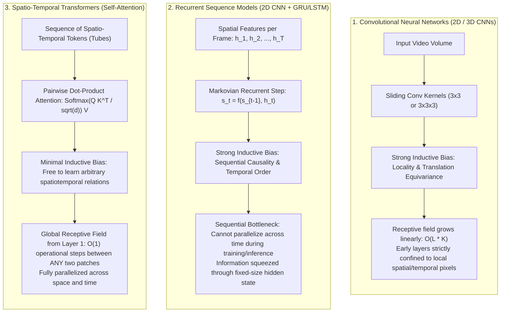
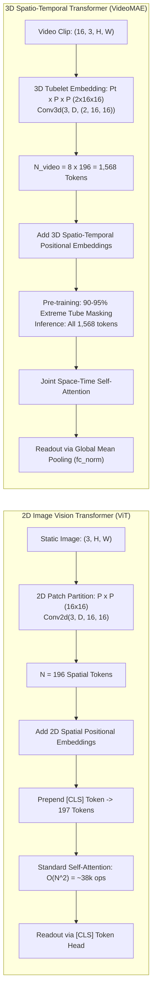
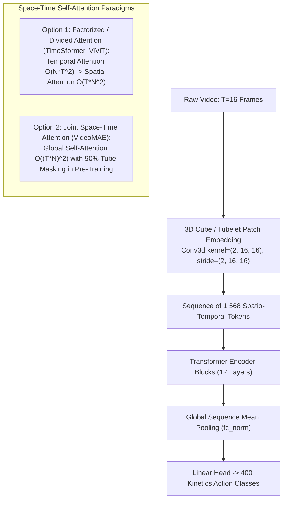

# Session 3: Spatio-Temporal Transformers & VideoMAE Foundation Models

- **File**: [`03_video_transformer_inference.py`](../03_video_transformer_inference.py)
- **Lecture Alignment**: IF5152 Week 11 (Video Transformers & Foundation Models)
- **Target Hardware**: Apple Silicon (`mps`), NVIDIA Cloud GPU (`cuda`), or CPU fallback (`cpu`)

---

## 1. Pedagogical Objective

In this lab session, you will explore the modern shift from convolutional and recurrent architectures to **Video Foundation Models**:
1. **The Architectural Triad**: How Transformer-based video architectures fundamentally differ from 2D/3D Convolutional Neural Networks and Recurrent sequence models (RNN/GRU/LSTM).
2. **The Dimensional Leap (Image ViT vs. Video Transformers)**: How Vision Transformers adapt from 2D planar images to 3D spatio-temporal video volumes (tubelet embeddings, 3D positional encodings, quadratic complexity walls, temporal redundancy, and readout pooling).
3. **Space-Time Attention Paradigms**: Comparing **Divided Space-Time Attention** (TimeSformer, ViViT) against **3D Tubelet Masked Autoencoding** (VideoMAE).
4. **Pretrained VideoMAE Inference**: Running inference with an 86-million parameter model (`MCG-NJU/videomae-base-finetuned-kinetics`) to classify complex human actions across 400 Kinetics categories.

---

## 2. Theoretical Background & Mathematical Foundations

### 2.1 The Architectural Triad: CNNs vs. Recurrent Models vs. Transformers

To understand why Vision Transformers have become the dominant foundation model for video, we must examine how video representations are constructed across the three major deep learning paradigms:



#### 1. Inductive Bias & Receptive Field Growth:
* **CNNs (Sessions 1 & 2)**: Impose strong **hardcoded inductive biases**—namely *spatial locality* (neighboring pixels are related) and *translation equivariance* (features are invariant to spatial translation). A convolutional kernel operates within a fixed receptive field ($3 \times 3$ or $3 \times 3 \times 3$). To model long-range correlations between objects at opposite sides of the frame or between distant frames, the network must stack dozens of layers ($O(L \cdot K)$ growth). Early and intermediate layers cannot capture global spatiotemporal context.
* **Recurrent Models (Sessions 1 & 5)**: Impose a **sequential Markovian bias** ($\mathbf{s}_t = f(\mathbf{s}_{t-1}, \mathbf{h}_t)$). While this naturally captures sequential order, it creates a severe **information compression bottleneck**: the entire visual history from frame $1$ to $t-1$ must be squeezed into a fixed-dimensional vector $\mathbf{s}_{t-1}$. Furthermore, recurrent updates cannot be parallelized across the time dimension during inference or training.
* **Transformers (Session 3)**: Discard hardcoded locality and sequentiality assumptions. Every token interacts with every other token via pairwise scaled dot-product attention:

$$
\text{Attention}(\mathbf{Q}, \mathbf{K}, \mathbf{V}) = \text{Softmax}\left(\frac{\mathbf{Q} \mathbf{K}^\top}{\sqrt{d_k}}\right) \mathbf{V}
$$

Any spatial patch at frame $t_1$ can directly attend to any other patch at frame $t_2$ in **$\mathcal{O}(1)$ operational steps**, regardless of spatial distance or temporal separation.

#### Comparative Summary Matrix:

| Architectural Family | Temporal Aggregation Mechanism | Inductive Bias | Receptive Field Growth | Time-Parallel Execution | Long-Range Dependency Capacity |
| :--- | :--- | :--- | :--- | :--- | :--- |
| **2D CNN + Late Pooling** | Element-wise mean/max over time | Spatial locality; Permutation-invariant | Local $K \times K$ per frame | Fully parallel across frames | Poor (Cannot model motion order or phase) |
| **2D CNN + Recurrent (GRU)** | Sequential recurrent state $\mathbf{s}_t$ | Spatial locality; Temporal causality | Local in space; Unbounded in time | Sequential across time steps | Moderate (Suffers from memory compression) |
| **3D CNN ($R(2+1)D$, $MC3$)** | 3D spatio-temporal convolutions | Joint spatiotemporal locality | Hierarchical: $\mathcal{O}(L \cdot K_t)$ | Fully parallel across clips | Moderate (Bounded by layer receptive field) |
| **Spatio-Temporal Transformer** | Pairwise Space-Time Self-Attention | Minimal (Learned from data) | **Global from Layer 1** | **Fully parallel across space & time** | **Excellent (Direct patch-to-patch routing)** |

---

### 2.2 The Dimensional Leap: 2D Image Transformers (ViT) vs. 3D Video Transformers

While both 2D Image Transformers ([Dosovitskiy et al., ICLR 2021](https://arxiv.org/abs/2010.11929)) and Video Transformers operate on tokenized visual inputs, transitioning from a single static image to dynamic video introduces critical structural differences:



#### Contrast 1: Tokenization (2D Planar Patches vs. 3D Tubelets/Cubes)
* **2D Image ViT**: An image $\mathbf{X}_{\text{img}} \in \mathbb{R}^{C \times H \times W}$ is partitioned into non-overlapping 2D patches of size $P \times P$ (e.g. $16 \times 16$). A 2D convolution (`Conv2d(3, D, kernel=16, stride=16)`) projects each patch to dimension $D=768$:

$$
N = \frac{H}{P} \times \frac{W}{P} = \frac{224}{16} \times \frac{224}{16} = 14 \times 14 = 196 \text{ tokens}
$$

* **3D Video Transformer (VideoMAE)**: If we naively treated every 2D patch across all $T$ frames as an independent token, a 16-frame clip would produce $16 \times 196 = 3,136$ tokens. To reduce sequence length, VideoMAE introduces a **3D Tubelet Embedding** (`Conv3d(3, D, kernel=(2, 16, 16), stride=(2, 16, 16))`) that merges temporal slices:
  - Each tubelet captures $P_t = 2$ consecutive temporal frames across a $16 \times 16$ spatial patch.
  - The effective temporal sequence length is halved: $T' = T / P_t = 16 / 2 = 8$.
  - Total tokens:

$$
N_{\text{video}} = \left(\frac{T}{P_t}\right) \times \left(\frac{H}{P}\right) \times \left(\frac{W}{P}\right) = 8 \times 14 \times 14 = 1,568 \text{ tokens}
$$

#### Contrast 2: Positional Encoding (Spatial vs. Spatio-Temporal)
* **2D Image ViT**: Uses 2D spatial coordinate embeddings $\mathbf{E}_{\text{pos}} \in \mathbb{R}^{N \times D}$ to inject spatial location ($x, y$).
* **3D Video Transformer**: Tokens exist at a 3D coordinate $(t, y, x)$. The model must differentiate whether two identical appearance patches occur at the same timestamp or seconds apart. Video transformers use **3D Spatio-Temporal Positional Embeddings**:

$$
\mathbf{E}_{\text{spatiotemporal}}(t, y, x) = \mathbf{E}_{\text{temp}}(t) + \mathbf{E}_{\text{spatial}}(y, x) \quad \text{or} \quad \text{SinCos3D}(t, y, x)
$$

#### Contrast 3: The Quadratic Complexity Wall & Attention Scaling
Self-attention computes pairwise dot-products between all tokens, scaling with $\mathcal{O}(L^2)$ where $L$ is the sequence length:
* In 2D Image ViT:

$$
L_{\text{image}} = 196 \implies L^2 = 196^2 = 38,416 \text{ pairwise operations}
$$

* In 3D Video Transformer:

$$
L_{\text{video}} = 1,568 \implies L^2 = 1,568^2 \approx 2,458,624 \text{ pairwise operations}
$$

A 16-frame video clip results in a **$64\times$ explosion in attention compute and activation memory per layer** compared to a single image!

To resolve this quadratic explosion, two primary paradigms exist:
1. **Factorized (Divided) Space-Time Attention (TimeSformer, ViViT)**: Restricts attention to spatial patches within the same frame ($\mathcal{O}(T \cdot N^2)$), followed by temporal attention across frames for the same spatial coordinate ($\mathcal{O}(N \cdot T^2)$).
2. **Tubelet Masking + Joint Attention (VideoMAE)**: Retains full joint space-time self-attention, but makes self-supervised pre-training tractable by dropping $90\%\text{--}95\%$ of tokens.

#### Contrast 4: Temporal Redundancy & Masked Pre-Training Dynamics
Why do Image Masked Autoencoders ([He et al., CVPR 2022](https://openaccess.thecvf.com/content/CVPR2022/html/He_Masked_Autoencoders_Are_Scalable_Vision_Learners_CVPR_2022_paper.html)) and Video Masked Autoencoders ([Tong et al., NeurIPS 2022](https://arxiv.org/abs/2203.12602)) use radically different masking ratios?

* **Image MAE Masking Ratio**: $\approx 75\%$. An image has moderate spatial correlation, so masking 75% forces the model to learn semantic object parts (e.g., predicting an eye given the surrounding face).
* **VideoMAE Masking Ratio**: **$90\%$ to $95\%$**. 
  - **The Temporal Redundancy Problem**: Consecutive frames in video recorded at 24–30 FPS are nearly identical. If a video model only masked 75% of tokens with random spatial masking, almost every masked patch would have an unmasked identical counterpart in frame $t-1$ or $t+1$. The model would learn a trivial "copy-paste" shortcut (optical interpolation) rather than learning deep semantics!
  - **The Tube Masking Solution**: VideoMAE uses **temporally consistent tube masking**: if a spatial patch $(y, x)$ is masked, it is masked across **all time steps** $t = 1, \dots, T$. By combining tube masking with an extreme 90–95% masking ratio, only $5\%\text{--}10\%$ of tokens remain visible during pretraining ($~78\text{--}156$ tokens), making joint space-time attention fast while forcing the network to infer true motion physics and trajectories.

#### Contrast 5: Token Readout (`[CLS]` Token vs. Global Mean Pooling `fc_norm`)
* **Image ViT**: Traditionally prepends a learnable `[CLS]` token ($\mathbf{x}_{\text{cls}} \in \mathbb{R}^{1 \times D}$) to the input sequence. The final representation of `[CLS]` is routed to the classification MLP.
* **VideoMAE**: Does not use a `[CLS]` token during masked autoencoding. Instead, after passing all $1,568$ tokens through the 12 transformer encoder blocks, it aggregates the contextualized representations via **Global Sequence Mean Pooling** (`fc_norm`):

$$
\mathbf{z}_{\text{video}} = \frac{1}{N_{\text{video}}} \sum_{i=1}^{N_{\text{video}}} \mathbf{h}_i \in \mathbb{R}^{D}
$$

This produces a single 768-dimensional video representation that averages evidence across both space and time before the final linear classification projection.

---

### 2.3 Factorized vs. Joint Space-Time Attention Paradigms



To scale Vision Transformers to video, two prominent architectural paradigms have emerged:

1. **Divided (Factorized) Space-Time Attention** — used in **TimeSformer** ([Bertasius et al., ICML 2021](https://arxiv.org/abs/2102.05095)) and **ViViT** ([Arnab et al., ICCV 2021](https://arxiv.org/abs/2103.15691)):
   Factorizes attention into two sequential steps within each transformer block:
   - **Temporal Attention**: Each spatial patch attends *only* to patches at the same spatial coordinate across different time frames:

$$
\mathcal{O}(N \cdot T^2)
$$

   - **Spatial Attention**: Tokens within the same frame attend to each other across spatial positions:

$$
\mathcal{O}(T \cdot N^2)
$$

   Total complexity drops from $\mathcal{O}(T^2 N^2)$ to $\mathcal{O}(T N^2 + N T^2)$.

2. **3D Cube (Tubelet) Embedding + Joint Space-Time Attention** — used in **VideoMAE** ([Tong et al., NeurIPS 2022](https://arxiv.org/abs/2203.12602); extending Masked Autoencoders by [He et al., CVPR 2022](https://openaccess.thecvf.com/content/CVPR2022/html/He_Masked_Autoencoders_Are_Scalable_Vision_Learners_CVPR_2022_paper.html) ([arXiv:2111.06377](https://arxiv.org/abs/2111.06377)) to video):
   - **3D Cube Embedding (`Conv3d`)**: Uses a 3D convolution with kernel size $2 \times 16 \times 16$ and stride $2 \times 16 \times 16$ to fuse 2 consecutive temporal frames and a $16 \times 16$ spatial patch into a single token, immediately halving the temporal token count $T' = T / 2$.
   - **Extreme Tube Masking in Pre-Training**: Masks $90\%\text{--}95\%$ of tokens using tube masking during self-supervised reconstruction.
   - **Full-Token Downstream Evaluation**: During inference on a 16-frame input clip at $224 \times 224$, all $1,568$ tokens are processed jointly and aggregated via **Global Mean Pooling (`fc_norm`)**:

$$
\text{Temporal Tokens} = \frac{16}{2} = 8, \quad \text{Spatial Tokens} = \left(\frac{224}{16}\right)^2 = 14 \times 14 = 196
$$

$$
\text{Total Tokens} = 8 \times 196 = 1,568 \text{ tokens}
$$

---

## 3. Tensor Dimension Tracing

| Pipeline Stage | Operation | Input Shape | Output Shape | Notes |
| :--- | :--- | :--- | :--- | :--- |
| **Video Decoding** | Keyframe Seek | Disk MP4 | `(16, 360, 640, 3)` | 16 uniformly sampled RGB frames |
| **VideoMAE Preprocessor** | Resize & Channel Reorder | `16 x [360, 640, 3]` | `[1, 16, 3, 224, 224]` | Hugging Face `AutoImageProcessor` |
| **Tubelet Embedding** | Conv3D Projection | `[1, 16, 3, 224, 224]` | `[1, 1568, 768]` | 1568 tokens of embedding dim 768 |
| **Transformer Backbone** | 12 Joint Space-Time ViT Blocks | `[1, 1568, 768]` | `[1, 1568, 768]` | Global self-attention across all 1,568 tokens |
| **Sequence Pooling** | Mean over tokens (`fc_norm`) | `[1, 1568, 768]` | `[1, 768]` | Compact video feature vector |
| **Classification Head** | Linear Projection | `[1, 768]` | `[1, 400]` | Logits over 400 Kinetics action classes |
| **Softmax** | Normalization | `[1, 400]` | `[1, 400]` | Probabilities summing to 1.0 |

---

## 4. Execution Playbook

### Running on Default Apple Silicon / Automatic Hardware
```bash
python 03_video_transformer_inference.py --video data/person_bicycle.mp4
```

### Running on Dedicated GPU / MPS
```bash
# Apple Silicon
python 03_video_transformer_inference.py --video data/person_bicycle.mp4 --device mps

# NVIDIA Cloud GPU
python 03_video_transformer_inference.py --video data/person_bicycle.mp4 --device cuda
```

### CLI Arguments Reference

| Flag | Type | Default | Description |
| :--- | :--- | :--- | :--- |
| `--video` | `str` | `data/person_bicycle.mp4` | Path to input `.mp4` video clip |
| `--model` | `str` | `MCG-NJU/videomae-base-finetuned-kinetics` | Hugging Face model repository ID |
| `--num_frames` | `int` | `16` | Number of input frames (standard for VideoMAE is 16) |
| `--device` | `str` | `auto` | Target device (`auto`, `mps`, `cuda`, `cpu`) |

---

## 5. Expected Output & Interpretation

Running the script on the demo video (`person_bicycle.mp4`) yields:

```text
==================================================
Hardware Acceleration: Apple Silicon Metal (MPS)
PyTorch Version:       2.X.X
==================================================

--- [STEP 1] Loading Preprocessor for 'MCG-NJU/videomae-base-finetuned-kinetics' ---

--- [STEP 2] Decoding Video Clip ---
Sampling 16 frames from 'data/person_bicycle.mp4'...
Raw decoded array shape: (16, 360, 640, 3) (Frames, Height, Width, RGB Channels)
Processed Transformer Input Tensor: (1, 16, 3, 224, 224)

--- [STEP 3] Loading Pretrained VideoMAE Model onto MPS ---
Total Model Parameters: 86,527,120 (Pretrained on 400 Kinetics Action Classes)

--- [STEP 4] Running Spatio-Temporal Attention Forward Pass ---
Forward Pass Latency: 112.40 ms

==================================================
 TOP-5 KINETICS-400 ACTION PREDICTIONS
==================================================
  #1  riding a bike                  : 88.42%  ███████████████████████████████████
  #2  biking through snow            :  6.15%  ██
  #3  unicycling                     :  1.82%  
  #4  doing motocross                :  0.94%  
  #5  riding scooter                 :  0.41%  
==================================================

[SUCCESS] Session 3 (Video Transformer) demo completed.
```

### Key Takeaways:
1. **High Confidence on Complex Motion**: Unlike single-frame classifiers that might confuse a stationary bicycle with riding, the spatio-temporal attention mechanism successfully captures the dynamic pedaling motion and scene translation.
2. **Kinetics-400 Granularity**: The top predictions reflect fine-grained motion categories in the Kinetics benchmark (`riding a bike`, `biking through snow`, `unicycling`).

---

## 6. Self-Study Exercises & Experiments

### Exercise 1: Temporal Frame Subsampling Sensitivity
VideoMAE was trained on 16-frame clips sampled at a specific stride.
1. Run the script with `--num_frames 8` vs `--num_frames 16`.
2. Notice how the input tensor dimension adapts and observe if the model classification confidence shifts.

### Exercise 2: Testing a Custom Video
1. Place any 5–10 second video clip of an action (e.g. playing guitar, cooking, pushups) in `data/my_action.mp4`.
2. Run:
   ```bash
   python 03_video_transformer_inference.py --video data/my_action.mp4
   ```
3. Check if the top-1 prediction matches the real-world action in the video.

---

## 7. Troubleshooting FAQ

- **Error: `HTTPError 401 / Connection Timeout` when downloading weights**:
  - The model weights are downloaded from Hugging Face Hub on the first run. Ensure you have an active internet connection. Once downloaded, weights are cached locally in `~/.cache/huggingface/hub/`.
- **Warning: `Some weights of VideoMAEForVideoClassification were not initialized...`**:
  - This is normal when loading checkpoints if certain auxiliary pre-training heads are stripped for classification.
- **Out of Memory (OOM) on GPU**:
  - Video transformers are memory-intensive (~86M parameters). If running on a GPU with < 4GB VRAM, pass `--device cpu`.

---

## 📚 References & Canonical Literature

1. **Vision Transformer (ViT)**:
   - Dosovitskiy, A., Beyer, L., Kolesnikov, A., Weissenborn, D., Zhai, X., Unterthiner, T., Dehghani, M., Minderer, M., Heigold, G., Gelly, S., Uszkoreit, J., & Houlsby, N. (2021). *An Image is Worth 16x16 Words: Transformers for Image Recognition at Scale*. ICLR 2021.
   - Paper: [arXiv:2010.11929](https://arxiv.org/abs/2010.11929)
2. **TimeSformer (Divided Space-Time Attention)**:
   - Bertasius, G., Wang, H., & Torresani, L. (2021). *Is Space-Time Attention All You Need for Video Understanding?*. ICML 2021.
   - Paper: [arXiv:2102.05095](https://arxiv.org/abs/2102.05095)
3. **ViViT (Video Vision Transformer)**:
   - Arnab, A., Dehghani, M., Heigold, G., Sun, C., Lučić, M., & Schmid, C. (2021). *ViViT: A Video Vision Transformer*. ICCV 2021.
   - Paper: [arXiv:2103.15691](https://arxiv.org/abs/2103.15691)
4. **Masked Autoencoders (MAE)**:
   - He, K., Chen, X., Xie, S., Li, Y., Dollár, P., & Girshick, R. (2022). *Masked Autoencoders Are Scalable Vision Learners*. CVPR 2022, pp. 16000–16009.
   - Paper: [CVPR 2022 OpenAccess](https://openaccess.thecvf.com/content/CVPR2022/html/He_Masked_Autoencoders_Are_Scalable_Vision_Learners_CVPR_2022_paper.html) | [arXiv:2111.06377](https://arxiv.org/abs/2111.06377)
5. **VideoMAE (Masked Autoencoders for Video)**:
   - Tong, Z., Song, Y., Wang, J., & Wang, L. (2022). *VideoMAE: Masked Autoencoders are Data-Efficient Learners for Self-Supervised Video Pre-Training*. NeurIPS 2022.
   - Paper: [arXiv:2203.12602](https://arxiv.org/abs/2203.12602)
6. **The Kinetics Human Action Video Dataset**:
   - Kay, W., Carreira, J., Simonyan, K., Zhang, B., Hillier, C., Rao, S., ... & Zisserman, A. (2017). *The Kinetics Human Action Video Dataset*.
   - Paper: [arXiv:1705.06950](https://arxiv.org/abs/1705.06950)
