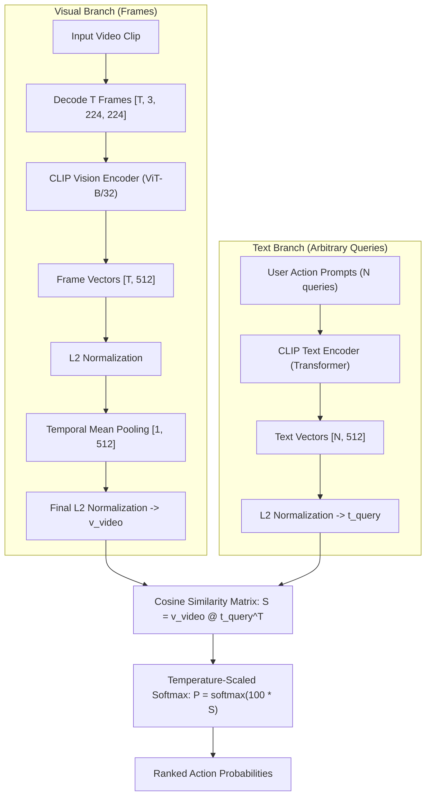

# Session 4: Zero-Shot Video Search with Multimodal Foundation Models (CLIP)

- **File**: [`04_zeroshot_video_search.py`](../04_zeroshot_video_search.py)
- **Lecture Alignment**: IF5152 Week 11 (Multimodal Video-Language Understanding)
- **Target Hardware**: Apple Silicon (`mps`), NVIDIA Cloud GPU (`cuda`), or CPU fallback (`cpu`)

---

## 1. Pedagogical Objective

In this lab session, you will explore **Multimodal Open-Vocabulary Video Understanding**:
1. **Closed-Set vs. Open-Vocabulary**: Why traditional fixed-class classifiers fail in open-world industry applications (search engines, recommendation feeds, content moderation).
2. **Dual-Encoder Architecture (CLIP)**: How separate vision and language encoders project visual frames and arbitrary natural language strings into a unified metric embedding space.
3. **Temporal Aggregation on Embeddings**: How to represent a full video clip by pooling frame-level multimodal representations without training any temporal parameters.

---

## 2. Theoretical Background & Mathematical Foundations

### Closed-Set Bottleneck vs Open-Vocabulary
Traditional video models (like Session 2's VideoMAE) are **closed-set**:
- They classify inputs into a pre-defined fixed label set $\mathcal{Y} = \{1, 2, \dots, K\}$ (e.g. $K=400$ Kinetics classes).
- If a user searches for an action not explicitly present in the training vocabulary (e.g., *"a person fixing a punctured bicycle tire on the pavement"*), closed-set classifiers are fundamentally incapable of recognizing it.

### Dual-Encoder Vision-Language Alignment (CLIP)
Contrastive Language-Image Pre-training (CLIP) trains a Vision Encoder $f_v(\cdot)$ and a Text Encoder $f_t(\cdot)$ simultaneously using a symmetric contrastive loss on hundreds of millions of web image-text pairs:



### Mathematical Steps in Detail

#### 1. L2 Normalization onto the Unit Hypersphere $\mathbb{S}^{D-1}$
For both visual frame embeddings $\mathbf{e}_t$ and text query embeddings $\mathbf{q}_i$:

$$
\hat{\mathbf{e}}_t = \frac{\mathbf{e}_t}{\|\mathbf{e}_t\|_2}, \quad \hat{\mathbf{q}}_i = \frac{\mathbf{q}_i}{\|\mathbf{q}_i\|_2} \in \mathbb{R}^{D}
$$

where $D = 512$ for `clip-vit-base-patch32`.

#### 2. Temporal Embedding Aggregation
We compute the temporal mean across all $T$ sampled frame vectors to obtain the video-level embedding:

$$
\bar{\mathbf{v}} = \frac{1}{T} \sum_{t=1}^T \hat{\mathbf{e}}_t
$$

Followed by a second L2 normalization:

$$
\mathbf{v}_{\text{video}} = \frac{\bar{\mathbf{v}}}{\|\bar{\mathbf{v}}\|_2}
$$

#### 3. Metric Matching & Temperature Scaling
The alignment between the video and text query $i$ is given by their inner product (cosine similarity):

$$
s_i = \langle \mathbf{v}_{\text{video}}, \hat{\mathbf{q}}_i \rangle = \mathbf{v}_{\text{video}} \cdot \hat{\mathbf{q}}_i^\top \in [-1, 1]
$$

To produce a probability distribution over the candidate queries, we apply a temperature parameter $\tau$ (CLIP standard learned scale is approximately 100.0, or temperature $\tau = 0.01$):

$$
P(\text{Query } i \mid \text{Video}) = \frac{\exp(100.0 \cdot s_i)}{\sum_{j=1}^N \exp(100.0 \cdot s_j)}
$$

---

## 3. Tensor Dimension Tracing

| Pipeline Stage | Operation | Input Shape | Output Shape | Notes |
| :--- | :--- | :--- | :--- | :--- |
| **Video Decoding** | Keyframe Seek | Disk MP4 | `(8, 360, 640, 3)` | 8 uniformly sampled frames |
| **CLIP Frame Processing** | Preprocessor Resize | `8 x PIL Image` | `[8, 3, 224, 224]` | Pixel normalization |
| **Vision Encoding** | `model.get_image_features` | `[8, 3, 224, 224]` | `[8, 512]` | 512-dim visual embeddings |
| **Frame L2 Norm** | `x / x.norm(dim=-1)` | `[8, 512]` | `[8, 512]` | Unit hypersphere projection |
| **Temporal Mean** | `torch.mean(dim=0)` | `[8, 512]` | `[1, 512]` | Time dimension aggregated |
| **Video L2 Norm** | `v / v.norm(dim=-1)` | `[1, 512]` | `[1, 512]` | Final video unit vector |
| **Text Tokenization** | CLIP Tokenizer | $N=6$ query strings | `[6, 77]` | Max sequence length 77 tokens |
| **Text Encoding** | `model.get_text_features` | `[6, 77]` | `[6, 512]` | 512-dim text embeddings |
| **Text L2 Norm** | `t / t.norm(dim=-1)` | `[6, 512]` | `[6, 512]` | Unit hypersphere projection |
| **Similarity Matrix** | Dot Product `@` | `[1, 512] @ [512, 6]` | `[6]` | Cosine similarities |
| **Softmax** | Temperature $\times 100$ | `[6]` | `[6]` | Probability distribution |

---

## 4. Execution Playbook

### Running Default Open-Vocabulary Search
```bash
python 03_zeroshot_video_search.py --video data/person_bicycle.mp4
```

### Specifying Hardware Accelerators
```bash
# Apple Silicon Mac
python 03_zeroshot_video_search.py --video data/person_bicycle.mp4 --device mps

# NVIDIA Cloud GPU
python 03_zeroshot_video_search.py --video data/person_bicycle.mp4 --device cuda

# CPU fallback
python 03_zeroshot_video_search.py --video data/person_bicycle.mp4 --device cpu
```

### CLI Arguments Reference

| Flag | Type | Default | Description |
| :--- | :--- | :--- | :--- |
| `--video` | `str` | `data/person_bicycle.mp4` | Path to input `.mp4` video clip |
| `--model` | `str` | `openai/clip-vit-base-patch32` | Pretrained CLIP checkpoint |
| `--num_frames` | `int` | `8` | Number of uniformly sampled frames |
| `--device` | `str` | `auto` | Target device (`auto`, `mps`, `cuda`, `cpu`) |

---

## 5. Expected Output & Interpretation

Running the script against candidate textual actions:

```text
==================================================
Hardware Acceleration: Apple Silicon Metal (MPS)
PyTorch Version:       2.X.X
==================================================

--- [STEP 1] Loading Multimodal Foundation Model: openai/clip-vit-base-patch32 ---
Vision + Text Encoder Parameters: 151,277,313

--- [STEP 2] Decoding 8 Video Frames ---
Decoded 8 frames across the video duration.

--- [STEP 3] Defining Candidate Open-Vocabulary Queries ---
  Query #1: "a person riding a bicycle outdoors"
  Query #2: "a person playing an acoustic guitar"
  Query #3: "a chef preparing food in a kitchen"
  Query #4: "cars driving on a highway road"
  Query #5: "a person applying facial makeup"
  Query #6: "two people having a conversation"

--- [STEP 4] Encoding Visual and Textual Modalities ---

--- [STEP 5] Zero-Shot Retrieval Results (Computed in 48.20 ms) ---
====================================================================
  #1  a person riding a bicycle outdoors            :  99.87%  █████████████████████████████
  #2  cars driving on a highway road                :   0.11%  
  #3  two people having a conversation              :   0.01%  
  #4  a person playing an acoustic guitar           :   0.00%  
  #5  a chef preparing food in a kitchen            :   0.00%  
  #6  a person applying facial makeup               :   0.00%  
====================================================================

[SUCCESS] Session 4 (Zero-Shot Video Search) demo completed.
```

### Key Takeaways:
1. **Zero-Shot Adaptability**: The model was never explicitly trained on a classification category named *"a person riding a bicycle outdoors"*. It inferred this through shared cross-modal geometric alignment.
2. **Industrial Scalability**: You can query millions of video clips in real time simply by pre-computing and indexing the 512-dimensional video vectors $\mathbf{v}_{\text{video}}$ inside a vector database (e.g. Milvus, FAISS, Pinecone) and computing fast dot products.

---

## 6. Self-Study Exercises & Experiments

### Exercise 1: Fine-Grained Prompt Engineering
1. Open [`04_zeroshot_video_search.py`](../04_zeroshot_video_search.py) in your editor.
2. Replace `DEFAULT_QUERIES` with competing plausible descriptions:
   ```python
   DEFAULT_QUERIES = [
       "a person riding a bicycle on a sunny street",
       "a person walking next to a bicycle",
       "a person repairing a bicycle wheel",
       "a motorcycle racing on a track"
   ]
   ```
3. Run the script. Notice how CLIP evaluates semantic nuances between different activities involving the same object (bicycle).

### Exercise 2: Temporal Binding Limits
- **Question**: Because this script aggregates frame embeddings via average pooling ($\frac{1}{T}\sum \hat{\mathbf{e}}_t$), can the model distinguish between *"a person getting onto a bicycle"* versus *"a person getting off a bicycle"*?
- **Experiment**: Test this limitation by adding those two prompts to `DEFAULT_QUERIES`. What architectural upgrade would be required to enforce temporal directionality (e.g., temporal cross-attention or X-CLIP)?

---

## 7. Troubleshooting FAQ

- **Warning: `The following keys were not used when initializing CLIPModel...`**:
  - Harmless informational message from Hugging Face when standard pooled projections are loaded.
- **Latency when changing queries**:
  - Text encoding takes only ~2–3 ms. Frame decoding and visual ViT encoding represent >90% of execution time.
- **Memory footprint**:
  - ViT-B/32 requires ~600 MB of VRAM. It fits comfortably on standard laptops and Google Colab free tier.
