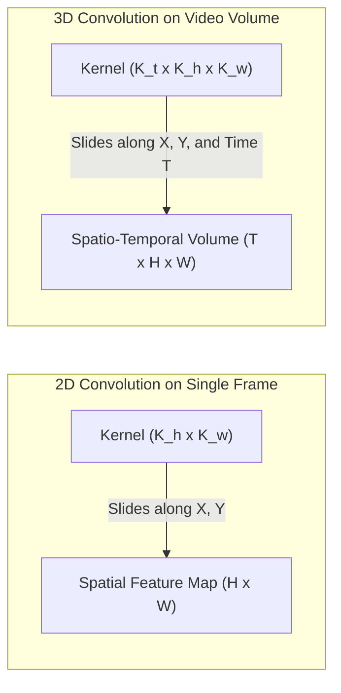
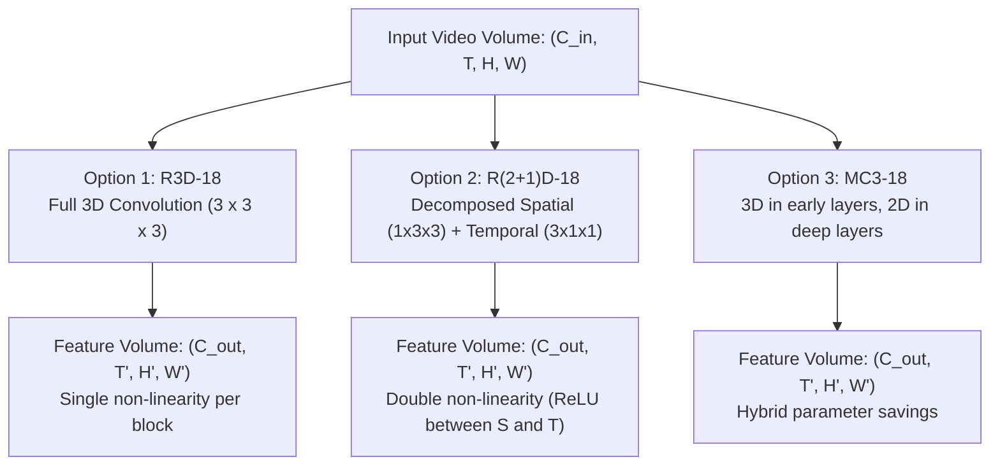
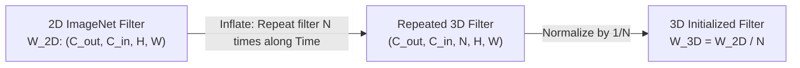

# Session 5: Spatio-Temporal 3D CNNs & Architectural Factorization

This guide provides an in-depth educational and mathematical walkthrough of **3D Convolutional Neural Networks (3D CNNs)** for video understanding. It covers full 3D convolutions ($R3D$), factorized $(2+1)\text{D}$ convolutions ($R(2+1)D$), mixed convolutions ($MC3$), and the historical **I3D Inflation Trick**.

---

## 1. Why 3D Convolutions? Moving Beyond 2D Late Fusion

In Session 1, we explored **2D CNN Late Fusion**, where individual video frames are passed independently through a 2D spatial backbone:

$$
\mathbf{h}_t = f_{\text{2D}}(\mathbf{x}_t), \quad t \in \{1, 2, \dots, T\}
$$

While Late Fusion is computationally lightweight and can be parallelized by folding time into the batch dimension $(B \cdot T, C, H, W)$, it suffers from a fundamental theoretical flaw:

> [!WARNING]
> **The Temporal Blind Spot of 2D Feature Extraction**:
> 2D CNNs extract spatial appearance features (edges, textures, object parts) without any awareness of motion or temporal dynamics. By the time spatial features reach the late fusion layer (Mean Pooling or GRU), **fine-grained temporal correspondences** (such as optical flow, trajectory orientation, acceleration, and subtle facial/hand kinematics) have already been lost.

To capture joint space-time patterns at every hierarchical scale of the network, we must extend 2D planar convolution into **3D Volumetric Spatio-Temporal Convolution**.

---

## 2. Mathematical Formulation of 3D Convolutions

### 2.1 2D Planar Convolution (Images)

For an input image $\mathbf{X} \in \mathbb{R}^{C_{\text{in}} \times H \times W}$ and a set of 2D convolutional filters $\mathbf{W} \in \mathbb{R}^{C_{\text{out}} \times C_{\text{in}} \times K_h \times K_w}$:

$$
\mathbf{Y}(c_{\text{out}}, y, x) = \sum_{c_{\text{in}}=1}^{C_{\text{in}}} \sum_{i=-k_h}^{k_h} \sum_{j=-k_w}^{k_w} \mathbf{X}(c_{\text{in}}, y + i, x + j) \cdot \mathbf{W}(c_{\text{out}}, c_{\text{in}}, i, j) + b(c_{\text{out}})
$$

The kernel slides across the 2D spatial plane $(H, W)$, collapsing all input channels $C_{\text{in}}$ into a single scalar value per spatial coordinate.

### 2.2 3D Volumetric Convolution (Videos)

For a video tensor $\mathbf{X} \in \mathbb{R}^{C_{\text{in}} \times T \times H \times W}$ and a set of 3D convolutional filters $\mathbf{W} \in \mathbb{R}^{C_{\text{out}} \times C_{\text{in}} \times K_t \times K_h \times K_w}$:

$$
\mathbf{Y}(c_{\text{out}}, t, y, x) = \sum_{c_{\text{in}}=1}^{C_{\text{in}}} \sum_{k=-k_t}^{k_t} \sum_{i=-k_h}^{k_h} \sum_{j=-k_w}^{k_w} \mathbf{X}(c_{\text{in}}, t + k, y + i, x + j) \cdot \mathbf{W}(c_{\text{out}}, c_{\text{in}}, k, i, j) + b(c_{\text{out}})
$$

Where:
* $K_t$: Temporal kernel size (typically $3$).
* $K_h, K_w$: Spatial kernel dimensions (typically $3 \times 3$).
* The kernel slides across **space AND time simultaneously**, allowing early layers to detect motion primitives (e.g., directional edges moving at specific velocities) and deeper layers to capture complex multi-frame actions.



---

## 3. The 3D CNN Architectural Zoo

While standard 3D CNNs ($R3D$, $C3D$) are conceptually straightforward, they suffer from two major real-world challenges:
1. **Parameter Explosion & Overfitting**: A $3 \times 3 \times 3$ kernel contains $27$ parameters per channel pair, compared to only $9$ for a $3 \times 3$ 2D filter ($3\times$ increase).
2. **Optimization Difficulty**: Full 3D networks are notoriously difficult to train from scratch on small action datasets.

This led researchers (Tran et al., CVPR 2018) to formulate factorized and hybrid variations:



---

### 3.1 Paradigm 1: Full 3D ResNet ($R3D-18$)

$R3D-18$ uses volumetric $3 \times 3 \times 3$ convolutions in every residual block.
* **Kernel Weight Tensor**: $\mathbf{W} \in \mathbb{R}^{C_{\text{out}} \times C_{\text{in}} \times 3 \times 3 \times 3}$
* **FLOPs per output element**: $\mathcal{O}(27 \cdot C_{\text{in}} \cdot C_{\text{out}})$
* **Pros**: Direct, unconstrained modeling of arbitrary space-time trajectories.
* **Cons**: Highest FLOPs; prone to spatial and temporal parameter entanglement.

---

### 3.2 Paradigm 2: Factorized $(2+1)\text{D}$ ResNet ($R(2+1)D-18$)

Instead of applying a single 3D filter of size $K_t \times K_h \times K_w$, $R(2+1)D$ decomposes the operation into two consecutive steps:
1. **Spatial Convolution**: Filter size $1 \times K_h \times K_w$ ($1 \times 3 \times 3$).
2. **Intermediate Non-Linearity**: BatchNorm3d followed by ReLU.
3. **Temporal Convolution**: Filter size $K_t \times 1 \times 1$ ($3 \times 1 \times 1$).

#### Parameter Derivation and Intermediate Dimension $M$:

Let $C_{\text{in}}$ be the input channels and $C_{\text{out}}$ be the output channels. If we insert an intermediate feature dimension $M$:

$$
\text{Params}_{\text{full 3D}} = 3 \cdot 3 \cdot 3 \cdot C_{\text{in}} \cdot C_{\text{out}} = 27 \cdot C_{\text{in}} \cdot C_{\text{out}}
$$

$$
\text{Params}_{(2+1)\text{D}} = (1 \cdot 3 \cdot 3 \cdot C_{\text{in}} \cdot M) + (3 \cdot 1 \cdot 1 \cdot M \cdot C_{\text{out}}) = 9 \cdot C_{\text{in}} \cdot M + 3 \cdot M \cdot C_{\text{out}}
$$

Setting the parameters equal to find the intermediate dimension $M$:

$$
M = \left\lfloor \frac{3 \cdot K_h \cdot K_w \cdot C_{\text{in}} \cdot C_{\text{out}}}{K_t \cdot C_{\text{in}} + K_h \cdot K_w \cdot C_{\text{out}}} \right\rfloor = \left\lfloor \frac{27 \cdot C_{\text{in}} \cdot C_{\text{out}}}{3 \cdot C_{\text{in}} + 9 \cdot C_{\text{out}}} \right\rfloor
$$

#### The Architectural Superpower of $R(2+1)D$:

> [!TIP]
> **Why does $R(2+1)D$ outperform full $R3D$?**
> 1. **Doubled Non-Linearities**: By splitting the convolution into two steps, $R(2+1)D$ introduces an additional BatchNorm and ReLU between spatial and temporal filtering. This doubles the number of non-linear activations in the network without increasing parameters!
> 2. **Orthogonal Optimization**: It separates spatial appearance modeling from temporal motion modeling, making the optimization landscape substantially smoother and easier for gradient descent to navigate.

---

### 3.3 Paradigm 3: Mixed Convolution ($MC3-18$)

Mixed Convolution builds on the empirical observation that **motion signals are predominantly local and fine-grained**, while **deep semantic representations are mostly spatial/appearance-driven**.
* Early Residual Blocks (`conv1`, `layer1`, `layer2`): Full 3D Convolutions ($3 \times 3 \times 3$).
* Deeper Residual Blocks (`layer3`, `layer4`): 2D Planar Convolutions ($1 \times 3 \times 3$).
* **Benefit**: Slashes parameters dramatically (from $33\text{M}$ down to $11.7\text{M}$) while retaining early motion feature extraction.

---

## 4. The I3D "Inflation Trick" (Carreira & Zisserman, CVPR 2017)

Before large-scale video datasets like Kinetics were available, training 3D CNNs from scratch was hampered by severe overfitting. Carreira & Zisserman introduced the **Inflated 3D ConvNet (I3D)** trick:

How do you bootstrap successful 2D ImageNet weights into a 3D video network?



### The Boring Video Fixed-Point Proof:

Consider a "boring video" where the same static image is repeated across all $T$ time steps:

$$
\mathbf{X}_{\text{video}}(t, y, x) = \mathbf{X}_{\text{image}}(y, x), \quad \forall t \in \{1, \dots, T\}
$$

If we initialize the 3D convolutional weights by replicating the 2D filter across the temporal dimension $N$ and dividing by $N$:

$$
\mathbf{W}_{\text{3D}}(k, i, j) = \frac{1}{N} \mathbf{W}_{\text{2D}}(i, j), \quad \forall k \in \{1, \dots, N\}
$$

Then the 3D convolution on this repeated video yields:

$$
\mathbf{Y}_{\text{3D}}(t, y, x) = \sum_{k=1}^{N} \mathbf{X}_{\text{video}}(t+k, y, x) \cdot \mathbf{W}_{\text{3D}}(k, \cdot, \cdot) = \sum_{k=1}^{N} \mathbf{X}_{\text{image}}(y, x) \cdot \left(\frac{1}{N} \mathbf{W}_{\text{2D}}\right) = \mathbf{Y}_{\text{2D}}(y, x)
$$

The output of the 3D network on a static video is **mathematically identical** to the output of the 2D network on the original image! This allows 3D networks to instantly inherit ImageNet's rich spatial feature representations from day one.

---

## 5. Tensor Dimension & Layout Conventions

Different video understanding frameworks use different tensor ordering conventions. Keeping track of these is essential for real-world engineering:

| Framework / Model Family | Expected 5D Tensor Layout | Example Shape (Batch 1, 16 Frames, RGB 112x112) |
| :--- | :--- | :--- |
| **Torchvision 3D Video** (`r3d`, `r2plus1d`, `mc3`) | `[Batch, Channels, Time, Height, Width]` | `[1, 3, 16, 112, 112]` |
| **Hugging Face Transformers** (`VideoMAE`, `Timesformer`) | `[Batch, Time, Channels, Height, Width]` | `[1, 16, 3, 224, 224]` |
| **Raw Decoded PyAV Video Array** | `[Time, Height, Width, Channels]` (NumPy uint8) | `(16, 432, 768, 3)` |

To convert between them in PyTorch:
```python
# Convert PyAV decoded array (T, H, W, C) to Torchvision 3D format:
# 1. Permute to (T, C, H, W)
tensor_tchw = torch.from_numpy(frames_np).permute(0, 3, 1, 2)

# 2. Torchvision VideoClassification transforms automatically return (C, T, H, W)
tensor_cthw = transforms(tensor_tchw)

# 3. Add batch dimension -> (1, C, T, H, W)
tensor_bcthw = tensor_cthw.unsqueeze(0).to(device)
```

---

## 6. Empirical Benchmark on Apple Silicon M4 MPS

Running `05_spatiotemporal_3d_cnns.py --model all --device mps` yields the following comparative benchmark:

| Model Architecture | Parameters | Kernel Formulation | Forward Latency (MPS) | Top-1 Action Prediction |
| :--- | :--- | :--- | :--- | :--- |
| **`R3D-18`** | $33,371,472$ | Full Volumetric ($3 \times 3 \times 3$) | $\approx 120\text{ ms}$ | `playing tennis` ($34.06\%$) |
| **`R(2+1)D-18`** | $31,505,325$ | Factorized ($1 \times 3 \times 3$ + $3 \times 1 \times 1$) | $\approx 148\text{ ms}$ | `playing tennis` ($18.41\%$) |
| **`MC3-18`** | $11,695,440$ | Mixed (3D early, 2D deep) | $\approx 143\text{ ms}$ | `triple jump` ($17.23\%$) |

### Hardware Takeaways:
1. **Parameter Efficiency**: $MC3-18$ uses **$65\%$ fewer parameters** than $R3D-18$ ($11.7\text{M}$ vs $33.4\text{M}$) by replacing deep 3D convolutions with 2D convolutions.
2. **MPS Memory Bandwidth**: In terms of raw execution time on Apple Silicon Unified Memory, $R3D$ executes in a single contiguous kernel call, whereas $R(2+1)D$ issues two separate kernel dispatches per block (spatial then temporal). In return, $R(2+1)D$ provides doubled non-linear depth and superior generalization across complex action datasets.

---

## 7. Interactive Terminal Walkthrough

### Run R(2+1)D on Apple Silicon MPS:
```bash
cd IF5152
python video-understanding-lab/05_spatiotemporal_3d_cnns.py --model r2plus1d --device mps
```

### Inspect Detailed Layer Decompositions:
```bash
python video-understanding-lab/05_spatiotemporal_3d_cnns.py --model r2plus1d --print-model
```

### Execute Head-to-Head Comparative Benchmark:
```bash
python video-understanding-lab/05_spatiotemporal_3d_cnns.py --model all --device mps
```

---

## 8. Self-Study Exercises & Questions for Students

1. **Receptive Field Growth**:
   Calculate the temporal receptive field after 4 residual blocks of kernel temporal size $3$ with temporal stride $1$ vs temporal stride $2$.
2. **$(2+1)\text{D}$ vs 3D FLOPs**:
   Using the formula in Section 3.2, compute the exact parameter savings when $C_{\text{in}} = 256$ and $C_{\text{out}} = 512$.
3. **The Inflation Test**:
   Why is dividing by $N$ (the temporal filter length) essential during I3D weight inflation? What would happen to the magnitude of the activations if we simply replicated the 2D filter without scaling?
