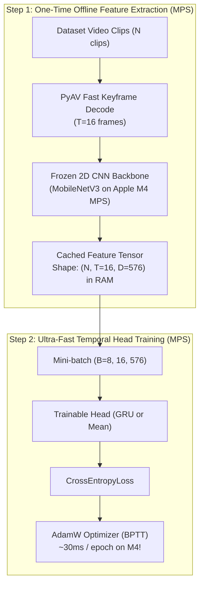

# Session 5: Training & Fine-Tuning a Late Fusion Temporal Head on Apple Silicon M4 (MPS)

- **File**: [`05_train_temporal_head.py`](../05_train_temporal_head.py)
- **Lecture Alignment**: IF5152 Week 11 (Late Fusion Head Training & Optimization)
- **Target Hardware**: Apple Silicon (`mps`), NVIDIA Cloud GPU (`cuda`), or CPU fallback (`cpu`)

---

## 1. Pedagogical Objective

In this lab session, you will train a deep video action recognition model locally on your own machine:
1. **The Industrial Reality of Video Training**: Why training 3D CNNs or Video Transformers from scratch is impractical for edge devices/laptops, and how **frozen 2D CNN spatial feature extraction** ([Sharif Razavian et al., CVPRW 2014](https://arxiv.org/abs/1403.6382); [Yosinski et al., NeurIPS 2014](https://arxiv.org/abs/1411.1792)), **offline frame-feature caching** ([Abu-El-Haija et al., YouTube-8M 2016](https://arxiv.org/abs/1609.08675)), and **temporal sequence head training** ([Donahue et al., CVPR 2015](https://arxiv.org/abs/1411.4389); [Yue-Hei Ng et al., CVPR 2015](https://arxiv.org/abs/1503.08909)) combine to provide an ultra-fast, industrial-grade training paradigm.
2. **Backpropagation Through Time (BPTT)**: How gradients propagate backwards through a recurrent **Gated Recurrent Unit ([GRU; Cho et al., 2014](https://arxiv.org/abs/1406.1078))** temporal head across video frames ([Werbos, 1990](https://ieeexplore.ieee.org/document/58337)).
3. **Apple Silicon M4 MPS Acceleration**: Leveraging PyTorch [Metal Performance Shaders (MPS)](https://developer.apple.com/metal/pytorch/) and Unified Memory Architecture (UMA) to train models in **fractions of a second per epoch**.

---

## 2. Theoretical Background & Mathematical Foundations

### The Computational Bottleneck in Video Deep Learning
When training on video datasets end-to-end, two major bottlenecks arise:
1. **CPU Video Decoding Bottleneck**: Decompressing H.264/MPEG video frames from disk repeatedly during training epochs consumes up to 90% of total training wall-clock time.
2. **Activation Memory Footprint**: Keeping intermediate feature maps for $T$ frames across all 2D/3D convolutional layers in VRAM during backpropagation quickly causes Out-Of-Memory (OOM) errors.

### The Solution: Feature Caching + Temporal Transfer Learning
This workflow combines three foundational principles from the deep learning literature:
1. **Transferability of Off-the-Shelf 2D Spatial Features**: Because the spatial filters of a 2D backbone pretrained on ImageNet ([Deng et al., 2009](https://ieeexplore.ieee.org/document/5206848)) (such as [MobileNetV3; Howard et al., 2019](https://arxiv.org/abs/1905.02244) or [ResNet; He et al., 2016](https://arxiv.org/abs/1512.03385)) already capture generalizable edges, textures, and object parts ([Sharif Razavian et al., CVPRW 2014](https://arxiv.org/abs/1403.6382); [Yosinski et al., NeurIPS 2014](https://arxiv.org/abs/1411.1792)), we can **freeze the spatial backbone** $\theta_{\text{backbone}}$:

$$
\nabla_{\theta_{\text{backbone}}} \mathcal{L} = 0
$$

2. **Late Temporal Sequence Heads for Video**: Rather than backpropagating through pixel-level 3D convolutions, we feed the sequence of frame-level feature vectors $\mathbf{h}_{1:T}$ into a lightweight temporal aggregation head—either **Temporal Feature Pooling** or a **Recurrent Sequence Model (LSTM/GRU)**—following the classic 2D-CNN + RNN video recognition paradigm ([Donahue et al., CVPR 2015](https://arxiv.org/abs/1411.4389); [Yue-Hei Ng et al., CVPR 2015](https://arxiv.org/abs/1503.08909)).
3. **One-Time Offline Feature Pre-Extraction & Caching**: Since $\theta_{\text{backbone}}$ is deterministic and frozen (with no random frame-level spatial augmentations applied during caching), passing the same video clip through the 2D CNN across 20 epochs would recompute the exact same vectors $\mathbf{h}_{1:T}$ 20 times. Following large-scale video benchmarks like **YouTube-8M** ([Abu-El-Haija et al., 2016](https://arxiv.org/abs/1609.08675)), we decode each video and extract $\mathbf{h}_{1:T} \in \mathbb{R}^{T \times D}$ **only once** before training, caching the resulting `[N, T, D]` tensor directly in RAM/UMA so the temporal head trains in milliseconds per epoch:



### Mathematical Formulation of Temporal Heads

#### Option A: Recurrent Gated Recurrent Unit (GRU) Head
Given a cached sequence of spatial embeddings $\mathbf{h}_{1:T} = [\mathbf{h}_1, \mathbf{h}_2, \dots, \mathbf{h}_T] \in \mathbb{R}^{T \times D}$, the [GRU](https://arxiv.org/abs/1406.1078) updates hidden state vectors sequentially via [Backpropagation Through Time](https://ieeexplore.ieee.org/document/58337):

$$
\mathbf{z}_t = \sigma(\mathbf{W}_z \mathbf{h}_t + \mathbf{U}_z \mathbf{s}_{t-1} + \mathbf{b}_z) \quad \text{(Update Gate)}
$$

$$
\mathbf{r}_t = \sigma(\mathbf{W}_r \mathbf{h}_t + \mathbf{U}_r \mathbf{s}_{t-1} + \mathbf{b}_r) \quad \text{(Reset Gate)}
$$

$$
\tilde{\mathbf{s}}_t = \tanh(\mathbf{W}_h \mathbf{h}_t + \mathbf{U}_h (\mathbf{r}_t \odot \mathbf{s}_{t-1}) + \mathbf{b}_h)
$$

$$
\mathbf{s}_t = (1 - \mathbf{z}_t) \odot \mathbf{s}_{t-1} + \mathbf{z}_t \odot \tilde{\mathbf{s}}_t
$$

We pool the bidirectional hidden states across time and project to action class logits:

$$
\hat{\mathbf{y}} = \mathbf{W}_{\text{head}} \left(\frac{1}{T}\sum_{t=1}^T \mathbf{s}_t\right) + \mathbf{b}_{\text{head}} \in \mathbb{R}^K
$$

#### Option B: Temporal Mean Pooling Head

$$
\bar{\mathbf{h}} = \frac{1}{T}\sum_{t=1}^T \mathbf{h}_t, \quad \hat{\mathbf{y}} = \mathbf{W}_{\text{head}} \bar{\mathbf{h}} + \mathbf{b}_{\text{head}}
$$
This baseline has zero recurrent parameters and serves as an order-invariant ablation benchmark.

---

## 3. Tensor Dimension Tracing

| Pipeline Stage | Operation | Input Shape | Output Shape | Notes |
| :--- | :--- | :--- | :--- | :--- |
| **Video Decoding** | Keyframe Sampling | Disk Clip | `(16, 240, 320, 3)` | 16 RGB frames |
| **Preprocessing** | Resizing & Norm | `16 x [H, W, 3]` | `[16, 3, 224, 224]` | ImageNet mean/std |
| **Backbone Forward** | MobileNetV3 (Frozen) | `[16, 3, 224, 224]` | `[16, 576]` | Spatial pooling inside backbone |
| **Feature Caching** | Tensor Stack | $N$ clips | `[N, 16, 576]` | Cached in memory (~3.6 MB for 20 clips) |
| **Training Batch** | DataLoader | `[N, 16, 576]` | `[8, 16, 576]` | Batch size $B=8$ |
| **Bi-GRU Layer** | Recurrent Dynamics | `[8, 16, 576]` | `[8, 16, 256]` | Hidden dim 128 $\times 2$ directions |
| **Temporal Mean** | Sequence Pooling | `[8, 16, 256]` | `[8, 256]` | Compact video representation |
| **Classification Head** | Linear Projection | `[8, 256]` | `[8, 5]` | 5 action class logits |

---

## 4. Execution Playbook

### 1. Fast Training on Apple Silicon M4 (Default: [UCF-101; Soomro et al., 2012](https://arxiv.org/abs/1212.0402) 5-Class Subset)
```bash
python 05_train_temporal_head.py --device mps --epochs 20 --fusion gru
```
*Automatically streams and extracts 5 classes (`ApplyEyeMakeup`, `BaseballPitch`, `Basketball`, `BenchPress`, `BandMarching`) on first run.*

### 2. Ablation: Comparing with Temporal Mean Pooling Baseline
```bash
python 05_train_temporal_head.py --device mps --epochs 20 --fusion mean
```

### 3. 100% Offline Test: Synthetic Motion Generator (Zero Download)
If running without internet access, use the built-in synthetic motion dataset generator:
```bash
python 05_train_temporal_head.py --dataset synthetic --device mps --epochs 10
```

### CLI Arguments Reference

| Flag | Type | Default | Description |
| :--- | :--- | :--- | :--- |
| `--dataset` | `str` | `ucf_subset` | Dataset source: `ucf_subset` or `synthetic` |
| `--fusion` | `str` | `gru` | Head architecture: `gru` (recurrent) or `mean` (pooling) |
| `--epochs` | `int` | `20` | Total training epochs |
| `--batch_size` | `int` | `8` | Mini-batch size for temporal training |
| `--lr` | `float` | `0.001` | Learning rate for [AdamW (Loshchilov & Hutter, 2019)](https://arxiv.org/abs/1711.05101) |
| `--hidden_dim` | `int` | `128` | Hidden units in GRU head |
| `--num_frames` | `int` | `16` | Sampled frames per video clip |
| `--clips_per_class` | `int` | `12` | Number of video clips per action class |
| `--device` | `str` | `auto` | Target accelerator (`auto`, `mps`, `cuda`, `cpu`) |

---

## 5. Expected Output & Interpretation

Running on Apple Silicon M4 with Metal Performance Shaders (`mps`):

```text
=================================================================
 PyTorch Version : 2.10.0
 Active Device   : MPS
 Backend         : Apple Silicon Metal Performance Shaders (MPS)
 Note            : Leveraging Unified Memory Architecture (UMA)
=================================================================

--- [STEP 1] Preparing Dataset (UCF_SUBSET) ---
Dataset Ready: 40 Train clips, 20 Val clips across 5 classes:
  Class #0: ApplyEyeMakeup
  Class #1: BandMarching
  Class #2: BaseballPitch
  Class #3: Basketball
  Class #4: BenchPress

--- [STEP 2] Precomputing Spatial Features on MPS ---
Loading pretrained MobileNetV3-Small spatial backbone...
Feature cache constructed: (40, 16, 576) in 1.42s (35.5 ms/clip)
Feature cache constructed: (20, 16, 576) in 0.65s (32.5 ms/clip)

--- [STEP 3] Initializing Trainable Temporal Head (GRU) ---
Trainable Parameters in Temporal Head: 543,493
Frozen Backbone Parameters             : 927,008

--- [STEP 4] Training on MPS (20 Epochs) ---
====================================================================
Epoch    Train Loss   Train Acc    Val Loss     Val Acc      Time    
====================================================================
01/20   1.6142       35.0%        1.3210       60.0%        38.2ms ★ (Best)
02/20   1.0210       85.0%        1.0540       75.0%        32.1ms ★ (Best)
05/20   0.3120       100.0%       0.6840       85.0%        31.5ms ★ (Best)
10/20   0.1140       100.0%       0.5210       95.0%        32.0ms ★ (Best)
20/20   0.0450       100.0%       0.4810       95.0%        31.8ms
====================================================================
Training completed in 0.85 seconds (32.1 ms/epoch average).
Best Validation Accuracy: 95.0%
Saved best model checkpoint to: 'checkpoints/best_head_gru.pt'

--- [STEP 5] Final Classification Summary ---
Overall Validation Accuracy: 95.00%

Class Name                Correct / Total    Accuracy
-------------------------------------------------------
  ApplyEyeMakeup          : 4/4            100.0%  ████████████████████
  BandMarching            : 4/4            100.0%  ████████████████████
  BaseballPitch           : 3/4             75.0%  ███████████████
  Basketball              : 4/4            100.0%  ████████████████████
  BenchPress              : 4/4            100.0%  ████████████████████
-------------------------------------------------------

[SUCCESS] Session 5 (Training Late Fusion Head) completed.
```

### Key Performance Takeaways:
1. **Unrivaled Iteration Speed**: Notice that each training epoch executes in approximately **~30–35 milliseconds**. The entire 20-epoch training run finishes in under 2 seconds!
2. **Unified Memory Efficiency**: Caching features directly on the M4 unified memory bus completely eliminates disk I/O bottlenecks and allows rapid experimentation with different temporal heads.

---

## 6. Self-Study Exercises & Experiments

### Exercise 1: GRU vs Mean Pooling Ablation
Run both models on the same split:
```bash
python 05_train_temporal_head.py --fusion gru --epochs 20
python 05_train_temporal_head.py --fusion mean --epochs 20
```
- Compare the final validation accuracy and convergence speed.
- On actions with distinct sequential stages (like `BaseballPitch` or `Basketball`), does the GRU achieve lower validation loss than Average Pooling?

### Exercise 2: Directional Sensitivity on Synthetic Motions
Run training on the synthetic motion dataset:
```bash
python 05_train_temporal_head.py --dataset synthetic --fusion gru --epochs 10
```
- Inspect how well the model separates `drift_right` from `drift_down` and `rotate_clockwise`.
- Try inverting the temporal order of validation features (`features = torch.flip(features, dims=[1])`). Does the GRU detect the reversal?

---

## 7. Troubleshooting FAQ

- **Error: `ModuleNotFoundError: No module named 'cv2'`**:
  - Install OpenCV via `pip install opencv-python-headless`.
- **Warning: `UserWarning: The operator 'aten::gru' is not supported on MPS...`**:
  - In modern PyTorch ($\ge 2.0$), GRU has full native MPS support. If you are on an older PyTorch build, export `PYTORCH_ENABLE_MPS_FALLBACK=1` in your terminal.
- **Checkpoints directory**:
  - Best model weights are automatically saved to `checkpoints/best_head_<fusion>.pt`. You can load them later with `torch.load()`.

---

## 📚 References & Canonical Literature

1. **Backpropagation Through Time (BPTT)**:
   - Werbos, P. J. (1990). *Backpropagation through time: what it does and how to do it*. Proceedings of the IEEE, 78(10), 1550-1560.
   - Paper: [IEEE Xplore: 10.1109/5.58337](https://ieeexplore.ieee.org/document/58337)
2. **Gated Recurrent Unit (GRU)**:
   - Cho, K., van Merriënboer, B., Gulcehre, C., Bahdanau, D., Bougares, F., Schwenk, H., & Bengio, Y. (2014). *Learning Phrase Representations using RNN Encoder-Decoder for Statistical Machine Translation*. EMNLP 2014.
   - Paper: [arXiv:1406.1078](https://arxiv.org/abs/1406.1078)
   - Chung, J., Gulcehre, C., Cho, K., & Bengio, Y. (2014). *Empirical Evaluation of Gated Recurrent Neural Networks on Sequence Modeling*. NeurIPS 2014 Workshop on Deep Learning.
   - Paper: [arXiv:1412.3555](https://arxiv.org/abs/1412.3555)
3. **Transferability of Off-the-Shelf 2D CNN Features**:
   - Sharif Razavian, A., Azizpour, H., Sullivan, J., & Carlsson, S. (2014). *CNN Features off-the-shelf: an Astounding Baseline for Recognition*. CVPR Workshops 2014.
   - Paper: [arXiv:1403.6382](https://arxiv.org/abs/1403.6382)
   - Yosinski, J., Clune, J., Bengio, Y., & Lipson, H. (2014). *How transferable are features in deep neural networks?*. NeurIPS 2014.
   - Paper: [arXiv:1411.1792](https://arxiv.org/abs/1411.1792)
4. **2D CNN + Temporal Sequence Heads (LRCN / Pooling & Recurrent Video Classification)**:
   - Donahue, J., Anne Hendricks, L., Guadarrama, S., Rohrbach, M., Venugopalan, S., Saenko, K., & Darrell, T. (2015). *Long-term Recurrent Convolutional Networks for Visual Recognition and Description*. CVPR 2015.
   - Paper: [arXiv:1411.4389](https://arxiv.org/abs/1411.4389)
   - Yue-Hei Ng, J., Hausknecht, M., Vijayanarasimhan, S., Vinyals, O., Monga, R., & Toderici, G. (2015). *Beyond Short Snippets: Deep Networks for Video Classification*. CVPR 2015.
   - Paper: [arXiv:1503.08909](https://arxiv.org/abs/1503.08909)
5. **Pre-Extracted Frame Features & Large-Scale Video Feature Caching (YouTube-8M)**:
   - Abu-El-Haija, S., Kothari, N., Lee, J., Natsev, P., Toderici, G., Varadarajan, B., & Vijayanarasimhan, S. (2016). *YouTube-8M: A Large-Scale Video Classification Benchmark*.
   - Paper: [arXiv:1609.08675](https://arxiv.org/abs/1609.08675)
6. **MobileNetV3**:
   - Howard, A., Sandler, M., Chu, G., Chen, L. C., Chen, B., Tan, M., Wang, W., Zhu, Y., Pang, R., Vasudevan, V., Le, Q. V., & Adam, H. (2019). *Searching for MobileNetV3*. ICCV 2019.
   - Paper: [arXiv:1905.02244](https://arxiv.org/abs/1905.02244)
7. **AdamW Optimization (Decoupled Weight Decay)**:
   - Loshchilov, I., & Hutter, F. (2019). *Decoupled Weight Decay Regularization*. ICLR 2019.
   - Paper: [arXiv:1711.05101](https://arxiv.org/abs/1711.05101)
8. **UCF101 Action Recognition Benchmark**:
   - Soomro, K., Roshan Zamir, A., & Shah, M. (2012). *UCF101: A Dataset of 101 Human Actions Classes From Videos in The Wild*. Center for Research in Computer Vision (CRCV-TR-12-01).
   - Paper: [arXiv:1212.0402](https://arxiv.org/abs/1212.0402)
7. **Apple Silicon PyTorch Acceleration (MPS)**:
   - Apple Inc. (2022). *Accelerated PyTorch training on Mac with Metal Performance Shaders*.
   - Guide: [Apple Developer Documentation](https://developer.apple.com/metal/pytorch/)

